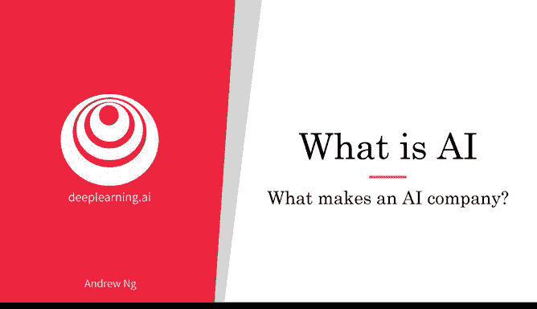
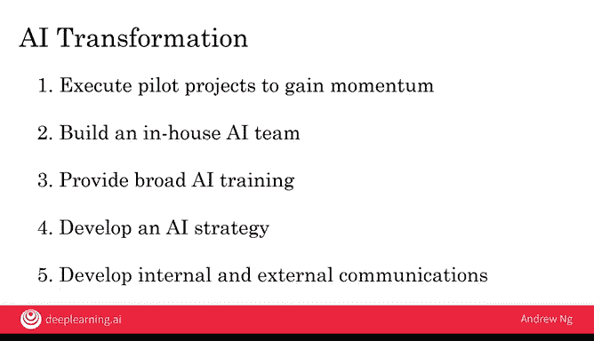

# 吴恩达《AI for everyone》给所有人的AI课（中英字幕） - P5：4_人工智能公司的核心要素.zh_en - GPT中英字幕课程资源 - BV1yC4y127uj

What makes a company good at AI and perhaps even more importantly。

 what will it take for your company to become great at using AI I had previously led the Google Brain team and Baidu's AI group。

 which had respectively helped Google and Baidu become great AI companies。

 So what can you do for your company。The Soleser had learned watching the rise of the internet that I think would be relevant to how all of us navigate the rise of AI。

 let's take a look。A lesson we learned from the rise of the internet was that if you take your favorite shopping mall。

 so my wife and I sometimes shop at Stanford Shopping Center and you build a website for the shopping mall。

 maybe sell things on the website that by itself does not turn the shopping mall into an internet company。

In fact， a few years ago， I was speaking with the CEO of a lush retail company who said to me。

Hey Andrew， I have a website， I sell things on a website。 Amazon has a website。

 Amazon sells things on a website is the same thing but of course it wasn't in a shopping mall with a website isn't the same thing as a firstclass internet company So what is it that defines an internet company if it isn't just whether or not you sell things on the website I think an internet company is a company that does the things the internet lets you do really well For example。

 we engage in pervasive AB testing， meaning we routinely throw up two different versions of website and see which one works better because we can and we learn much faster whereas in a traditional shopping mall you know it's very difficult to have two shopping malls in two parallel universes and you can only maybe chase things around every quarter or every six months。

Internet companies tend to have very short iteration time。

 you can ship a new product every week or maybe even every day because you can。

 whereas a shopping mall can be redesigned and we are protected only every several months。

Internet companies also tend to push decision making down from the CEO to the engineers and to other specialized roles。

 such as the product managers。This is in contrast to a traditional shopping mall where you can maybe have the CO just decide all the key decisions and then just everyone does what the CO says and it turns out that traditional model doesn't work in the Internet era because only the engineers and other specialized roles like product managers know enough about the technology and the product and the users to make great decisions so these are some of the things that internet companies do in order to make sure they do the things that the Internet let them do really well。

This is a lesson we learned from the internet era。How about the AI error I think that today you can take any company and have it use a few neural networks。

 a few deep learning algorithms that by yourself does not turn the company into an AI company。

 instead what makes a great AI company sometimes an AI first company is are you doing the things that AI lets you do really well。

 For example， AI companies are very good at strategic data acquisition。

 This is why many of the launch consumer tech companies may have free products that do not monetize and it allows them to acquire data that they can monetize elsewhere。

 So let strategy teams where we would deliberately launch products that do not make any money just for the sake of data acquisition。

And thinking through how to get data is a key part of the great AI companies。

AI companies tend to up unified data warehouses。 If you have 50 different databases or 50 different data warehouses under the control of 50 different vice presidents。

 then it'll be impossible for an engineer to get the data into one place so that they can connect the dots and spot the patterns so many great AI companies have preemptively invested in bringing the data together into single data warehouse to increase the odds that the teams can connect the dots。

 subject of course， to privacy guarantees and also to data regulations such as GDPR in Europe AI companies are very good at spotting automation opportunities we're very good at seeing。

 oh， let's insert to supervised learning algorithm and have a A tob mapping here so that we don't have to have people do these tasks instead we can automate it AI companies also have many new role such as the M or machine learning engineer and new ways of dividing up tasks among different。

Members of the team。 So for a company to become good at AI means architecting the company to do the things that AI makes it possible to do really well。

 Now， for a company to become good at AI does require a process。 In fact，10 years ago。

 Google and Baidu， as well as companies like Facebook and Microsoft that was not a part of were not great AI companies the way that they are today。

 So how can a company become good at AI。 It turns out that becoming good at AI is not a mysterious magical process。

 instead there is a systematic process through which many companies。

 almost any big company can become good at AI。 This is the fivestep AI transformation playbook that I recommend to companies that want to become effective at using AI。

 I'll give a brief overview of the playbook here and then going into detail in a later week。

 Step 1 is to execute pilot projects to gain momentum。

 So just do a few small projects to get a better sense of what。

AI can and cannot do and get this better sense of what doing an AI project feels like and this you could do in health or you can also do with an outsourced team。

 but eventually you then need to do step two， which is to build an in health AI team and provide broad AI training not just to the engineers but also to the managers。

 division leaders and executives on how to think about AI after doing this or as you're doing this。

 you have a better sense of what AI is and then it's important for many companies to develop an AI strategy and finally to align internal and external communications so that all your stakeholders from employees。

 customers and investors are aligned with how your company is navigating the rise of AI。

AI has created tremendous value in the software industry and will continue to do so。

 it will also create tremendous value outside the software industry if you can help your company become good at AI I hope you can play a leading role in creating a lot of this value In this video you saw what is it that makes a company a good AI company and also briefly the AI transformation playbook which are go into much greater detail on in a later week as a roadmap for helping companies become great at AI if you're interested there is also publish online an AI transformation playbook that goes into these five steps in greater detail。

 but you see more of these in a later week as well。Now。

 one of the challenges of doing AI projects such as the pilot projects in step one is understanding what AI can and cannot do in the next video。

 I want to show you and give you some examples of what AI can and cannot do to help you better select projects for AI that may be effective for your company Let's go on the next video。

