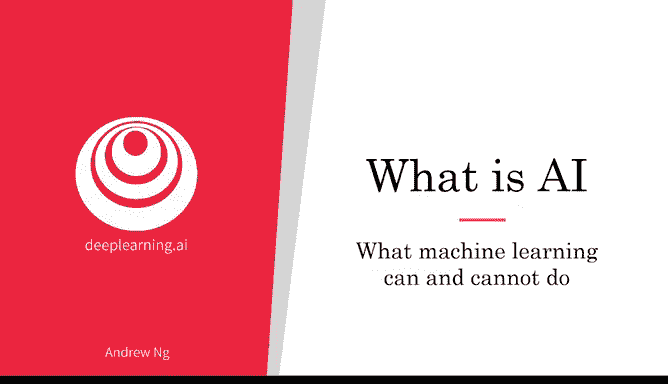
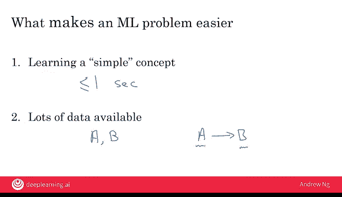

# 吴恩达《AI for everyone》给所有人的AI课（中英字幕） - P6：5_机器学习的能力与局限.zh_en - GPT中英字幕课程资源 - BV1yC4y127uj

In this video and the next video， I hope to help you develop intuition about what AI can and cannot do in practice before I commit to a specific AI project。

 I'll usually have either myself or engineers do technical diligence on the project to make sure that is feasible。

 This means look at the data look at the input and output A and and just thinking through if this is something AI can really do。

 What I've seen， unfortunately， is that some CEOs can have overinflated exploit of AI and can ask engineers to do things that today's AI just cannot do One of the challenges is that the media。

 as well as academic literature tends to only report on positive results or success stories using AI and we see a string of success stories and no failure stories people sometimes think AI can do everything and unfortunately that's just not true。

 So what I want to do in this and the next video is to show you a few examples。

 So what today's AI technology can do but also。not。

 And I hope that this will help you hone your intuition about what might be more or less promising projects to select for your company。

Previously， you saw this list of AI applications from span floating to speech recognition。

 machine translation and so on。 one imperfect rule of thumb you can use to decide what supervised learning may or may not be able to do is that pretty much anything you could do with a second of thought。

 you can probably now or soon automate using supervised learning， using this input output mapping。

 So， for example， in order to determine the position of other cars。

 know that's something that you can do with less than a second。

In order to tell if a phone is scratch， you can look at it and you can kind of tell in less than a second。

 in order to understand， at least transscribe what was said。

 you know it doesn't take that many seconds of thought。 And while this is an imperfect rule of thumb。

 it maybe gives you a way to quickly think of some examples of tasks that AI systems can do。

 whereasas in contrast， something that AI today cannot do would be accurately predicting the stock market。

 say predict the future price of some company stock， given only the historical price of that stock。

 This is something that a person probably can't do in one second or even longer than a second。

 And it's probably not possible to get machine learning to do this accurately either。

 Let's look in greater detail at this say the task we want to tackle is given the recent price of a stock。

 That's the input A。 Pre the price at a future point in time。 say a month into the future。

 That's the output B。 What would happen。If you were to apply machine learning into this。Well。

 a simpler algorithm might try to fit a straight line to the data。

 but depending on what period of time you fit the data to， you might get a red line like this。

 or if you fit it to this narrow window， you might get this blue line。

 So depending on the details of the implementation。

 this particular algorithm might give wildly varying output values。

 And the main problem with this application is that the past history of a stock price is just not very predictive of the future stock price。

 which is why attempts to use machine learning this way haven't been successful。

 future stock prices are so random that is just hard for AI to predict it accurately。 By the way。

 for completeness， I should say that predicting stock price based only on the historical price of the same stock seems to be impossible。

 But there are stock traders that sometimes find other inputs。 For example。

 if they manage to legally obtain。Web traffic or foot traffic data that helps them estimate what the company's sales were。

 then that， in combination with the historical price data might make it possible for the algorithm to have some predictive power。

 However， these other inputs are typically complex or costly to acquire and still can't overcome the intrinsically somewhat random nature of the stock market to hold your intuition about how to quickly filter feasible or not feasible projects。

 here are a couple of other rules of thumb about what makes a machine learning problem easier or more likely to be feasible。

 One， learning a simple concept is more likely to be feasible。

 but what does it mean for something to be a simple concept， there's no formal definition of it。

 but if it is something that takes you less than a second of mental thought or maybe just a very small number of seconds of mental thought to come up with a conclusion。

 then that would be suggestive of it being a simple concept。

So if you are looking outside the window of a self-driving car to spot the other cars。 Well。

 that would seem like a relatively simple concept， whereas in contrast。

 trying to come up with clever signals to predict a given company sales。

 Well that seems like less of a simple concept。 Second。

 a machine learning problem is more likely to be feasible if you have lots of data available here。

 data means both the input A and the output B that you want theI system to have in your A to B or input output mapping。

 So for example， in trying to determine whether a phone is scratched or not。

 the input A would be a set of images of phones and the output B could be a label identifying the phone as being scratched or not scratch。

 Then if you have thousands of pictures of phones with both A and B。

 the odds of you building a machine learning system to detect scratches accurately would be much higher。

 AI is the new electricity and is transforming。

ever industry， but it's also not magic and you can't do everything under the sun I hope that this video started to help you hone your intuitions about what it can and cannot do and increase the odds of your selecting feasible and valuable projects for maybe your teams to try working on。

In order to help you continue developing your intuition。

 I would like to show you more examples of what AI can and cannot do。 Let's go into the next video。

