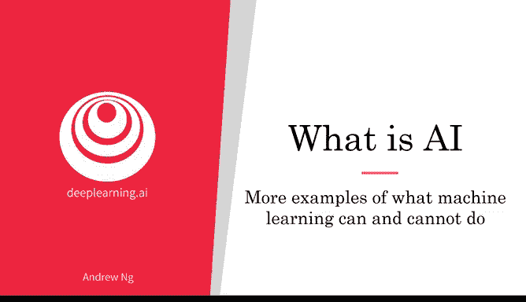
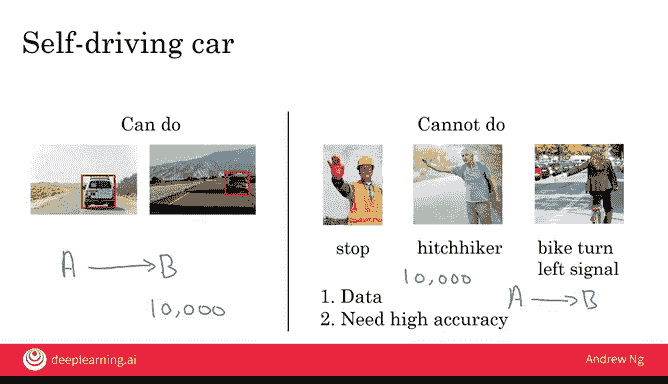
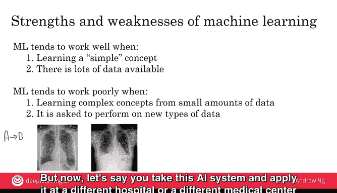

# 吴恩达《AI for everyone》给所有人的AI课（中英字幕） - P7：6_机器学习能力与局限的更多示例.zh_en - GPT中英字幕课程资源 - BV1yC4y127uj

One of the challenges of becoming good at recognizing what AI can and cannot do is that it does take seeing a few examples of concrete successes and failures of AI and if you work on an average of say one new AI project of the year then to see three examples will take you three years of work experience and that's just a long time What I hope to do both in the previous video and in this video is to quickly show you a few examples of AI successes and failures or what it can cannot do so that in a much shorter time you can see multiple concrete examples to help hone your intuition and select valuable projects so let's take a look at a few more examples let's say you're building a self-driving car here's something that AI can do pretty well。

 which is to take a picture of what's in front of your car and maybe just using a camera maybe using other sensors as well such as radar or LiDar and then to figure out what is the position or where are the other costs。

So this would be an AI where the input A is a picture of what's in front of your car or maybe both a picture as well as radar and other sensor readings and the output B is where are the other cars and today the selfdriving car industry has figured out how to collect enough data and has pretty good algorithm are doing this reasonably well so that's what AI today can do。

Here's an example of something that today's AI cannot do。

 or at least would be very difficult using today's AI。

 which is input the picture and outputs the intention of whatever the human is trying to gesture at your car。

 so here's a construction worker holding out a hand to ask your car to stop。

 here's a hitchhiker trying to wave a car over， here's a bicyclist raising the left hand to indicate that they want to turn left。

And so if you were to try to build a system to learn a A to B mapping where the input A is a short video of a human gesturing at your car and the output B is what's the intention of what does this person want that today is very difficult to do part of the problem is that the number of ways people gesture at you is very very large imagine all the hand gestures someone could conceivably use ask slow down or go or stop the number of ways that people could gesture at you is just very very large and so it's difficult to collect enough data from enough thousands or tens of thousands of different people gesturing at you and all of these different ways to capture the richness of human gestures so learning from a video to what this person wants is actually a somewhat complicated concept In fact even people have a hard time figuring out sometimes what someone waving at your car wants and then second because this is a safety critical application。

It want an AI that is extremely accurate in terms of figuring out does a construction worker want you to stop or does he or she want you to go and that makes it harder for an AI system as well and so today if you collect just say 10000 pictures of other cars。

 many teams were be able to build an AI system that at least as a basic capability at detecting other cars in contrast。

 even if you collect pictures or videos of 10000 people it's quite hard to track down 10000 people waving at your car even with that data。

 I think it's quite hard today to build an AI system to recognize human intention from the gestures at the very high level of accuracy needed in order to drive safely around these people So that's why today many self-driving car teams have some component for detecting other cars and they do rely on that technology to drive safely but very few self-driving car teams are trying to count on an AI system to recognize that。

Huge diversity of human gestures and counting just on that to drive safely around people。

 Let's look at one more example， say you want to build an AI system to look at x ray images and diagnose pneumonia。

 So all of these are chest x rays。

So the input A could be the X-ray image and the output B can be the diagnosis Does this patient have pneumonia or not so there's something that AI can do something that AI cannot do would be to diagnose pneumonia from 10 images of a medical textbook chapter explaining pneumonia a human can look at a small set of images。

 maybe just a few dozen images and read a few paragraphs for a medical textbook and start to get a sense but actually don't know given a medical textbook。

 what is A and what is be or how to really poses as an AI problem that know how to write a piece of software to solve if all you have is just 10 images and a few paragraphs of text that explain what pneumonia and a chestess X-ray looks like whereas a young medical doctor might learn quite well reading a medical textbook and just looking at you know maybe dozens of images in contrast an AI system isn't really able to。

that today to summarize here are some of the strengths and weaknesses of machine learning machine learning tends to work well when you're trying to learn a simple concept such as something that you could do with less than a second of mental thought and when there's lots of data available。

Machine learning tends to work poorly when you're trying to learn a complex concept from small amounts of data。

 a second underappreciated weakness of AI is that it tends to do poorly when it's also performed on new types of data that's different than the data it has seen in your data set let me explain with an example say you built a supervised learning system that uses A to B to learn to diagnose pneumonia from images like these these are are pretty high quality ches X ray images。

But now let's say you take this AI system and apply it at a different hospital or a different medical center where maybe the X-ray technician somehow strangely had the patients always lie an angle or sometimes there are these defects not sure you can see the little scratches in the image these other objects lying on top of the patients If the AI system has learned from data like that on your left。

 maybe taken from a high quality medical center and you take this AI system and apply it to a different medical center that generates images like those on the right then its performance will be quite poor as well。

 a good AI team would be able to ameliorate or to reduce some of these problems but doing this is not that easy and this is one of the things that AI is actually much weaker than humans If a human has learned from images on the left。

 they're much more likely to be able to adapt to images like those。

On the right as they figure out that the patient's just lying at an angle。

 but an AI system can be much less robust than human doctors in generalizing or figuring out what to do with new types of data like this。

I hope these examples are hoping you hone your intuitions about what AI can and cannot do in case the boundary between what it can and cannot do still seems fuzzy to you。

 don't worry there's completely norm completely okay In fact。

 even today I still can't look at the project and immediately tell if something is feasible or not and I often still need weeks of small numbers of weeks of technical diligence before forming strong conviction about whether something is feasible or not。

But I hope that these examples can at least help you start imagining some things in your company that might be feasible and might be worth exploring more。

The next two videos after this are optional and are a non- technicalchnical description of what are neural networks and what is deep learning。

 please feel free to watch those and then next week we'll go much more deeply into the process of what building an AI project will look like。

 look forward to seeing you next week。