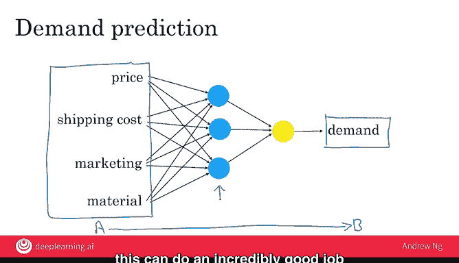

# 吴恩达《AI for everyone》给所有人的AI课（中英字幕） - P8：7_深度学习的非技术性解释 第1部分（可选）.zh_en - GPT中英字幕课程资源 - BV1yC4y127uj

The terms deep learning and neural network are used almost interchangeably in AI。

 And even though they're great for machine learning。

 there's also been a bit of hype and a bit of mystique about them。

 this video will demystify deep learning so that you have a sense of what deep learning and neural networks really are。

 Let's use an example from demand prediction。 let's say you run a website that sells t-shirts and you want to know based on how you price the t-shirts how many units you expect to sell how many t-shirts you expect to sell。

 you might then create a data like this where the higher the price of the t-shirt。

 the lower the demand So you might fit the straight line to this data showing that as the price goes up。

 the demand goes down。 Now demand can never go below0。

 So maybe you say that the demand will flattenal as0 and beyond on a certain point， you expect。

 you know pretty much no one to buy any t-shirts。😊。

It turns out this blue line is maybe the simplest possible neural network you have as input。

 the price A， and you want it to output the estimated demand B。

So the way you would draw this as a neural network is that the price would be input to this。

The round thing there and this little round thing outputs yes made to demand in the terminology of AI。

 this little round thing here is called a neuron or sometimes is's called an artificial neuron and all it does is compute this blue curve that I've drawn here on the left。

This is maybe the simplest possible neural network with a single artificial neuron that just inputs the price and outputs the estimated demand。

If you think of this orange circle， this artificial neuron as a little Lego break。

 all that the neural network is is if you take a lot of these Lego breaks and stack them on top of each other until you get a big power or a big network of these neurons。

 let's look at the more complex example。Suppose that instead of knowing only the price of the t-shirts。

 you also have the shipping cost that the customers will have to pay to get the t-shirt。

 maybe you spend more or less on marketing in a given week。

 and you can also make the t-shirt out of a thick， heavy expensive cotton or a much cheaper。

 more lightweight material。 These are some of the factors that you think will affect the demand for your t-shirts。

 Let's see what a more complex neural network might look like。

 you know that your customers care a lot about affordability。 So let's say you have one neuron。

 And let me draw this one in blue whose job it is to estimate the affordability of the t-shirts。

 And because affordability and so affordability is mainly a function of the price of the shirt and of the shipping cost。

 A second thing that will affect the demand for。T shirts is awareness。

 How much are consumers aware that you're selling this T shirt。

 So the main thing that affects awareness is going to be。Your marketing。

 So let me draw here a second artificial neuron that inputs your marketing budget。

 how much you spent on marketing and outputs。How aware are consumers of your Tshir。 Finally。

 the perceived quality of your product will also affect demand and perceived quality would be affected by marketing。

 If the marketing tries to convince people this is a high quality T-shirt。

 and sometimes the price of something also affects perceived quality。

 So I'm going to draw here a third artificial neuron that inputs price。

 marketing and material and tries to estimate。The perceive。Quality。Of your t-shirts， finally。

 now that the earlier neurons， these three blue neurons have figured out how affordable。

 how much consumer awareness and what's the perceived quality。

 you can then have one more neuron over here that takes us input these three factors and outputs the demand。

 So this is a neural network and its job is to learn to map from these four inputs。

That's the input A。To the output B to demand。 so it learns this input output or A to B mapping。

 This is a fairly small neural network with just four artificial neurons In practice neural networks used today are much larger with easily thousands。

 tens of thousands or even much larger than that numbers of neurons。

Now there's just one final detail of this description that I want to clean up。

 which is that in the way of describing neural network。

 it was as if you had to figure out that the key factors are affordability。

 awareness and perceived quality。One of the wonderful things about using neural networks is that to train a neural network。

 in other words， to build a machine learning system using a neural network。

 all you have to do is give it the input A and the output B and it figures out all of the things in the middle by itself。

 So to build a neural network， what you would do is feed it loss of data。😊，With the input a。

And have a neural network that just looks like this with a few blue neurons feeding to a yellow output neuron。

 and then you have to give it data with the demand B as well。

 and the software's job to figure out what these blue neurons should be computing so that it can completely automatically learned the most accurate possible function mapping from the input A to the output B and it turns out that if you give this enough data and train a neural network that is big enough。

 this can do an incredibly good job mapping from inputs A to outputs B so that's a neural network is a group of artificial neurons。

 each of which computes a relatively simple function but when you stack enough of them together like Lego breaks they can compute incredibly complicated functions that give you very accurate mappings from the input A to the output B。

Now in this video you saw an example of neural networks applied to demand prediction。

 let's go on the next video to see a more complex example of neural networks applied to face recognition。

😊。