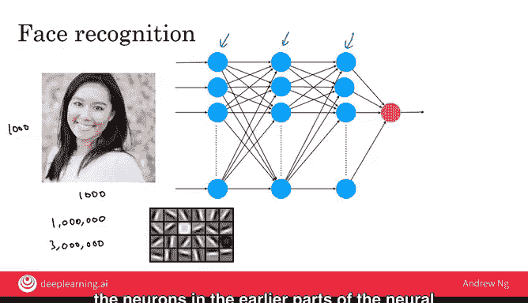

# 吴恩达《AI for everyone》给所有人的AI课（中英字幕） - P9：8_深度学习的非技术性解释 第2部分（可选）.zh_en - GPT中英字幕课程资源 - BV1yC4y127uj

In the last video， you saw how a neural network can be applied to demand prediction。

 But how can a neural network look at a picture and figure out what's in a picture or listen to an audio clip and understand what is said in an audio clip。

 Let's take a look at a more complex example of applying a neural network to face recognition。

 sayy you want to build a system to recognize people from pixel。 How can a piece of software。

 look at this picture and figure out the identity of the person in it。

 Let's zoom in to a little square like that to better understand how a computer sees pictures。

 where you and I see a human eye， a computer instead sees that it sees this grid of pixel brightness values that tells it for each of the pixels in the image。

 how bright is that pixel。 If it were a black and white or a grayscale image。

 then each pixel would correspond to a single number telling you how bright is that pixel if is a。😊。

Color image， then each pixel would actually have three numbers corresponding to how bright are the red。

 green and blue elements of that pixel。So the neural network's job is to take us input a lot of numbers like these and tell you the name of the person in the picture。

 In the last video， you saw how a neural network can take us input for numbers corresponding to the price shipping cost amount of marketing and the cloth material of a t-shirt and output demand。

 In this example， the neural network just has to input a lot more numbers corresponding to all of the pixel brightness values of this picture。

If the resolution of this picture is 1000 pixels by 1000 pixels， then that's a million pixels。

 So if it were a black and white or grayscale image。

 this neural network was tickers input a million numbers corresponding to the brightness of all 1 million pixels in this image or it was a color image it would takeers input3 million numbers corresponding to the red。

 green and blue values of each of these 1 million pixels in this image similar to before you will have many。

 many of these artificial neurons computing various values and it's not your job to figure out what these neurons should compute。

 the neural network will figure out by itself。 but typically when you give it an image the neurons in the earlier parts of the neural network will learn to detect edges in pictures and。

A little bit later， I'll learn to detect parts of objects。

 so you may learn to detect eyes and noses and the shape of cheeks and the shape of mules。

And then the later neurons further to the right will learn to detect different shapes of faces。

 and it will finally put all this together to output the identity of the person in the image and again。

 part of the magic of neural networks is that you don't really need to worry about what it is doing in the middle all you need to do is give it a lot of data of pictures like this A as well as of the correct identity B。

 and the learning algorithm will figure out by itself what each of these neurons in the middle should be computing。

Congratulations on finishing all the videos for this week。

 You now know how machine learning and data science work。

 I look forward to seeing you in next week's videos as well。

 where you learn how to build your own machine learning or data science project。 See you next week。😊。

