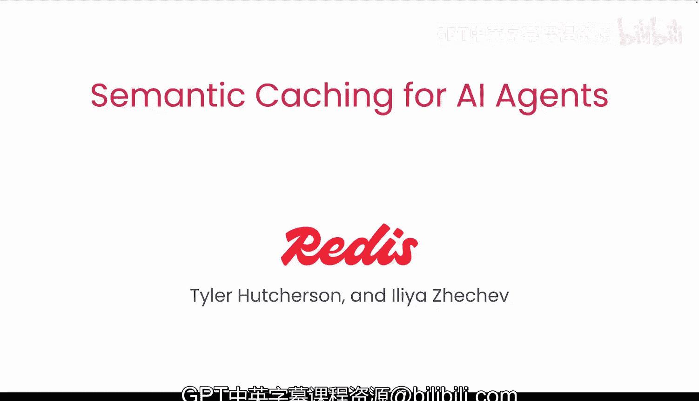
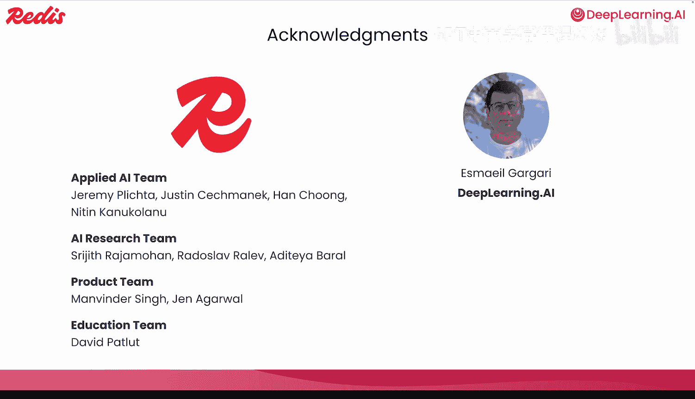

# 吴恩达《AI 代理语义缓存｜Semantic Caching for AI Agents》中英字幕 - P1：1.intro.zh_en - GPT中英字幕课程资源 - BV1aUSjBtECn

Welcome to semantic Caching for AI agents built in partnership with Reds， taught by Tyler Hutchinson。

 who is Applied AI engineeringing lead and Elilia Zchev， who is Se research engineer at Reds。

In this course， you learn how to make your AI agents faster and more cost effective by adding a semantic cache。

😊，In many projects， inference costs and latency affect your ability to scale an application。

 Tra input output caches that work when the input text is exactly the same can help in some cases。

 but if someone else how can I get the refund and another person askI want my money back。

 a normal exact match cash sees them as completely different？"。

Semantic caching on the other hand looks at meaning。

 It uses embeddings to measure how similar two questions are in this meaning space。

 and if they're semantically similar， they can reuse the model's response to an old answer instead of calling the model game。

 Thanks Andrew。😊，You'll first build a cache from scratch to learn under the hood of Samantha Caching piece by piece。

You will create embeddings， compare distances instead set of threshold to decide when two queries are semantically similar enough。

Then we'll move it into implementing en endorsement to cache using Redis's open source SDK。

This will make your cash closer to a production deployment。

 as your cache will now have features like time to live to keep your cash fresh and small and even separate caches for different users or teams or tenants。

Youll also use our open weight embedding model fine tuned for cache accuracy Once you have a work in cache we'll matter how well it performs。

Well look at heat rate， precision and。These metrics will show how often your cache helps and how often it is correct。

 You will visualize them in a confusion matrix， and you see how changing the similarity threshold will shift the balance between precision and recall。

We also look at latency， and we see how a few hits quickly add up to a big time saving。

 After measuring the effectiveness of your cache， you'll learn four methods for enhancing it。

 You optimize the threshold and we use a cross encode coder for battery ranking and even a small LM check that can confirm whether two questions mean the same thing。

 We also add fuzzy matching to handle simple typos that frequently happen when users ask questions。

 Finally， we'll connect it all inside an AI agent。 The agent breaks a big question into smaller parts and checks the cache for each one and only cause the LLM when it needs to。

😊，This means every new user or slightly different phrasing benefits from what the system already knows over time as the cache warms up。

 model calls drop and responses feel just as good but arrive much faster。

 Many people have worked to create the course。 I like to thank from Redis， the applied AI。

 AI research， product and education teams from De Blada AI Isberggagari also contributed to the course。

 The first lesson will be an overview of semantic caching。😊。

You will also learn about a real use case where Walmart publish techniques to improve their production caching system。

 so let's go into the next video and get started。