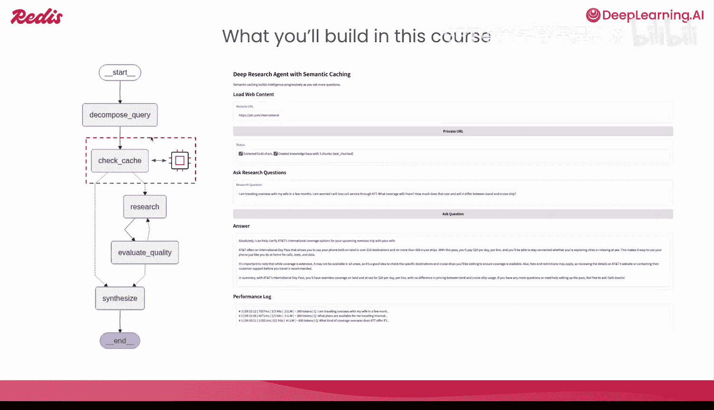
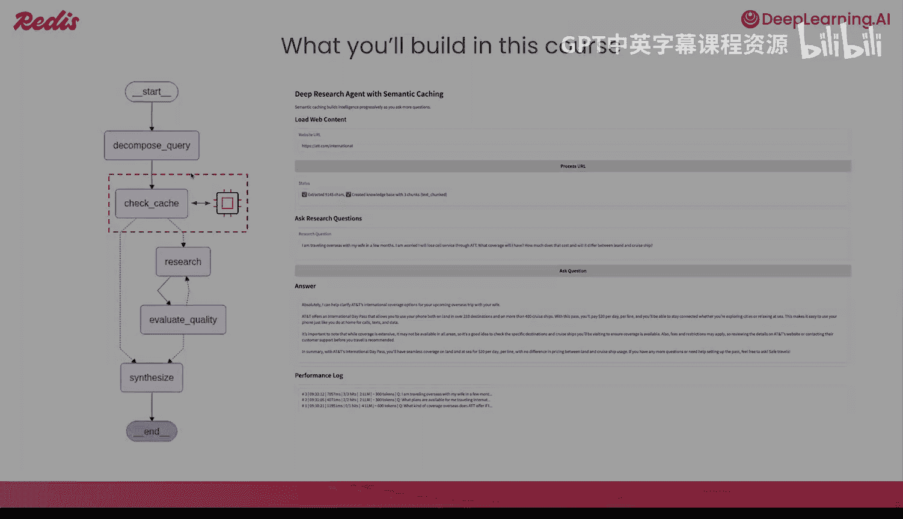

# 吴恩达《AI 代理语义缓存｜Semantic Caching for AI Agents》中英字幕 - P2：2.overview-of-semantic-caching.zh_en - GPT中英字幕课程资源 - BV1aUSjBtECn

In this lesson， you'll learn what Sammanticcaching is。

 Why it matters and how it helps AI agents reuse results to reduce cost and latency。 Let's dive it。

 Let's start with the beginning。 Model quality tends to go up with cost per token。

 That curve is improving， but the price and latency trade off is still the gating factor on real world deployments。

 This is a real tension， because popular models for reasoning and solving complex tasks like G 5 or a cloud are just more expensive and also slower。

 here we see some results produced by artificial analysis do AI in their comparison of multiple foundation models against one another。

 and we compare intelligence versus price。 So for many teams， inference。

 not data plumbing is now the dominant unit cost and AI systems。

 organizations are building retrieval augmented generation systems or rag for short。

 These systems can infuse domain specific knowledge into the prompt of a large language model and make them so they reduce hallucinations by inserting the right information at the right time。

And also stay fresh by providing up to date information at runtime that the large language model has never seen before。

 AI agents， however， are token hungry。 They， by nature， extract and plan and act。

 and reflect and iterate over multiple multiple passes。

 So agents use multiple L L M calls throughout the course of their execution。

 This consumes more tokens adds additional latency and the prompt lengths also grow over time。

 And as we can see through this one benchmark produced by the agent company。

 This is a paper that came out in September 2025， multiple real world tasks compared against one another with different L L Ms。

 You can see that even in some cases， an entire execution end to end costs up to $6。8。

 Let's talk about a very common use case for agents。

 One where we might see in the real world like customer support。 So in a customer support scenario。

 agents are trying to accelerate the time to resolution of a customer support ticket or inquiry。

 S agents negatively impact the end to customer。User experience and customer support agents generate tons of frequently asked questions。

 Redundant data that adds up over time and the rag operations over that data will drive up infrastructure costs。

 So take， for example， multiple users asking questions about how they can get a refund or how they can get their money back or what the refund policy is。

 This agent is having to solve all of these scenarios from scratch。

 Let's talk about this classic principle called caching。

 The idea is not to repeat yourself on redundant information。

 Use might ask multiple questions of agents。 and in these cases。

 we can check the cash for queries that have already been answered in the past。

 and avoid invoking the large language model when we don't have to。 This is a great idea in theory。

 but the problem is that it naive exact match caching fails for natural language。

 So let's look at this example again， I went my money back， how do I get a refund。

 What is your refund policy。 In traditional caching use exact matches on string data The words and tokens and characters have to be exactly the same in order to get a cash hit。

 This yields perfect precision。But really poor recall and in most cases。

 very low cache hit rates for natural language。 So in this scenario。

 all three of these questions would be a cache miss。 but introducing semantic caching。

 this is where we can take advantage of the meaning of the questions。

 And now this brings us with higher recall and higher cache hit rates the ability to influence performance。

 however， this also introduces the risk of false positives。 In other words。

 this introduces the opportunity for the cache to hit on the incorrect thing。

 So let's talk about how semantic caching works from scratch。

 Step one is we're going to embed the user question。

 we're going to convert this user question into a vector that we can use for semantic search。 Second。

 we're going to compare the similarity of the user query to every entry in our semantic cache and next。

 we will classify this result。 If the result is close enough to the original question in terms of semantic distance。

 we can go straight back to the user with the answer that was stored in the cache。

 but if it's a cache miss， then we need to call our ragg system。

System involves generating some kind of search。 and then some kind of call to an LLM。

 And at the very end， we need to still respond back to the user。 Once we have an answer。

 we can update our cache with that question and answer pair to make sure it's reusable in the future。

 Now， the very backbone of semantic caching is this idea of vector search。 And just as a recap。

 Ves are lists of numbers。 And these numbers represent data and encode meaning and semantics。

 There are many example applications of vector search in the wild。

 including content discovery search， recommendation systems or even fraud and anomaly detection。

 semantic caching in production introduces new kinds of challenges。

 It's more than just vector search。 Here， we have to care about the cache effectiveness in particular。

 accuracy are we sering the correct results from the cache when we get a hit Perance are we making sure that we actually hit the cache often enough to get value from it。

 And can we actually serve the cache at scale without impacting round trip latency the next。

We need to care about as upability or extensibility。

 Can we refresh and invalidate or warm the semantic cache as data evolves over time And lastly。

 observability。 Can we make sure to measure and observe the right metrics like cache hit rate latency cost savings and cash quality。

 So in this course， we're gonna to be focusing on four different metrics to measure the effectiveness of the cache that is cache hit rate。

 which is the frequency of times that we hit the cache given a distance threshold And this is what primarily influences our cost savings that we get from adding a semantic cache And then the next set of metrics are ranking metrics like precision and recall an F1 score。

 these will be used to help us understand how accurate our cache is when we actually get a hit Now this course is also going to help us introduce different ways to improve the accuracy and performance of the semantic cache for improving the precision and recall of the cache will focus on a couple different methods like tuning the distance threshold and adding additional re-raker steps like a crossencor model or large language model。

Ju additional， techniques like fuzzy matching can be used to help us handle typos and exact match cases before even invoking the embeddings associated with the cache。

 this helps us save on compute And lastly， additional filters for different kinds of data and context like temporal data。

 So time sensitiveensitive queries or code detection like domainspec code， Python code， Java code。

 you name it All of those things that should potentially bypass any kind of caching operation to begin with in this course。

 where primarily going to implement a cache that uses techniques to improve precision and recall and efficiency。

 So let's talk about a realwl example at a large retailer like Walmart Walmart published a paper recently。

 where they talked about the need for semantic caching in both internal use cases and their external customer support use cases。

 they called this Walmart cache in this cache， they introduced several different techniques like distribution of the cache across multiple nodes adding a flexible decision engine and even preloading common。

And this helps to increase the overall accuracy to nearly 90%。

 So let's take a quick dive into how exactly they got to this particular benchmark。

 The first place that we see the contributions from the Walmart cache。 was first。

 by adding a load balancer。 and this load balancer allows them to grow the system very easily horizontally。

 meaning they can add additional nodes of compute and the cache can scale up in terms of the number of operations that it con serveve。

 This is absolutely essential for an organization like Walmart at scale across the entire world。

 Secondly， they add a dual tiered storage layer for the cache。 by dual tiered。

 we mean there's both an L1 and an L2 layer of storage and L1， this is a vector database。

 This is a simple retrieval based on semantic search。 to find similar entries in the semantic cache。

 In L2， this is an endmemory cache like Redis or some other database to just do a simple lookup。

 Given the ideas that come from the L1 cache。 we go find their data and metadata in the L2 cache for retrieval。

Lastly is multitenancy。 So given the size of an organization like Walmart。

 they can have multiple teams， multiple tenants and applications use the same storage infrastructure by serving multiple tenants out of the same cache storage。

 In next， Walmart added a decision engine。 The decision engine is there to improve the cache precision beyond pure semantic search in their particular decision engine。

 they added a module for code detection。 and also temporal context detection。 In any case。

 a user query that comes in involves code or time sensitiveens queries。

 These avoid the cache operations altogether and just go straight through the traditional Lm or ragbased workflow。

 And these are both added before semantic search happens。 So in this course。

 we're going to end with building an AI agent from scratch using a Lagraft workflow In this La graph workflow。

 we will take a large， complicated user query like from a customer support use case。

 And the agent will decompose that query into smaller pieces。

 The agent will then check the cache for each query to find if we've already answered。

This in the past and if we haven't， the agent will proceed with additional research and evaluation iterations to make sure we get quality answers and at the very end an LLM will synthesize the results back to the user in a personalized fashion This will be paired with a front end experience that we provide that allows you to put the URL of your favorite website。

 we can scrape this website for all of its raw content， enabling you to chat with the data。

By the end， we will build up a semantic cache from scratch that is filled with commonly asked questions from your testing。

 And this agent will be able to leverage those semantic cache entries for improved performance over time。

 In the very next lesson， we're first going to start with building a semantic cash from scratch。

 Let's get started。

