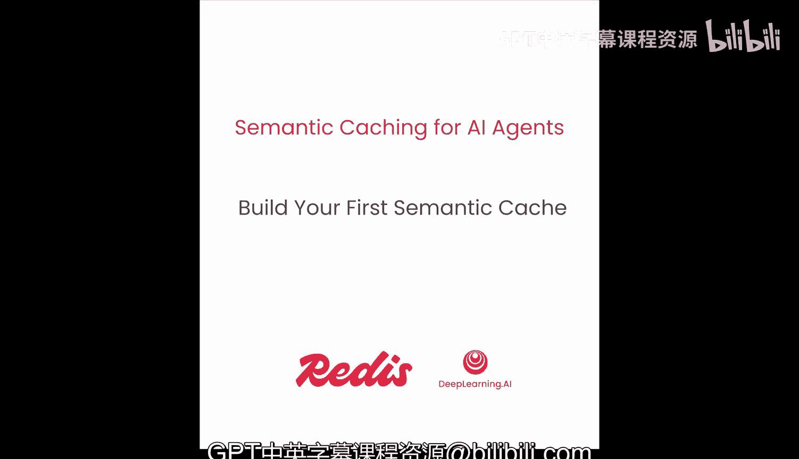
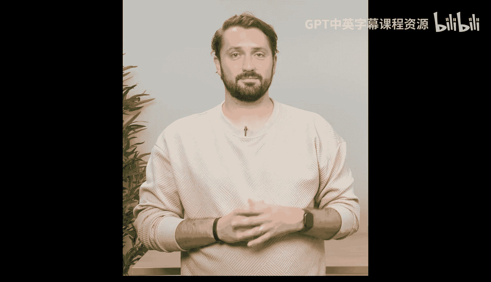
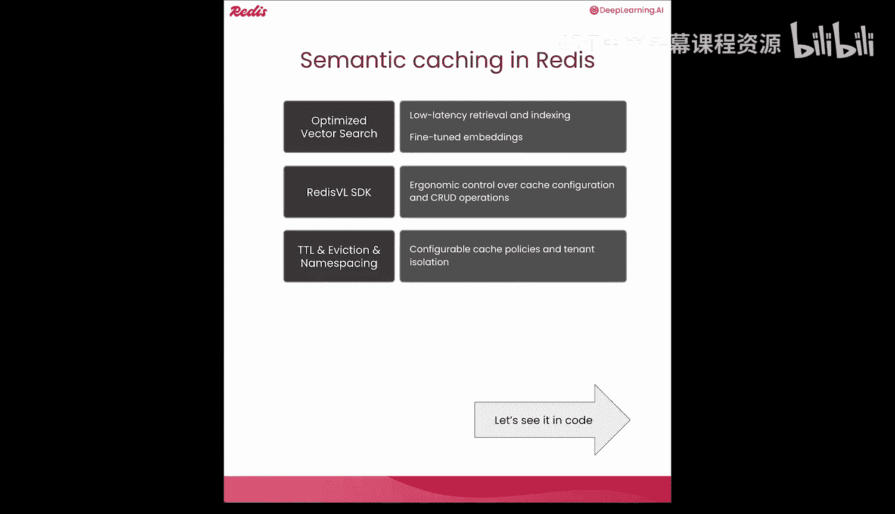
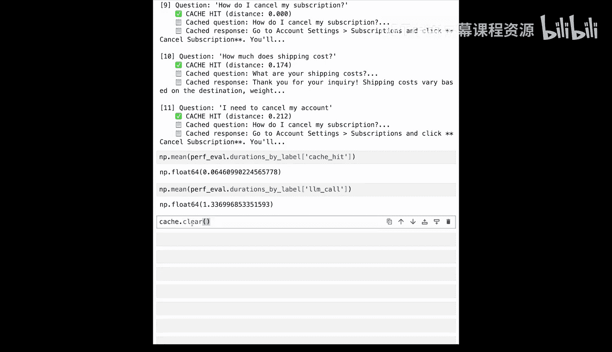

# 吴恩达《AI 代理语义缓存｜Semantic Caching for AI Agents》中英字幕 - P3：3.build-your-first-semantic-cache.zh_en - GPT中英字幕课程资源 - BV1aUSjBtECn

In this lesson， you'll build a working semantic cache from scratch so you can see how each part works。

 and then you'll reimplement it using Redis' open source SK and database。 Allright。

 let's give it a shot。 In this lesson， we're going to build a semantic cache from scratch on a customer support use case。

 Custom supports a very common agent use case or agents can help accelerate customer resolution to common Que and inquiries and issues。

 The data set we're going to worked with is a set of frequently asked questions from a customer support system and a knowledge base of content that supports the agent retrieval of different kinds of knowledge。

 just as a quick recap， semantic caching involves first checking a cache using semantic search to see if there's a question that we've processed in the past that similar enough to the current user question。

 If it's similar enough， we can hit the cache and we can return directly to the user and if it involves a cache miss。

 Then we need to go through our agent rag process。 ultimately getting a result back to the user and updating our。

All right， in this lesson， we're going to use Redis， which stands for remote dictionary server。

 Redis is an open source fast inmemory Kv database。

 This means that you can store different data structures on the Redis server and distribute them across multiple nodes and your applications can go read and write and access this data at scale。

 Redis is commonly used for caching， but also has the ability to do secondary indexing。

 which means we can store insert across vectors， text， numerics tags and even geospatial data。

 These properties allow us to do semantic caching and Redis。

 The first thing we'll see when we test with Redis as we can optimize our vector search for low latency retrieval and indexing。

 This means we can quickly insert and check the cache or questions that are very similar to the user query that comes in。

 We'll also use an open source open weight， finetuned embedding model that improves the semantic caching accuracy。

 Second we'll use an open source Redis via SDK This gives us erergonomic control over cache configuration。

And different crowd operations。 And lastly， we can take advantage of TTO or time to live and in and name spacing policies that allow us to configure how data moves and flows through the cache and how tenants can be isolated from one another。

 Let's see this in code。 So the first step is we're going to load the FAQ data set。

The FAQ dataset comes from a CSV file。Here in the system。

 and this contains frequently asked questions， question and answer pairs and some test data we can use。

Let's load our FAQs and take a look at what they look like。

You'll notice each entry in our FAQ dataset contains a question like how do I get a refund？

In an answer， like toquester refund， visit our orders page and select， et cetera， et cetera。

In order to do semantic caching， we need embeddings。

We will use the sentence transformformers's library in order to do so。 For our first example。

 we're going to use the popular all MPut base V2 model。

 We will use this model to encode our FAQ data set， our list of questions and embeddings。

The first time you run， you'll need to download the model。

 which may take a couple seconds given your network connection。At the end here。

 you can see this is a sample of our first embedding。

 a couple float values to show you what it looks like。Next。

 we will use two functions in order to implement semantic search from scratch。

The first function calculates the cosine distance between two sets of vectors。

 and the second function implement semantic search by taking a query。

Constructing an embedding of the query， calculating the cosine distance between the query embedding and our matrix of FQ embeddings。

 And at the end， we find the index and the value of the best。Entry and our FA Q embeddings matrix。

 At the end， we return the index in the distance value。

Let's try the semantic search function over a sample query to see what it comes back with。

We will run semantic search over the query。 How long will it take to get a refund for my order。

So the most similar FAQ in our index is how do I get a refund？And the cosine distance was 0。331。

Now we're going to turn our semantic search into a semantic cache。

We will do this by implementing another helper function called check cacheash。

 which takes a query as a string and a distance threshold float value。First。

 within our cache check function， we implement semantic search with the query to get the index and the distance value。

 If our cosine distance value is less than the stated threshold。

We treat this as a cache hit and return the entries from the cache。Otherwise， we returned none。

 This would be a cash miss。Let's test our cash over her a couple queries。

So we can see the first query is it possible to get a refund hit on an entry with a distance of 0。

262， but the other two entries in our test queries did not hit on anything in the cache。

We can also extend our cache with new entries as new data comes in over time。

Let's add a helper function to do that？This helper function takes a question and answer pair。

 It adds it to our data frame， concatenating with what was already there。

Generates a new embedding and adds us to our FAAQ embeddings。

Now we're going to try updating our original cache with three new entries。Originally。

 the cache had only eight entries， but after all three were added successfully， the cash now has 11。

This operation worked exactly as we expected。Now that we've extended our cache with a few new entries。

 let's run a test to see what hits on the cache now。

Here we can see all three of our test queries now hit the cache because we've added new entries to it。

Now that we've seen how a cache works in practice and from scratch。

Let's move towards a more production ready scenario。

 We're going to move to a Redis database instance。First， we need to connect to a Redis server。

 You can do this through using the Redis URL parameter， which in most cases is Redis local host 6，3。

7，9。 Next， we need to quickly test the connection to make sure we can speak to Redis properly。

We can see our Redis is running and accessible from this notebook here。

The next ingredient is a cache optimized embedding model， L cache embed V1。

This is an open source open weight model available in hugging face that's been fine tuned specifically for semantic caching operations。

 Let's load this model using the hugging face text specizer class。

 This class will reach out to hugging face and download the weights of the model here on our server。

Now that we have the embedding model downloaded and ready to go。

 we can create our Sammantic cache using the RedosVL open source SDK。

Here we pass a name to our semantic cache， which creates a unique name space in the database。Second。

 we pass the lane cache and bedding model that we just created。Third。

 we pass our Redis client connection object。And lastly。

 we configure a baseline distance threshold to use for the cash checks。

Let's hydrate our cache with our FAQ data。This will set up Redis with all of that data and make it ready for use。

 in our example。Here we just iterate through the data frame， and entry by entry。

 we store these in the cache。Let's quickly check what's in our cash。 We can ask the question。

 I need a refund for my purchase。AndLet's speak at the result。

There we can see a cash entry was returned with the prompt How do I get a refund？

The full validated answer。The vector cosine distance here at 0。25。

 which is less than our cache distance threshold of 0。3。 So this is a proper hit we expected it。

Lastly， before we can test this end to end with a large language model。

 we're going to implement T TL。 TTL stands for time to live。

 and this is how the database knows when to evict data that's been in the cache for a certain period of time。

 It's commonly used to keep the cache fresh when data changes or evolves in a system。

 This is really easy with the Redis open source SDK。 You just call set T TL。

 And we're going to set this time to live for a full day。And seconds。

 we're going to conclude this lesson with an end to end large language model example using open AI。

 We'll use the L chain， Open AI SD K and the chat Open AI wrapper to connect with G 40 mini。

The open AI keys for this course should already be loaded inside your environment to talk with our large language model。

 we have a helper function that sends a prompt In this particular scenario。

 you are a helpful customer support assistant。And this language model is going to answer the customer question concisely and professionally。

It's going to provide a response in one to two sentences based on whatever the question is that you give it。

 Now， for our end to end example， we have a list of test questions。

We also have a performance evaluation class。 The performance evaluation class is built as part of the course materials and contains the ability to do fine grainined timings on cast checks。

 on LLM calls on hits and misses。This will allow us to compare the results after we run this entire test。

With our performance evaluation class ready to go to take on our timings。

 we're going to iterate through each test question， check the cache， and if it's not in the cache。

 we'll record that as a miss and go to our large language model。

This loop runs over our list of test questions we saw earlier and prints out the results。

Let's take a look at the results from the test。We can see a mix of cache hits and cache misses over the sample questions as expected。

Now that we finish the tests， we can look at the results between the cache hits and the cache misses that ultimately went to the LOM。

First， we can see that the mean time it took to run a cachet， which is around 65 milliseconds。

 And that， in contrast with the L L M。As we would expect。Took over a second， on average。

This is just one form of measurement。 In the very next lesson。

 we'll go into depth about measuring cash effectiveness。

 This means we'll focus on all of the core metrics between cash accuracy and cash performance to make sure we have a system ready for production and up and running。

At the very end， you can clear your cache to clear the workspace and get ready for the next piece。

