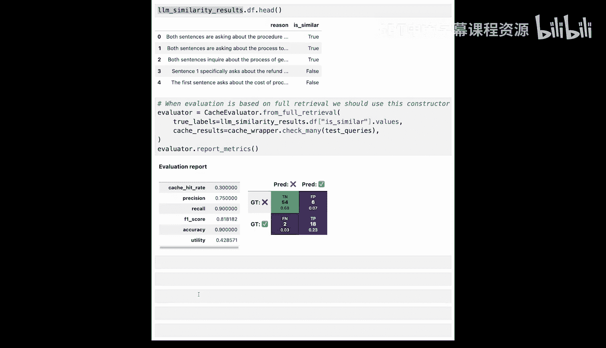

# 吴恩达《AI 代理语义缓存｜Semantic Caching for AI Agents》中英字幕 - P4：4.measuring-cache-effectiveness.zh_en - GPT中英字幕课程资源 - BV1aUSjBtECn

In this lesson， you will learn how to evaluate your cache using metrics like hit rate， precision。

 recall and latency to understand its real impact。 A rathers go。 So two ways that our cache can fail。

 it can either have a quality or a poor performance and the way that were going to measure our cache performance is similar to how we measure the performance of machine learning models。

In this lab we're going to use this dataset where we have user queries。

 their corresponding cache hits or the closest match we have the distance to that cache hit and we also have a label column which tells us whether this cache hit was true or not this last column can be obtained either by using human feedback or labeling it with El as a judge in the slide here we can see the grammatically what happens with the dataset we have examples of the cache entries and they are mapped in embedding space here we have a point and embedding space and we also see the distance threshold。

 These two user queries are mapped to the specific cache entry。

This metric measures from all of the user queries that come to our system how many of those actually fall within the bounds of the distance threshold in this case。

 we have three out of5。Next， we'll continue with precision and precision measures how much of all of the entries that fall within the distance threshold are actually valid。

 and this validity comes from the label column recallco measures how many of the queries that should have hit actually hit。

 And here in this case we see that one of the questions that should have hit did not because of a too low of a distance threshold。

 It is also important to see where each examples fall in our confusion matrix which shows us all the true positives true negatives false positive and false negatives in the specific case of our example we have one true negative that doesn't map to anything。

We have one false positive， which maps but it's wrong。

 we have one false negative that should have mapped but just because of the threshold was too low it didn't and two true positives。

 and these are all the values of our confusion matrix we prefer for the confusion matrix values to be mainly on the main diagonal。

The distance threshold can help us trade off between precision and recall as we lower the distance threshold。

 we can increase precision， but we lose recall， and as we increase it， the reverse happen。

 We increase the recall of the model and decrease the precision。

And the measure that we can use to strike a good balance between precision and co is the F1 score。

We'll use this technique of sweeping through the threshold to optimize and find the best threshold for our data and the next lesson we're going to use the FO core to find the perfect threshold for our cache。

 It is important also to measure the speedup that the caching system can give us and the LM tokens that it can save us to measure the latency performance we can use this formula。

 which measures metric code with cache latency， which breaks down into three different variables。

 AL or average cache latency， which is the average time that our cache takes to respond ALL or average LM latency。

 which is how long the LM takes to respond and CHR or cache hit ratio。

 which is how many of the user queries actually get cache hits。

And let's look at a specific example where the average cache latency would be 11 milliseconds。

 The average L and latency is 350 milliseconds， which is probably another estimate。

 and the cash heat ratio is 30%。 We calculate that the weak cash latency is 256 milliseconds。

Which you can compare to the system's latency before being cached， and we see the improvement。

 which in this case is 26%。At the measure of the saved All tokens。

 you can use the resource at the correspondingent URL。

 whether can you put your cache hit rate and expected daily queries input in output of tokens。

 and it will calculate for you an expected measure of the annual savings。

And now let's do all the cash performance measures in the code。All right。

 let's start by setting up apart environment。And let's continue with loading our data that we are already familiar with。

 then we introduce the semantic cache wrapper that wraps around our cache and provides us some helper functions that we can use to hydrate our cache or check our cache。

那说会儿。Then using the abstraction， we can hydrate our cache using the simple helper function and you can also check it with questions like this first instance of a user query that we have in our FAQ data frame when we check our cache we get an object which we see nicely formatted here which shows us what our query was and all of our matches。

In this case， we have a single match we have already defined this test queries list which contains all of the user queries that we're going to be using。

 we can also introduce the checkman helper function which can given a list of user queries give us results of the matches we can also configure it with different thresholds or different number of matches moving on we can now also use an abstraction called the cache evaluator I've already executed this cell but as you can see you can provide a number of cache results and because our dataset is set up in a particular way we're actually able to automatically label them because the data was automatically generated we can use the data container that provides the data to provide also labels for the data because the data container can extract the queries in the matches because we already know the correspondences because of how the data was generated we can generate。

Labels automatic running the report matrix function also prints this nice looking report where we see the confusion matrix in this case we have a rather nice looking confusion matrix none of the matrix for the particular threshold that the cache was iniated in this case we get a precision of 0。

79 the 0。79 another very useful highlevel helper function is called get matrix this function gives us access to all of these metrics in a dictionary format。

 but it also gives us something called the confusion mask。

 the confusion mask is similar to the confusion matrix but instead of giving you the values of the confusion matrix as numbers。

 it gives you a mask over the data which you can use and extract the different values corresponding the different categories。

 the confusion matrix in this example we're seeing the first9 examples of the true negatives group in this case。

We see that the012， the third element is a part of the two negatives group。

 Another very useful method of the evaluator is the matches data frame。 If we run it。

 we get a nicely looking data frame that gives us our queries matches distance to the corresponding match and labeling we can use our confusion masks and filter out it get the corresponding groups In this case we're looking at the false positives or these five examples here of this particular example in this specific instance we see that the query can I get a refund if I change my mind is mapped to the cache entry。

 how do I get a refund It's obvious why the retrieval model got confused but because we generated our data set in a particular way having in mind that this query is not particular enough to be matched to this cache entry we have generated the label to be false and so that because of that we're considering this example as a false。

So， for instance， let's look at this last example in the table。

 Can I schedule a specific delivery time is matched against Can I change my delivery address。

 As you can see， these are quite different， even though they sound similar。

 the model has given them low enough distance so that we've considered them as a match。

 even though we've labeled them。As though they should be a false match。

 So that's why this example falls into the bucket of false positives。

 I would strongly encourage you to change this false positives modifier here or a mask to all of the other values like false positives false negatives and true positives。

 all of the other groups of the confusion matrix so that you can explore the results there。 Now。

 let's introduce helper functions for evaluating the latency performance of our cache。

 Who define the simple function just that would simulate a malem response latency by randomly sleeping for a period of。

200 to 500 milliseconds。Then we'll run this performance code， which uses an abstraction code perfval。

 which we can use to compare performance of two different executions simultaneously。😔。

At the end of the execution we'll obtain a dictionary called metrics。

 which is generated by the Perf vow abstraction， which will give us the latency both for the cache and the LM code if we look into this dictionary we can see that we can obtain the average latency of the cache which is 2。

2 milliseconds and the average latency of the simulated LM which is 361 milliseconds using the Perf vow we can also plot all of the metrics that we have obtained。

Here we see a breakdown of all of the different groups of evaluations that we did。

 we had 80 cache hits and 80 LM codes， and here we can compare their latency in a visual manner。

So this is how 360 milliseconds on average looks like compared to the 2。

 something milliseconds for the cache in the summary block here we can also see the cache speed up that we get which in this case is 161 times faster。

So what we saw now is a row Lm latency versus4 cache latency， which gave us this big speedup。

 but it's not a fair comparison。 What we should actually do is get our row Lm latency and compare it this is the cache latency we can assume some cache he trade in this case 30% we can calculate using the formula from the slide the cached LM latency that we can expect Now using that we can calculate both a drop in the latency and cached Lm speed up in here for this particular example you see that we see 29% euro latency and around 1。

42 x speedup of the system let's move to our last section here which is LM as a judge where we were going to introduce an automatic way to label your query cache pairs we're going to start over by hydrating our cache with the FAq data frame we' are going to do a full retrieval so we're going to use。

Distance threshold of one and for each test query， we're going to retrieve the closest neighbor no matter the threshold and what we get is a list of all of the closest matches for all of the queries Now we're going to use an LLM to label all the query cache pairs。

 we have to load our key， which is already loaded。Then we can use an abstraction called LM evaluator。

 which here we will construct using the Cha GPT API， it already comes with preconfigured prompt。

 which help us compare pairs， queries and caches， This evaluator instance has a method called predictd which you can use to pass in our pairs which are the test queries and the full retrieverieval matches。

 we can also configure a batch size。So this code to predict gives us an object called LM similar results。

 let's inspect it。This object has a property called data frame。

Which formats the results in a data frame format。We can see that this is a data frame that matches every pair with a reason and is similar label which tells us if this pair is similar or not。

 and the reasoning why the Lm thought that was the case now we can continue and use our evaluator again but instead of using the data container to label our data set。

 we can use the automatic labeling that we generated here by passing the is similar column and all the values as a boolean labeling。

 it is important to note that we have to connstrue the evaluator with this special constructor called from fully litrieval。

 which is important when we're using a full lit thval matches we can again use the evaluator report matrix function to get a report of the performance as we can see previously we had 79% precision in 79% recall using the automatic labeling we get 75 versus 90 recall which is。

close in terms of metrics to what we had previously。

 which tells us that this method can create good enough labels for our evaluation。

 And now that you've learned how to evaluate your cache in the next lesson。

 you're going to learn how to improve it。 Now， let's clean the cache and continue to the next lesson。

