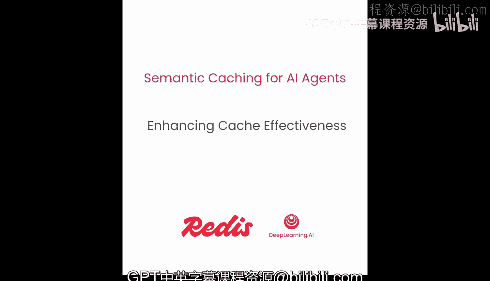
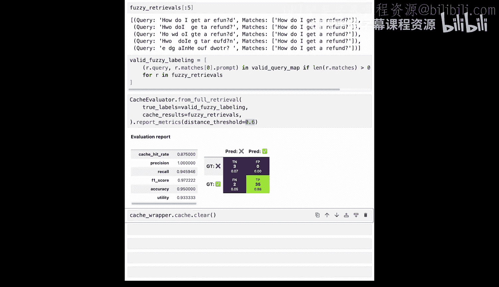

# 吴恩达《AI 代理语义缓存｜Semantic Caching for AI Agents》中英字幕 - P5：5.enhancing-cache-effectiveness.zh_en - GPT中英字幕课程资源 - BV1aUSjBtECn

In this lesson， you'll learn several techniques to make your cache more accurate。

 like threshold tuning， crossing coders， LM checks and phimatic。 Let's get coding。

 We will use four different strategies to improve the cache quality。

 The first one is called threshold sweep。 In this strategy。

 we evaluate the cache with different thresholds to find the one that maximizes the F1 score。

 Looking at the graphics， we can see that increasing the threshold needs to better recall。

 but it decrease the precision。 We see that F1 because it's a function of both of them。

 It maximizes an intermediate threshold value。 This is usually the threshold we want to be。

 The second strategy is using a crossing coder as a re。

 crossing code is a model that can capture more nuances between the two sentences。

 because it processes them simultaneously。 In this regard， it is more expressive。

 but it cannot be used in place of the embedding model because it does not produce vectors that are quick to search。

 In this specific example， we can see the crossing coder score and compare it to the embedding distance。

 As similarity increases so does the crossing。

The score or its confidence in the similarity of the pair the way we usually use the crossing code effectively in semantic caching system is by first retrieving a set of closest cache hits for a specific user query and then running them through the crossing code we proceed by picking the cache hit with the highest similarity score。

 So in summary， we can expect a sizable boost in precision especially if we fine tune the model on our own data but of course the setup also increases the cache latency of our system。

 Our third strategy is to use an Llm and simply ask if a pair of sentences are semantically similar to make this work effectively we can use a cheaper Lm to do the validation and also validating similarity requires less tokens than generating a whole user query response and therefore is cheaper in practice you can also set it up as a fullback mechanism to query cache hits which have an ambiguous distance value。

 These validation scheme might can drastically increase precision but it comes with increased latency in talking usage compared to a system without an LM validator。

 Lastly， let's look at fuzzy matching。An algorithmic strategy to matching strings。

 fy matching usually measures the added distance between strings or how quickly can transform one string to the other using deletions。

 substitutions and insertions As you can see in the example on the slide。

 The two sentences with small difference produce a high similarity score and the two sentences that are completely different have a very low score。

 This technique can be very helpful in keyword style search domains where we can filter easily for typos to set this up properly we usually place the fuzzy matching in front of our semantic caching system and with high similarity threshold it can match typos to corresponding previous queries。

 short circuitcuing the whole embedding generation and vector search mechanism after that setting this usually leads to decreased latency and increased precision but it can lead to false positives if not set up correct Let's see all of these techniques in code。

Let's start again by setting up our environment。And wait for this load。😔，And as previously。

 let's also again introduce the cache wrapper， which help us hydrate and use our cache。

 let's also instantiate our data container and get an instance of all our test queries and just as a reminder from last time we'll hydrate our cache。

Get all of the matches or a distance of 0。3。And run this through the evaluator。

We will obtain a previously seen evaluation report and use this as a baseline for the metrics that we're going to obtain further。

Let's now look at our first improvement technique， which is the threshold suite。

We will start by checking all of the test queries that we have with a distance threshold of one obtaining a full retrieval。

 then we'll run the evaluator as previously being mindful to construct it with a special constructor from Full retrieval Finally let's look at this new helper function which is called report threshold sweep。

The evaluator already has all the information necessary to run a threshold sweep for us and report the results in this nicely formatted report。

 As you can see on the diagram here， we have our precision going down with higher distance thresholds and recall going up respectively。

 We see that the F1 maximizes in this specific value here。

Which if we look at the table with matrix maximizes at threshold 0。2828。

 which gives us 90% precision and 85% recall at 25% cache rate 90% precision is pretty good and we also have a decently sized cache rate looking at the confusion matrix we can also see that most of our values lie on the diagonal。

 which is what we want Now let's move on to the next technique that we're going to see running this code instants our crossing coder。

 which is based on Alibaba Nlp， which is a reranker based on modern birth base。

 the cache wrapper also has another helper function called register rearrancor。

 which when given a proper instance of a rearrancor。

 which can obtain from the crossing coder using this helploer method。You can supply it here。

And get the cache that has a reranking mechanism injected into it。But before that。

 let's look at an example of what the crossing codeder does。 as we saw in the slides。

 The crossing codeder is a model that can given two pairs of sentences。

 give us a score of how similar they are or how relevant they are。 In this case。

 we have what is the capital of China versus Beijing。

 and we see that we have a very high similarity score。

 We also have sentence pairs of how to implement Quicksword in Python。

 which matches very well with introduction to Quickssort， and bad match， which is， again。

 how to implement Quicksword in Python matched against the weather is nice today。

 which is very dissim and has a very low score。 Let's also see another example of crossingcor versus an embeending model here we're learning the sentences both through the semantic cash and the crossing codeder。

 The sentences are as follows。 The bank raised its interest rates versus the river overflowed near the bank。

 after heavy rain。 They are intentionally confusing。And we can see， that even though。

They are relatively far apart。 the crossing coder rightfully was then very far apart。

 while the embedding model is relatively confused it is also important to note that here the crossing coder distance is constructed by doing one minus the crossing coder score that the source previously here。

 Okay， so let's now obtain results from the crossing coder and run it to our evaluator。

 we're running again now our cache wrapper in which we register the crossing codeder we're running it with the test queries using a distance threshold of one。

 which means that we're doing a full detrieval here。 We're using number results 10。

 which means that the crossing coder is going to look into an evaluate 10 examples and re rank them and again。

 we are instantiating the evaluator using the special constructor with from full detrieval。

 Let's look at the results。From the threshold sweep report， interesting。

 now we can obtain a much higher precision at 94%。With relatively decent。

 recall 79% inst good cachey rate of 23% and this we obtained at a threshold of 0。11 Moving on。

 let's now look at the system using GL validator in our cache because this is using an。

 let's load our open AI key。And let's instantiate our LM evaluator。

 we can instantiate it similarly in the cache wrapper by constructing it and passing it to the register revraner map。

We continue by running the cache wrapper。That has the LM validator with threshold that we already know is relatively good。

So this will potentially improve our results even further by filtering out those positive results。

Let's run the cache results through the evaluator As you can see we obtained 100% precision。

 This means that we removed all of our false positives。

 Our recall dropped significantly but we still have a relatively high cache rate Now let's run the seman cache3 LM validator through the evaluation that we've seen previously we have 100% precision。

 which means that we filter out all of our false positives。

 but we also acquired a lot of false negative So things that could have hit that did not because the LM was too strict。

 this might be still valuable in a lot of domains， and we achieved a relatively high cache rate of 21% while。

Having 100% precision。Lastly， we arrived at the last section of our lesson we are going to explore fuzzy matching。

 we'll start by introducing a simple function called Fuzzify string。

Basically gets a string as input and number of iterations where introduces a random swaps between strings。

So because Fuzzy matchingching is useful technique to use in keyword style searches where the queries and the cache hits are relatively similar syntactically。

We're going to augment our data set。To make it more appropriate for evaluation in the specific setting。

 So we're going to construct a special data set to validate and showcase this technique。

Where were going to use the FAQ questions。And we're going to generate pairs with varying degree of difficulty or fuzziness。

 which is introduced with this function， which does random swaps between neighboring characters。

 let's take a look at the fuzzyf queries that we've generated here。

 These queries have a varying degree of fuzziness。 We start by fzziness of two which does only two random swaps and we go to3。

4，10 and then 100 where the string looks almost unrecognizable After that。

 we're going to instant an abstractstruction called fuzzycache。

 which has very similar interface as the semantic cache wrap that we have worked with so far we can hydrate it using our FAQ dataset set we can check multiple queries。

Looking in the physy query retrievals， we have again the query and the matches that it gets。

 as you can see for complex cases like these ones， they get matched their corresponding queries rightfully。

And even for this really difficult example， we still manage to map it to the correct cache entry。

 well continue by generating a valid fuzzy labeling。

 which basically captures all of the pairs that are valid query and cache hit matches。

We'll use this to label our Hs and because we have this labeling。

 we can use it in the evaluator where we're going to pass it here in the true labels argument。

And we're going to report the metrics for a specific distance threshold where this retrievals。

 which in this case is 0。6 and we obtained 100% precision 94% recall and a very high cash rate。

 but this example is very untrived in a way and rather small scale and just serves to showcase that you can actually set up and use such a system in front of your cache Let's also clean up our cache here In the next lesson youre going to implement your first day agent that is going to use semantic caching to be fast and efficient。

