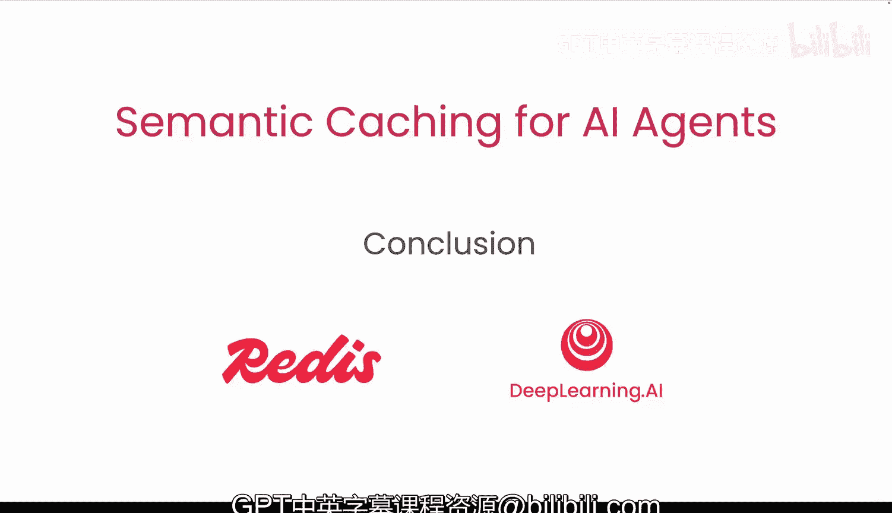

# 吴恩达《AI 代理语义缓存｜Semantic Caching for AI Agents》中英字幕 - P7：7.conclusion.zh_en - GPT中英字幕课程资源 - BV1aUSjBtECn

In this course， you learned how semantic caching helps AI agents become faster and more efficient while keeping quality high。

 We hope you enjoyed the course and can't wait to see what you build。😊。

