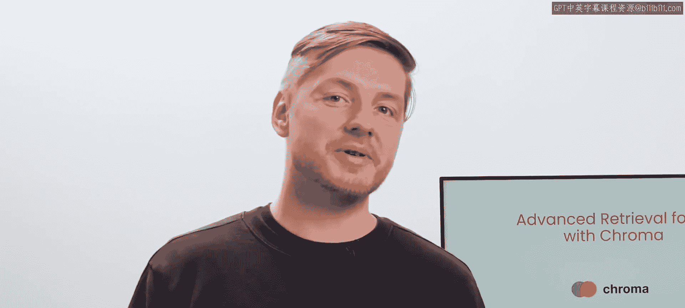
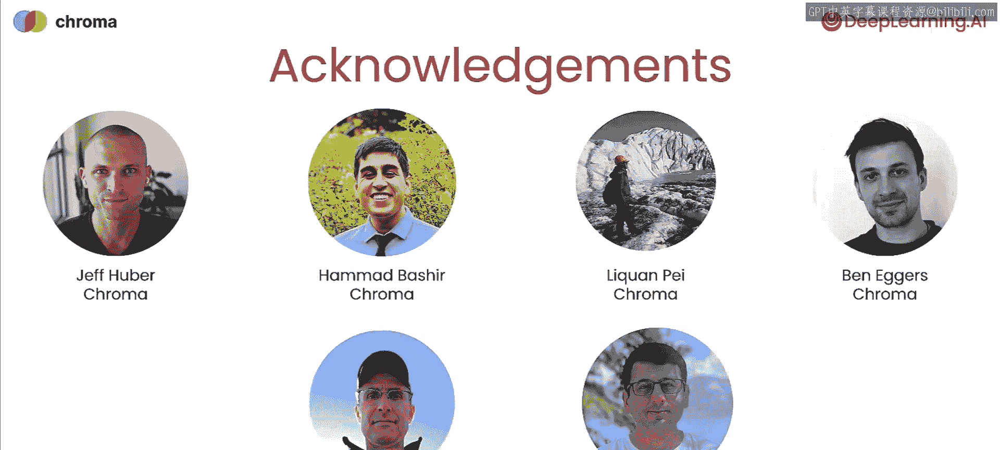

# 吴恩达《AI高级检索：Chroma｜Advanced Retrieval for AI with Chroma》（中英字幕） - P1：Introduction.zh - GPT中英字幕课程资源 - BV1Bw411372q

Rag or retrieval augmented generation retrieves relevant documents to give context to an LM。

 and this makes it much better in answering queries and performing tasks。

 Many teams are using simple retrieval techniques based on semantic similarity or embeddings but you learn more sophisticated techniques in this course which let you do much better than that a common workflow in rag is to take your query and embed that。

 then find the most similar documents， meaning once with similar embeddings and that's the context。

 But the problem with that is that it content to find documents that talk about similar topics as a query but not actually contain the answer。

 but you can take the initial user query and rewrite this is called query expansion。

 rewrite it to put in more directly related documents two key related techniques One to expand the original query into multiple queries by rewording or rewriting it in different ways。

 And second to even guess a hypothesis。😊，izeWhat the answer might look like to see if we can find anything in a document collection that looks more like an answer rather than only generally talking about the topics of the query I'm delighted that your instructor for this course is Anton join theov。

Anton has been one of the innovators driving forward to steal the art and retrieval for AI applications。

 he is cofounder of Chroma which provides one of the most popular open source vector databases if you've taken one of our L chain short courses taught by Harrison Chase。

 you have very likely used Chroma。Thank you， Andrew。

 I'm really excited to be working with you on this course and share what I'm seeing out in the field in terms of what does and doesn't work in RAG deployments。

We'll start off the course by doing a quick review of RAG applications。

 you will then learn about some of the pitfalls of retrieval where simple vector search doesn't do well。

 then you'll learn several methods to improve the results。

 as Andrew mentioned the first methods use an LLM to improve the query itself。

 another method re-rannks query results withhel from something called a cross encodecor which takes in a pair of sentences and produces a relevancy score。

Youll also learn how to adapt the query embeddings based on user feedback to produce more relevant results。

There's a lot of innovation going on in RAG right now。

 so in the final lesson we'll also go over some of the cutting edge techniques that aren't mainstream yet and are only just now appearing in research。

And I think they'll become much more mainstream soon We'd like to acknowledge some of the folks that have worked on this course from the Chrome team。

 we'd like to thank Je Hober， Hamed Bashal， Li Chuan Pei and Ben Eggs。

 as well as Chromema's open source developer community。

From the Deep learning team we have Jeff Ludwig and Ema Gargari The first lesson starts with an overview of Ra I hope you go on to watch that right after this and with these techniques it turns out it's possible for smaller teams than ever to build effective systems so after this course you might be able to build something really cool with an approach that previously would have been considered ragtag。

😊。

