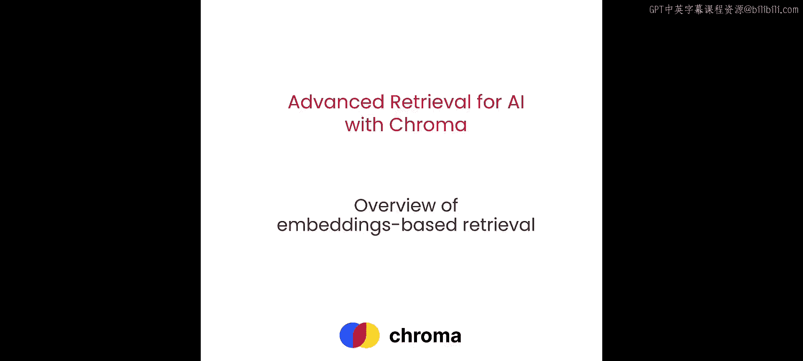
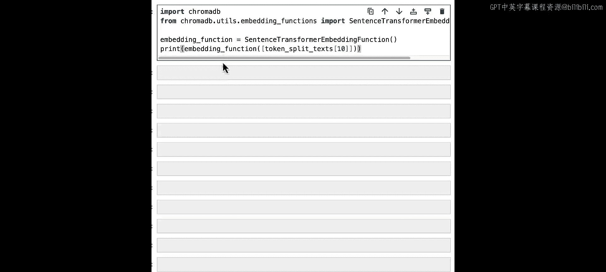
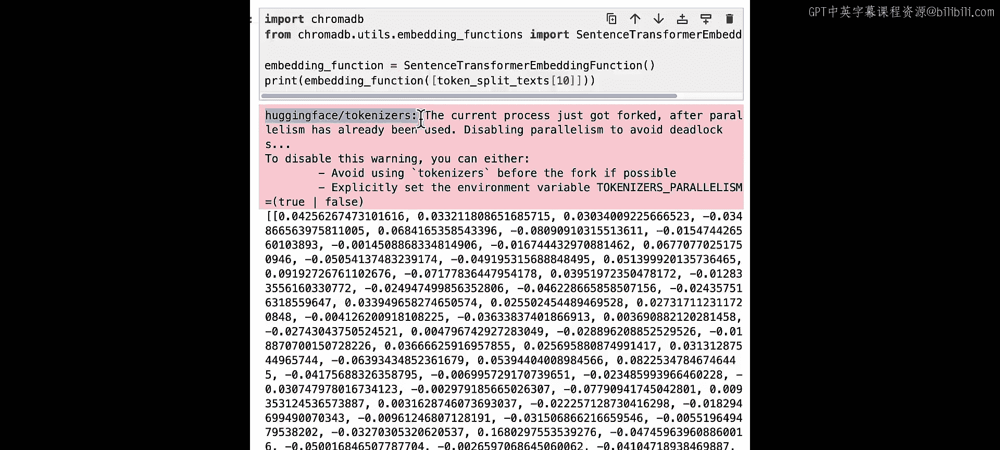
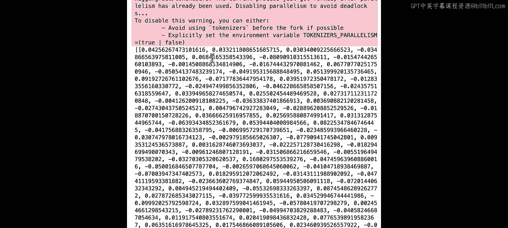
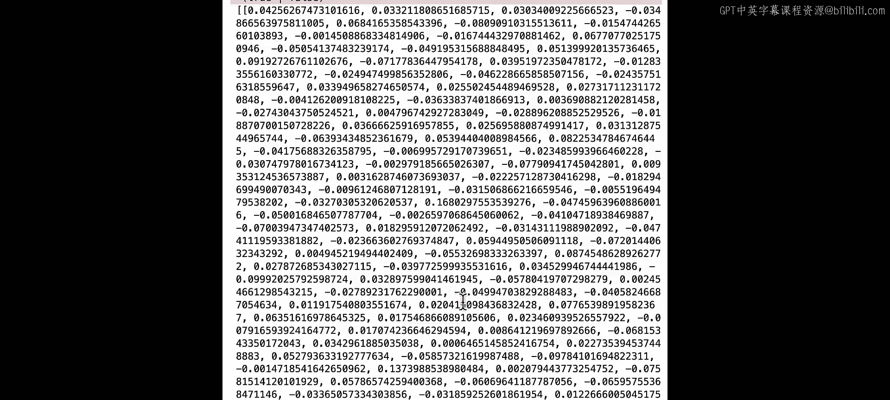
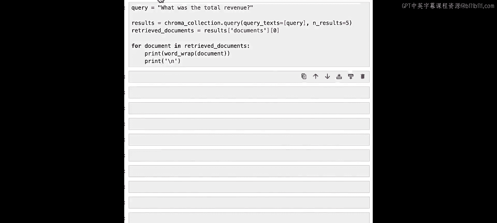
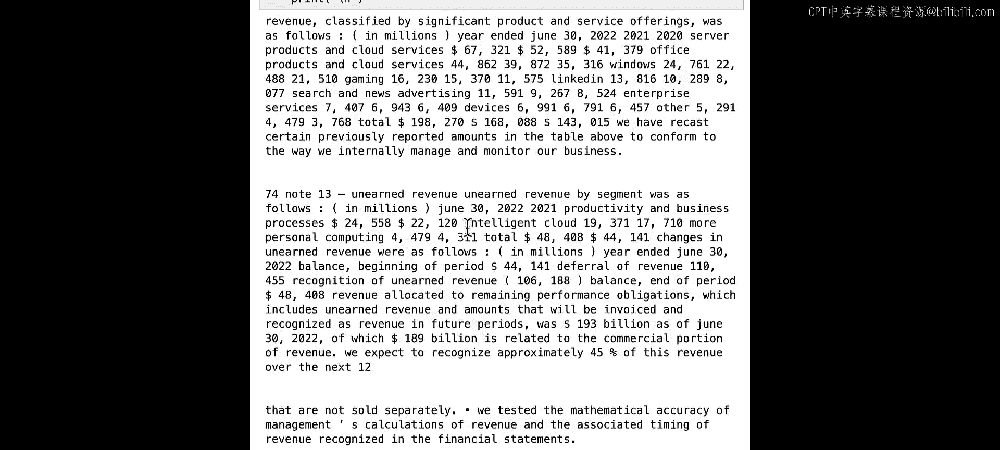
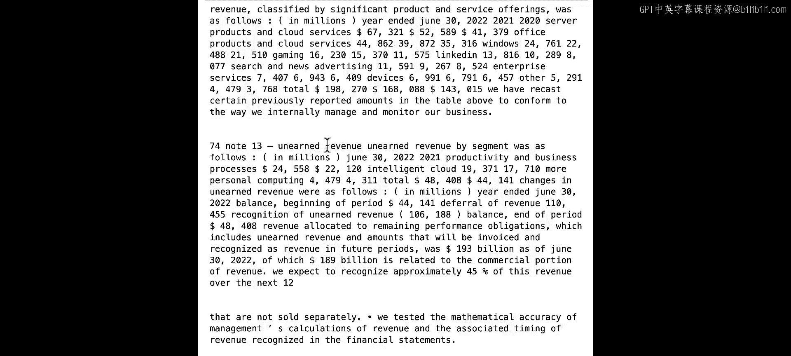

# 吴恩达《AI高级检索：Chroma｜Advanced Retrieval for AI with Chroma》（中英字幕） - P2：Lab 1 - Overview of embeddings-based retrieval.zh - GPT中英字幕课程资源 - BV1Bw411372q

In this first lesson， we're going to review some of the elements in an embeddings based retrieval system and how that fits together in a retrieval augmented generation loop together with an LLM。

 so let's go。

So the first thing I'd like to show you is the overall system diagram of how this works in practice。

The way retrieval augment generation works is you have some user query that comes in and you have a set of documents which you've previously embedded and stored in your retrieval system in this case quoma。

 you take your query， you run your query through the same embedding model as you use to embed your documents which generates an embedding。

 you embed the query and then the retrieval system finds the most relevant documents according to the embedding of that query by finding the nearest neighbor embeddings of those documents。

 We then return both the query and the relevant documents to the LLM。

 and the LLM synthesizes information from the retrievetd documents to generate an answer。

 Let's show how this works in practice to start with we're going to pull in some helper functions from our utilities。

 This function just basically is a basic word wrap function。

 which allows us to look at the documents in a nicely pretty printed way。

 And the example that we're going to use。 we're going read from a P。

 So we're going to pull in PDF reader。 This is a really simple Python package that you can easily import its open source。

 and we're going to read from Microsoft's 2022 annual report and so。That we're going to extract。

The texts from the report using this PDF reader application and all we're doing here is for every page that the reader has we're extracting the text from that page and we're also stripping the white space characters from those pages Now the other important thing that we really need to do is make sure that we're not sending any empty strings there aren't any empty pages that we send to our retrieval system so we're going to filter out those as well and this little loop just basically checks to see if there's an empty string and if there is we don't add it to the final list of PDF texts and so just to show the sort of output that we get here we'll print an example。

And what we'll do is print the output of the first page of extracted text from this PDF。Here we are。

 and this is what the PDF reader has extracted as text from the first page of the document。

So in our next step， we need to chunk up these pages first by character and by token。To do that。

 we're going to grab some useful utilities from L chain。

 We're going to use some lang chain text splitters。

 We're going to use the recursive character text splitter and the sentence transformers token text splitter。

 It's important that we use the sentence transformers token text splitter。

 And I'll explain why in just a moment。 But first， let's start with the character splitter。

 The character splitter allows us to divide text recursively。

 according to certain divider characters。 And what that practically means is first in each presented piece of text。

 the recursive character text splitter will find。The double new lines and split on double new lines。

 And then if the chunks that got split are still larger than our target chunk size in this case。

1000 characters， it will use the next character to split them， then the next character。

 then just a space。 And finally， it will split just on character boundaries itself。

 And we've also selected a chunk overlap of0。 This is a hyperparameter that you can play with to decide what optimal chunking looks like for you。

 So let's go ahead and run these。And we're going to output the output of the character text splitter。

 and we're going to look at the 10th text split chunk that we get。

 and we're also going to output the total number of chunks that the character splitter gives us So let's run this cell and take a look at the output。

AndSo we see the 10th chunk is all of this text， according to the character recursive character text splitter。

 and there's 347 chunks in total from this annual report Pdf。 So now we've split by character。

 the character text splitting isn't quite enough。 And the reason for that is because the embedding model which we use called sentence transformers has a limited context window width。

 In fact， it uses 256 characters。 that's the maximum context window length of our embedding model。

 This is a minor pitfall if you're not used to working with embeddings you may not consider the embedding model context window itself。

 but it's very， very important because typically an embedding model will simply chunknkate any characters or tokens that are beyond its context window So to make sure that we're actually capturing all the meaning in each chunk when we go to embed it。

 It's very important that we also chunk according to the token count and what we're doing here is we're using the sentence transformer text splitter。

 again， with a chunk overlap of0 and we're using 256。

per chunk which is the context window length of the sentence transformer embedding model and I'll go into more detail about that embedding model in a little bit and we are essentially taking all of the chunks that were generated by the character text splitter and we are respliting them using the token text splitter let's put out similar output to what we had in the last cell and see what we observe here So we see a similar chunk。

It's a little bit different to what we got before， obviously it's fewer characters because we have only 256 tokens。

 this is again the 10th chunk and we notice that we have a couple more chunks than we had before in the previous output we had 347 chunks。

In this output， we have 349， so it's divided a couple of the existing chunks into more pieces。

 So we have our text chunks。That's the first step in any retrieval augmented generation system。

 the next step is to load the chunks that we have into our retrieval and in this case we'll be using Chroma so to use Chma we need to import Chroma itself。

And we're going to use。The sentence transformer embedding model。

As promised Now let's talk a little bit about the sentence transformer embedding model and what this actually means and what an embedding model really actually even is。

 So the sentence transformer embedding model is essentially an extension of the Bt transformer architecture。

 The Bt architecture embeds each token individually so here we have the class fire instruction token and then I like dogs each token receives its own dense vector embedding。

 What a sentence transformer does is allow you to embed entire sentences or even small documents like we have here by pooling the output of all the token embeddings to produce a single dense vector per document or an outcase per chunk。

 sentence transformers are great as an embedding model they're open source all the weights are available online and they're really easy to run locally they come built into Chroo and you can learn more about them by looking up the sentence transformers's website or taking a look at the linked paper So that's why we're using sentence transformers and now hopefully it makes sense why we use the sentence transformer tokenizer text splitter So what we're going to do is we're going to create a sentence transformer embedding function。

This is for use with chromma， and we're going to demonstrate basically what happens when this embedding function gets cold。

 So that's the output of the cell。 Let's take a look。

Now you may get this warning about hugging face tokenizers， this is a minor bug and hugging face。

 this is nothing to worry about perfectly normal and here's the output that we get and you can see this is one very。

 very long vector， it's a dense vector， every entry in the vector has a number associated with it and this is the representation of the 10th text chunk that we showed you before as a dense vector。

 this vector has 358 dimensions， which sounds like a lot unless you consider the full dimensionality of all English text which is much much higher。

So the next step is to set up Chroma， we're going to use the default Chroma client。

 which is great if you're just experimenting in a notebook。

And we're going to make a new Chma collection and the collection is going to be called Microsoft Ann Report 2022。

 and we're also going to pass in our embedding function， which we defined before。

 which as you remember is the sentence transformer embedding function， we are going to create IDs。

For each of the text chunks that we've created and they're just going to be the string of the number of their position in the total token split texts。

 and then what we're going to do is we're going to add those documents to our Chroa collection。

And to make sure that everything is is the way we expect。

 let's just output the count after everything's been added and let's run this cell。

So now that we have everything loaded into Chroma let's connect an LLM and build a fullfledged ragG system and we're going to demonstrate how querying and retrieval and LLMs all work together so let's start with a pretty simple query I think if you're reading an annual financial report one of the top questions you have in mind is what was the total revenue for this year and what we're going to do guess we're going to get some results from Chroa by querying it and we see here that we call query on our collection。

We pass our query texts， and we're asking for five results。

 Chroma under the hood will use the embedding function that you've defined on your collection to automatically embed the query for you。

 So you don't really have to do anything else to call that embedding function again。

 And we're going to pull。The retrieve documents out of the results。

 this zero on the end is basically saying give me the results for the zeroth query。

 we only have the one query and what we're going to output now is basically the retrieve documents themselves and take a look。

So let's run the cell and we see that the documents that we get here are fairly relevant to our query。

 what was the total revenue we have。

Classified revenue by different product and service offerings。

 we are talking about an unearned revenue， and there's more information in a similar vein。

So the next step is to use these results together with an LLM to answer our query。

 We're going to use GT for this and we need to just do a little bit of setup so that we can have an openaiI client。

 We're going to load our openaiI API key from the environment so that we can authenticate and we're going to create an open AI client This is using their new version1 API where they've wrapped everything in this one nice client object for us So running the cell。

 there won't be any output here， but everything's ready to go Now we're going to define a function that allows us to call out to the model using our retrieved results along with our query。

 we're going to use G3。5 tubo， which does a reasonably good job in RA loops and is fairly quick and fast So the first thing is we're going to pass in our query and retrieved documents。

 We're going to just join our retrieved documents into a single string called information and we're going use the double new line to do so we're going to set up some messages So the first thing is the system prompt The system prompt essentially defines how the model should behave。

In response to your input and here what I saying you are a helpful expert financial research assistant。

 your users are asking questions about information contained in an annual report。

Youll be shown the user's question and the relevant information from the annual report。

 answer the user's question using only this information。

 so what this is doing and this is really the core of the entire RA loop。

 where' turning GPT from a model that remembers facts into a model that processes information。

That's the system prompt and now we're going to add another piece of the message for our user content and we have here that we're in the role of the user and here's the content the content is essentially a formatted string that says here's our question and that's just our original query here's the information you're supposed to use here's the information and then we need to send the request to the open AI client which is just using the normal API from the client there's nothing special here at all we're specifying the model we're sending the messages。

 we're basically calling the chat completion endpoint on the open AI client specifying a model and the messages we'd like to send I'm getting the response back and then we need to do a little bit more just to unpack the response。

For what the client returns。 So we've defined our rag function。 And now let's actually use it。

 Let's put everything together。 So here's what we're going to do。

 We are going to say output is equal to。Calling rag。With our query and retrieve documents。

 then we're just going to print the word wrapped output。And fire away。

There we go the total revenue for the year ended of June 30。

 2022 was $198270 million for Microsoft Microsoft are doing pretty well now is a good time to take a moment and try some of your own queries。

 so remember we specified the query a little bit further up。

What was the total revenue try some of your own and see what the model outputs based on the retrieve results from the。

Annual report I think it's actually really important to play with your retrieval system to gain intuition about what the model and the retriever can and can't do together before we dive into really analyzing how the system works in the next lab。

 we're going to talk about some of the pitfalls and common failure modes of using retrieval in a retrieval augmented generation loop。

