# 吴恩达《AI高级检索：Chroma｜Advanced Retrieval for AI with Chroma》（中英字幕） - P3：Lab 2 -Pitfalls of retrieval - when simple vector search fails!.zh - GPT中英字幕课程资源 - BV1Bw411372q

In this lesson， we're going to learn a little bit about some of the pitfalls of retrieval with vectors。

 I want to show you some cases where simple vector search really isn't enough to make retrieval work for your AI application。

 just because things are semantically close as vectors under a particular embedding model doesn't always mean you're going to get good results right out of the box。

 Let's take a look。

First thing we need to do is just get set up our helper utilities this time will let us load up everything we need to load from Chroma。

 have the right embedding function ready to go。And we're just going to do a little bit of setup。

So again， we're going to create the same embedding function and we're going to use our helper function this time to load our Chroa collection。

 and we're just going to output the count to make sure we've got the right number of vectors in there。

And again， don't worry about any of these warnings zoom Nancy， So yep， that's the right output。

 There are 349 chunks embedded in chromroa。So one thing that I personally find useful is to visualize the embedding space。

 remember that embeddings and their vectors are a geometric data structure and you can reason about them spatially。

 Obviously embeddings are very high dimensional sentence transformer embeddings have 348 dimensions like we talked about but we can project them down into two dimensions which humans can visualize and this can be useful for reasoning about the structure of embedding space to do that we're going to use something called UMap Umap is uniform manifold approximation。

 and it's an open source library that you can use exactly for projecting high dimensional data down into two dimensions or three dimensions so that you can visualize it。

 This is a similar technique to something like PC or Tney except Umap explicitly tries to preserve the structure of the data in terms of the distances between points as much as it can。

 unlike for example PCA which just tries to find the dominant directions and project data down in that way So we're going to import Umap and we'll grab nuy and we'll grab to QDM ift。

What QDM is it's the little thing that basically shows you a percentage bar when you have some long running process I like to use this so that I know how long the iterations are taking and how much longer I might be waiting and we're going to grab all of the embeddings out of the Cha collection And what we're going to do is we're going to fit a Umap transform So again Umap is basically a model which fits a manifold to your data to project it down into two dimensions。

 we're setting the random seed to zero here just so that we can get reproducible results and we get the same projection every time So let's go ahead and fit that transform。

And again， don't worry about any warnings you might get here。 Now， in this next step。

 now that we fitted the transform， we're going to use the transform to project the embeddings。

 and we're going to define a function that does that。

We're going to call it project embedding and it takes as input and array of embeddings and it takes the transform itself。

 and we're going to start by declaring an empty array。

 empty nu array of the same length of as our embeddings array but with dimension2 because we're just going to get two dimensional projections out and what we're going to do is we're going to project the embeddings one by one The reason to do it one by one is just so that we get consistent behavior from Umap。

 The way that Umap does projection is somewhat sensitive to its inputs So to ensure that we have reproducible results。

 we're just going to project one at a time instead of in batches and then of course we're just going to return the result of the function just the way that you would expect having to find the function。

Let's run it。On our data。And this will take a minute。Great， so now that process is finished。

 let's project the embeddings and actually take a look at them。

 So we're going to grab matpllib and probably most of you are fairly familiar with Mattpllib by now。

 we're going to make a figure。 and we're just going to do a scatter plot of the projected embeddings now。

😊，So you can see we have projected data embeddings。

 the first element of each one and the second element of each one and we're going to make them size 10 just because it's visually pleasing。

 we're going set some other properties of our axes。

 and there we go and this is what our data looks like inside chroma projected down to two dimensions and you can see that we preserve some structure a little bit more advanced visualization would allow you to sort of hover over each of these dots and see what's actually in there and you would see that things with similar meanings end up next to each other even in the projection sometimes there are a little bit unusual structures because a two-dial projection cannot represent all of the structure of the higher dimensional space but as I said it is useful for visualization and one thing that it's useful for is to bring your own thinking into a more sort of geometric setting and actually think about vectors and points which is what embedding space retrieval is really all about。

 So what evaluating the quality and performance of a retrieval system is all about is actually relevancy and distraction So let's take a look at our original query again。

 the one that we used in our rag example。

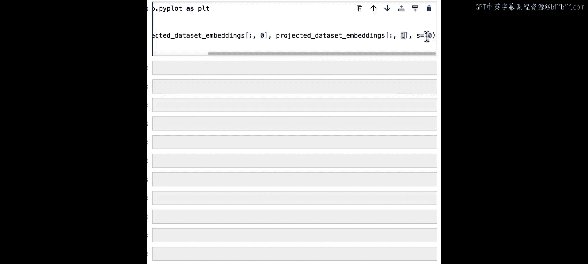

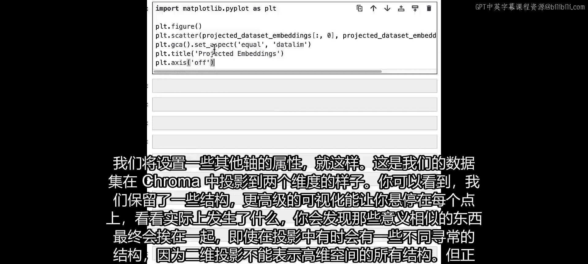

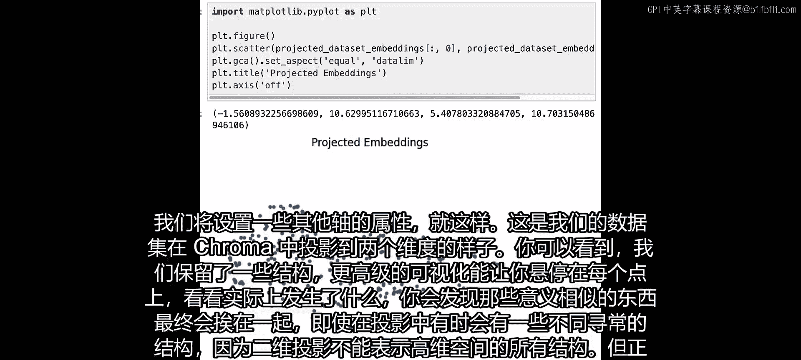

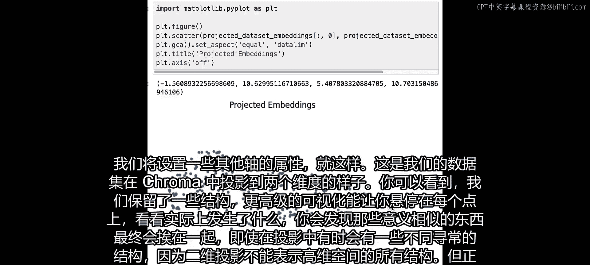

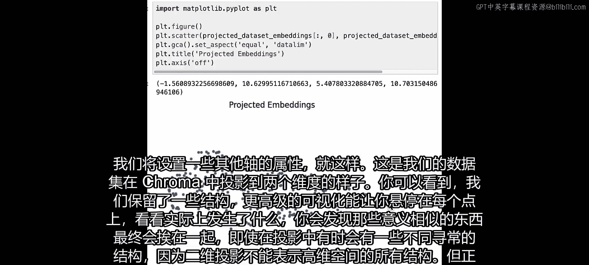

total revenue and we're going to do just the same thing as we did last time we're going to query the Chroa collection using this query。

 ask for five results and we're going to include the documents and the embeddings because we'd like to use those embeddings for visualization and so we're going to grab our retrieve documents out of the results again and let's print them out。

And we see again the same results as we saw before， retrieevval is deterministic in this case。

 and we see that there are several revenue related documents。

 but also there are things that here that are might not be directly related to revenue and we see things like potentially costs things that are to do with money but not necessarily revenue。

 so let's take a look at how this query actually looks。

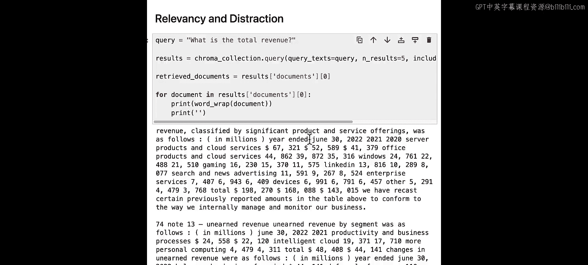

When visualized， so we're going to do is grab the embedding for our query using the embedding function。

And we're going to grab our retrieved embeddings as well， which we get from our result。

 And what we're going to do is use our projection function to project both of these down to two dimensions。

 And then now that we've got the projections， we can visualize them and we can visualize them against the projection of the data set。

 I'll just copy paste this in， but it's again a scatter plot of the data embeddings of the query embedding and of the retrieved embedding and we're going to set the query embedding to be a redx。

 and we're going to see the selected or retrieved embeddings as empty circles which are green。

 So let's go ahead and see what that looks like and here we are。

 So this is the visualization of the query and the retrieved embedding。

 you can see the query here is this redx and then the green circles basically circle those data points that we actually end up retrieving notice that it doesn't look in the projection like these are the actually nearest neighbors but remember we're trying to squash down many。

 many higher dimensions into this two dimensional representation。

 So it's not always going to be perfect。 but the important thing is to basically look at the structure of these results。

 and you can see some are more outlier than others right and this is actually the heart of the entire issue。

The embedding model that we use to embed queries and embed our data does not have any knowledge of the task or query we're trying to answer at the time we actually retrieve the information。

 So the reason that a retrieval system may not perform the way that we expect is because we're asking it to perform a specific task using only a general representation。

 and that makes things more complicated。 let's try visualizing a couple other queries in a similar way。

 So here I'm just going to copy paste the whole thing。

 but the query now is what's the strategy around artificial intelligence that is AI So let's run and see what results we get。

 And you see here that AI is mentioned in most of these documents。

 and this is sort of vaguely related to AI we have a commitment to responsible AI development。

 But then we have know something about this know information about a database which is not directly related to AI。

 And you know here we're talking about mixed reality applications and metaverse。

 which is know tangentially related to technology investments。

 but not necessarily directly AI related。 So let's visualize first we'll project the same way as we did in previous query。

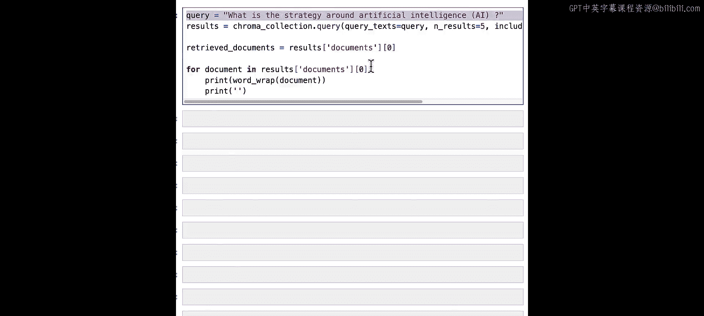

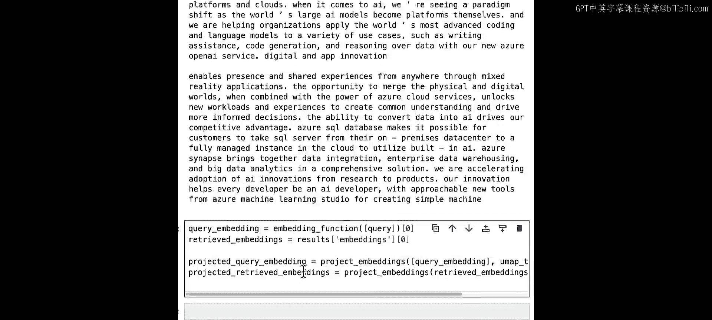

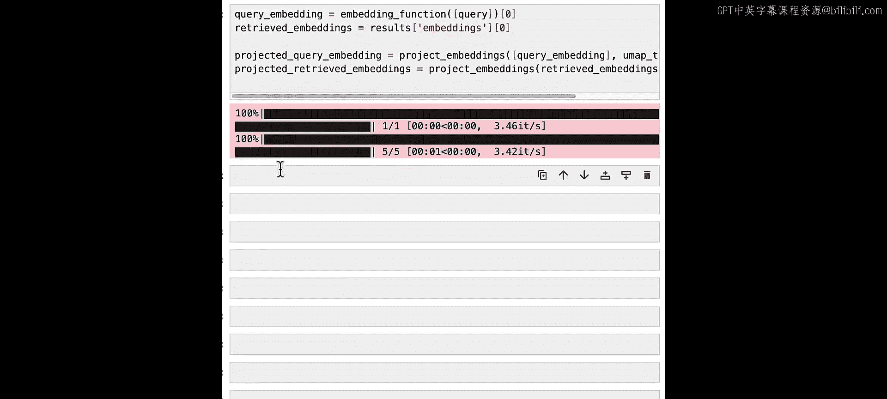

And then。We will plot。Take a look。 here's our query and our related results and they're all coming from the same part of the data。

 but you can see that some of the results that we got know and here this point appears to be bang on where our query landed So it's super super relevant So you can see that obviously where the query lands in the spaces geometric meaning and we're pulling in related results。

 but again what's related is from the general purpose embedding model not from the specific task that we're performing。

 So let's take a look at another query What has been the investment in research and development。

 This is a very general query and it should be reflected in the annual statement。

 so let's see what kind of documents we get back we see that we start with general ideas about investments。

 some of it is about research and development for example this document research development expense concluded a third-part development and programming costs。

 but we see that there are also distractors in this result so a distractor is a result that is not actually relevant to the query and it's called a distractor because if you pass this information to the large language model to complete your rag loop。

 the model tends to get distracted。

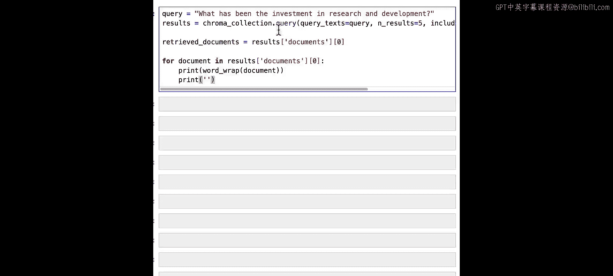

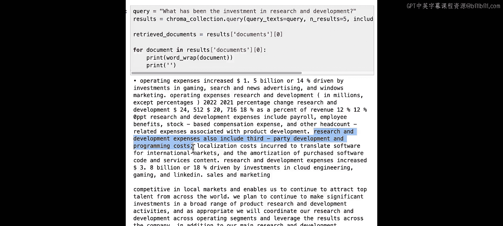

By this information and output suboptimal results and the reason this is really important is that bad behavior from the model due to distractors is very difficult to diagnose and debug both for the user。

 but also for developers and engineers building these types of systems。

 so it's very important to make your retrieval system robust and return relevant results and no distracting results to the model。

So again， let's take a look at the projection。 I always find it very。

 very helpful to visualize And again， because this is a geometric type of data。

 I find visualization is a great way to develop intuitions。 So there's our projection。

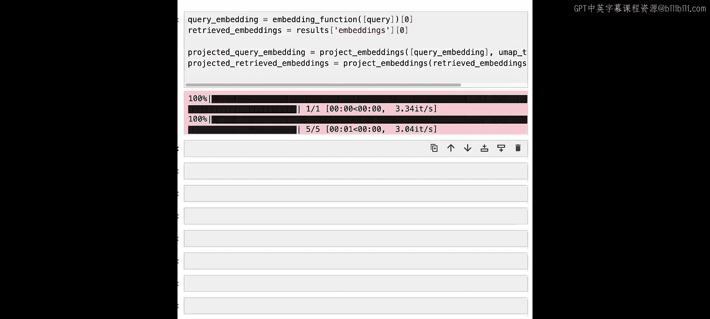

And let's plot it。So here we see the results that we're getting are a lot more spread out And the way you can imagine this is imagine all your data is a cloud of points sitting in this high dimensional space。

 A query that lands inside the cloud is likely to find nearest neighbors that are sort of densely packed and close together inside the cloud。

 But a query that lands outside the cloud is likely to find nearest neighbors from a lot of different parts of that cloud so they tend to be more spread out。

 It's a geometrical intuition。 So finally， I think it's really important to understand what happens when we put an irrelevant query into our retrieval system So let's find out what Michael Jordan has done for us lately in terms of the Microsoft annual report from 2022。

 Obviously I would be very surprised if this was an all irrelevant query and when we look at the results。

 of course， none of them have anything to do with Michael Jordan。

 This doesn't mention him at all and neither do any of these documents。

 neither do any of these results and that's what we should expect。

 But remember if we're using a retrieval system as part of a rag loop。

 you're guaranteed to return the nearest neighbors in this case your context。

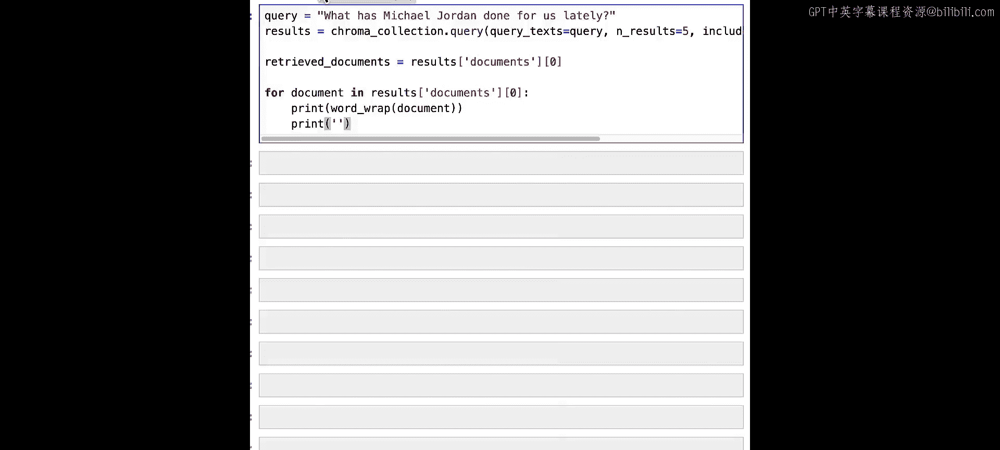

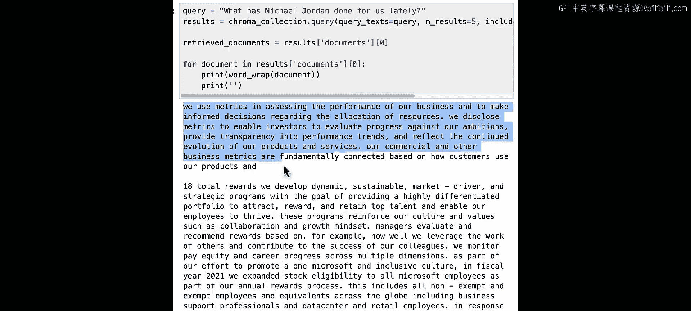

Window is going to be made up entirely of distractors， which as I mentioned earlier， can be very。

 very difficult to understand and debug from the application user's perspective and from the application developers' perspective。

 so we need a way to deal with irrelevant queries as well as irrelevant results and again。

 let's take a look at the projection let's see if there's something we can understand。

Great， we've projected。And let's put。

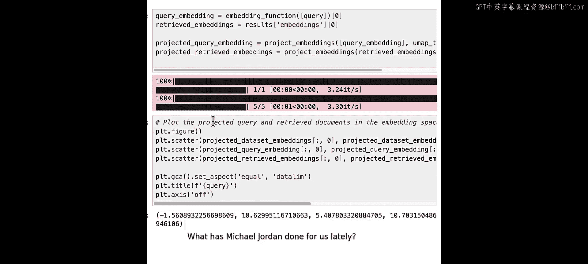

And you can see that the results about Michael Jordanan are really all over the place。

 which I guess shouldn't surprise us， given that the que is totally irrelevant to any of the data that we have in our data。

 Try visualizing some of your own queries in the way that we've done here and see how they influence the structure of the return results。

 see if you can get queries to land in different parts of the dataset and see what the return results say about the information that might be contained in that part of it in this lab you've learned how a simple embedding-based retrieval system might return distracting or irrelevant results even for simple queries and you've learned how to visualize this data so you can gain some intuition about why and how the results are being returned in the next lab will show you some techniques to basically improve the quality of your queries using LLMs by using a technique called query expansion。

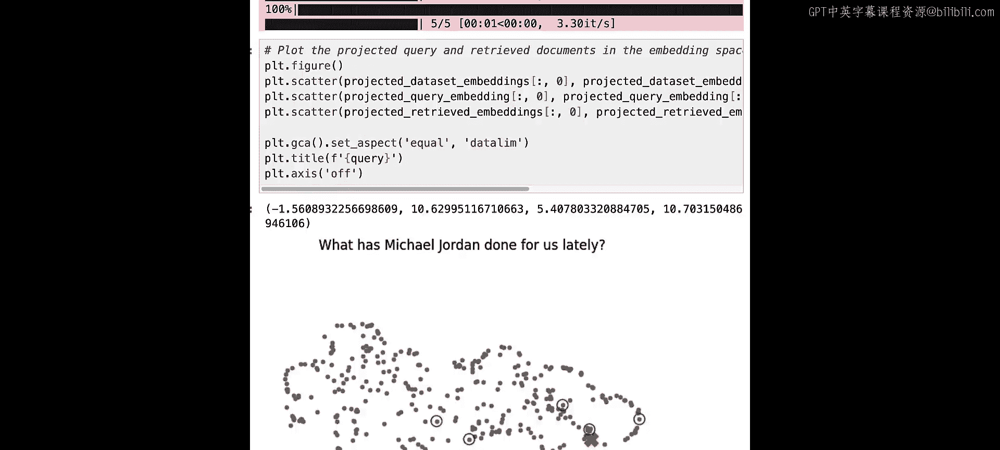