# 吴恩达《AI高级检索：Chroma｜Advanced Retrieval for AI with Chroma》（中英字幕） - P4：Lab 3 - Query Expansion.zh - GPT中英字幕课程资源 - BV1Bw411372q

The field of information retrieval has been around for a while as a subfield of natural language processing and there's many approaches to improving the relevancy of query results。

 but what's new is we have powerful large language models and we can use those to augment and enhance the queries that we send to our effective- based retrieval system to get better results。

 Let's take a look。

So the first type of query expansion we're going to talk about is called expansion with generated answers。

 Typically the way that this works is you take your query and you pass it over to an LLM which you prompt to generate a hypothetical or imagined answer to your query and then you concatenate your query with the imagined answer and use that as the new query which you pass through your retrieval system or affect your database then you return your query results as normal。

 let's take a look at how this works in practice So the first thing that we're going to do is once again grab all the utilities that we need and we're going to load everything we need from Chrome and create our embedding function。

And we're going to set up our open AI client again because we'll be using the LLM。 And once again。

 to help with visualization， we're going to。Use UMap and project our data set so that that's all ready to go for us。

Now that we're done setting up。 Let's take a look at expansion with generated answers。

 and there's a reference here to the paper which demonstrates some of the empirical results that you can get by applying this method。

 So to do expansion with generated answers， we're going to use an LLM in this caseGPT。

 and just the same as last time we're going to prompt the model in a particular way。

 Let's create this function called a augmentment query generated and we're going to pass in a query。

 We're also going to pass in a model argument in this casetptT 3。5 turbo by default。

 and we're going to prompt the model and in the system prompt。

 we're going to say you're a helpful expert financial research system。

 provide an example answer to the given question that might be found in a document like an annual report。

 In other words， we're pretty much asking the model to hallucinate。

 but we're going to use that hallucination for something useful and in the user prompt we're just going to pass the query as the content。

 and then we'll do our usual unpacking of the response。Yeah。

And that defines how we're going to prompt our model， let's wire this together。

Here's our original query asking was there a significant turnover in the executive team。

 we will generate a hypothetical answer， and then we'll create our joint query。

 which is basically the original query prepending the hypothetical answer。

And let's take a look at what this actually looks like after we generate it So here we see the output。

 we see our original query was there significant turnover in the executive team and a hypothetical answer in the past fiscal year there was no significant turnover in the executive team。

 the core members of the executive team may not changed etc。

 So let's send this query plus the hypothetical response to our retrieval system as a query and we'll query the Chme collection usually way。

And print out our results。And we're sending the joint query as the query to our retrieval system。

 and we're attrieving the documents and the embeddings again。

 So these are the documents that we get back。 we see things here discussing leadership。

 We see how consultants and directors work together Here we have sort of an overview of the different directors that we had in Microsoft and we talk about the different board committees。

 Let's visualize this。 Let's see what sort of difference this made。 So to do that。

 we get our retrieved embeddings。 We get the embedding for our original query we get the embedding for our joint query。

 and then we project all three and plotting the projection。

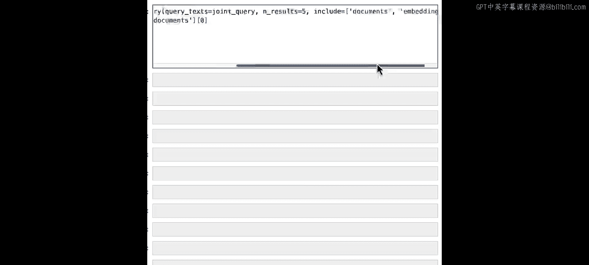

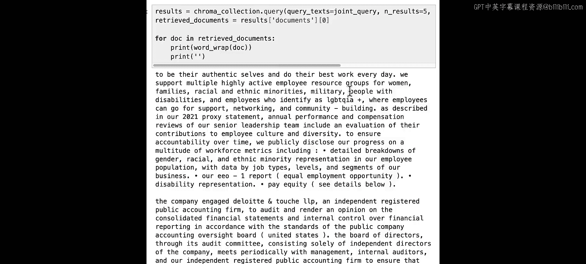

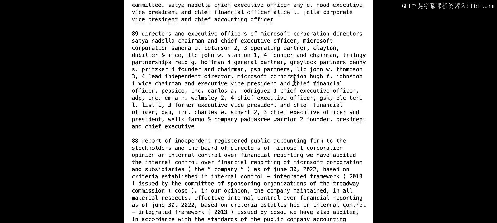

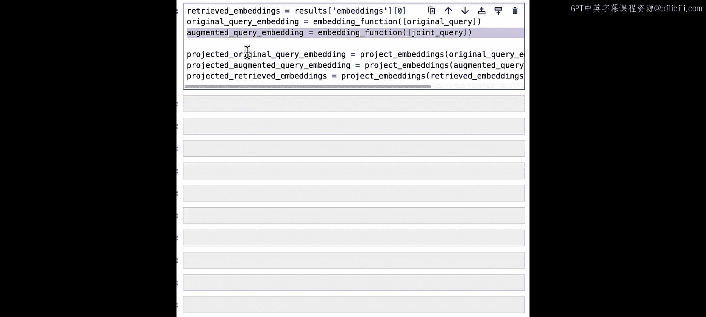

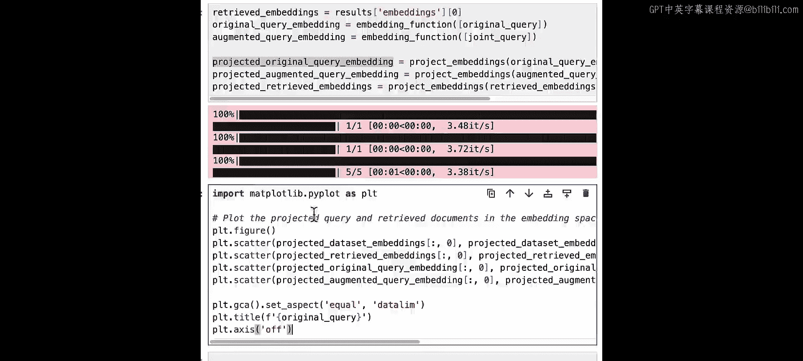

And we see the redx is our original query。 The Rx is our new query with the hypothetical answer。

 and we see that we get this nice cluster of results。 And but most importantly。

 what I want to illustrate here is that using the hypothetical answer moves our query elsewhere in space。

 hopefully producing better results for us。 So that was query expansion with generated queries。

 But there's another type of query expansion we can also try。

 this is called query expansion with multiple queries。

 And the way that you use this is to use the LLM to generate additional queries that might help answering the question。

 So what you do here is you take your original query。 you pass it to the LLM。

 you ask the LLM to generate several new related queries to the same original query。

 and then you pass those new queries along with your original  query to the vector database or your retrieval system。

 that gives you results for the original and the new queries and then you pass all of those results to the LLM to complete the RAg loop。

 So let's take a look at how this works in practice。 Once again。

 the starting point is a prompt in the model。 and we see here that we have a system prompt and the system prompt is a bit more detailed this time。

We take in a query which is our original query， and we ask the model。

 It's a helpful expert financial research assistant。

 The users are asking questions about an annual report。

 so this gives the model enough context to know what sorts of queries to generate。

 and then you say suggest up to five additional related questions to help them find the information they need for the provided questions。

 suggest only short questions without compound sentences and this to make sure that we get simple queries。

 suggest a variety of questions that cover different aspects of the topic and this is very important because there are many ways to rephrase the same  query。

 but what we're actually asking for is different but related queries and finally we want to make sure that there are complete questions。

They're related to the original question， and we ask some formatting output。

 One important thing to understand about these techniques in particular that bring an LLM into the loop of retrieval is prompt engineering becomes a concern。

 It's something that you have to think about And I really recommend that you as a student play with these prompts once you have a chance to try the lab see how they may change see what different types of queries you can get the models to generate。

 try different models and basically experiment not just with the retrieval system。

 but with the prompts you're using to augment your queries。 So let's define this function。

 And let's see what we get when we actually try this。 So here's our original query。

What were the most important factors that contributed to increases in revenue。

 so this this is a compound query there could be many。

 many different factors and it's not just about revenue and let's see what augmented queries we get back last the model。

And let's print a set of augmented ques as output。Great， so we got a few back。

 And we see that what were the most important factors that contributed to decreases in revenue。

 Great question。 What were the sources of revenue also very important。

 How were sales and revenue distributed across the different product lines。

 We there any changes in pricing strategy。 did the company acquire any new customers。

 you can see that these are related questions to our original  query。

 but they're not precisely the same and they have different meanings。

 That's very very useful and that's a great illustration of augmenting an original query through query expansion with multiple queries。

 So let's see how this works in practice。 once we pass these queries to our retrieval system。

 So first， we build off set of queries。 Now， Chroma can handle multiple queries in parallel。

 So what we're doing here is taking our original query in an array and then concatenating that with our array of augmented queries。

 So now we have one array where each entry is a query our original query plus the augmented queries。

 and we can grab the results。 And again， Chroma can do  querying and batches。

 and let's look at the retrieved documents that we get。

 And one thing that's important here is because the queries are related。

 you might get the same document retrieve for more than one queries。 So what we need to do is。

Duplicate the retrieve documents and that's what we do here。 And finally。

 let's just output the documents that we get。

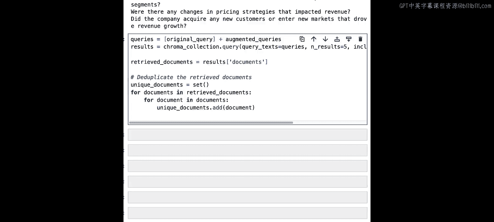

So we can see now the documents that we get for each query， and these are all to do with revenue。

 different aspects of revenue growth， which is exactly what we were hoping for。

 We have increases in Windows revenue。 We can see things that are coming from other components。

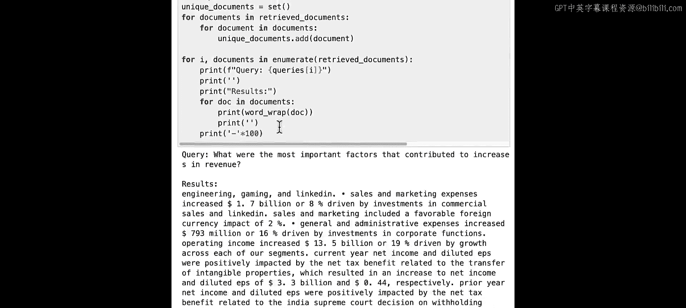

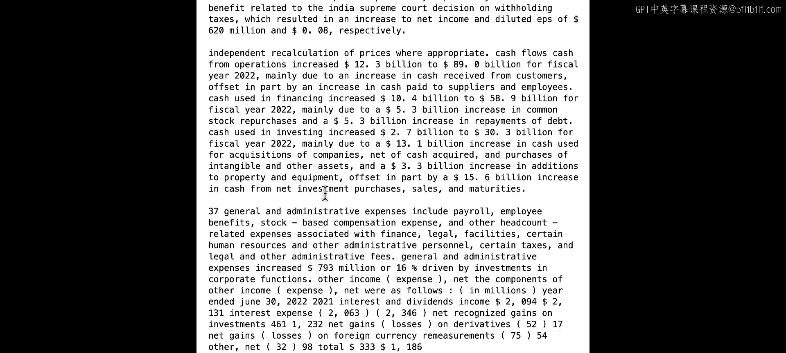

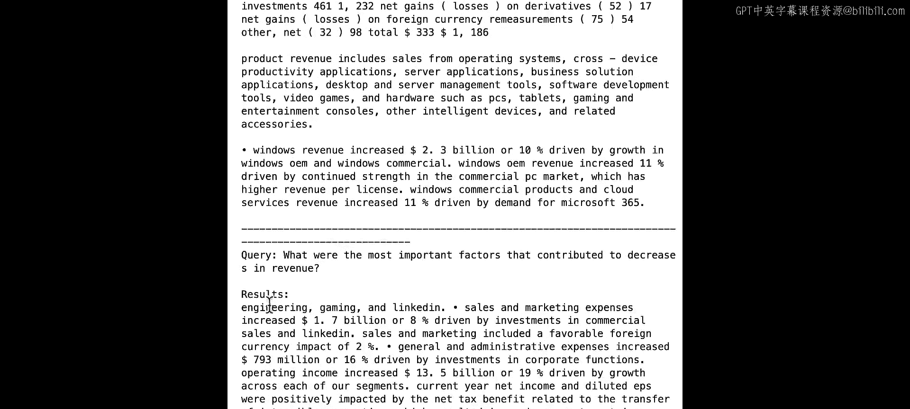

So for example， what were the most important factors that contributed to decreases in revenues that we see increased sales and marketing expenses。

 different types of investments， different types of tax breaks。

 essentially each of these augmented queries are providing us with a slightly different set of results and let's visualize that What did we actually get in geometric space in response to these results So again。

 we'll take our original query embedding and our augmented query embeddings and project them and the next thing we'll do is project our result embeddings before we do that we need to flatten the list because we have a list of embeddings per query。

 we just want the flat list of in returned embeddings， and then we just project them as before。

 and then let's visualize what we got and we see that using query expansion we were able to actually hit other related parts of the data that our single original query may not have reached and this gives us more of a chance to find all of the related information。

 especially in the context of more complex queries which require more and different types of information to answer So here we see that the redx is our original query。

 the orangejectes are the augmented the new queries generated。

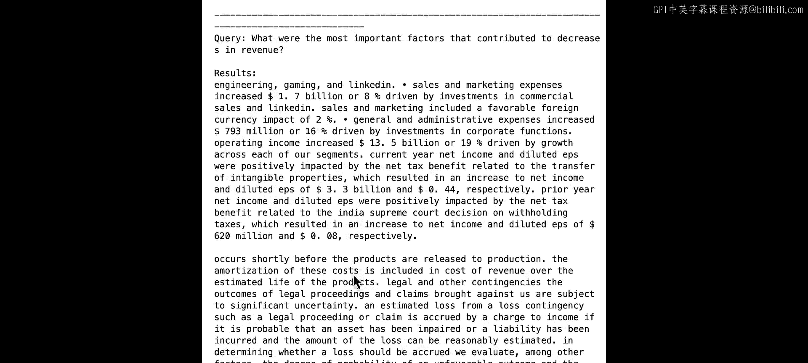

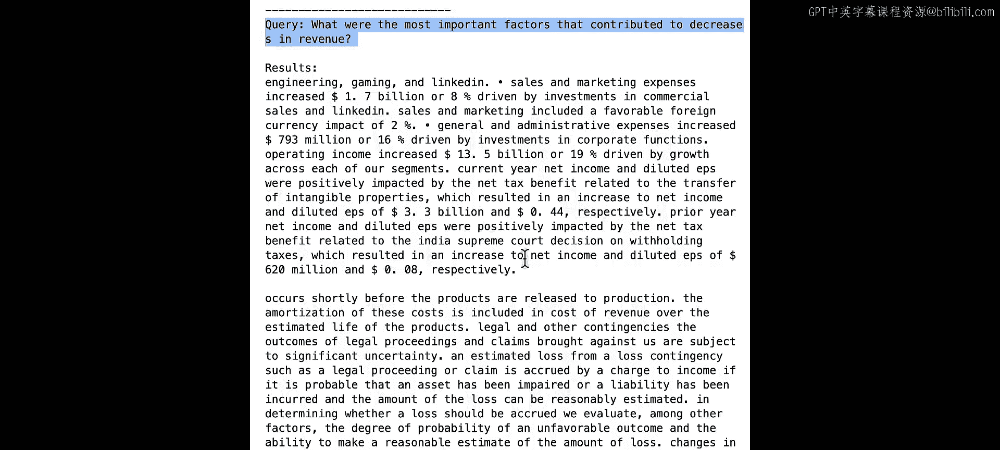

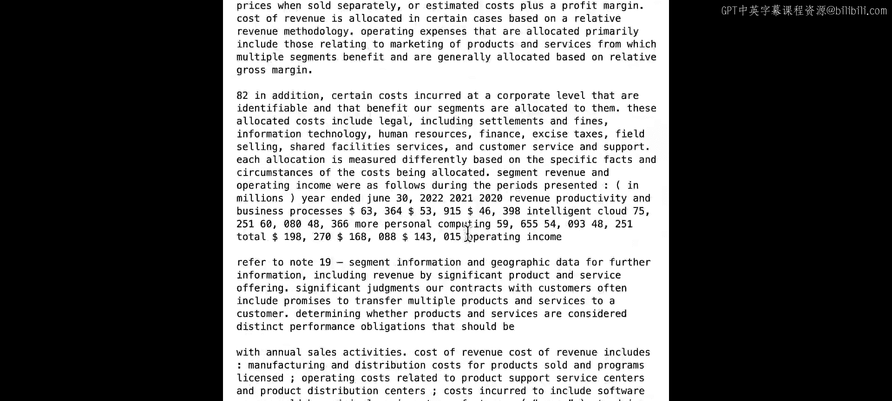

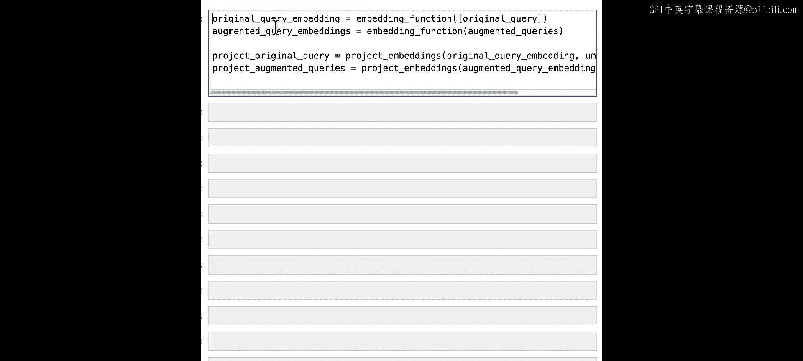

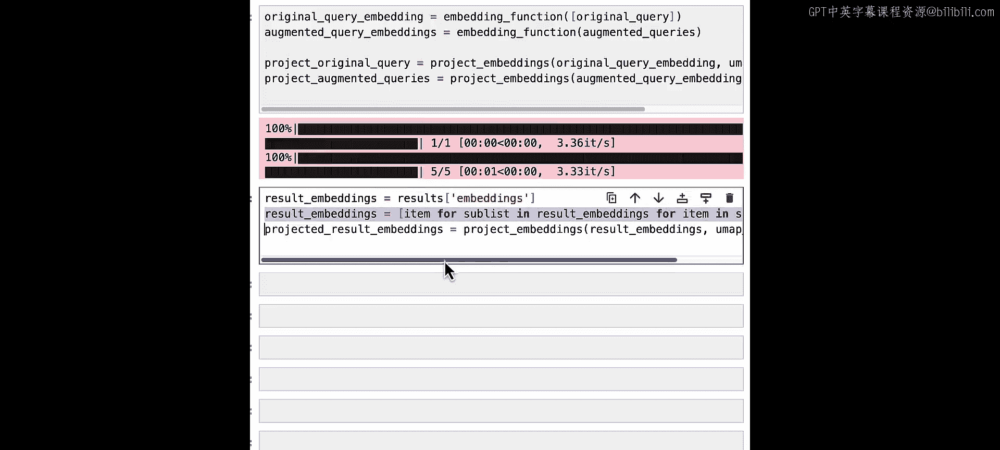

For us by the LLM and then once again the green circles represent the results that we actually return by the retrieval system to the model。

 One way to think about this is that a single query turns into a single point in embedding space and a single point in embedding space likely doesn't contain all of the information that you need to answer a more complex query like this one so using this form of query expansion where we generate multiple related queries using an LLM gives us a better chance of capturing all of the related information and the downside of this of course。

 is now we have a lot more results than we had originally and we're not sure if and which of these results are actually relevant to our query in the next lab using crossencor reranking we have a technique that allows us to actually score the relevancy of all the return results and use only the ones we feel match our original query and I'll demonstrate that in the next lab in this lab I recommend that you try playing around with the query expansion prompts try your own queries and see the types of results you get by asking different types of questions about the Microsoft An report。

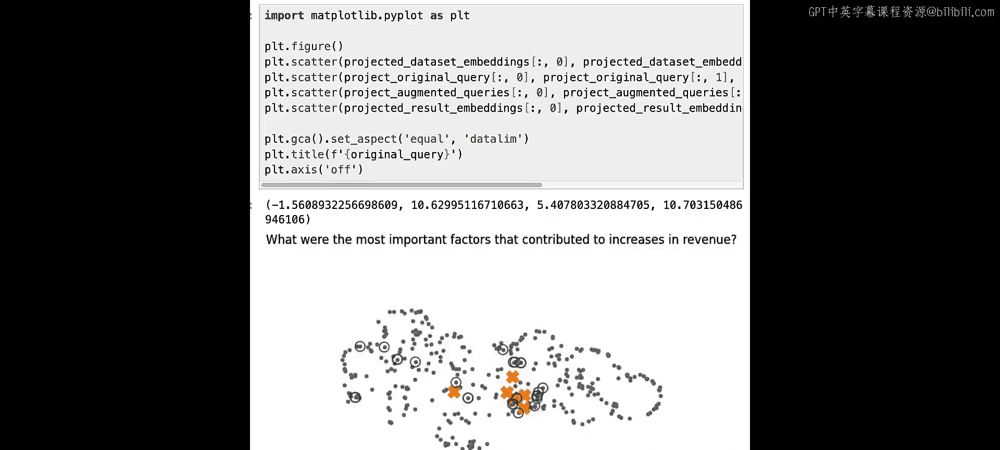