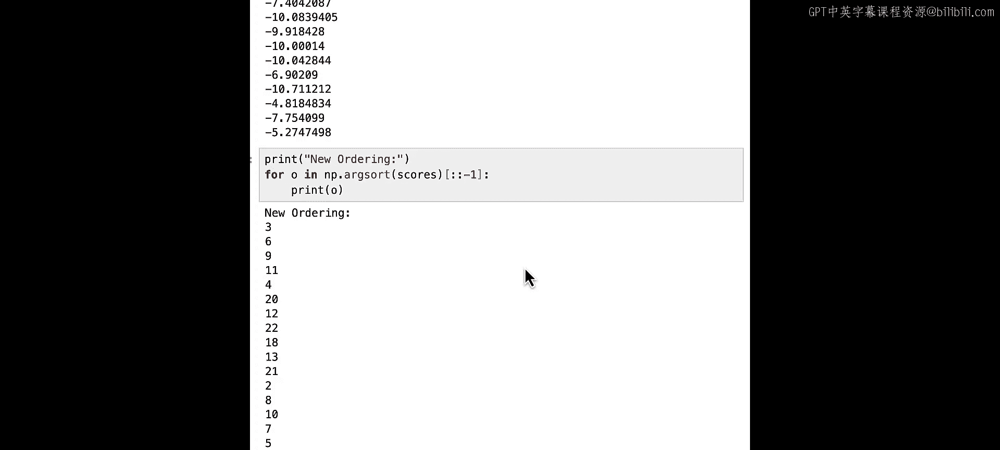

# 吴恩达《AI高级检索：Chroma｜Advanced Retrieval for AI with Chroma》（中英字幕） - P5：Lab 4 - Cross-encoder re-ranking.zh - GPT中英字幕课程资源 - BV1Bw411372q

In the last lesson， we looked at how to improve retrieval results by augmenting the query we send with an LLM In this lesson。

 we're going to use a technique called cross encoder reranking to score the relevancy of our retrieved results for the query that we sent。

 Let's dig in。

Reranking is a way to order results and score them according to their relevancy to a particular query。

 So let's take a look at how this works underneath in reranking after you retrieve results for a particular query。

 you pass these results along with your query to a reranking model。

 This allows you to rerank the output。 So the most relevant results have the highest rank。

 Another way to think about this is your reranking model scores each of the results conditioned on the query。

 and those with the highest score are the most relevant。

 then you can just select the top ranking results as the most relevant to your particular query。

 So let's take a look at how to do this in practice。First， we import our helper functions as before。

And we load the data into Chma。So one use of reranking is to get more information out of the long tail of query results。

 So let's take a look at this query that we've already covered once before。

 which is what has been the investment in research and development。

 and usually we've been asking for five results in return for our particular query。

 but now we're going to ask for 10。 That means we're going to get a longer tail of possibly useful results。

 And again， we're going to include documents and embeddings。

 And so let's retrieve the documents and take a look at what we get。

 We see that we get the same first five results as before because retrievals deterministic。

 but we also have five new results， which might have relevant information to our question。

 The trick is to figure out which of these results are actually relevant to our specific query instead of just being the nearest neighbors in embedding space and the way we do that is through using crossencoder reranking So we're going to use the sentence transformers crossencoder and we're going to instantiate it with a particular model。

So what is the crossencor model sentence transformers are made up of two kinds of models There' is something called a by encodeder where a by encoder encodes query separately。

 and then we can use the output of those by encoders to perform cosine similarity and find the nearest neighbors In contrast。

 a Bt cross encodecor takes both our query and our document and passes it through a classifier which outputs a score and in this way we can use our crossencor to score our retrieve results by passing our query and each retrieve document and scoring them using the crossencoder we can use the crossencor by passing in the original query and each one of the retrieve document and using the resulting score as a relevancy or ranking score for our retrieve results。

So we've instantiated our cross encodecor， and the first thing we're going to do is create pairs。

 the pairs consists of our query and each dock in our retrieved documents。

And we're just going to ask the cross encodecoder to score each pair， So let's print out our scores。

 And while we see that the first two documents have high scores for our query。

 we notice first of all that the second retrieved document is actually a much higher score than our first one and also some documents in the longer tail of retrieved results have higher scores than some of the documents in the first five。

 So what would that look like if we were to reorder our documents according to score。

 we see that the second document is now ranked first first document is ranked second。

 and something in the long tail actually makes them into the top five and in fact。

 the top five reranked results contain results that originally the sixth and seventh results while the fourth and fifth results are actually ranked quite low。

 So in this way we've used the crossencoder and the score that it produces to rerank our results。

 and now if we were to cut to this top five we would see that the results should be much more relevant than what we had before because we've mined more of the long tail for information that's actually relevant to our question Now you might already be see where I'm going with this。

ButGiven the number of results that we get with query expansion and the way in which each generated query addresses a different part of the complex question。

 we can use the cross encoderor rerannker technique to actually get all of the best results for the original query from the augmented expanded queries instead of just sending all of them to the LLM and here's how we do that so from the previous lab this is just our original  query and the generated queries and I've saved them into text here for you。

 and then we do the same thing we concatenate the original generated queries together。

And we retrieve results， and then as last time we deuplicate the retrieve results。嗯。

And now we create pairs just as we did in the previous example。

 where we make pairs of the original query and each retrieved document in this way we can compute the relevancy of the retrieved results for the augmented queries to the original  query and select among them the five best that we actually want to pass to the LLM。

 so let's create those pairs and let's score them。And one great thing about using a crossencoder model like this one is it's extremely lightweight and runs completely locally。

 So here are the scores of role of our retrieved results and we can use these scores to order our results and give us a new ordering and then we can pass the top five of this new results to the LLM and get the most relevant information from this long tail of queries that we got through query expansion and the retrieve results for our augmented queries So in this lab we learn how to use a crossencoder as a reranking model and we've seen how we can apply reranking both to get more out of the long tail of a single query as well as to filter the results of an augmented expanded query to only the results relevant to the original query itself This is a really powerful technique and worth experimenting with some more and it's a good idea to try to understand and get an intuition for how the reranking score might change depending on query even when the result that your retrieval system is giving you the same This is because the crossencoder re-raner can emphasize different parts of the query than the embedding model does and so the ranking that it provides。

I much more conditional on the specific query than just what is naively returned by the retrieval system itself In the next lab we'll talk about query adapters query adapters are a way to directly alter or augment the query embedding itself using user feedback or other types of data to get better query results。

