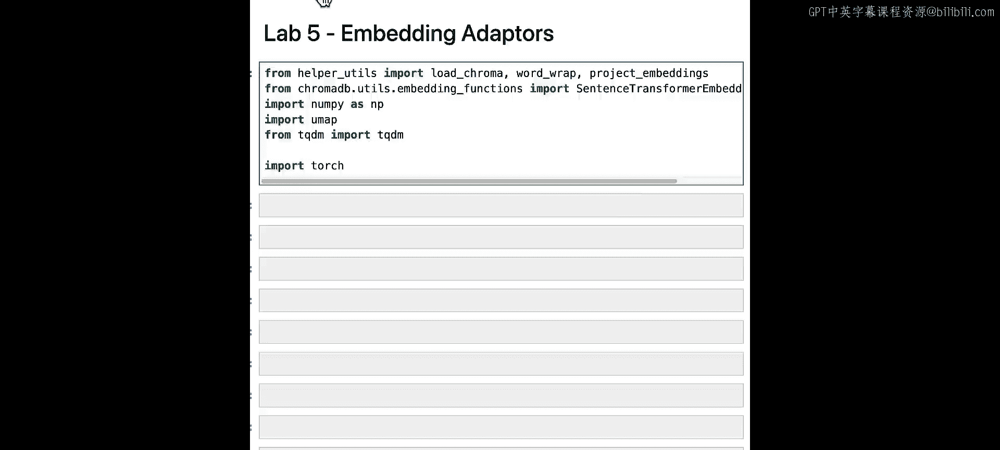
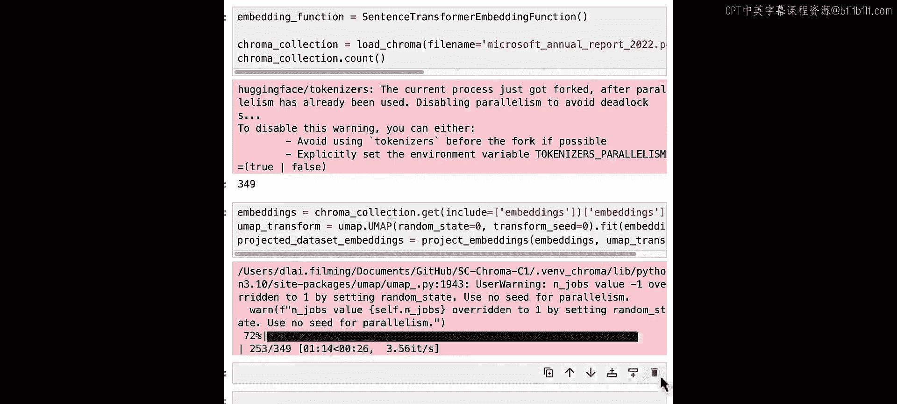
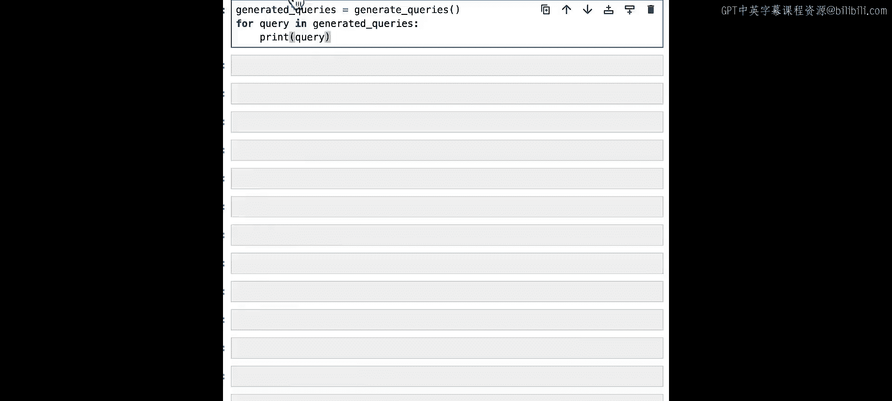
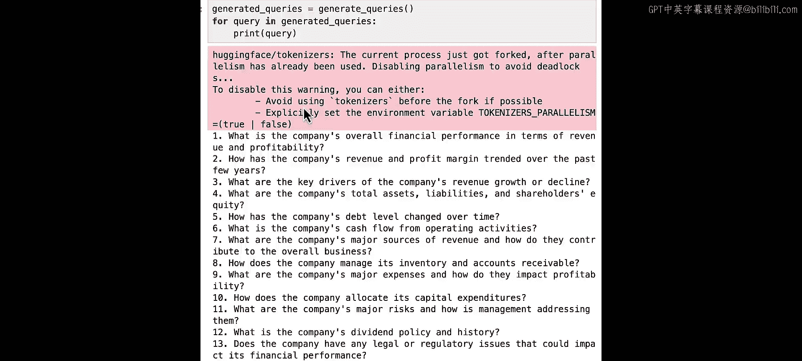
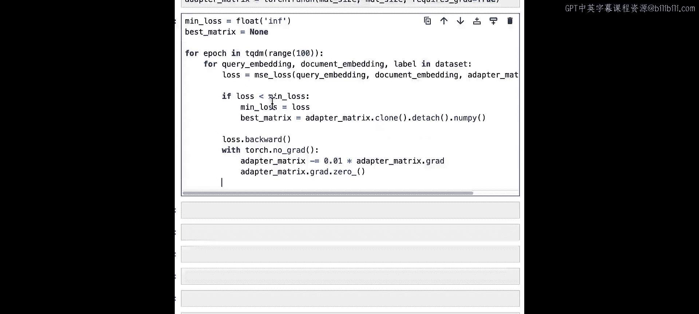
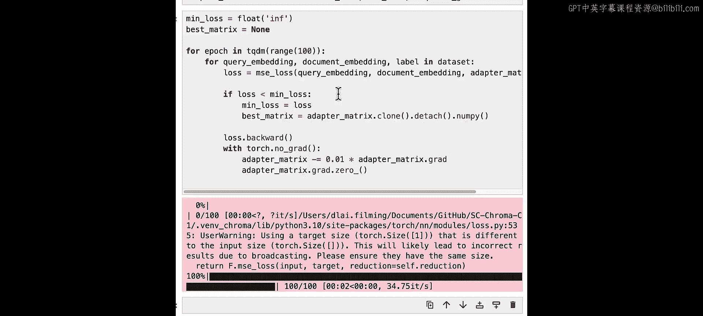
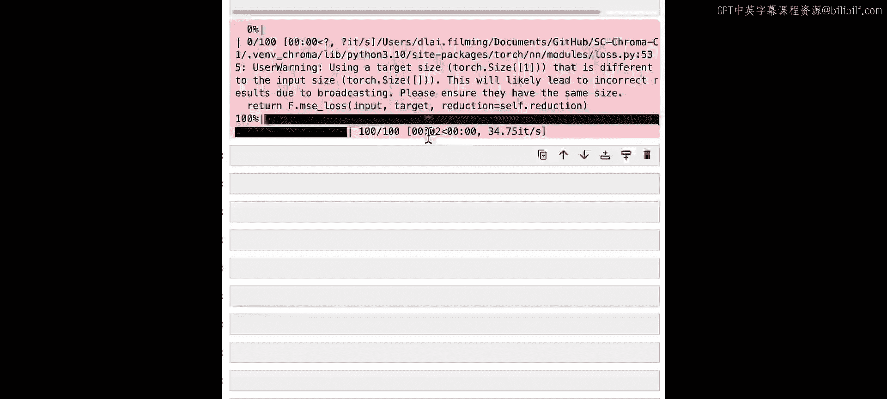
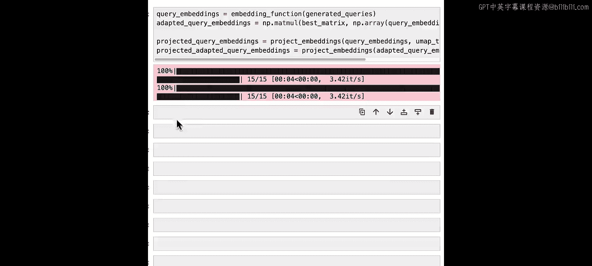
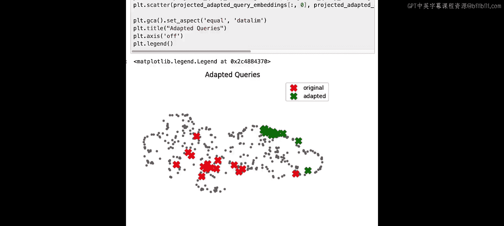

# 吴恩达《AI高级检索：Chroma｜Advanced Retrieval for AI with Chroma》（中英字幕） - P6：Lab 5 - Embedding Adaptors.zh - GPT中英字幕课程资源 - BV1Bw411372q

In the last couple of lessons， we've looked at how we can use query augmentation and cross encode coder reranking to improve retrieval results In this lesson I'm going to show you how we can use user feedback about the relevancy of retrieved results to automatically improve the performance of the retrieval system using a technique called embedding adapters。

Let me show you how it works。 embedding adapters are a way to alter the embedding of a query directly in order to produce better retrieval results。

 In effect， we insert an additional stage in the retrieval system， quo an embedding adapter。

 which happens after the embedding model。 But before we retrieve the most relevant results。

 we train the embedding adapter using user feedback on the relevancy of our retrieve results for a set of queries。

 let's get into it。 So the first thing we do is grab our hardware functions as before。

One special thing here is we're going to need torch because we're going to effectively train a model but a very lightweight one。

 and we create our embedding function and load everything into Chmo and again we project all of our data。

So the first thing we need for this approach is a data。

 we don't have one ready because we haven't really had users using our RAG application。

 but we can use a model to generate a data set for us and once again this is all about creating right prompt so we're going to use GT again and essentially were prompting the model as an expert。

 helpful financial research assistant and it should suggest 10 to 15 short questions that are important to ask when analyzing an annual report and with some guidelines about what the output should be like and this will generate some queries that users might actually have run against our system。

So let's ask him to generate those queries， and we see that these are fairly reasonable questions to ask about any company's financial statements。

So we're going to get the results from Chrome and what we're going to do and we'll get the retrieved documents associated with the results。

 and what we're going to do is also ask the model to evaluate the results in a real Rag system。

 you can easily ask our users to give a thumbs up or thumbs down on the generated output and then reference that with the retrieved results to give a signal about what results were actually relevant and which weren't in this case we don't quite have that。

 but we can use a model to evaluate the relevancy of the retrieved results for each query。 And again。

 this is just about prompting the model。 So we're going to ask our helpful expert financial assistant to tell us whether a given statement is relevant to the given query and we're going to ask it to output only yes or no。

 and then we are going to essentially transform yeses to once and notice to negative ones。

 and I'll explain why in just a minute that's the prompt。

 and then what we're going to do is we are going to get our retrieved embeddings and our query embeddings and we're going to start making a data set to train our embedding adapter And the way we're going to do it is like this。

 We're going have our adapter query embeddings， adapter doc embeddings and our adapter labels Now the adapter。

Prefix just means we're going to use this in a dataset。re they're not special in any way。

 they're just the embeddings of our queries and the embeddings of our documents。

 The labels we're going to get from our evaluation model。

 the label is going to be plus1 or minus1 depending on whether the document is relevant or not to the given query so we're just going to loop over everything to create these triples So the models is performing an evaluation for us Now it's no mistake that our labels are plus1 and minus1 because what we're going to do when we're training our embedding adapter model is use these values as our loss function for cosine distance when two vectors are identical the cosine similarity between them is one when two vectors are opposite。

 the cosine similarity between them is negative one In other words。

 we want relevant results to point in the same direction as vectors and we want irrelevant results to point in the opposite direction from a given query and this is the model that we're going to train That's exactly what it's going to try to do。

All right， and let's check out the length of our data。Great， 150。

 so that's 15 queries with 10 results each with each one labeled for relevancy。

So the next thing we need to do because we're using torch to train our embedding adapter is we need to transform our data into a torch tensor data set。

So we're just going to do some data manipulation here to transform these into torch tensor types and finally we're going to pack everything into a torch data set。

So let's set up our embedding adapter model。 The first thing is to set up the model itself。

 and the model is fairly straightforward。 It takes as input， a queryium embedding。

 a document embedding and an adapter matrix。 we compute。

An updated query embedding by multiplying our original query embedding by the adapter matrix。

 and then we compute the cosine similarity between our updated query embedding and our document embedding。

 Next， let's define our loss function。 again， our loss takes a query embedding document embetting。

 adapter matrix and label and we run the model to compute the cosine similarity and we compute the mean squared error between the cosine similarity and the label and you'll notice again that the plus1 label means that the cosine similarity says that the vectors are pointing in the same direction and a negative one label means they should be pointing in the opposite direction。

 In this way， we want our queries to be pointing in the same direction as relevant documents and in the opposite direction to irrelevant documents。

 and this is what we're training our adapter matrix to do。

 We initialize our adapter matrix for training。 You might recognize this is very similar to a linear layer in a traditional neural network and that's really all we're doing。

Next， let's set up our training loop， we set our minimum loss and our best matrix as things to keep track of。

 let's train for 100 epochs for each query embedding。

 document embedding and label in our torque data set。

 we compute our loss if the loss that we computed is better than our previous loss。

 we will keep track of that as the best matrix so far。And then we backrock it。

And let's run our training loop。

And you can see it's very， very fast because again this is exactly the same thing as if we were training a single linear layer of a traditional neural network。

 so let's take a look at the best loss that we got。 This is pretty good， a loss of 0。

5 is pretty good。 It means we've got pretty much a halfway improvement in terms of where we started from So one thing we'd like to take a look at is how the adapter matrix influences our query vector to do that we can construct a test vector consisting of all ones and we can multiply that test vector by our best matrix and what this will tell us is which dimensions of our vectors get scaled by what amount you can think of an embedding adapter as stretching space and squeezing space for the dimensions which are most relevant to the particular queries that we have while reducing the dimensions that are not relevant to our query you'll also notice that it can reverse dimensions So let's plot what that looks like And here you can see how each dimension of our test vector which consists only of ones has been stretched and squeezed Some have been elongated a lot while others have been made to be almost zero and so what this means。

As our embedding adapter has basically decided okay these dimensions are more relevant。

 these are less relevant， these are actually opposite to the things that we want to find and these things are actually more relevant to the things that we want to find and let's take a look at what effect this actually has on our queries so let's do as we did before we'll take our generate queries and embed them and let's compute our also our adapted query embeddings and then we project them。

And let's plot what we get against our data set。

。And as you can see， our original queries are quite scattered around。

 but our new queries concentrate in a certain part of the dataset。

 which is most relevant to our queries。 you can see how the red queries have been adapted through the embedding adapter to transform them into the green queries to push them into particular part of the space So as you can see an embedding adapter is a simple but powerful technique for customizing query embeddings to your specific application in order to make this work。

 you need to collect a data， either a synthetic one like the one we've generated here or else one that's based on user data Use data usually works best because it actually means that people are using your retrieval system for their specific tasks again。

 because this approach involves prompting and because it involves the use of a large language model it's worth experimenting with the prompts and it's also worth experimenting with different initializations of the adapter matrix even maybe consider using a full lightweight neural network and training that instead of a simple matrix instead you might want to tune the hyperparas of the embedding adapter trading process or you might want to collect more specific data and try this out with a specific。

appplication in mind rather than our very general one of trying to understand a financial statement in the next lesson。

 we'll cover some other techniques which are just now emerging from research to improve embedding based retrieval systems。

