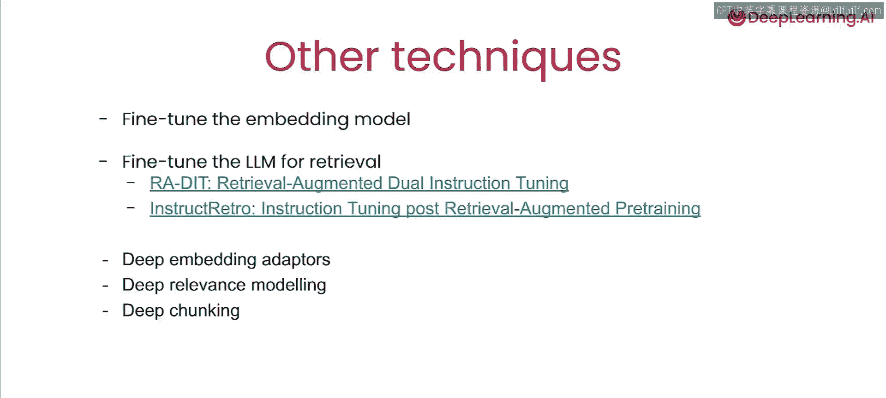
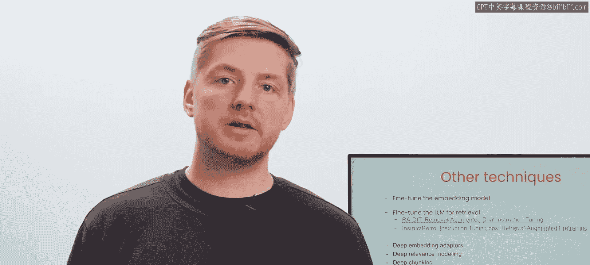

# 吴恩达《AI高级检索：Chroma｜Advanced Retrieval for AI with Chroma》（中英字幕） - P7：L6_Other Techniques.zh - GPT中英字幕课程资源 - BV1Bw411372q

Ebedding based retrieval is still a very active area of research。

 and there's a lot of other techniques that you should be aware of。For example。

 you can fine tune the embedding model directly using the same type of data as we used in the embeddings adapters lab。

 Additionally，  recently， there's been some really good results published in fine tuning the LLM itself to expect retrieve results and reason about them。

 You can see some of the papers highlighted here。 Additionally。

 you could experiment with a more complicated embedding adapter model using a full blownown neural network or even a transformer layer。

 Similarlyly， you can use a more complex relevance modeling model rather than just using the crossencoder as we described in the lab。

 And finally， and often overlooked piece is that the quality of retrieve results often depends on the way that your data is chunked before it's stored in the retrieval system itself。

 There's a lot of experimentation going on right now。

 about using deep models including transformers for optimal and intelligent chunking and that wraps up the course。

 In this course， we covered the basics of retrieval augmented generation using embedding space retrieval。

We looked at how we can use LLMs to augment and enhance our queries to produce better retrieval results。

We looked at how we can use a cross encoder model for reranking to score the retrieve results for relevancy。

And we looked at how we can train an embedding adapter using data from human feedback about relevancy to improve our query results。

Finally， we covered some of the most exciting work that's ongoing right now in the research literature around improving retrieval for AI applications。

 thanks for joining the course and we're really looking forward to seeing what you built。

