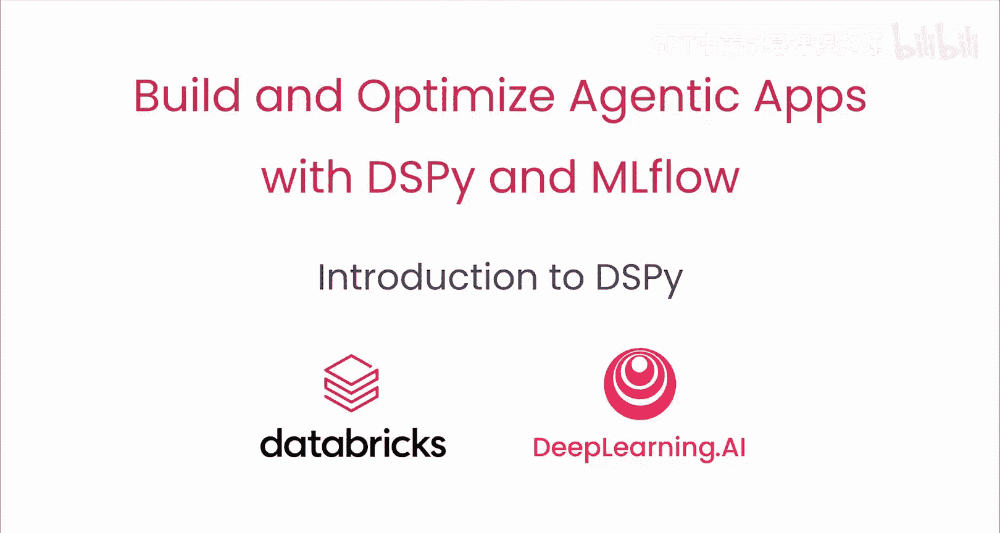
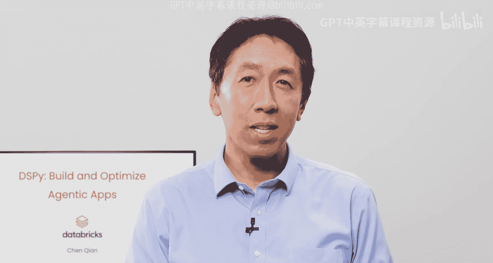
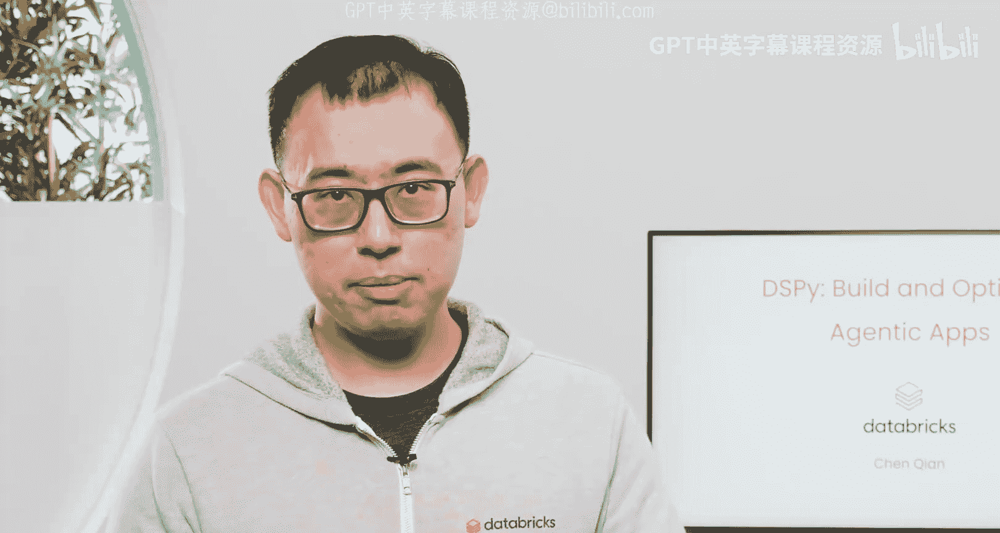
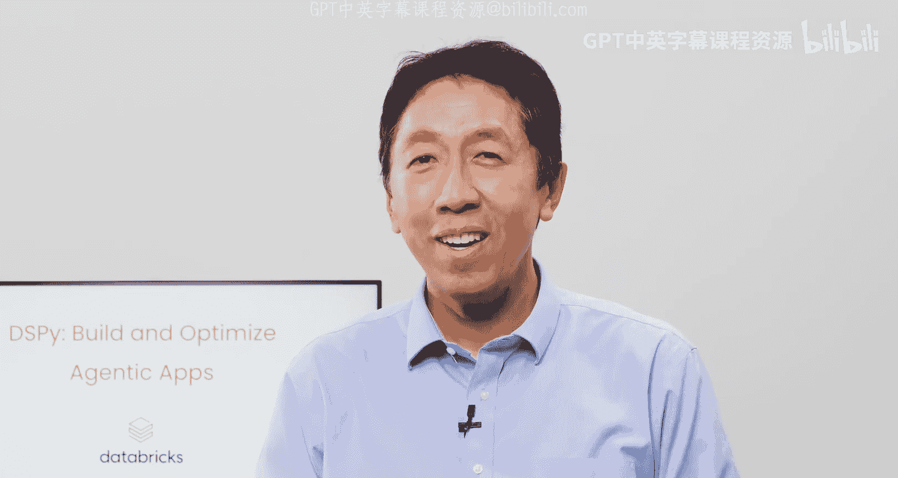
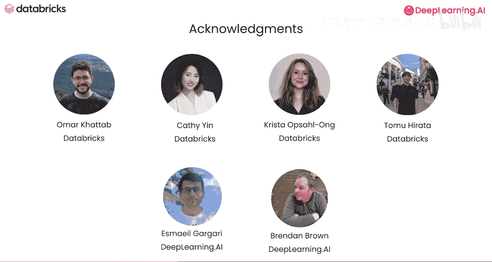

# 吴恩达《DSPy：构建与优化智能代理应用｜DSPy： Build and Optimize Agentic Apps》中英字幕 - P1：1.introduction.zh_en - GPT中英字幕课程资源 - BV16ATuzoE8o

Welcome to DSP，Build and Opize AT App built in partnership with Databricks。In this course。

 you learn how to build and optimize your JI application using DSP。

When you start building complexing your apps， one of the challenges is writing good prompts for NL。😊。

I' often try dozens of prompts， tweaking words， changing formats， hoping to get better results。

 but this process takes off all the time and the prompts often even break when you change the underlying O。

😊，D SP streamlines and authorizes this old process。

 you define what inputs your mobile needs and what outputs is your return。

 and also provide a data set of inputs and design outputs。

The SPI can then optimize your AI programs to get with a performance with much less manual work。

I'm delighted to introduce the instructor Zn Tian， who is a software engineer at Databricks and colleagues the development of DS SP。

😊，T Andrew， in this course， you will learn how to build AI programs with D Spi。

 E Spi has two main building blocks， signature and a module When you are trying to build a component of an application。

 specifying a signature tells a system where inputs and outputs to expect from the component。

 for example， a sentiment analysis program will have a stringax as an input。

 and an integer representing a sentiment as the output。

A module then uses those signatures to actually call a language model and get results Sometimes an app doesn't work。

 but we are not sure why in this course， you also learn to use aflow tracing to help you see exactly what's going on Each step of application What data was used what tools work up what the model return and where things broke with just one layer of code you can turn on these tracecing featuresure for your app When we use a DSsP is in optimizing agent workflow If you have a complexx workflow that takes an input and uses multiple steps of processing to generate the outputs may be using an Om on multiple Vceps then DSpi's optimizer can take your agent as well as an evaluation data sets and metric and based on that。

 automatically search for better prompts for all steps I sometimes though really high quality fu prompts of your data。

In a way that is far better than I as a human could likely have achieve a hand In this course。

 you use DsP's optimizeizer to optimize prompts in a rag app that answers Wikipedia questions Many people have worked to treat this course。

 I'd like to thank Omar Kat Kahi Yin Trister Ob salon at Tobo Hirata from Databs from Tbli Ash Gagari and Brendan Brown also contributed to this course。

 The first lesson will be an introduction to DP one surprising thing about DP is how few lies the Cols Inment and that it essentially autobe the prompt engineering process。

 Please go to the next video to see how this works。😊。

