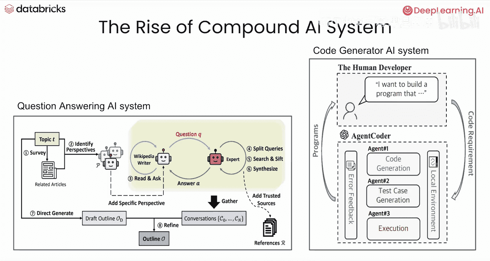
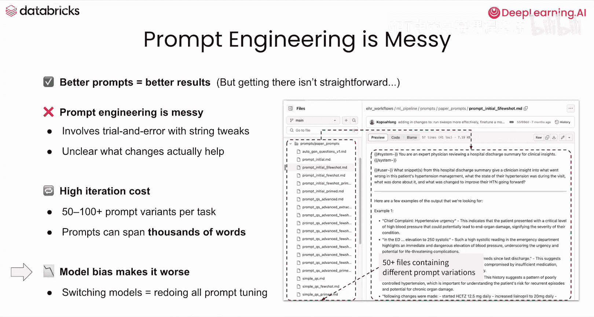
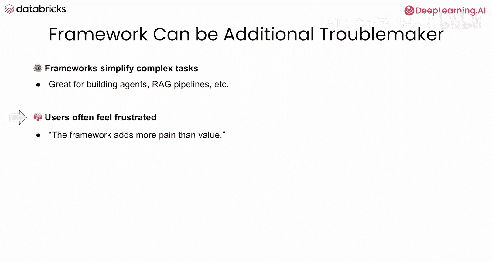
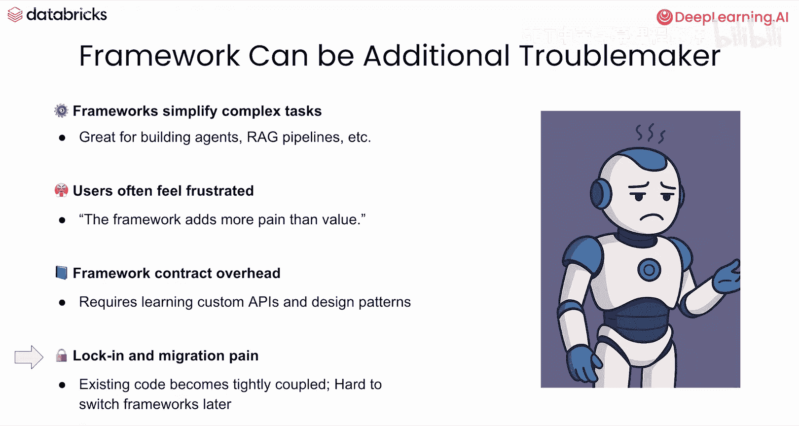
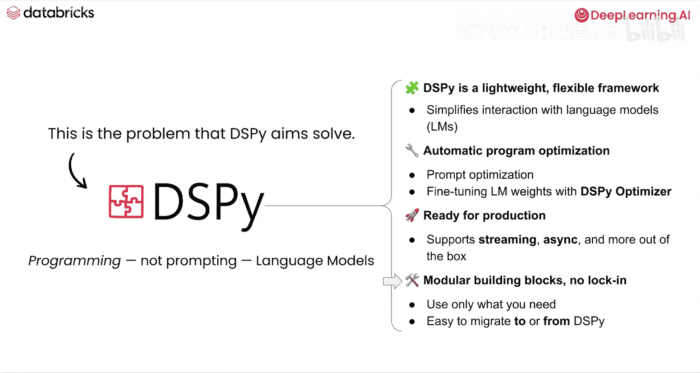
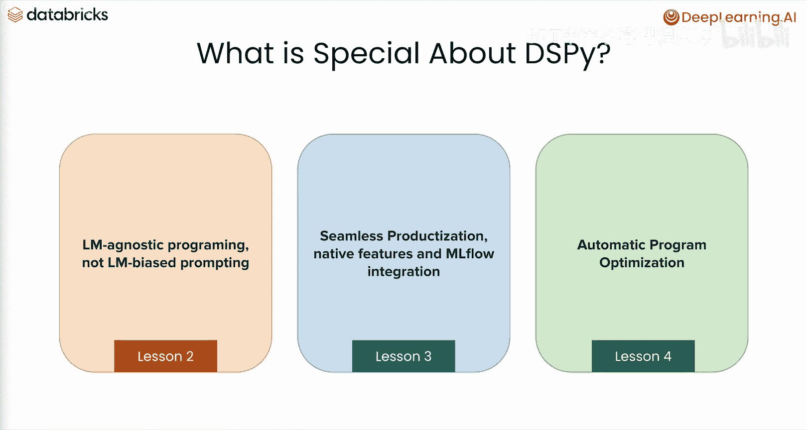
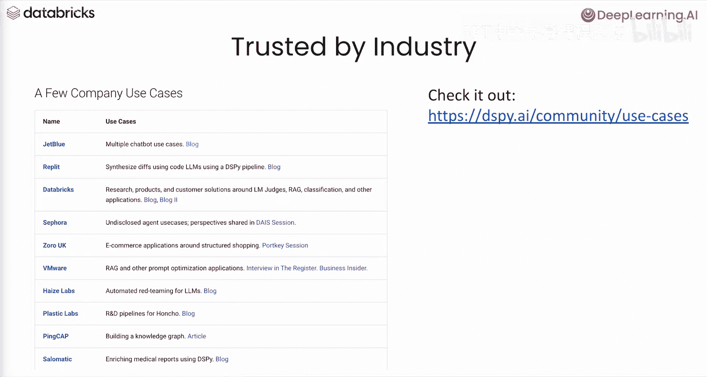

# 吴恩达《DSPy：构建与优化智能代理应用｜DSPy： Build and Optimize Agentic Apps》中英字幕 - P2：2.introduction-to-dspy.zh_en - GPT中英字幕课程资源 - BV16ATuzoE8o

In this lesson， you will learn about what DSP is and more importantly。

 what is special or DSP and why many developers are using DSP to build their G apps， less's divey。

 so what is DSP at a very high level DSP is in G authoring framework that simplifies the development of DNA applications。

You can use it to build a rug system to agent。 But as a user， I would ask this very natural question。

 are we reinventing the wheels， We already have so many options over there。 The answer is no。

 let's explore together。 Before we learn about the specialty of the Spi。

 Let's talk about the problems we are facing。 Since late 2022。 due to the success of Gena models。

 There came the rise of compound AI system。 Here you can see a question answering system。

 and also a cogen。😊，Compound AI system is a system that has multiple modules。

 Each module handles a subtask， which could make our on calls or could just be a regular to a calling combining all these modules together。

 we form a big and powerful AI system that can handle complex tasks like rettrival augmented generation or cogen as you see in the picture when building a compound AI system。

 we are all facing the problem from prompt engineering。

We do prompt engineering because we know that with a better prompt。

 well get a better result from the language model。But prompt engineering could be very messy because we are tweaking the strings and we don't really know what changes make an actual difference in practice。

 that usually means we end up iterating over 50，100 or even more prompts。

 and each prompt could be very long like tens of thousands of words。Making that even worse。

 if we switch a model， then we need to start over because prompt engineering is heavily biased towards the language model。

 As a summary， prompt engineering is both brittle and time consuming。

 The other problem comes from the framework itself。

 Fmeworks are very powerful because they simplify and standardize the experience of building things like agents or rack and so on。

But there have been more and more complaints that I don't like the user frameworks because instead of value。

 I'm seeing more trouble。

One very solid concern is that Im being forced to learn the framework contract。

 which sometimes means unnecessary overhead for me rather than keeping me focused on the logics。

 and it's really hard to migrate off the framework on existing code if I decide to switch over to another one。

To address both problems， there came the DS Spi。Now， let's answer the question。

 What is DS S pie again with more details。DSP is a flexible lightweight framework that simplifies the interaction with LM and provides automatic program optimization。

 including prompt optimization and LM weights5 20 through the DSP optimizer。

D Spi also provides seamless productization support， like streaming， async and so on。

 We provide you with the building blocks for A applications in DS Spi。

 but we don't restrict the way you build applications。

 It's both easy to migrate to DS Spi and migrate off DS Spi。

 We have three special things inside the S。 and the first one is our agnostic programming instead of our bias prompting。

Basically， instead of doing prompt engineering， DSpi interacts with LM by defining input fields and the output fields in DSpi context。

 you can shoot howM and point as a well engineered rest for API。

 but different from traditional APIpis。 the input and output are defined at the client side。

 Don't worry if this is not fully clear yet。 We will cover this right in the next lesson。

 The second part is seamless productization through both native BSpi features。

 Exing cache and also fill the close integration with mouthflow。

Mlflowlow is an ML and AIOs tool that streamlines end end development of AI applications。

 for example， helps debugging AI programs by MLflow Tracing。

 tracking development by MLflow experiments and deployed application with MLflow deployments where will learn more about it in lesson3。

And in lesson4， you will learn about automatic program optimization after you build your AI applications with DSpi。

 you can create a DSsP optimizer and apply it on your program and automatically get quality improvements。

 Dpi is trusted by industry。 We have many successful integration with lots of enterprise users。

 Please check it out more at DSspi or AI s community s use cases。

 That's all about this lesson In the next lesson you will learn how to build a DNA applications in DSspi。

 See you there。

