# 吴恩达《DSPy：构建与优化智能代理应用｜DSPy： Build and Optimize Agentic Apps》中英字幕 - P3：3.dspy-programming---signatures-and-modules.zh_en - GPT中英字幕课程资源 - BV16ATuzoE8o

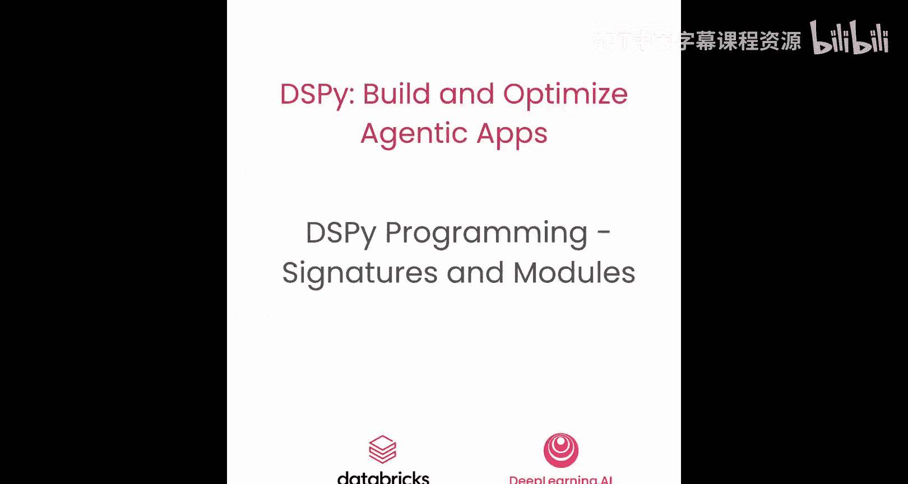

In this lesson， you will learn how to build your AI applications with DS S pie。

 Let's dive into the code。 This lesson comes with a lab。

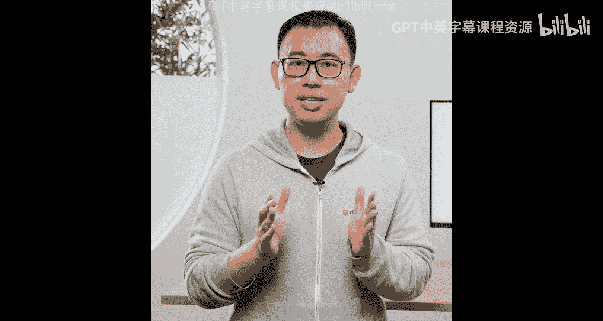

In the lab， you will learn DSP fundamentals by building a simple sentiment analysis program with DSP building modules。

 and you will also learn how to build a custom agent with DSpi with a demo of building the name the celebrity game is a very simple game where the player one thinks about celebrity name and player2 starts asking yes or no question until finding the name or use up all the question codes。

 DSP programming has two important abstractions Sign and module Sign is where you define the input and output contract of your IM cause and DSP module is interface of talking to the LM with custom logic。

 Let's look at them one by one As we're mentioning lessonson one that in DSP contacts interaction with IM is similar to calling a restful API that has a welldefined input and output format but this data format definition happens on client side instead。

Of the server side， like a normal rest for API。 The definition is through DSs P signature。

En sure language。Signature defines the input output fields。

 along with types and annotations After alarm interaction。

 there are two ways of defining a DSspi signature， class based signature and stream based signature。

 The first way is class based signature。 All you need to do is subplusing from DS padal signature。

 and mark input fields by DSpi or input field。 and output fields by DS pad output field。

 And optionally， you can provide type and annotation to each field。

 There are five important parts of a class based signature。😊。

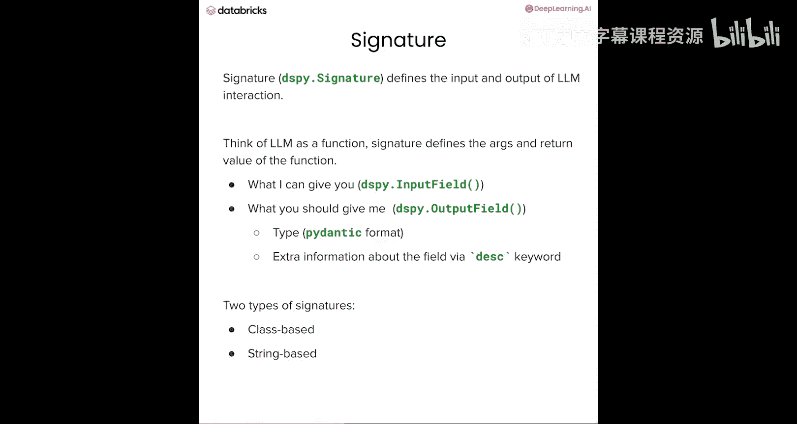

The red box， which is the doctrine of the signature class。

 is a signature instruction which defines the purpose of the IM call like a brief overview of your task。

 this usually only requires a few sentences， but if you already have an existing prompt and don't want to simplify。

 you can paste the whole prompt into the Do。The orange box is the field name。

 you will use this name to carry the input data and access the output data。

 the blue box simply tells a program if that's an input field or outputfil。

And the purple box carries actual information about the field。

 and it's useful when the field name is not selfexable。 Lastly。

 the green box carries the typing information， which could be an impitivey types or be any custom class orenting models。

 This is mostly useful for output fields。 If you specify the type when you access the output fields。

 the value will automatically be of the type you desire。

 DS Spi also supports a lighter way of signature definition Co based signature。

 you just write the input fields before the arrow and write output fields after the arrow and separate fields by comma。

 This is good for prototyping， but for general usage。

 we recommend go with the class based signature for flexibility and the more powerful support。

 Now we have defined input and output format。 but we still only have static information。

 and we need to define a way to utilize the signature。 to talk to the Lm。 that is the purpose of DS。

😊。

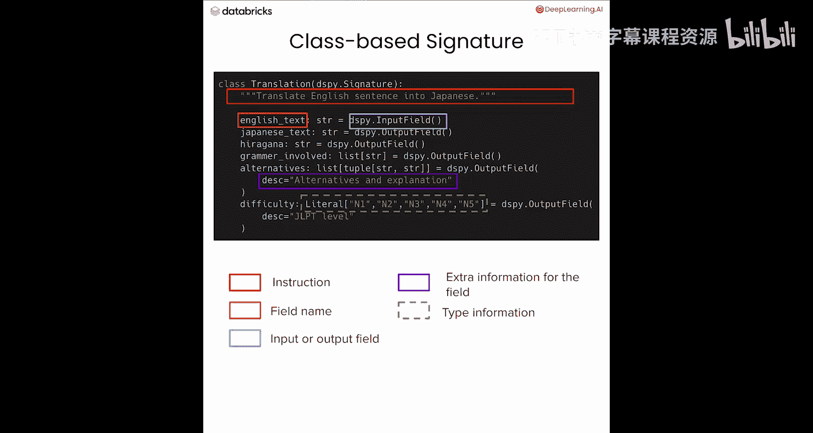

冇죠。Module is the minimal building block of a DSP program。

 and in most situations has signature attached。 the simplest module is DSP to predict。

 which formats a user query to El prompt and par element response according to the attached signature modules have configurable attributes aside from the signature for example。

 attribute demo carries a future examples。 DSpi modules can be customized for implementing custom logic and that module can consist of sub modules。

 DSpi provides a list of building modules that makes it easy for users to get started and the most important one is DSspi predict。

 which simply does L interaction and it is a building block for all the complex modules。

 channel thought is also commonly used。 A from the plan response and also ask for reasoning behind the answer。

 React stand for reasoning and act will be using the next lesson， which。

a common standard for building AI agents DSfi program of thought。

 similar to react but the tool calling is just a code and DSI refi With that users can set a rewardword function and threshold if the threshold exam mat which is issue re with all feedback that's a definition of DSI module Let's talk about usage right now to use the built modules。

 simply pass a signature to a building modules and invoke a building modules through input fields by settingting the keyword argument。

 for example， in a slide。 you create a channel after our instance which has a single input field called question Then when you invoke the module。

 you just pass the value into the question。 we have a complete list of built modules available in a documentation site please read out more there。

 But more commonly you have complex logic that cannot be fully covered by pre modules In those case。

 you need to write a custom module to define custom logic。 This is。

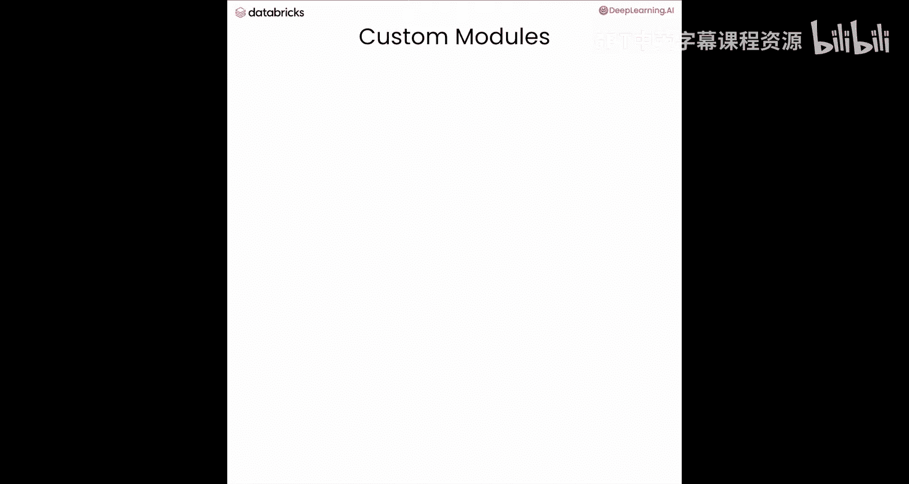

Similar to Pythtor， you subclass from the DSpa module class and implement the forward method with your customer logic。

 then you create a module instance， and instance is a callable， similar to preview modules。

 This is very flexible。 You can call any Python function within your any frameworks a Lachn or Lama index depth or any tools like S or file system handler。

 As long as that is the Python program。 you are allowed to put that in the forward method。

 That's a lot of contexts。 Let's do some coding to get a better sense of how this module signature system works。

 Let's get started with a coding。 So before we start When you set up the API key。

 And don't worry in this lab， we have set up the key for you。 Simply call our helper function。

 get opening an API key。 As set us as an environment variable than youre get to go。

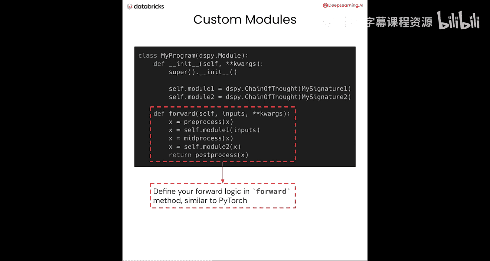

The first step of DS SI programming is choosing your RM in this lab， or I use the G4 mini。

And to change our simply change the string here， it is following a format of provider name followed by model name。

 provider name is like open AI Anthropic and model name is actual model name like GT4 mini or G40 Now let's start building a sentiment classifier to see how the module signature system works as were mentioning a slides we recommend going with a class based signature and here with subplus from DSPA signature and write the task description in Doc string。

An input will be a single string called text of type string with some actual information marked as the S or input field。

 an output field would just be a sentiment of type integer marked as the S output field。

 Some actual information and restricted in the range of 0 to 10。

 This part is called pantic constraints， which is fully supported in the Spi。

 We can also use the string based signature， just to write input。

Before the arrow output after the arrow， you can see that this is clean but losing some information from class based signature。

 Now we have the signature， which is the static information about input and output when to create a module to actually interact with ELM let's use the very basic DSpi module DSpi predict we just fit the signature into DS file predict and create an instance。

 Now it's time to invoke the instance。And we only have one input field text so we specified the value for a text and call that。

 and let's see the print。 The output is a DSs pad of prediction。

 which is similar to a dictionary but allows both keyword accessor and dot accessor。

 has only one value。 which maps to our output field sentiment of type integer in the runs of 0 to 10。

 Let's see how we access the sentiment field。 We can use both keyword accessor or dot accessor。

 so give you same value。 Let's see how to change the RM behind the scene to do that simply call Ds con and change ourM instance here。

 let's change that to be G 40 and let's feed the same input to see if that can generate a different value we're given the same value。

 Allright， that gives us the same value。 Now let's change back the Om to be4 meaning。

Now a lot of people may ask this question， where is my prompt， this looks aclaim。

 but there is definitely some prompt somewhere when we talk to you the LM to answer this question in DSP we provide an API called In history and the end number here determines how many entries you want to pull around the memory as around that。

The console output is the pretty print of the multiter message NRM response。

 the system message maps to the system row message。

 tie the signature information like the input fields， output fields， patent constraints。

 and also determines the input output format we talked to the LM。

And the user Master carries actual user input and is formatted according to the format defined above。

And the response section is our response， which is also formatted according to the format we defined。

 Let's now try different building modules。We use the chain of file module and see what will happen for the output。

You can see that in addition to a sentiment field which of the same value as before。

 we also include a reasoning part in the output。 and let's see why we get a different output。

 We can check the LM interaction history by calling the DS pilot In history。

And we can see that the output fields in addition to the sentiment。

 include a reasoning field and has a specific format。

And the response can the field reasoning and get pared by the module。

 let's see what's happening behind the scene and explain by the minimal DSP module DSPyO Preict DSPy predictict has signature and other information like demos attached to the self。

When we receive the user input。In the forward method。

 we send all the information to something called the S adapter。

 which talks to the LM after receiving all the information， including signature。

 user queries and other attributes， the adapter format the actual prompt combining all this information and sensor prompt to the LM。

 the prompt tells the LM about response format according to adapter type we use。

We are showing a lab how to change the adapter based on a language model。

 but normally you can let DSpi automatically select for you。 Let's dive deep into the prompt。

 We can see the fields information are at the top。

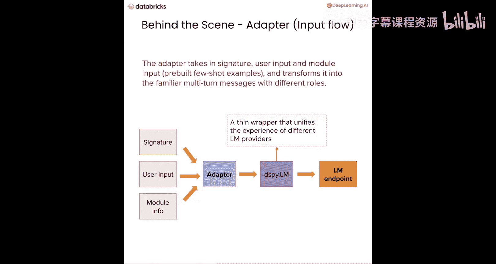

Then we define input and output data format with a default adapter， it's a section header。

 followed by the value。Then the user question is formatted according to its defined format in the user message。

The output format is very important because only if we know the data format。

 we can extract the field value automatically。

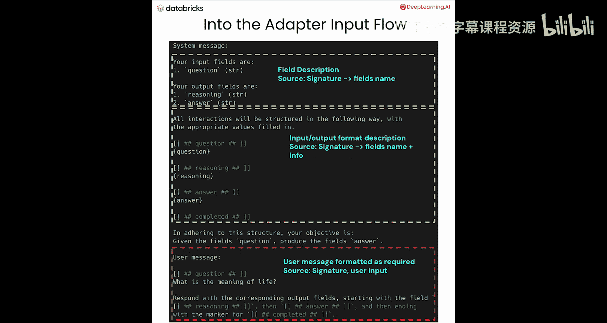

The upper flow is just a reverse， the LM gives back response in our defined format。

Then the adapter passes it into the output fields and send back to the module。

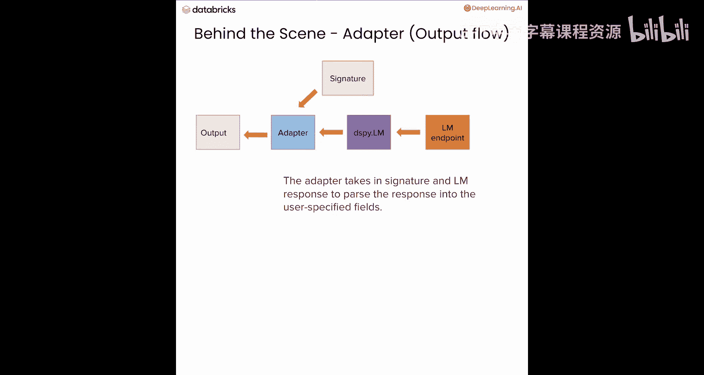

Because the response comes in the format we define in the prompt。

 the adapter knows how to parse it into the required fields。

The parel result is wrapped in DS SP prediction， which is similar to Dt。

 but allows both dot accessor and a key accessor。To summarize in concise language。

 DSpi combines signature and module information and actual inputs into a multiterm prompt and pars the ALM response according to the signature。

 so the LOM functions like a reservo API with well defined inputs and outputs。

Now let's build a complex program by customizing DSP module。

 let's first talk about how to use a different adapter to do that simply call DSP configurefi and set an adapter to be your favorite adapter class and here will use chasing adapter which is a good adapter if your model supports Str output like GT 40 GT 4 whole Mini。

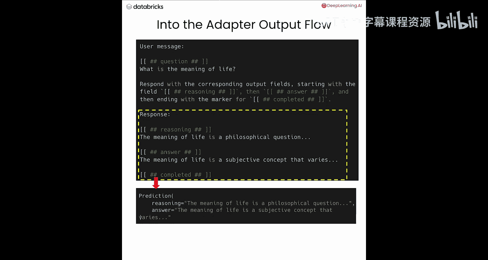

Let's invoke the same channel of our instance with the same input。

 and let's see what happens with a different adapter。

We can see that in addition to the original ones， we ask the outputs to be an adjacent format instead of the section header followed by the value。

And the response will be formatted as a J object。And so that the adapter can parse it。

Now I's start building the name the celebrity game by customizing the DSP module。

Let's recap what the game is doing playerer one is us thinking about celebrity name and playerer2 is the LOM starts asking yes so no question untilll find the name or use up all the codes we give 20 for this game Now let's build a module。

Before we talk about what's happening inside Ma Z and how we build it。

 let's play with that to get a sense of how it works。

We think how about celebrity name and type the name， use a brown James。

He started ask yes or no question， and we just answered that， not an actor。Not a musician。

 sports figure。Possible， yes。Current player， yes。Lers， yes， Leron James， yes。 So get you the answer。

Let's take a look of how we write this module。So we subclass from DSP module and we have two sum modules。

The first one is a question generator， which generates a yes or no question。

 and it is a chain of the module with this question generator signature。

 Let's take a look at the signature。The signature has two input fields。

 which is past questions and past answers and starts with empty list and has two output。

The new question for the yes or no question and gasmate indicating if that's a generic gas or let's say de gas on a name。

The second sub module is a reflection module after we wrap up the game。

 we want to do a selfrelection， which takes in the correct celebrity name and the final guess and the pass question and answers and output will be a single string for the reflectionraction process good what's going wrong and we define the custom logic in the forward method we first get a user to enter a name。

And we're starting accumulating the question and in the for loop。

 we'll keep generating a question and keep asking a user for the answer and keep that in the record until we reach the correct address or we use up all the quotas。

When the process has started doing self reflection。And which maps to the log of this running process。

 The demo is just a for fun。But I want to explain with this demo like how flexible it is to use DSP module。

Basically， you can write any Python function inside this forum method， we don't have any restriction。

 so it's easy to migrate to the Spi and migrate off the Spi。

And we can also see how the signature system makes it easy to interact with LOM because we have the signature system asking explicitly for the output new question and gasmate we don't need to worry about pars the fields out of the LOM response and we don't need to worry about if the gas made can indicate dial like indicate if that's a generic answer generic question or direct name gas robustly the last thing I want to show with this lab is how to save and load the DSP module DSP provides two ways of saving and loading The first way is state only saving only saves internal state after the DSP module and to do that。

Set a path to adjacent file and set the flag of say program equals to false。

In order to load that back， you need to recreate the instance。

 or if you have an existing instance and call a load on your module to load that back。

 DSP also supports whole program saving through Cloudical you only worry about dependency in order to recreate the instance to do that。

 keep that directory as a path。And set the same program equals to 2。

 then call a save to load that bug， use DSP out load and give the same path。

 and it will be loaded as a new instance。After you load about the program。

 you can call that just as if that's the original program。And that will restart the game process。

That's all about this lesson。 In this lesson， you have learned how to program with DS S pie。

 In the next lesson， you will use ammoflow tracing to debug your D Spi program。 See you there。

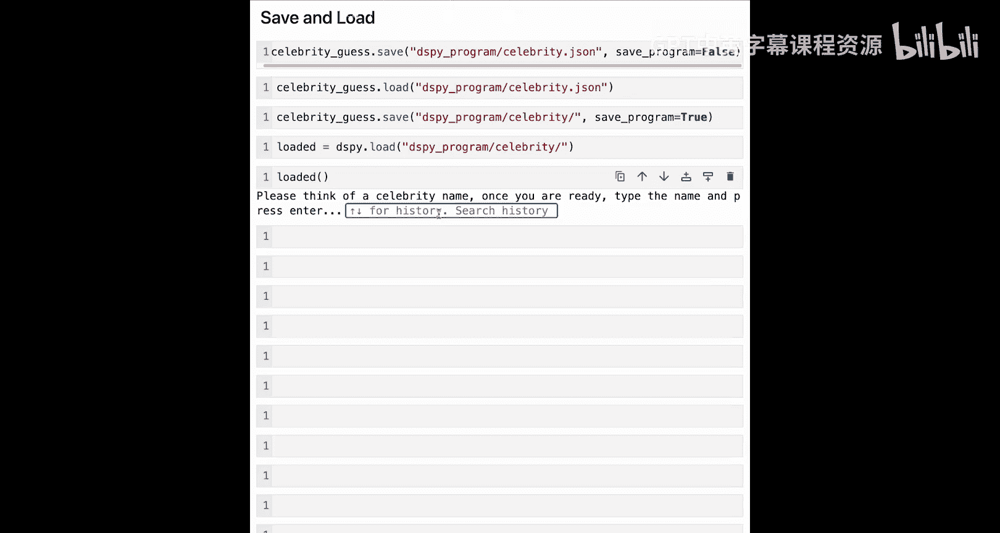