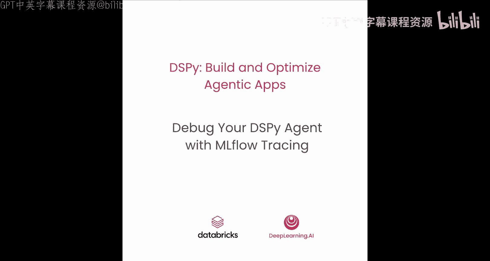
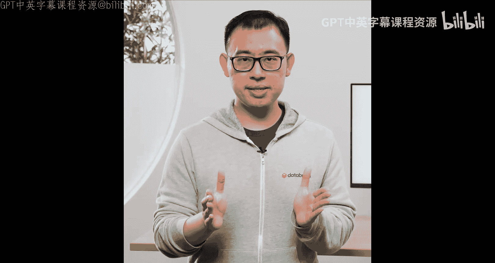
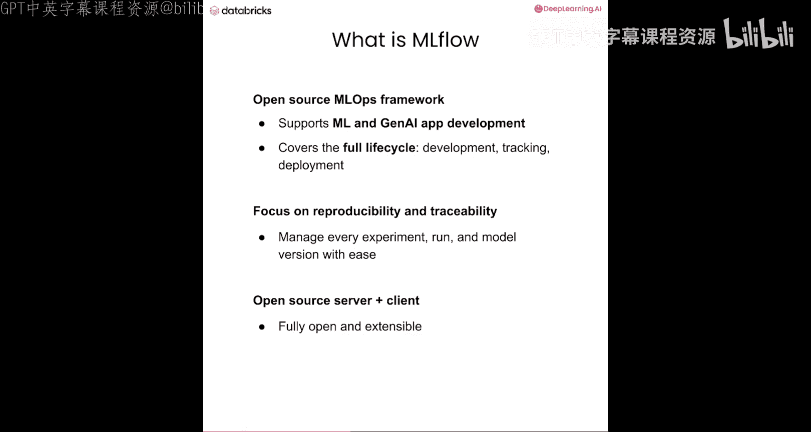
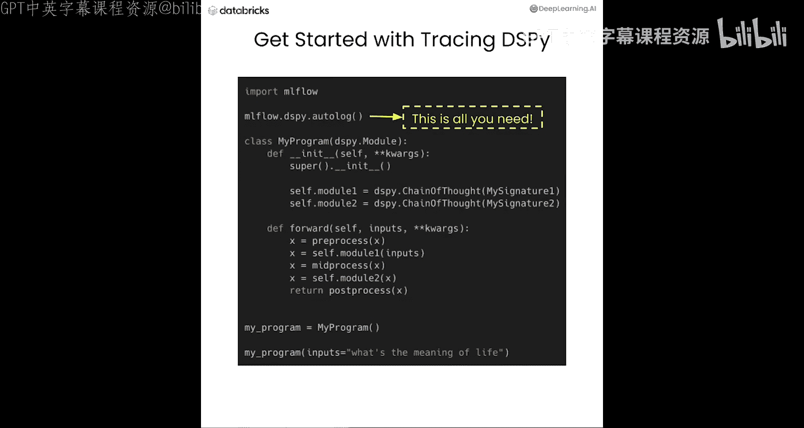
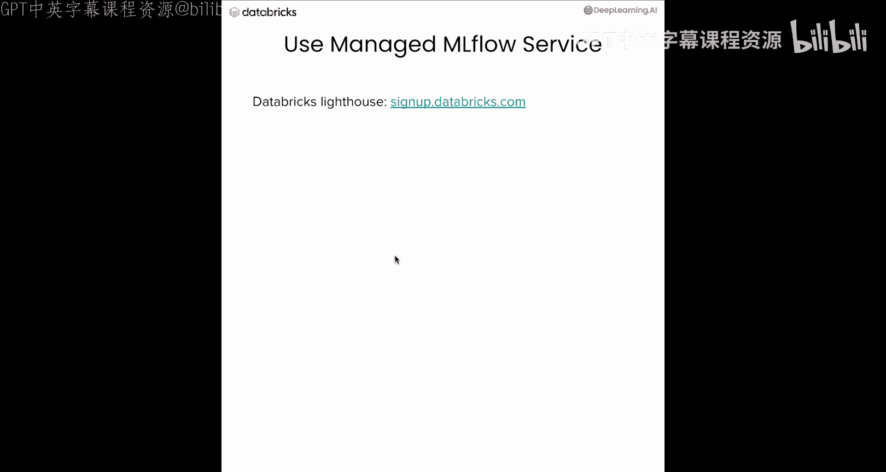

# 吴恩达《DSPy：构建与优化智能代理应用｜DSPy： Build and Optimize Agentic Apps》中英字幕 - P4：4.debug-your-dspy-agent-with-mlflow-tracing.zh_en - GPT中英字幕课程资源 - BV16ATuzoE8o

In this lesson， you will learn about how to use Mflow tracing to help debug the DSP program。

 Allright， let's go。 This lesson comes with a lab In a lab。

 you are going to build a DSP agent with the help of M flow tracing。

As a demo， well build an airline customer service agent that helps users book and manage the flights。

 Let's diveie。So what is tracing and why do you need tracing？

Traccing basically means recording the inputs and output of the intermediate function inside your AI program and captures a hierarchical calling stack like module A cos module B。

GI applications can be very complex internally， while only the final output is exposed。

 so when something is going off， it's hard to trace back to the root cause。For example。

 if you have built a DSP program consisting of five sub modules。

 that if oneRM course fails due to not being able to understand the prompt。

 even though DSP provides in history to check the LM course， it's hard to trace back。

Traccing provides an easy way for interpretability and debugging。

 And what is Mlflow Mlflow is an open source AI ops package that streamlines your GI app development。

 Mlflow helps with a full life cycle of building G applications。

 ensuring that each phase is traceable and reproducible。

Both Mflow server and clients have fully open source。

 you can easily set it up to get started with tracing a DSI program with Mflow。

 you only need to add one line to a program， which is Mflow DSpi do auto log or simply Mflow auto lock After that your program will be automatically traced and the trace will be saved in the Mflow server that you can access any time after being generated。

 let's talk about what is getting traced in Mflow， which has four things inside your DSI program which trace every module call。

 no matter if that's a top module or internal modules。

 we also trace all the cost to the adapter from which you can see how adapter formats a user query and passes theLM response。

We also trace the calls to the alarm so that you can inspect the actual prompt and the actual alarm response。

D SPO tool， which is a wrapper over DSP tool calling， is also traced with Mfo tracing。

 not only we can interpret the input and output of each sum module of the DSP program。

 we can also see the hierarchy of this modules together with some other important information like time consumption。

When something is going wrong， there will be a cross mark that points out to the problematic module。

The screenshot in the slide is a real trace of a react module。

 Let's map it to the components we trace reactact is our top levell module。

 which costs a few submods represented as predict and we can see both react and predicts are getting traced inside the predict the chat adapter format and parse carries the trace for the adapter and the LM traces in the middle has the actual prompt and response from theLM at the bottom。

 we can also see the trace of the two calling and in this case to a calling files So there is a redmark next to that in the previous lesson we have seen how to use DSpi inspect history API to check out the actual prompt with Mflow tracing now be even easier。

 Simply click on the LM trace and you can see the actual prompt and LM response Let's get started with coding similar to the previous lab。

When to set up the API key and additionally， when to set up the MLflow environment， import MLflow。

 we need to pour that to the MLflow tracking UI。In this lab。

 we have set up the Mao tracking server for you so you can get a tracking UI and set it up with ourer helper functions。

And now let's give the experiment a unique identifier just called IPS Pi lesson 3。

And as we call in a slides， we can turn on the tracing feature at one line hammerma float or D Spi to autolog。

Then we can choose ourM， as we did in the previous lab。

Now let's get started with building an airline customer service agent with DSP Re and use Mflow tracing to help with the process。

So this agent will be able to take user requests and book flyly for the users。

And can also modify the itinerary for the users。 We first need to define the data in real production。

 There will be a database schema。 Here we have user profile。 We have fly information。

 anderary information and custom of support ticket。 Now we have the domain data and data format。

 Let's define few tools the module we use。 within with a fashion fly information based on date。

 origin， destination with the fashion itinerary。And we need to be able to pick the flight out of a few candidates。

And we need to be able to book an itinerary on behalf of the user。

And we need to be able to cancel your itinerary， and user information or file a custom ticket if we can now resolve the issue automatically。

To define tools or functions with the DSI contacts。

You need to specify adoption to describe what this function can do and providety hints。

For input arcs so that the LM can help set the arguments。 Now we have the tools and data。

 Let's define a signature so that we know what the input and output to expect from this program。

The input will be a single strain。Representing a user request and the output is a process result。

Wwhichch is a message A to en the user if that's a successful booking that will have the confirmation number。

 we will like a number to a ticket if we cannot resolve the issue。

Now we have the signature and the tools。 We can combine them into a DS part react。 So what is react。

 React stands for reasoning and Act。 So basically， we give the LOM the signature。

 which is undergo goal of this program， along with a list of tools。

 and the LM can decide if that wants to call the tools to get actual information to answer user questions。

 If it doesn't need actual information， can just answer the question。

 Now we have build a react instance。 Let's invoke it。

We can simply put user requests into user requests。

 and book a flight from SFO to GFK on a certain date which we have a fly there and tell the agent the name。

Let's run that。Com， now we'll get back the result along with M flow tracing。

 Here is M flow trace U I。 We can see what is being traced and the attributes of the trace。

 So let's take a look at the attributes of the trace。

 We capture the input and outputs along with the attributes。

 which is the arguments to a function call in the R M that will be。The temperature。

 mark token and other congurable attributes。The event tab will hold an error message if there is any error。

And we can see that the top module react is being traced。

 and the input output is our end input and end output。 Can see that the inputs is our user query。

And the final output， the final representing as our output field process result says。

 has successfully booked a flight and heres the confirmation number。

And we can look into some module to see what happens in the process。So when we talk to the LM。

 we give that a user request and ask a for。The next effect could be a tool calling could be the end of the process at the origin。

 it will just say say I want to flash a flight information because I don't have any information right now。

 and it also determines arguments of the function calling to give the provider date we want to flash a flight。

After receiving that， we go ahead ahead and call the tool faster flight information。

 which has the inputs decided by the ELM。As a date， origin， destination。

 then we fetch a list of flights， matching a request， we get two out there。

Then we grab all the information， like the two candy flights。

 along with the tool calling information， send them back to the LM to decide the next tool calling where we can wrap up the process。

So we represent all the things in a trajectory field， we have the last tool calling arguments。

And the result。And the RM says， okay， I have a bunch of flights。 when to pick the bus of flight。

With the arguments as a flight candidates。And we call it to overpic the flight。

We have pretty fine logic for this pay flight。 We always pick the shortest flight。

 If that's the same duration。 we pick the cheapest one。

So here we'll get the flights information and inputs and we pick a flight out out of that。

And we grab all the information to call the A again， the IM this time， see， okay。

 we have the flights。And we can pull the user information so that I can book the flight on behalf of the user。

你 will get user information。And understand all the things to that arm again。And next thought will be。

 have all the information。 I can just go ahead book a flight。 Then we call Book a flight。

And we write this into a data database and record IM。 And this time now Im say， okay。

 this seem to be complete， so we can call the finish with a dummy tool in the Spi marking the end of the reactor tool a calling。

And after all the process， we still need to find a way to fulfill the process result。

 which is output field， so we just call a channel of that。

 give the all the tool calling history and a user request to form the final output。Then after that。

 we wrap up the process。We can see clearly with MLlflow tracing how we interpret what's happening inside react module with a very complex multihop calling。

And if there's anything going wrong， we can click on that certain module and find the input output to decide how we debug。

 by the way， Mflow is also integrated with La Lama index and other frameworks you can get the auto tracing feature with other frameworks as well in the lab we set up an Mflow server for you and the actual development。

 you will need to do it by yourself。 If you don't have time to set up your own Mflow server or want to explore more features Databricks provides managed Mflow service and you can simply connected to it to get started。

 you can try out through databricks lighthouse which provides free trial give it a try and sign up that data databricks co in this lesson you have used Mflow tracing to build a complex react module for an airlineline customer service In next lesson you will learn how to use the S optimizer automatically optimize the program quality See you there。

