# 吴恩达《DSPy：构建与优化智能代理应用｜DSPy： Build and Optimize Agentic Apps》中英字幕 - P5：5.optimizing-agents-with-dspy-optimizer.zh_en - GPT中英字幕课程资源 - BV16ATuzoE8o

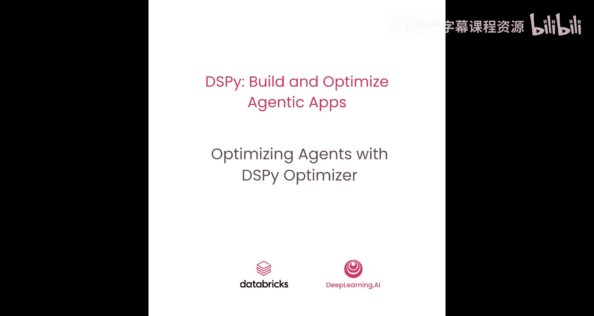

In this lesson you will learn about how to use the DSP optimizer to automatically improve your DSP program's quality。

 Let's get codinging This lesson comes with a lab in the lab you will get a handsz experience of using DSP optimizer to automatically improve the quality of aic rock。

 which uses Wikipedia as a data source。

After the optimization you will see hour rug has a big quality boost。

 lesss div before talking about DSP optimizer。 let's think about what optimization means when we talk about DNA applications。

 mostly can mean three things。 It could mean optimizing a prompt template could also mean building high quality future examples。

 These two parts both belong to a concept of prompt optimization or prompt engineering optimizationim could also mean fine tune LM weights in DSpi we support all of the three parts。

 Now let's take an overview at how to use the DSP optimizer。 First， you need to pick optr。

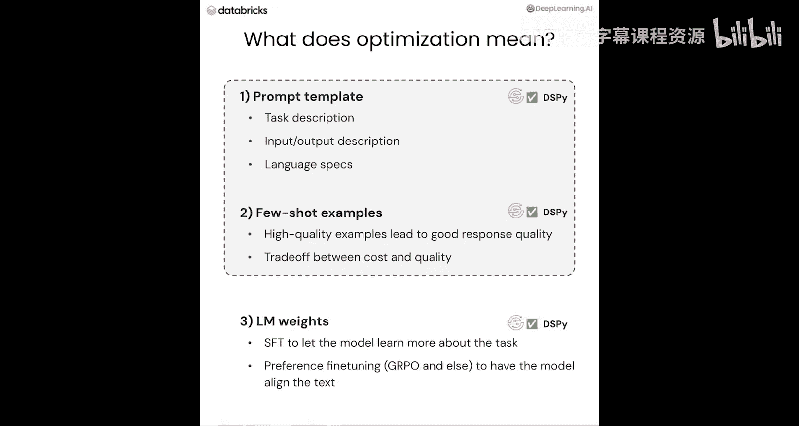

For how to pick the optimizer， please refer to our documentation site at DS SPal AI。

For this lesson and lab， we will use the Mi V2 optimizer。

 which is a good optimizer for prompt template optimization and building future examples。

After you pick optimizer， you need to tell the optimizer the evaluation metric function and also the training and the validation data set。

 the core idea of the requirement is the optimizer has you know what is a good program and what is a bad program。

Different from normal machine learning job， the data set can be as small as 20 records if you don't have a validation data set。

 the optimizer will split part of the data to be the validation data set。

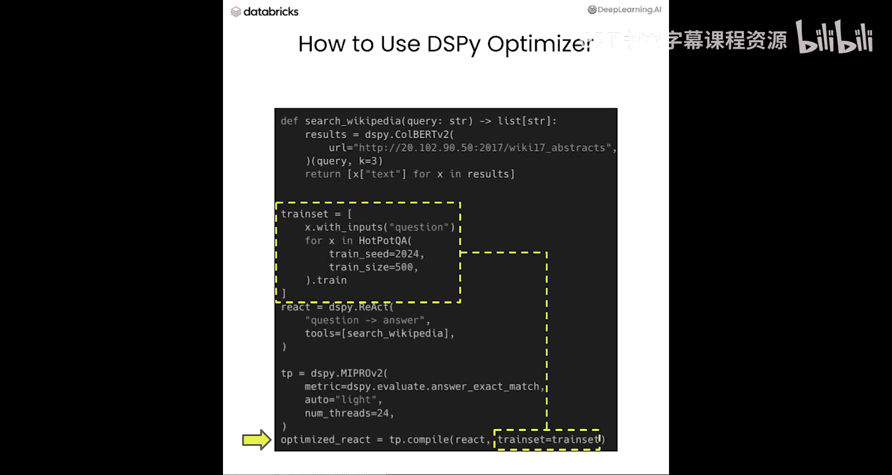

Let's talk about how optimizes work In this lesson we are focused on prompt engineering and demonstrated by Miprovi optimizer for how to do fine twinning with DSP optimizer and how other optimizes work please read on our documentation page at DSpi to AI tutorials So from a very high level we first build multiple sets of future examples we will talk about how to build that in the next slide then based on a future examples and your program information we let ourm generate multiple prompt template candidates which map to the instruction of the signature if you use the class based signature if you use the classbased signature that means the doctrinestream of it then we sample from both directions。

 the future example set and instruction set to form the candidate program and run evaluations on the candidate program the evaluation is based on a metric function and validation data set we pick data。

From validation data set and run against a program。

 compare the program output against the golden labels using a user defined matrix function。

The final program score is the average over allPC data。

Along the process would continuously pick the candidate of the highest score。And importantly。

 in an optimizer， we neither do proof force search nor try all the combos instead we use a statistical way called Bayian sampling to intelligently sample towards optimal combo Now we have seen the optimization flow at a high level。

 Let's talk about how we generate the future examples and the instruction candidates。

 Fu examples are generated through the process called busrapping。

 which is very simple we grab data from a training data set and feed that into a DSP program。

 which can be one module or multiple modules， then if according to the metric function that has a score over the threshold set by the user we grab the trace which is input and output of each module to make that as a future example candidate for that module。

Please note that one data can generate multiple choices because we add randomness to each call via setting temperature to nonzero Now let's talk about how we build the instruction candidates we grab the program code and description along with the future examples and some arbitrary tips like being comprehensive or being concise and send all of them to the LM through something called DSP proposal and generate a bunch of instruction candidates now we have the candidates of both instruction which is prompt template。

And few short examples， we can start generating candidate programs by picking one future example candidate and one instruction candidate and combine them。

And then we can evaluate the candidate program and keep simply for the number of trials users specify。

 We have done thorough experiments on the performance of the Miprovi optimizer。

 We see that Miprovi outperforms the original prompt by large margin in multiple tasks for more details please check out the paper optimizing instructions and demonstrations for multistage language model programs we can also utilize Mlflow to interpret optimization process simply turn on the autolo by setting a few more flex22 in Mlflow DS autolo then the optimization process will be tracked as we say when we try the candidate program we do evaluation on that and all these evaluations along with the candidate programs information like what's the instructions What's a few short example will be saved to Mlflow so get a full track of what's being tried across the process Now let's get some coding to see how。

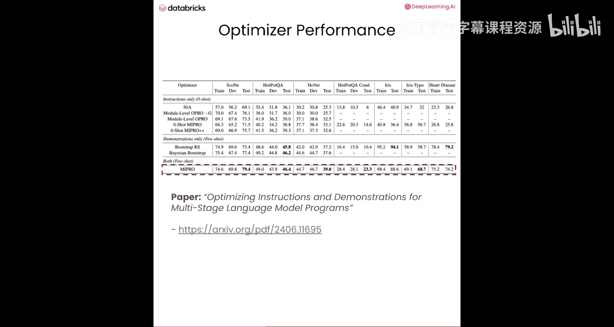

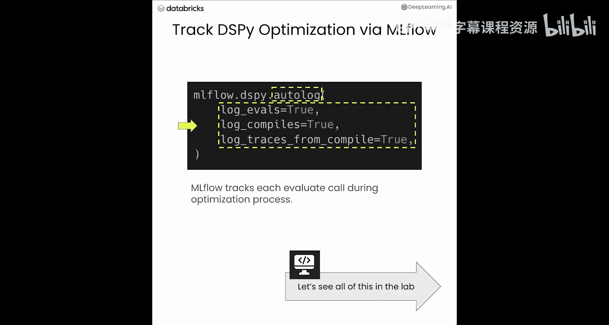

izer works as were did in previous labs when set up APIT。And we need to set up aflow tracking server。

 and we need to give that a unique identifier。Let's call that DS pie course， too。

And we can set up the auto login and turn on a few more flags than before so that we can track the optimization process handling to specified LOM let's continue using a GT4 meaning for this rock agent will be based on the Wikipedia data and then we use aant rack instead of like fix the number of node source call a Gen rack basically means we' let IOM decide if we still need more data from node to source before we get to the final answer let's first define our tool which is such a Wikipedia。

 we use codet V2 which is public available interface for acquiring Wikipedia data and the return value will be the chunk fastera from Wikipedia data source。

And we still use the DSSP React as our program。 and this time the input output is very simple。

 just question and answer。 So we use a shrimp based signature and has only one tool is a search Wikipedia。

 Now let's recap where we need to have the optimizer around。When to have data。

 training dataset and validation dataset， So ass load data， we have prepared the dataset for you。

 which is a subset of the Hpo QA dataset， which is a question answer in data based on Wikipedia data After loading the data let's take a look at what the data looks like So it's very simple as a question has an answer An input case will be the question。

 Okay it's time to create our optimizer。Well use a Mipro video optimizer and as we said。

 we need to prepare a metric function so that the optimizer knows how to evaluate our candidate program and for this task we just use the answer exact match。

And to configure optimizer， we recommend you use the auto mode which has three modes， light。

 medium and heavy， which are carefully trained for good performance。

 but if you want to customize a Mipro Vo optimizer。

 you can find the available options on the documentation site and in the search box search for DSP or Mipro V2。

 then you will go find all the available configurations。

The optimization process can take quite a while。 So in order to speed up the process。

 we have recorded a cache for you， so the optimization will hit the cache to be much faster in real production。

 you don't need to record any cash。 just make I calls。 Now let's kick off the optimization process。

We use the optimizer compile function。And send the program to it。

 specify training set and validation set Allright， the optimization is done。

 we can take a look at the login so basically we're continuously getting a candidate program and run evaluation over that and we finally pick the best program out of the process。

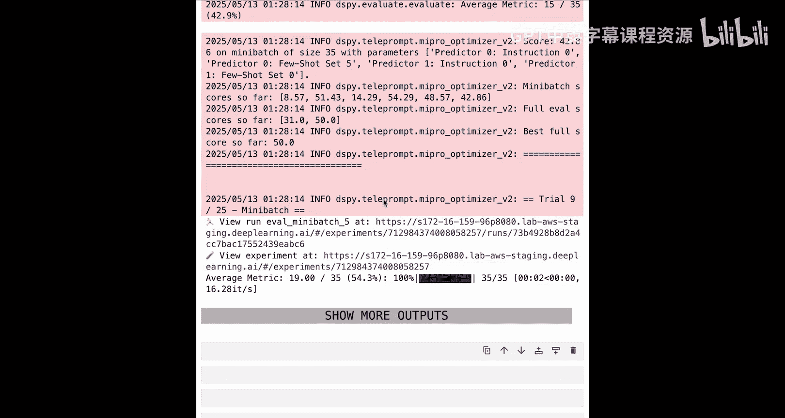

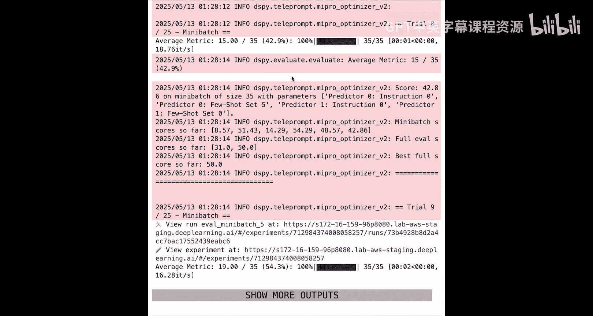

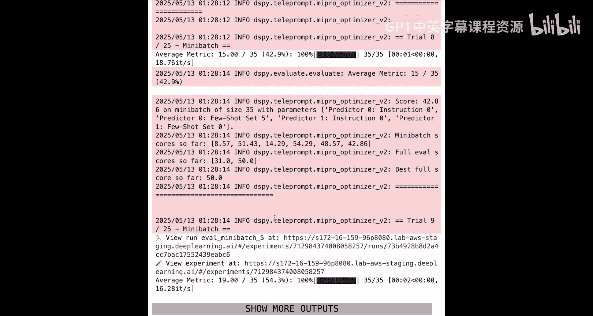

Let's take a look of what is getting changed along with the process。

So if you remember the original signature is just a very simple input to a question to answer and the react module will not have any instruction。

 but after the optimization process， the react submodule will have a very comprehensive instruction populated and to also have a few future examples built into that。

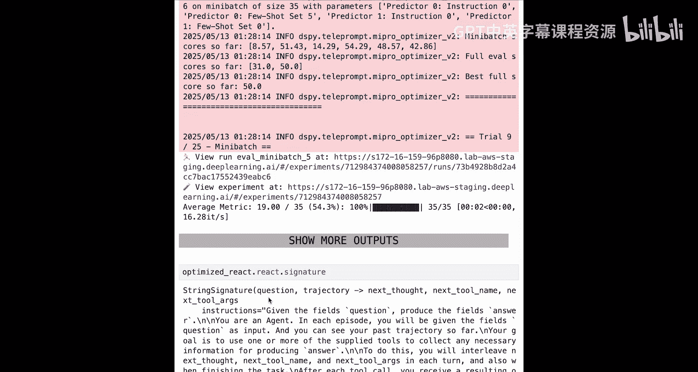

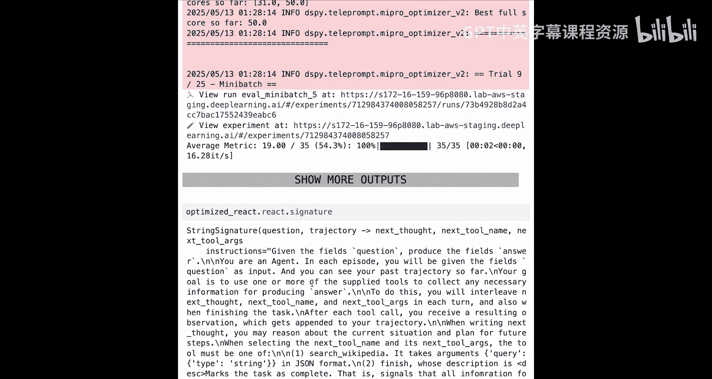

Represented as the list in the demo attributes。Let's further evaluate the non optimizeizer react。

 our Ra application。We get a score of 31， and we can see some example input and output here in the table Co。

 let's now evaluate the optimizer react and get a score。

We'll get a score of 54 and see that without any human interaction just by simply using the optimizer。

 we get a score boost from 31 to 54。 that is the power of DSP optimizer as we mentioned in slides we track the optimization process with Mflow and you can view that in the MLflow UI going to the UI the optimization run shows up as a NA row。

And each child maps to an evaluation of the candidate program。Clicking into the wrong。

 you can see the attributes of the candidate program like few examples。

 instruction along with other attributes and the evaluation score of the candidate。

 so you keep a track of the full record of the optimization process in this lesson you have learned how to use DSP optimizer to optimize your DSP program and we have seen how powerful the DSP optimizer is through optimizing the RA application with Wikipedia data。

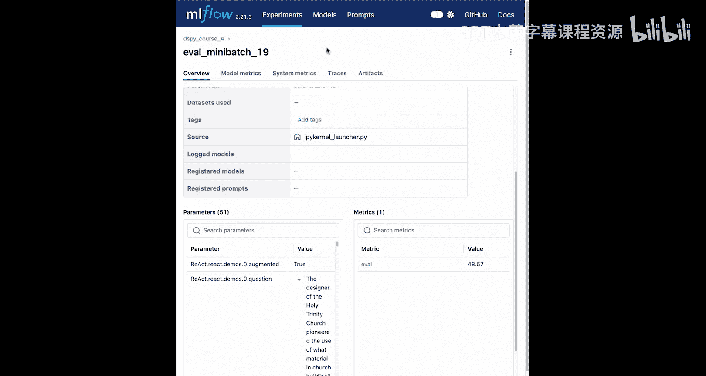