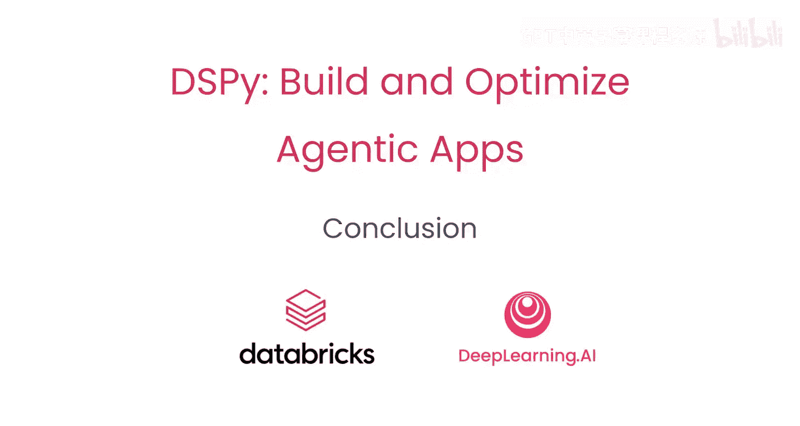

# 吴恩达《DSPy：构建与优化智能代理应用｜DSPy： Build and Optimize Agentic Apps》中英字幕 - P6：6.conclusion.zh_en - GPT中英字幕课程资源 - BV16ATuzoE8o

Congratulations on completing this course in this course， you'll learn that DSP is a lightweight。

 flexible DNA authoring framework that simplifies interaction with OMs and agent development It also provides automatic program optimization through DSP optimizations and has native MLflow tracing integration for easy development。

You use the DSP signature to define inputs and outputs and DSspiy module to wrap the custom logic After building a program。

 you'll learn how to prepare a small dataset set and a match function to use the DSP optimizer to improve the quality of the AI program and finally you use the amflow tracing by adding Mflow or DSsP do autolog I'm looking forward to seeing what you have built on your own。

