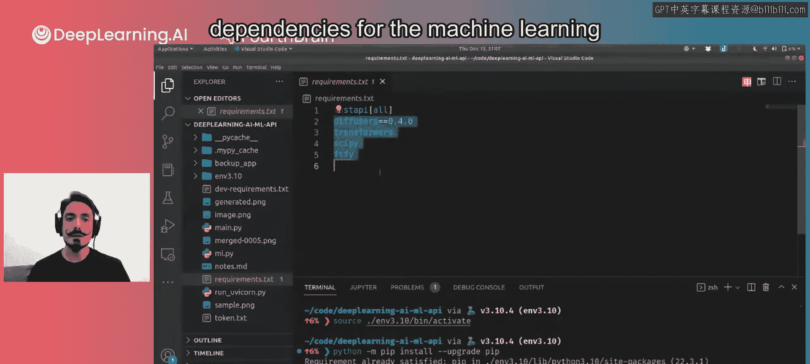
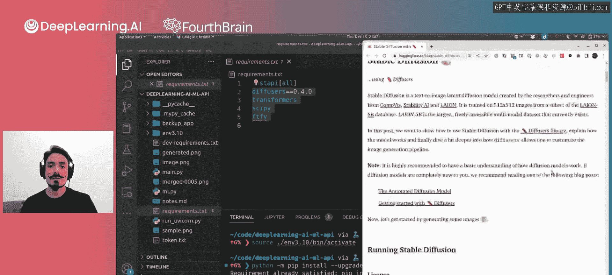
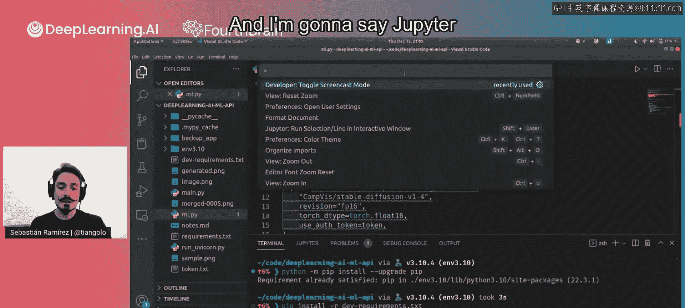
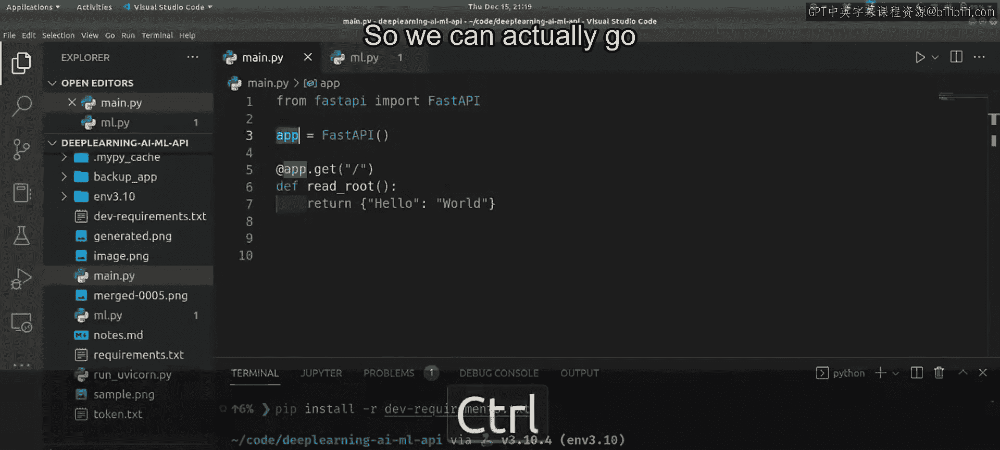
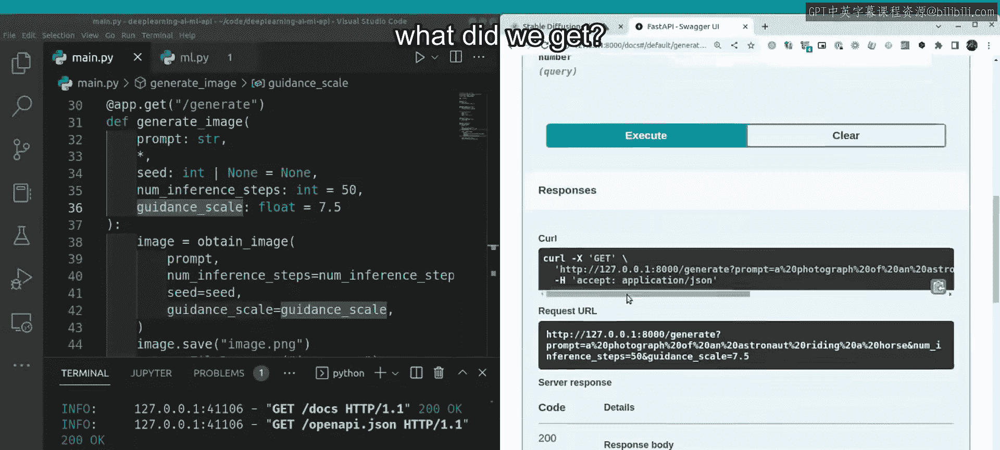
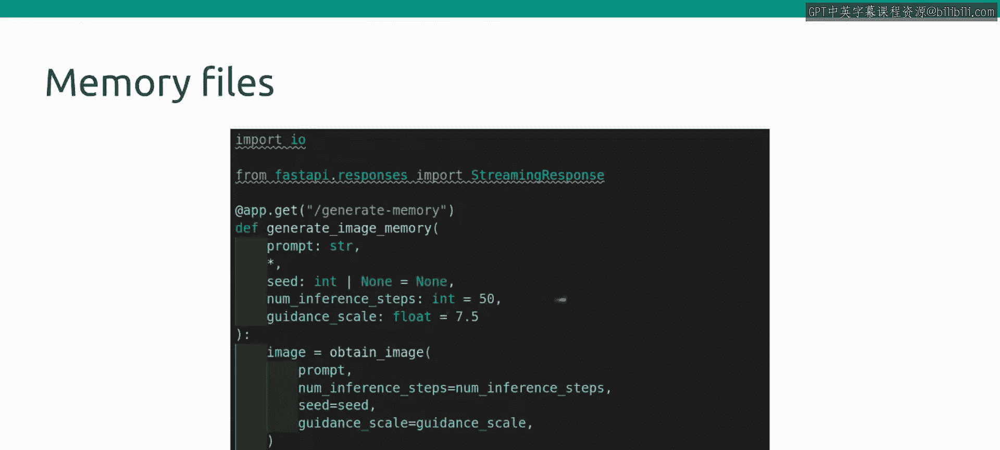

# 吴恩达《FastAPI for Machine Learning： Live coding an ML web application》中英字幕 - P1：FastAPI for Machine Learning- Live coding an ML web application..zh - GPT中英字幕课程资源 - BV1kC411b7Se

Hi， everyone and welcome to Fast API for machinech Learning Live coding and an ML web application。

 My name is Greg Locknain， and I'm head of product at Fourth Brain。

 We appreciate you taking the time to join us for this event。

 We're so glad to see you tuning in from all over the world。 If it's late for you。

 Thank you for staying up to join us。😊，Our event today will walk you through how to build your very own AI image generation web application using fast API and stable diffusion we're going to get right into it today If you hear anything during our event that prompts a question you'd like to ask Sebastian please follow the slido link in the description box on the YouTube page If you're just listening check out the link to see questions others have asked and upvote your favorites We will do our best to answer the most upvoted questions during the Q&A portion of this event。

Without further ado， it's my pleasure to welcome Sebastian Rammiz to the stage。Sebastian。

 also known as Tanglo， is the creator of Fast API， Tr， SQL model and other open source tools。

 mainly using Python。 He's currently a senior staff。

 software engineer at forethought and also helps out other companies as an external consultant。

 Sebastian， off to you， my friend。 Take it away。Thank you very much。

 Thank you very much for inviting me。 Thank you everyone for being here。 So amazing。 let's do it。

 So what we are gonna do is that we are gonna build well。

 we're gonna live code this live part is freaking me out。

 let's hope if the code please help me pray to the goods of live demos we're gonna live code and'm a machine learning API with fast API So the idea with fast API that we will get high performance is's easy to learn is a fast code and is ready for production So first who am I'm Z in Rammiz I am from Colombia in South America。

 That's why the accent but I live in Berlin Germany and you can find me an online on multiple places I'm currently working at forough working as an external consultant with other companies and I created a bunch of tools was So we're gonna talk about fast API first what is fast API It's a Python Web API framework It currently has 50 something plus Github stars is being。

😊，By a bunch of cool companies and the performance is in the top rank of what you can get in Python so that's quite cool and it's been like it's been one of the most used Python frameworks by the official Python developer survey is the one with the fastest growth is one of the most loved ones from the stack Overflow developer Sur So it's been liked by a bunch of people unfortunately so that's why it will be kind of relevant but then fast P for。

😊，Sorry， first E for machine learning people is what we are going to talk about so I will assume that you know machine learning I won't teach you machine learning if you don't know machine learning probably you'll go and take one of the courses that deep learning or with first thing like those are the masters that's where you know like I started my career with the first course from Andrew on coursesera before it was called Cosera about machine learning which is now what deep learning is AI is doing so you should probably go on study that over there I will assume that you know the basics of web API like HtTP Jason but we are going to cover all that here live so this is what we're going to be talking about。

😊，Now， fast API is based on standards like open API education schema or2 the thing is that it's based on standards and it uses those standards underneath。

 but the ways designed is that you don't have to know those standards to be able to take advantage of that。

 So you get things like automatic API talks like this what we see on the side。

 we're gonna see a little bit more about that。 And it's all based on the standard Python type and notations。

 So from the typenotations， you will get out of completion ins a bunch of things。

But then fastpi does automatic data validation， data automatic data conversion。

 data validation and data documentation for you。 So you get something that is based on standards for free。

 which is quite nice。 Now let's start talking and showing slides like we came to live code and give nervous and type typos。

 So let's just do that。 So I have here my editor。😊。

And I am in this project that we are going to work so the first thing that you will have to do is to go and actually let me activate screencast so that you can see the things that i'm piping here so the first thing that you will do in a project it will probably be on the command line you will create a virtual environment so it will be something like Python。

😊，D M the end and then you will type the name of the virtual environment that you want to create So you are calling Python with the flag dash M this tells hey Python I want you to use the module called VM VM is part of the Python standard library and then we were telling it what is the directory that we want it to use to create the virtual environment I already run this command so I already have the virtual environment here。

Then the next thing that you have to do is to activate the virtual environment。

 so you will do swords do m the name of the direct with your virtual environment slash bin slash activate this is on Linux or Mac if you are on Windows it will be slightly different but the thing is that you have to activate a virtual environment before installing anything inside of it so I can activate that here and then the next thing that you should do is make sure that you upgrade a version of PP。

So you do python and Pip install upgrade P and this will make sure that you have the latest version of P installed in your virtual environment many errors while installing packages and that you see like oh error compilulating like compiling something or like building something those errors in many cases just because you have an old version of Pip but the error won't give it away so just make sure that you have the latest version of P After that we can install the dependencies that we are gonna be using so we're gonna use these file requirements where is it I lost it here requirements requirements that TxD I have a bunch of dependencies here this is what were gonna use there's a a bunch of ideas that you can have about how to use dependencies how to pin them。

We are not going to talk about that today， we're just going to install these like this。

So we are saying we want to install fast API with the extra optional requirements。

 all this includes Ucorn， which is the server that is going run fast API。

 we're gonna to use it in a second and some other additional dependencies。

 Then this is what we need for fast API and then we are install the dependencies for the machine learning stuff So about the machine learning stuff This is what we are gonna use You are going use the stable diffusions stable diffusion model from diffusers。

 which is part of hoging face you can read a bunch about that in in their blog post。

 I'm not going be teaching you that we are not going be reading all this I already copyied this code So this code is not what we are writing because we are not writing the machine learning part we are writing the API part So we are going be using this same thing。

 Then we have to install the dependencies for this as what we have here。

So what we will do is skip， install dash error requirements， and this is what we will type。

I won't hit enter because I don't want it to reinstall the pay all the things I already installed all that。

 then the next thing that we will do is to install the development dependencies， which are this。

They that requirements， this file that I have over here。

 and I here I have just some some packages that will help me link the code and automatically format the code。

 And I also use this iPad kernel package， which is part of the Jupyter notebooks package is an internal part of that。

 And we are going use it to create an interactive window while we are editing。

 So this is going to help us explore code a bit quicker。

 This is one of those secret tips that I think not many people have not many use and it's one of those amazing gems。

 So we have after having all these requirements。 now we can start coding。 So let's。

 let's jump to the machine learning part of things。😊，So I have this file M。

 I just copied the code from that blog post and I just put it here。 This is what you're gonna use。

 So we're gonna import some parts of the code。 we're gonna import some libraries and then for hugging face we need to have a token So I put the token in this file token to TSD I'm not going show it to you because it's supposed to be private but then I'm reading it with this path and I'm reading the content in this variable token this is all that this is doing Now let's actually explore all this thing live。

 So I'm gonna select this first line。 and I'm gonna say controlt shift P to show this command interface and I'm going say Jupiter Jupiter run。

 This is the option that I'm looking for run selection or line in interactive window I actually have it with a shortcut of shift enter So I'm gonna hit this and this is actually gonna start an interactive window here on the side This is the equivalent of a Jupiter notebook So I have a kind of a Jupyter notebook here that I can。

Interact with， and I can interact from the code directly。 So let me hi this。 Now we have this here。

 and I can actually interact with this thing from here directly。 I can create a new path。

 for example。😊，It just hit shape enter， and then it's going to create that object there in this interactive window。

 but I can select lines of code， let me highlight this on the side。

You can select these lines of code and just import those different packages。

By selecting them and shift enter， which is the shortcut that I have。

 and this is just going to send them to the notebook here on the side。😊，点这个。

Now this is important here， this is going to take a little bit because it's just importing the whole torch and everything。

 but after it's done you can see that we have the check mark。

Now we can select the talking path and we are going to load the talkingken here。

Now we are also importing here we're importing the stable diffion pipeline from diffusers。

 This is part of hogging phase， so we're going to create a pipe which is going to be a stable difficion pipeline that is reading from a pretrain model。

 so I'm going to select。This whole section of code， and I'm going to run it。

I'm going to send it to the Jupyter notebook or the interactive window that I have here。

 the first time that you run this on your local machine。

 this is going to take a while because this is actually downloading all the weights for this model and it's quite a big model so it's going to take a while the first time you run I already run it so this is actually being fast it's just that the model is really big so it has to take some time to load everything。

And you can also see that I can I don't have to select all the line I can just like put the cursor on some oh by the way you see these redquilyn those are telling me that there's probably a error in my code normally that's what those quickly red lines tell us in this case is just that there's a little thing that is not correctly written in the source code of of this stable diffion pipeline something that could be improved there but anyway it still works。

Also I don't have to select the whole line I can just like put the cursor anywhere on that time and as long as it's on the line itself。

 I can shift enter and this is going to send that to the interactive window so you can see that this is being sent here This is still going to take a while so we're going wait for a little seconds for that and we're going start playing around with fast API while this finishes loading machine learning model。

So I'm going to create a FA API application here， we're going to do it from scratch。

 so we are going to create we are going to import from FA API。

We're going to import the FA APII class。They were going to create enough。

It's going to be a fast API instance。And this this object is just an instance of this app then we're going to create this app do and we're going to define a function that is going to be us this yes thank you with profile pilot for the suggestions so this is what we are doing we are telling hey fast API。

Whenever someone sends a request that goes to the root path and it's an HTTP get request an HTTP get operation or get method。

 I want this function to be the one that handles that and I want you to return this content which is just this dictionary and this is going to be encoded automatically as Jason by fast yet so we just write this if you have never seen this at symbol this is equivalent as if we say。

Something like this， hey， I want you up get， I want you to take this function。

 read route and do whatever is it that you are doing there。

What we are doing with that a single is roughlyequ to that so we are just saying hey faculty。

 I want you to do that thing that you do when you get get requests to the rootpath。

 do that with this function now。We are going to continue with our code because the machine learning model is already finished。

So we have this pipeline that was loaded and then we also sent the pipeline to Kuda we wanted to be executing on the GPU to be a little bit faster so now we can play around with this let's actually move this a little bit to the side so we're going create a prompt which is this one so I'm just so let me move it to the top so you can see it better and I'm just sending these to the interactive window so we have the prompt variable there and now we can let me uncom this line because this is the land that we are going to use。

Let's selectlect this line and we can execute it and what we are doing here is hey。

 I want to use this pipe to process the prompt。This is going to execute all these heavy machine learning model that is going to take a while to process and to load them to do everything and then this is going to generate some result that result contains a dictionary that has a sample and then we can take the first one of that and that is going to be an image this image is some particular type of object but this is what will going is going to contain the actual image that we are going to be using so。

In these variable images that we going to have the generatedative stable diffusion machine learning image。

Now the thing is。If we have this just here like this， it will mean that if in the main file。

 we were importing all this code， then this will be running every time we try to import that code。

 So it will run every time we just load the module。

 and you can see that this takes a long while to process。

 We don't want this to be running every time we just want to run whenever we call it。

 So we need to create a function。 That's what we are doing here。

 we are creating this function obtained image。 And you can see that this is just doing exactly the same that we are doing here manually。

 Its just that we are doing it inside of a function。

 and then we are passing the extra parameters that it can receive。

 So we are saying here's the pipe and this pipe is gonna receive the prompt。

And it's going to receive some additional parameters and these parameters。

 we are just taking them directly from the same function that we are creating to pass the parameters。

The seed is just gonna make actually this is done。 It's actually see what is the image that we got so I can select this variable image。

 and then I can send it directly to the interactive window。 and then you're going to execute that。

 And then we see oh， this is a fancy astronaut riding a horse Nice， very cool。

 and it's actually kind of flying。 So it I guess the astronaut is actually flying the horse or something anyway Now we can put this logic inside of this function。

 This is what we actually really want。😊，So we can comment this part out。

And then now the see is just like what is the random generator number。

 we can fix that so that we can get always exactly the same image generated from some particular random number the number of inference steps is how many times we want them all to process the thing to improve the results of the generated image if you lower these we're gonna get a croppiier astronaut。

 but it's going to be a lot faster and you can we are read about all these parameters on on the block post the thing is that we are just taking those parameters and just using them inside of the code here now we can select this function and we can execute on the side so that we have the function available and now we can just to check that this is actually working。

We can uncom this line and we can generate the image again。

 but using our new function that is going to be able to generate this image when we call it instead of just like whenever we import it。

 we are just saying hey， I want the number of inference steps is just five。

 I want you to do some crappy random astronaut and I want the seed of the random number generators to be this one so I want you to give me exactly the same astronaut。

The same croppios route every time。 so we can just select this line， and then we can execute it。

 And this is going to take a while， but it's not going to be as long as the first one because this is having a number of steps that is much lower。

 So now we can see what is the images that we got。😊。

And we can see some psychedelic weird random astronaut on some random weird course nice amazing this is all we need for the machine learning for the machine learning side。

 we don't want to generate this image every time we load this much so we can come this part out and can of save this and we don't need this interactive window anymore we already have the function that we need and we know that this is actually working because we were running each thing step by step we run。

This whole thing even once a here。So we know that this is working， we can just like close this。

And now let's actually click play with Fast API so we have this code here。

 this is actually a completely valid fast API application。

 so we can now run this faster API application using Uorn。😊。

The way we use UVconn is what we call unorn。Then we pass this string main column app this string main column app that is the parameter that we pass to Ucon is equivalent to this。

 let's say that we are telling Ubicon hey， Ucon I want you to from main import the object app So main is the thing that we are importing then after the column is what is the thing that we are importing from that module this app is the same app if we go to the definition is the same app that we created here So we are telling Uicconn hey I want you to start the application using this object app this is all these means Now if we run this code。

actually throw this file。 we don't need to save anything there。

 We run it and we say that U become is running and it's running on this port on this on this I and this port so we can actually go and follow this link。

 This is gonna open here and we can see that we are receiving let's move this to the size we can see everything at the same time we are receiving the response that we are expecting hello well nice cool that's working Okay so let's actually try and do something else we're gonna get an item whenever someone sent our request to s items s and this thing is gonna be a path parameter so let's see what that means but first let's create a function that is gonna read this I'm gonna remove this because we just need the item I and we're gonna return the item I direct So whenever someone goes to let's say example co s items s。

This fo， this will be variable。 This will not be fixed URL。

 This fo will go in this item I that is put in these quarterly braces。

 The quarterly braces are the same ones that you use in F strings。

 but this is not an f string this doesn't have the F here and it cannot have the F because this is not a variable here but you can see that it use the same quarterly brace so you can remember what is the format that you need to put the past thepi is going read this URL and it's going extract the path that goes in this part of the path is going to extract it because it knows where to extract it from this definition here and it's going to put the value of this full inside of this parameter。

 We are telling you that this is an integer， so this is actually going to be like an integer like this So then we are going have inside of this parameter we're gonna to have an actual integer like7。

So now let's actually save these。And if we go in the URL here， we go to s items s 7。

 you're gonna say， hey， this is not found。 This is because when when we started Uicconn。

 it was actually with the old version of the code。 we haven't restart the Uiccon reading the new code。

 So we have to stop Uicconn with control see or what control auto。 And then we can start it again。

 but now I'm gonna use this trick of reload。 This is something that you should not use in production。

 This is only for development。 but this means that we are telling Uicorn hey。

 I want you to check the files and whenever I change them I want you to restart automatically the server。

 So now this is this is loading。 now I can refresh this page and I can see that now I'm receiving item I7。

 And because this is reloading。 now I can change things here。

 like let's say I want a message and the message is gonna say hello world with a single code。

 So we have this message hello work And if I save it， this is gonna reload automatically。

 So let me save and you can see that this。You can see they has a warning watch file detector changes。

 reloading， blah， blah， shutttting down starting， it is now restarted automatically。

 so now we can refresh this page and we can have the new message helllo wall that we were expecting。

So nice this is working quite nicely， this is great for development never used sit in production because it takes a lot of memory and consumes a lot of the resources of the machine but it's great for development so you can interact quickly with your with your own application now let's say that we want to also I was forgetting something so this item I。

😊，What we receive in the code， this is actually an integer because we are first because we are annotating it with this column in。

 then the editor is going to know what is the type of this parameter so we can say itemI dot and we're going to get out of completion for integer。

 we're not going to get out of completion for strings or for something else。

 the editor knows that this is going to be an integer and if we try to do some in operation like summing an integer with a string then the editor is going be able to tell us hey you are doing something that is not valid。

 you can sum an integer and the literal string HDdF。

So the editor is going to help us a lot just by using the type annotations。

But FA API is also going to make sure that we actually receive the data that we were expecting。

 so if we instead go instead of items seven， we go to items full and we go there。

we're going to receive an automatic error， the client is going to receive the client in the browser is going to receive an automatic error saying hey。

 you have an error in the path in the item ID， which is a path parameter。

 the value is not a valid integer。😊，So this is not a validity integer。

 so the fast API code here is actually in this line。Here is protecting us。

From running code within invalid data， so the data that we receive is going to be valid and you's going to be checked and converted by fast yeah。

 also notice that this is a URL。 if we pull that seven here。

 it's part of the URL and a URL is just text。So fastpi is also doing automatic data conversion because this is naturally a text URLs don't have a data type so SD is converting the data to extract that information Now the coolest part I guess fastpiI is that if you go we have been just like interacting with this typing the URL。

 but if you go to s dos。Then you get this nice automatic recommendation user interface for your API you can see this this is based on our own code so we have here is the main get that just returns hellello world and here's the get items item ID and we can actually try it out。

 we can type something here we can type7 and then we execute it and when we get the response from our server that is running here and we get the response here with the data item ID message hello world actually we don't need this message hellello world anymore because just for the demo so we can just save it again this is reloading we send the request again and now we get the new response without that message so we can interact live with the API that we are getting and that can help a lot。

Now let's actually send somebody to this request so but FastpiI is built on top of two libraries。

 one is star。And the other one is pedantic so Starlink does all the web parts and Pyantic does all the data parts you normally don't interact with Starlet directly but you interact a lot with Pyedantic directly and Pyantic is even great even if you're not building web application just for general data validation so yeah are going to import from pedantic。

We're going to import a base model。And then we are gonna create a class in item from that。

 So we're gonna create a class item that in its from a small。

 this is gonna have a name that is a string， a price that is a float。 we don't want this offer。

 We want something we want text We want to have a text that is gonna be a list of strings that by default just a empty list So we are just defining what is the data shape that we expect to receive and now we can use this class in a new path operation I'm calling this a path operation because it's a combination of a path like this one and an HtTP operation like this one you can also call it a root or a name point or however you prefer。

 but because in Fastpi， you normally have the two things together the path and the operation I'm calling it a path operation。

 So now we're gonna create a new one this is gonna be app dot post now this is a post one This is whenever we send an HttP post operation。

And this is going to say I want to create an item and this item is going to be this parameter item is going to be an instance of the class item this is a standard Python type annotations to do that now I can save this this is related automatically can refresh the documentation page and I can see that now I have the post here that takes the items and I even have the automatic example showing the data with the same shape that we defined it here。

We have the name that is a string。 price is an intesger， well actually a float。

 and tax is going to be a list of strings。 If I send some data， so full。Mar， whatever。

 executive that。 I'm going receive the response here。No。If let's say I remove the text。

I just sent this like this。 This is still going to work because the packs have a default value of an empty string。

 So this is still working。 But if I remove the price。

I try to execute it and this is also fatigue's going to tell us exactly where the program is inside of the body。

 the price field， this was a field that was required and you did and send it so Itelos is doing the automatic data validation based on the data shapes that we define so we can define arbitrarily nested data structures however we need。

And FA P is going to do the validation of that first。Even if we do deeply nest data structures。

 so for example， we have the tags that are supposed to be a list of strings or in terms of J it will be an array of the strings and let's say that instead of passing a string with pass a object or the equivalent is a Python dictionary so this is going to be named。

Fool， I will try to execute this。CpiI is also going to do the data validation for that it's going to tell us inside of the body inside of the ties at index1。

 so index 0 will be this is string and index 0 is fine。

 but index1 is the one that has a problem Index1 a string type was' expected so we get all the data validation even for deeply nested data structures。

Nice， that's very cool。 So this is quick overview of fast decay in general of the kinds of things that you might need now we're going to actually do the machine onifier so now we're going to get up those get we're going to get a generated model so let's say generate。

😊，Definitely no。Oh， I told you that you were going to see types， types in red， no， not pro yet。😊。

We're going to generate an image here and we're going to receive a prompt now we are saving this that we belowload this page。

And you can see that we have here the new endpoint or the new path equation generate。

 And now this prompt， because this prompt is not part of the path here。

 this is going to be read from the query parameters。

 You can see that this goes from the query parameters。 So I'm going to try it out。Hello。

 if I execute it， you can see the query parameters are these things that go after the question mark so we are telling it hey。

 I want the query parameter called prompt to have a value of hello so we are sending the query parameters here and that's how we just define it if it's not part of the path the is extract from the query parameters Now we just got the prompt we just need to return the actual image So what we are going do is that we are I'm going stop youic because I don't want it to be reloading every time and I'm going to import from Ml import of the image。

I don't want you be to be reloading because whenever this line is run from MLl import something。

 then this whole file is going to be executed。This is going to execute the creation of the function is not going execute the function itself。

 Its not going call the function。 So this line of generating the actual image。

 this is not going be called for the creating creation of the function is going to be called The creation of the function doesn't matter but loading the model is going be wide slow because the model is slow So we don't want Uorn to be reloading the file every time we save something and then just like taking a long time to reload again and reload again and reload again。

 So that's why I stop Ucorn and remove the reload。 Now what I'm going do is that I'm going to use that obtain image prompt。

And I'm going to say， hey， I want to have an image that is going to be equals to contain image of the prompt that Ive received in query parameters and I'm going to have the number of inferences steps is going to be five this is just the same small number of inferences steps and we're going to have the seed which is the same fixed one just to make sure that everything is working。

 we want to have like a C version first and then what I'm going to do is that I'm going to save this image so an image dot save and then I'm going to save it in a file image dot P andG。

And then I'm not going to return a dictionary， I'm going to return a file。

 so I'm going to from FA PI。past API， those requests， I'm going from the curtain all the responses。

 Yeah， I'm going to import a file response。 And then here， I'm going to return。They don a file。

Respon。With the same image。And I'm going to do it。 now I save it。

 I can restart Uiccon without reload。And I can run this。

And you can see that Ubicon is taking a little while to load because it's loading the whole machine learning mode now it has to load the whole machine learning all。

Whenever it reaches this point， you equal。Now this is going to finish at some point and then we're going to be able to reload here if I refresh the page。

 this is not going to run because everyone hasn't finished it。And then okay， this is done nice。

 amazing。 Now we can generate it。 So let's try it out。

 let's write the prompt and the prompt is gonna be a photograph of an optionalna writing a horse。

 let's copy this prompt。 let's generate that let's execute that and you can see that this is using the device coola is's generating the image is's taking a while and then it's generating the image saving that to a file and then returning us the file and we have the nice random am route on the horse This is not the coolest one let's actually build the coolest version so we have this thing to generate the image but we have a bunch of parameters that we can receive and we want to pass those parameters here。

These parameters are taken from here， we can actually copy all these parameters just as is。

 we can just copy paste that into this function。You can just copy pasting。

 and I should let me format the code。And now we can use all those parameters inside of our function。

The function that we created let me format the code against it that we can see that So we take the seed。

 we take the nonins steps， we take the guidance scale and because all these parameters are just pipe notations。

 fast P is going to be able to extract all that information from there。 So now we're going save it。

 we're going to stop you we're going to reload the。Let's start to again。

It is going to take a little bit to load the model again。

And then we're gonna be able to use use this code。 So let's let's go to everything。

 We are taking the same parameters。 So C is gonna be an integer but that can also be none by default is none because it has a default。

 then this seed is not gonna be required if we take the non inference steps this is an integer So Kapi is gonna validate that we actually send an integer or that we don't send anything because this has a default value of 50 this actually refresh this page because this is already and you can see that now we have all the parameters here。

 so we can just straight out the straight out with the same prompt that we were using photograph of an astronauts writing a horse give need that and we just execute that we're gonna execute we're gonna get this is the real thing So just brace yourself this is the cool astronaut writing a horse from a web API that we are building it is just taking a while because you know this is a massive machine learning model that is burning my laptop and it's probably gonna lift。

Of before weve finish the streaming so this is processing that is going to generate a very cool astronaut while that while this does that let's actually see what are the things that we have here so we have the seed we could put the seed here to fix the type of astronaut that we receive。

😊，We have the number of inferences steps that has a default value of 50。

 we have the guidance scale that has a value of 7。5 we could change it or we can just like leave it or just like not even send it and then fastPA would use the default values because this has all type annotations the plastic is when do automatic data validation data conversion。

 all that stuff so we just use the same type parameters the same type annotations that we have for the function and we just copy paste that and then we just uses it here and now we automatically have data validation data documentation here and data serialization。

So this is almost on and now we're going to see what did we get， okay。

 this is a nice strange black and white astronaut riding horse now very I don't know kind of Western black and white style。

 nice data we got the nice AI machine learning API and you saw that we just like built all this very quickly。

 I hope so without so any mistakes。

Nice， now let's go back to these slides for a little second。 So we were talking about the code。

 I wanted to tell you a little bit just very quickly about what we were doing。

 We were saving the file。 Actually， let me show you the call again。 We were saving the file here。😊。

And then we were loading the file again。 This means that if we have a client that is sending some some request and then we have another client sending another request。

 we might end up having the same file overwritten by one and the other and like we don't want to send the file for one request to the other we could have then random names for the files but that will also mean that we will be reading and writing to disk even though we actually don't need to read and write to disk normally reading writing to disk is a lot slower than doing it from memory so we could want to do it from memory in this particular case。

 it wouldn't make that much of a difference because the machine learning model is just taking so long because it's so heavy。

 that writing or not writing to this is gonna be negligible but if we have like a faster machine learning model or something like that we probably want to avoid writing written writing from disk and what we could do will be to import a streaming response。

 then we could import IO， which is this standard library module。

Then we can create a memory stream which is kind of a fake file in memory and then we can save the image to this memory stream in the format PNG because this doesn't have an extension。

 we have to tell it explicitly hey， this is PNG they will tell them memory file object go to the beginning of this file because we want to send the whole file not the end that doesn't have anything and then we will send that in the streaming response class here also telling it the media type is an image PNG because again this doesn't have an extension so it cannot infer is what is the type of the object but like yeah anyway this is just like the a little bit more for all sort of version where we don't even read and write from this we just like do everything in memory。

Nice， so a little a little bit more about fastpi was this thing about performance。

 So this is a benchmark run by a third called taking power they run compare a bunch of different languages and a bunch of different frameworks。

 these ones that I'm showing you are Python and go go where the green lines Python has the blue lines go is a compiled language so go has to be faster than Python Nevertheless Fastpi and a bunch of others get to have performance that is comparable to at least some of the go frameworks So this is quite nice and this is while staying on theness of Python where we can do all the machine learning and cool stuff which one is the fastest is unnecessary the clear Uicorn is the server that we were using to run fastpi Un knows a framework it a server to run the thing so Uorn will have to be on top of everything because UBn is running everything below but anyway it has just some random noise the cool thing is that it has 15000 requests or something so that means it's over 9000 requests。

For a second thing is that you can get like kind of the best on the ballpark of the best performance that you can get in Python while staying in the comfort of Python and getting like all these additional features about data validation documentation realizationization and all the stuff Fast API also has a bunch of additional features that you can just dependency injection security auto through integration website soets files back tasks。

 templates is like all the things that you will expect from one of these frameworks is just a fast API optimized for building web APIs which is the main type of thing that we are doing with web frameworks relate。

And that's it， thank you very much， I think we can probably jump to the questions。

Wow Sebastian that was fast and totally awesome thank you for walking us through that and you know I think we've got a nice chunk of time to get at some of these questions thank you everyone in the audience for asking those questions feel free to go into Slio keep up voting keep asking questions that you're interested in hearing from Sebastian about so yeah wow very very cool stuff the first question we've got that is by far the most upvoted is can we have a link to the repo with a template project。

And Sebastian， I think we've actually are started working on that on our side already so we will definitely I think yeah yeah absolutely we will share the like make sure to follow deploy the AI and forthing because they are going to share like the final code of this whole thing that we were playing with but like yeah absolutely yes。

 yes， and you know come back rewatch the video on half speed try to live code it again because yeah that was that was awesome Okay so the next question is what deployment options for fast API web app are available or is there any difference in the way the app needs to be packaged for serverless versus virtual machine for example。

 AWS Lambda versus AWS EC2。Yeah so if you are running the thing yourself。

 you're running a command directly as it will be running on EC2 or running on a Docker container or running directly on a machine or on heroroku or something like that where you can tell which is the specific command you just tell hey I want to run the command Uorn and you tell UConn why is the application that you want to run So Fast API is built on top of a standard called AsB this is a standard for Python for building AsInc web applications AsInc web frameworks actually and the communication between the server thing that is Ucorn and the framework thing that is fast API So Fast API is based on this standard so you can just like use the common techniques that you will do if you want to run on a server a system like AWs Lada。

 then you will use another application another package that is called mango that just wraps fast API to make it compatible with the specifics of AWs Lada if you are doing that on Google Cloud that will be Google Cloud rung which is a Docker container。

You you decided to run。Uiccon directly and also Azure results also building a bunch of things to support directly asG applications and to have like very good support for FastPI。

 the same with all these other providers， most of these providers have a way to support one of these mechanisms to run it。

 but normally it's very simple normally just you just run Uconn with the app directly and that's it。

Very cool Okay the next question we've got is about scaling so can you talk a little bit about best practices for scaling up handling you know hundreds。

 thousands of requests happening in parallel。Yeah， so well first。

 I recently well like some months ago， I revamped all the documentation in Fastpi about deployment and like what are the actual core concepts that you need to have it's actually even independent of fast API that you need to take care and think about requests per second is the request what is latency you need to take care about memory and CPU and like the ports and like what are the things that you're actually thinking of。

 then what are the mechanisms to deploy， how do you deploy that if you do it manually directly。

 how do you do that if you do it in containers， all the stuff is like。

Quite long and I won't be able to say everything here， but in general。

 you are normally running some type of system that is normally scaling you're normally running like I don't know some type of containers or some third tool that is scaling your application automatically So if it's lambda。

 then they are going take care of run multiple instances of the same thing if it's Kubernetes or something like that then you're gonna have containers that you're replicating outside of the process so you will normally have a single Uicorn program running a single fast application without workers without any wrappers just that directly and then you will replicate that container multiple times on the horizontal scaling to be able to have many fastPA applications that have yours and code or running at the same time and being able to handle like any load that you need to send them now about having a squeezing performance of a single fastPA application The thing is the recommendation will be just write your normal code。

That's one of the things that I probably didn't mention FastPA is actually an naI framework underneath so if you write AsI cannc weight functions the FastPA is going be able to run them and like do all the high performance and stuff but you don't have to do that you can write normal functions and FastPA is going take care of do the smart thing to not to not damage performance the technical terms are to not block the main event loop on the main thread if you don't understand that don't worry I don't fully understand but the thing is you can useIN weight functions or normal functions if you use AsInc can weight functions you need to make sure that all the packages that you use inside of those functions are actually compatible with AsN can weight so that you are not lookinging that for example reading a file and then it doesn't have an weight then Python is just going be waiting for that instead of just going and handling another request at the same time that does the whole benefit of AsIN can weight is that Python can handle many requests during the same period of time。

need to squeeze performance， then you can use make sure that you use As can weight and that the libraries that you just are compatible with that。

 then you can if you need to squeeze more performance。

 you can avoid having Fast API automatically sterize your data because in Fast API you can return kind of any type of object。

 sometimes you can even return like objects that come from the database and Fast API will do the best job it can to convert that to Jason。

 but if you want to squeeze performance， you can make sure that you compare it to Jason directly and that you return a response。

Directly and you can instead of using the standard Jasonson response。

 you can use Jason response using or Jason or Jason which is a package that serialize Jason and is written in rust so has much better performance and it's part of the part of the facility I included responses that you can use So there are a couple of tricks that you can do to squeeze performance as much as possible but the first thing that you will probably want to do is just write the simplest code you can and just scale horizontally just add more notes just like add more containers to that and you're gonna like you're going get far like far away with just that before having to squeeze performance in the code itself like you're gonna have clients and you're going have income before you need to go and squeeze the actual code internally So like yeah if you're just building something just write standard code and whenever you need to increase the through then you can just scale horizontally and just add more notes。

So love it love it yeah wait until you have clients and wait until you have some revenue coming in to worry about scaling so I want to follow up double clicking in on this sort of async development Marcio Ol Oliva asks what is the best approach to retrain the model we have trained outside our application and also what is the best way to load them asynchronously？

That's like the thing is that's something that there's there's no oh this is the way there's still no no perfect way it depends a lot on the team。

 it depends a lot on the approach depends a lot on how you are doing things so for some people it makes sense to use a third party service that just serves machine learning models for some particular frameworks with some particular layers and they are compatible with that and then like you are fine with that and you can just like load the model there and then you can have a fast API in the middle that will be kind of a proxy between that thing that is serving models and it's just like doing all the authentication and handling all the requests and just resing that。

That helps for some people I have seen a lot of people that what they do is that they need to be retraining quickly and they need to have a bunch of different modelss and they need to be able to have them isolated so what they do is that they train the models and they have them package like in whatever is the standard format form that model in a file then they create a Docker image with that machine learning model inside of the Docker image and then just load the all inside of the FAPA application and everything is in a single container。

If you do it this way then there's just like a couple of things that you need to make sure you do and you don't do so you should not load the machine learning model per request because loading a machine learning model normally means reading a file from disk which is very large reading from this case is low and if the file is large is going be super slow and if you do it per request that's gonna be super super slow one thing that you can do is load the all just like load the machine learning model at the top of the module so at the top of the Python file that will mean that whenever you import that file or whenever you start the FA application that's gonna take a while loading that machine learning model the only caveat is that if you have that machine learning model in some particular file that is part of the whole application and you need to import that Python file from different places then all those places are going end up the first place that import the file is going to end up loading that whole。

Learning application that whole machine learning model and that's gonna to take a while The superdo per trick that you can use is actually use a utility from the standard library from the funk tools library the tools for functions that is called another cache which is at least recent used cache you add that decorator on top of a function that would return the actual mold that is loaded and then the next time you call that function is actually going return the same object that it returned the first time So it's just going to load them all the first time you call it and then it' going to call that again that's kind of like the advanced trick that you can use if you need to if you need to optimize the type of thing you can read more about that in the fast documentation about settings is not related to models but it's also reading from files so it's kind of the same trick you can do that if you need to like handle all the different possible use case it's just that it's a little bit more advanced but probably for the first use cases for the。

First， things that you do， you can just load the machine learning model at the top of some Python file and that will probably be the easiest and the best way for a long while。

Okay， okay stay away from loading it per request yeah I love the the very simple rules that we we're getting out of this and obviously there's a ton of advanced things that we can do Okay。

 the big question here we go Sebastian okay fast API versus flask for building ML and AI web apps。

What's your take， what's your hot take on this？So like like I don't know there's a lot of fast APIpi versus flaskka I think that the main attention。

 the main focus should actually be on like hey flask to goes like up to here Flask has done a lot for us like there's just appreciation for Flask if you go to the fast API documentation there's a section about inspiration and alternatives and there's just like a lot of inspiration that Fast has taken from all these previous frameworks that have great ideas and Fast is just like trying to take all these ideas and a bunch of these ideas together in the best way possible So yeah like Flask has taken us a very long way The the thing is with Fast you get so extra advantages probably that are particularly applicable to modern code building APIs if you're not building an API if you're just rendering HTMLl on the account it' just going probably going be like kind of the same is you're gonna not gonna see like oh this is much better than the others like。

But if you are building APIs， the Fast is probably going be going help a lot more because it has a lot of the things that you normally need for APIs like data validation。

 data documentation， data serialization is all based on standards it's all based of these open API standards which also means that you can generate clients automatically for any programming language because this is all based on the same open API standards also documentation for that in and you get is all based on the standard typenotations and also asyn can wait these are for example。

 some of the features of modern Python that were not even available when Flask was created So Flask had no way to be designed to take advantage of that and exploited so it's like some of the advantages of like it's just like new so it's been able to take advantage of all these new things so that you can get like auto completion inline errors and all the stuff everywhere inside of your code but at the same time you get data validation serialization documentation all those things you can probably see like。

There's a whole section of the fast API features。And there's a section about alternatives and inspiration and you can see also like what are several other frameworks and how fastSAPPI learned some of the things from those frameworks to try to apply them again here in this way。

The other thing is if you are already used to working with flaskk。

Fpi is going to be very similar because fast API he it's a lot of the design from Flask it learned a lot from Flaskk and actually recent versions of Flask cop some of the designs of Fast API so like I guess we just kind of cross-poinate with all these ideas but the thing is if you're already used to flask you can probably just read the tutorial on the first page of fast API not more just that that's gonna to take like 10 or 20 minutes and that's gonna to be enough for you to decide like I like this thing or this doesn't make any sense that's gonna be enough for you to evaluate it if you like it or not so it's quite an easy investment just like 1020 minutes to see like do I like it or not love it love it awesome and you I think you you even mentioned when when we were kind of doing a run through automatic docs the best part and I think this is something that we've seen a lot in our courses at fourth brain is that's what people love a lot about fast API is the automatic docs I don't know if you had anything else to add to that but's。

what I've noticed。No， yeah， yeah me too。 Like you know。

 like I built this thing just to satisfy myself I was using flask and I just wanted to some extra things。

 So like I wanted to have those and I enjoyed that a lot。

 Well yeah know going back to the question like I have been hearing more and more teams even more in machine learning I guess because machine learning is in many cases just Apis and not even much more I have been hearing like more and more that teams tell me like whenever we're building something new its just like like by default directly with fastpi So like we have previous tools and previous parts are built with Fl but we are building something new that goes directly to fastpi because like that better for them or they also migrate grade some of the things from Fl to fastpi but yeah of course there are manyask applications already deployed and they are just like working fine but in many cases when you're building something new and you want to take those advantage like probably make sense I actually do like the do a lot I'm probably not a very good。

😊，I need to have out the completion the nameline errorss and I need to be able to have like the browser telling me what are the parameters that I can set。

 oh right， it was his name one I called that so I need to have all the help I can get and like I built first A to give me all the help I could get because like yeah I need the help from the tools。

😊，Yes， yes awesome we have one or two more questions here one okay we're going to get super tactical with this one this is highly upvoted and it's a common point of confusion talking about Anaconda versus virtual environment directly in python so it said your command line says you're using Anaconda is there a reason why you're also using。

Virtual environment， VN and Pip at the same time。Yeah， no。

 so just for this story and for what we saw disregard the fact that it's Ananaconda or not。

 it's just because this is the old installation I already had so like it's just like already there。

 but I'm not using any of the components of Ana aconda itself。

 it's just that I had that installation but I'm not using any of the internal parts of Ananaconda。

If you are building a project like it will probably depend on a lot of the projects。

 so Anaconda andconda in particular the package manager from Anaconda has some particular benefits when building tools and when installing pre-built binary tools when those are available in Conda forge in particular for example。

 if you're in a new architecture like like one of the new max and M1 in many cases they don't have a precomppied wheels which is the standard format and four packages they don't have them available but therere some version available for Conda so you can install those with Conda in those particular cases is probably like a very useful tool or when you have dependencies that go outside of Python itself of the Python ecosystem if you are dependencies or things like that but in most of the cases you are probably you're probably good enough and probably better off with just like plain Python and using visual environments or。

epOr even if you use a tool that helps you manage real virtual environments like poetry or something like that。

 but that is still in the same ecosystem of PEep that installed from Ppi and that installed with the same mechanisms and all the stuff because you get like the latest versions of Python and the latest official versions of those packages and like all the stuff but in some advanced cases like you will probably end up needing to use annaconda orconda or if you need to have like some environment that is just like pre-installed with everything and you are just using them that you're not really installing packages or things like that in some of those cases it might work well like yeah if you are just like building a project it probably makes sense just to use virtual environments in some way it could be what I was showing you I was just showing you the simplest case which is with the tool that come with Python but you could use some tool that helps you manage all that at the same dependencies virtual environment and installation with for example。

 something like poetry that helps you do everything。

On the same package and there are some other alternatives but love it love it yeah when in doubt always just keep it as simple as possible Sebastian wow I've learned so much today just listening to you I cannot believe how much content and questions that we were able to get through today thank you everybody for your questions and Sebastian thank you again so much for your amazing presentation and answering really everything that the audience had to throw at you。

Thank you， thank you very much for inviting me and thank you everyone for staying。

 I hope that was fun and enjoyable it's a massive pleasure to be here with you all with further and deep learninging the that's so cool。

😊，Yes， absolutely absolutely this is this has been amazing very very cool you know this and you know this brings us to the end of today's event so what a great high note to end it on you know brought to you by fourth brainin and deep learningning AI and Sebastian creator fast API Tiangolo give them a like give them a follow like and sub to the deep learningning。

 AI YouTube channel down in the link deep learning AI is going send out a follow up with a survey for all attendees we'd love to hear how to make future events even better select 100 attendees will receive a promo code as well for a onemon subscription to any deep learningning。

 AI course on course。One last giant thank you to you， Sebastian and to all of you joining us today。

We'll see you' all next time and until then， keep learning。

