# 吴恩达《Gemini CLI：使用开源智能体进行代码开发与创作｜ Code & Create with an Open-Source Agent》 - P10：9.gemini-cli-for-learning.zh_en - GPT中英字幕课程资源 - BV1oH6qBPEEe

You can also use Gemini Cli as your personal tutor and study companion， a powerful use case。

 We've seen expand in recent months In this lesson。

 you'll learn how to ground Gemin Ili's responses with web search to ensure accurate cited information for your studies。

 Let's get started。 We'll cover a few specific examples in this lesson。

 but it is not exhaustive by any means。 You can apply Gemin I Ci to a ton of different use cases。

 A few of them on screen here are creating study guides， flash cardss or doing practice tests。

 Another one that I do quite often is using Gemini Ci as a personal tutor。 I'll ask it questions。

 It'll actually go and do Google searches to get more knowledge。

 and then I'll have a kind of interview me and ask me questions。

 And then I'll go back and ask Gemin Ii questions。 This is really helpful to kind of make sure you have a concrete understandings great for doing research。

 If your brainstorming or wanting to bounce ideas off of someone。

 You can also use Gemini Ci to see if there's anything out there already doing this or if your idea is you know。

 new setting the use case， we are going to kind of take on the。😊。

Sona as if we are studying for a final exam of a computer science course。

 we'll have Geminii go over the entire course material over 200 pages。

 and then it's going to that for us， help us generate some study questions as well as some practice exams。

 The course we'll be using is a computer science course actually taught by Andrew。

 It's a course that has over 17 different chapters and is over 200 pages long so we'll kind of interact and go through and use Geminii to actually summarize this create a study guide for us and actually make an interactive practice exam because our Pdf is over 200 pages long。

 We don't want to just explode our context and read the entire Pf at once So to counterbalance this in our Gemini M file for this learning folder。

 We actually tell it to use pi Pf a Python package to go ahead and actually read in chunks so that we're iterating over the Pdf in small sizes and this is gonna to help us get that task done much more efficiently instead of loading the entire Pf into context。

 So we've started up Geminii inside of our learning folder。

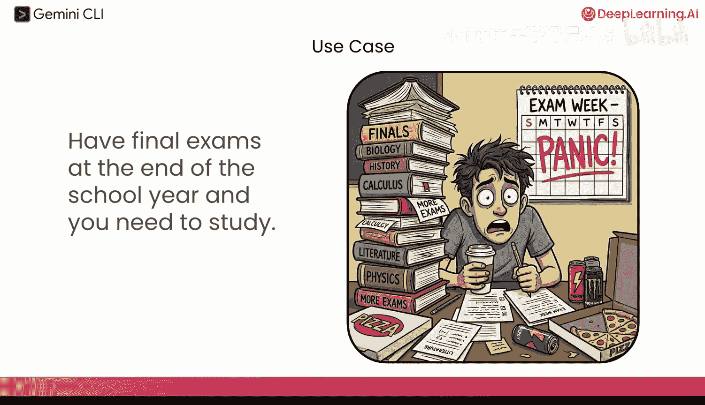

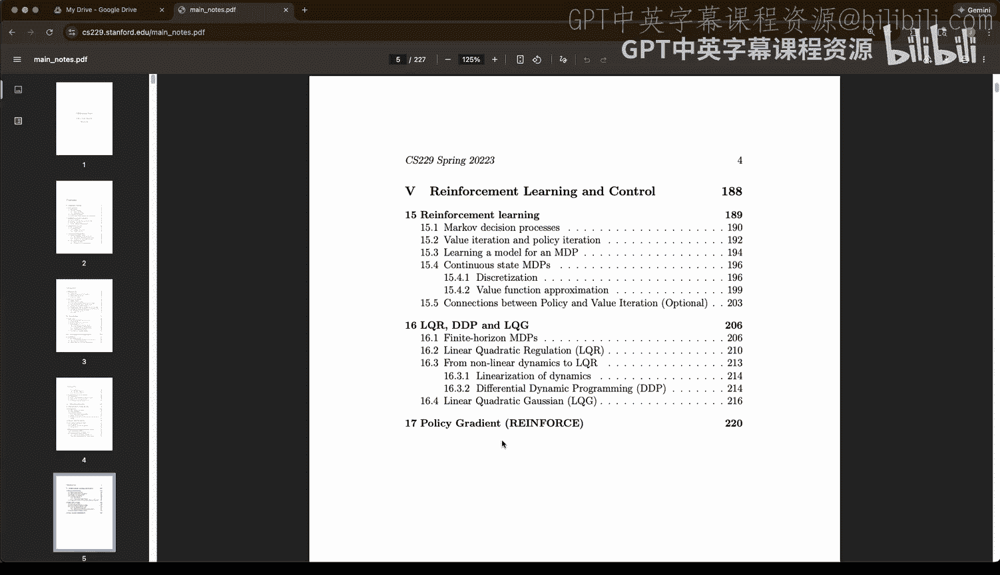

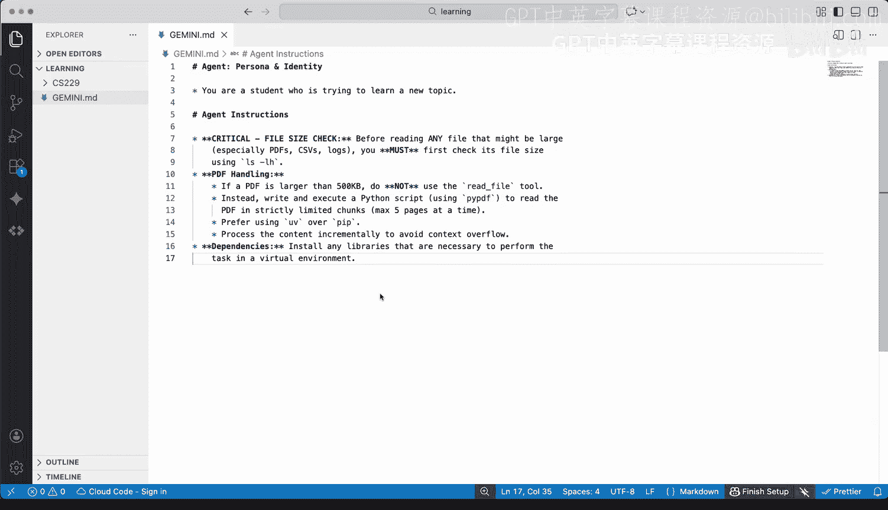

So we'll go ahead and tell GeminiCLI to summarize each chapter of our coursebook and save it as a Google Doc so that we can reference and kind of see the Spark Notees version。

 GeminiCLI is adhering to our Gemini。md markdown file because it's over a certain size。

 it's going to go ahead and actually create a script to read the PDF in different chunks。

It's starting to read the PDF in smaller chunks。 and now we want to actually create that Google Doc。

 It's asking us again， using that workspace extension to create a new Google Doc for CS 229 course summaries。

Once again， we'll allow all of the MCP server tools from the workspace extension。

 Ge Ili is now reading through its chapter by chapter and summarizing each as it goes and appending it to our Google Doc。

 If we open the Google Doc it created for us， we can actually see the summaries coming in in real time。

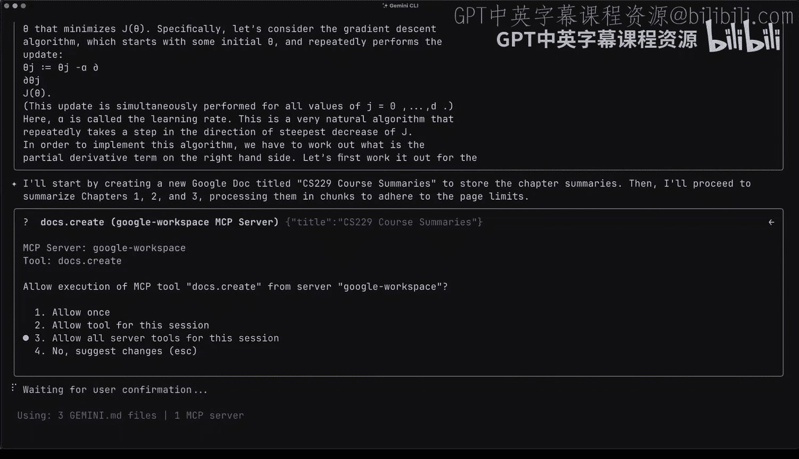

Like a second ago， Chapter 6 wasn't there， and now we can see we have a summary for Cha 6。

 support vector machines in our Google Doc。 So we'll let it go chapter by chapter and then we'll come back once it's finished。

 So Gemin Ili is now saying it has completed the summarization of all 17 chapters。

 We can go ahead and verify this by taking a look at the Google Doc itself to see if we have all 17 summaries。

 Looks like we do have 17 different chapters that are summarized in our Google Doc。

 So now that we have the summaries of each chapter of the course。

 let's ask Gemin Ii to generate us a study guide for each chapter。 It' will give us some questions。

 Some answers。 Hopefully it'll give us some good kind of practice questions and things to consider for each chapter that we should know ahead of our exam。

 We'll tell it to also save this to a Google doc。

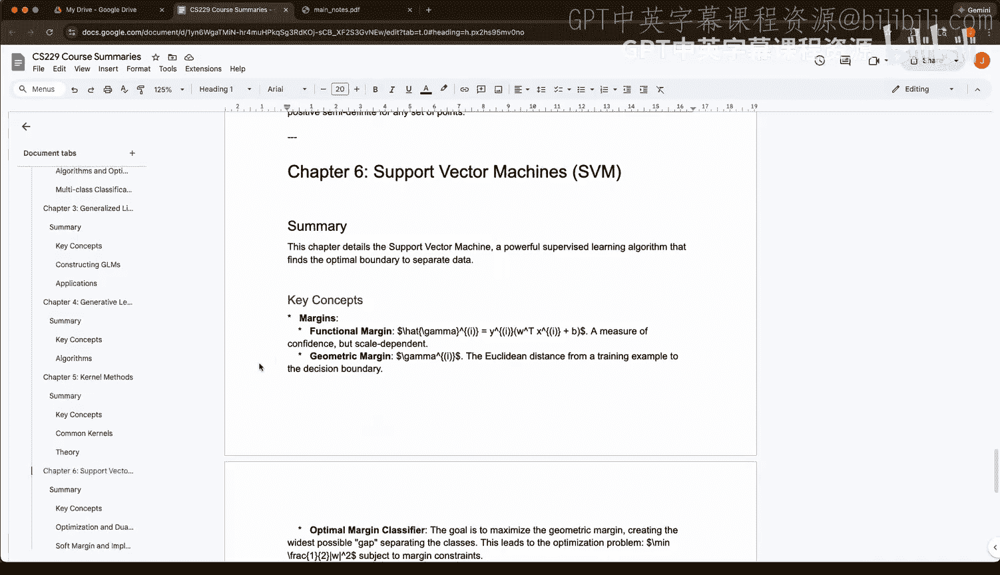

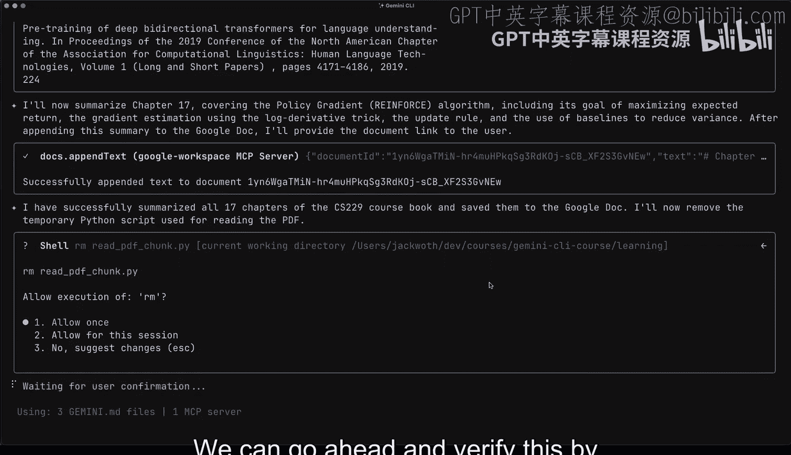

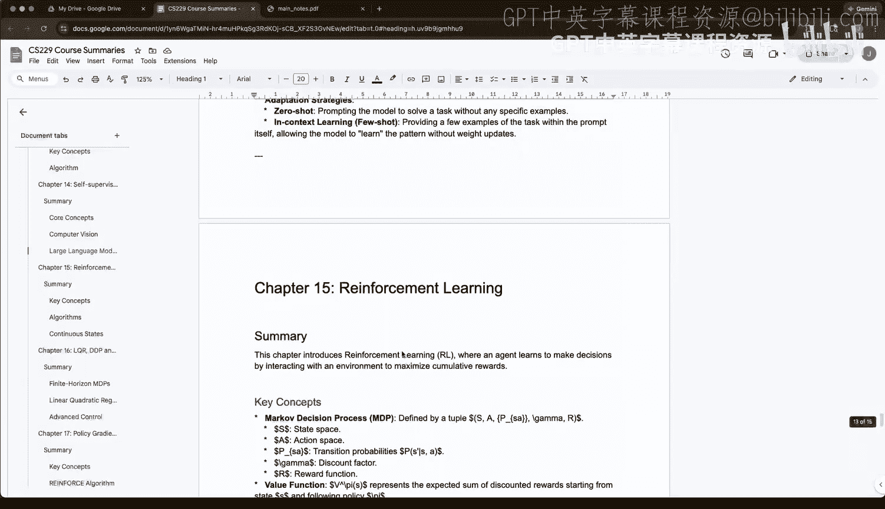

So it's going to create a new document for a study guide。

 and it's going to start adding new information to the document。 So that was pretty quick。

 It looks like it's already done the task。 And if we check the Google Doc。

 it looks like it's done just that we can see that we have key concepts。

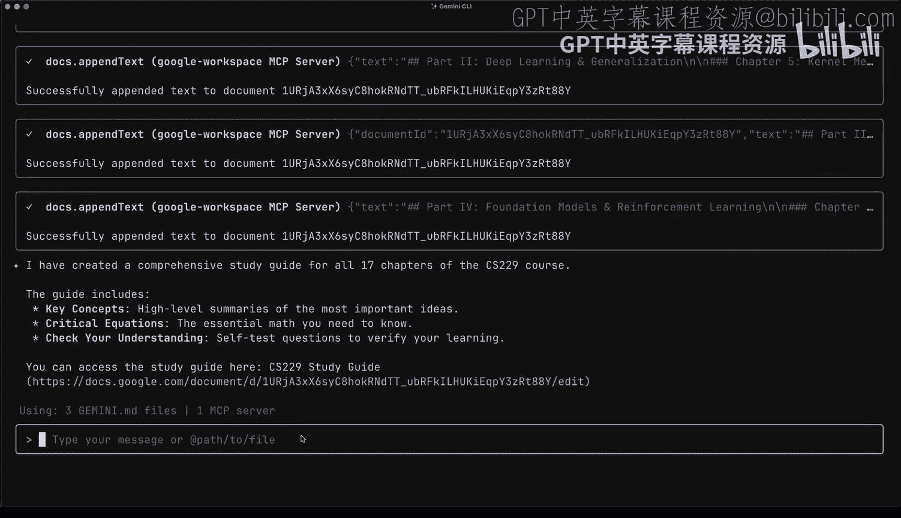

Critical equations。 And we have this check your understanding where it's asking us questions like why do we use the normal equation instead of gradient descent。

 which is a very good question， one that I should probably go study for as well。

 Now we'll take it a step further and actually have Gemin Ii create something that's interactive。

 It's a bit boring just to read through the sumizations and check your understanding questions。

 So let's go and actually have it create us a web application that will quiz us and that we can have it test our knowledge live。

 which is way more fun。 We haven't really given it any guardrails or any indication of what technology stack to use for this。

 So it's gonna to be fully gemmin Ili deciding on its own what it wants to use to create this interactive application。

 It looks like Gemin Ili has created a nice little h file that we can just go ahead and open in the browser of our choice。

 We can also just use the shell mode using open practice test hl to actually go ahead and open this in your preferred browser。

 We have our nice little interactive practice tests that Gemin Ili is created for us。

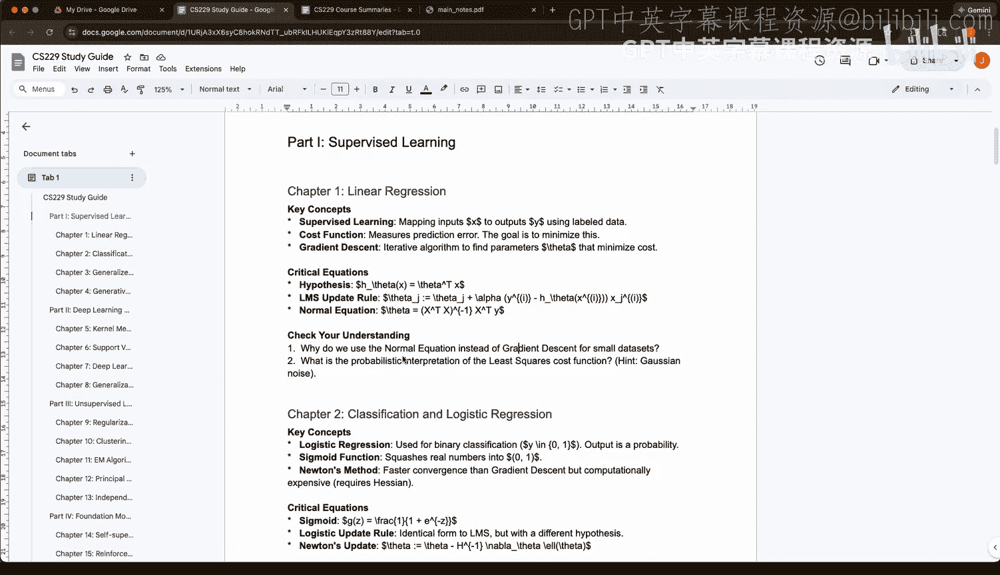

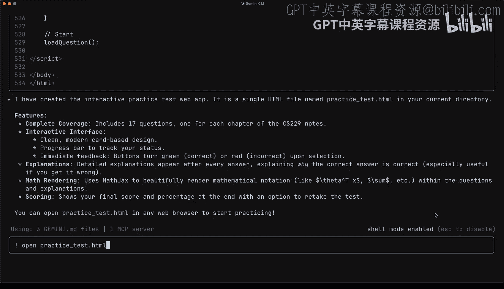

We can go ahead and quickly test it out。 whoops， it looks like we got the first question wrong。

 It's not gonna actually provide us with details on the correct information。

 which is really nice for when you're trying to study。 In a matter of minutes。

 we did quite a lot of different things with Gemini Ci for learning and studying。

 I hope this bonus lesson kind of taught you how you can really think outside of the box in use Gemin Ii in various different ways。

 having it be a tutor， having it be a study helper。 So the next time you're learning a new topic。

 studying for a test or maybe even just doing research or brainstorming idea you had spin up a Geminii and actually have it help you with the process。

 I think you'll find things are much more efficient and you can actually conquer a lot more that you couldn't without it。

😊。

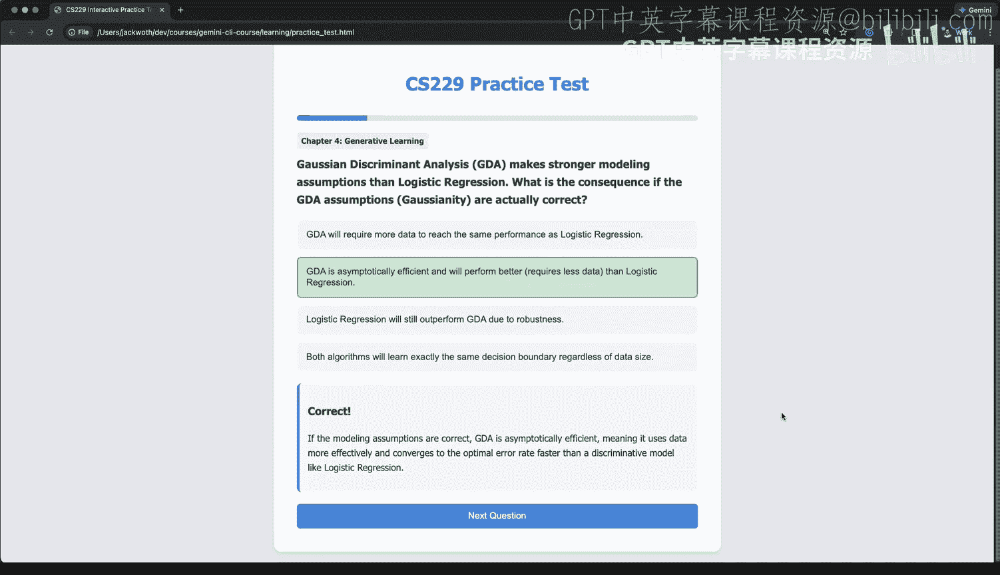