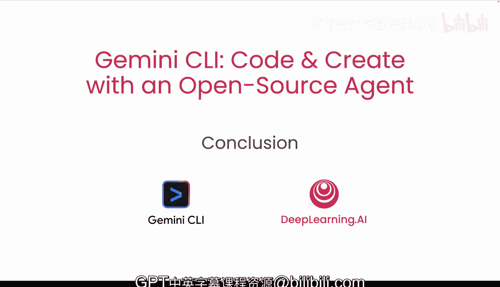

# 吴恩达《Gemini CLI：使用开源智能体进行代码开发与创作｜ Code & Create with an Open-Source Agent》 - P11：10.conclusion.zh_en - GPT中英字幕课程资源 - BV1oH6qBPEEe

In this course， you learned how to apply Gemini CI to many different use cases。

 You built out the feature set for a website， incorporating the Canva MCP server and Google Workspace extension。

 You also analyze a ton of data and developed a data dashboard with it。

You use Gemini CI to create social media video clips and use it for studying。

 I hope you've gotten a lot of great ideas for how to apply Gemini CI into your own life。

 whether that's coding， content creation， studying or something else。In the upcoming reading item。

 you can check out all the prompts used in this course。

 installation instructions and a reap both code examples that you can try out on your own。

 I'd love to see you get involved in the community。

 I hope to be able to review your pull requests in the near future。 Plus。

 I can't wait to see you at T cof 2026。 Happy building。😊。

