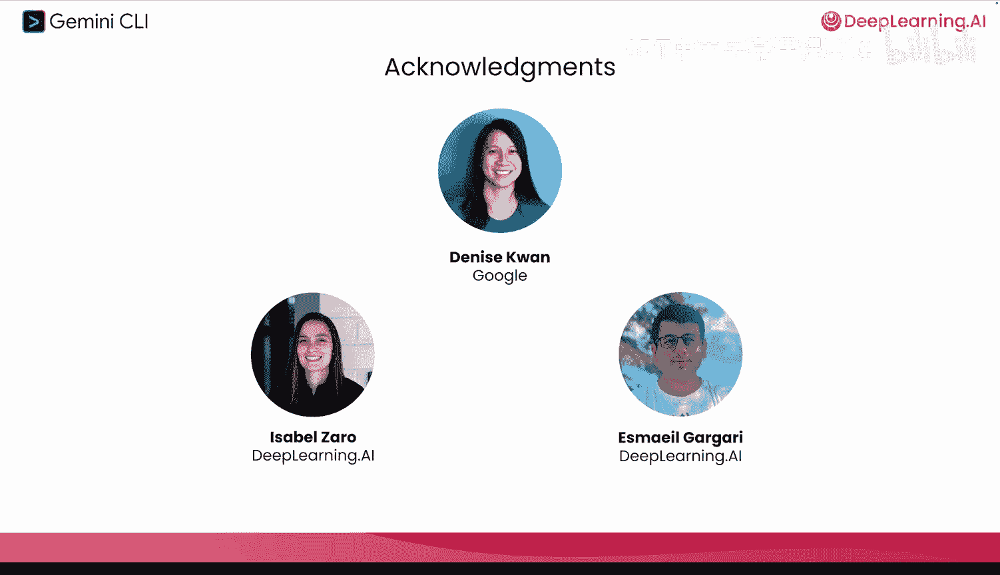

# 吴恩达《Gemini CLI：使用开源智能体进行代码开发与创作｜ Code & Create with an Open-Source Agent》 - P1：1.intro.zh_en - GPT中英字幕课程资源 - BV1oH6qBPEEe

Welcome to this course on Gemnii CI built in partnership with Google Expience developers are using agent gen coding assistance to dramatically speed up our work In this course。

 you learn about many of Google's internal best practices for agent genT coding。

 including how to apply it to common use cases like building web frontends or automating codere using Github actions and even non-cod tasks like creating multimedia content for social media。

😊，I really enjoy using Gemini CI myself and hope you also get a lot of value all of it I'm delighted our instructor for this course is Google's Jack Wellerwood。

 who is developer advocate working on Gemini CI。 Thanks Andrew Gemini CI is one of a number of agent coding assistants you may have used or heard of。

😊，This course will take you from installing Gemin Ili to organizing and coordinating multiple tools and MCP servers in an automated workflow。

 you'll learn how to coordinate between local files and cloud services to develop features and analyze data。

 You'll engineer Gemin II's context and memory to get the best possible outputs in the later lessons you'll use sophisticated automations to take care of routine tasks like CodeVi。

Throughout this course you'll explore Gemin II for software development and beyond using the example of planning an AI conference like the next AI dev conference。

 for example， you'll build key features for a conference website using Gemin II's native Google workspace extension to work with docs and calendar you'll also use the Canva MCcP server to create conference marketing materials you'll build a data dashboard that combines attendee data with existing company database and use Gemin Ili to work with multimedia turning a conference podcast into social media clips and posts as a bonus you'll see how Gemin II can help organize and search messy course materials to make studying easier which will hopefully help in your next deep learning AI course Many people are using a gen coding systems like GeminiI code or open AI codes these agent Gentic tools are valuable because they have access to your local machine and so can be given permission to run commands on your machine like Pp install or playwright or NPx or Git to get work done for you In fact。

Just a small set of tools， these agentT coding assistants can set up the development environment needed and build entire apps or feature sets quickly。

So especially when it comes to prototyping， I now almost never write code by hand anymore。

 but instead get AI coding assistance to write it for me。

 and this is dramatically speeding up me and many other developers Prototyping has never been faster。

 What's also exciting about Gemin II is that it's fully open source You can see exactly how it works。

 Every line of code is public on our Github right down to the actual instructions and system prompt。

😊，We've merged thousands of pull requests from members of the community。

 including popular features like session management and we're welcoming your contributions to open source software is very important for innovation especially in the age of AI If you feel so moved go to the Github repo and check out the prompts and after you've completed this course you might also consider contributing to Gemnii CI or to other open source projects these contributions create value for everyone speakingea of contributions many people have worked to create this course I'd like to thank from Google。

 Denise Kwan and from Deep blameed AI Isabel Zro and Ismail Ggari In the first lessons。

 you'll see how to get Geni CI up and running and get a taste of some of the most common tasks built in tools and usage patterns we're seeing in the community I think you have a lot of fun using Gemni Ci Let's go to the next video and get started。

