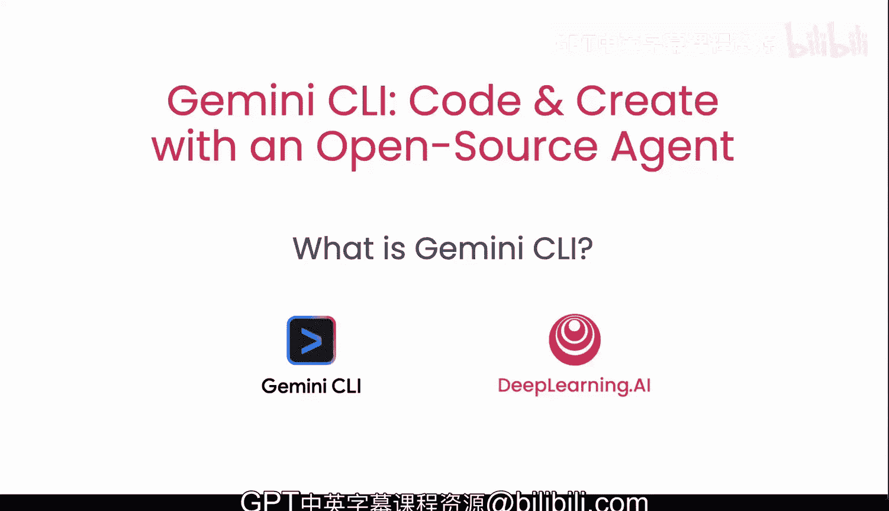
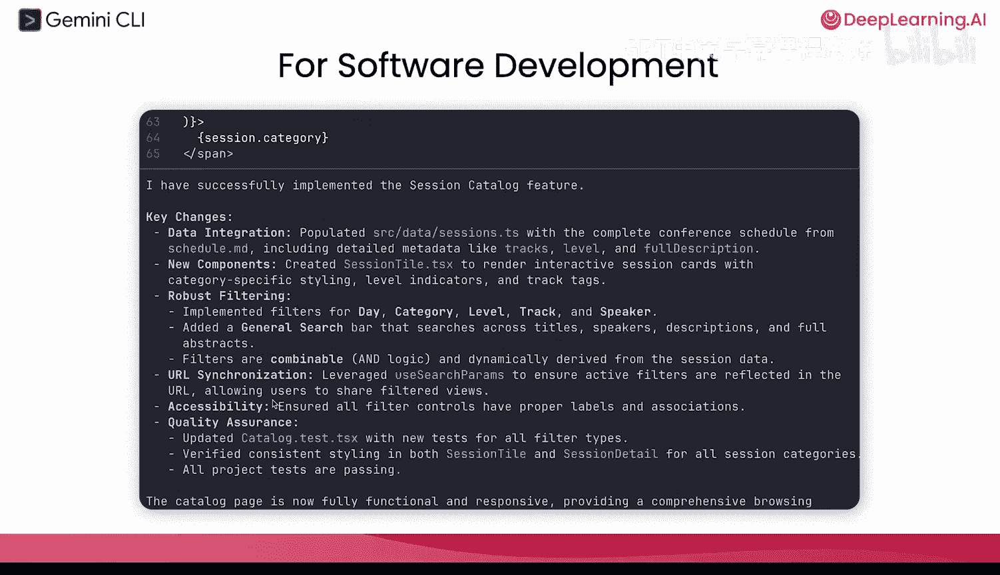
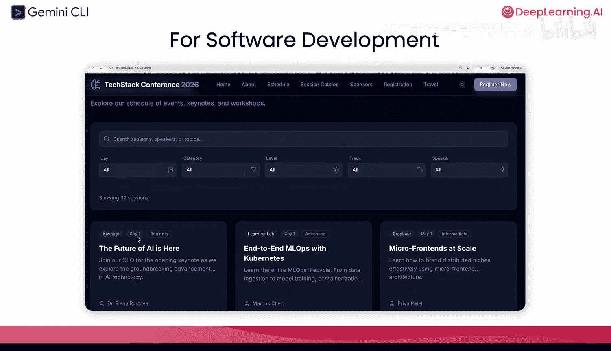
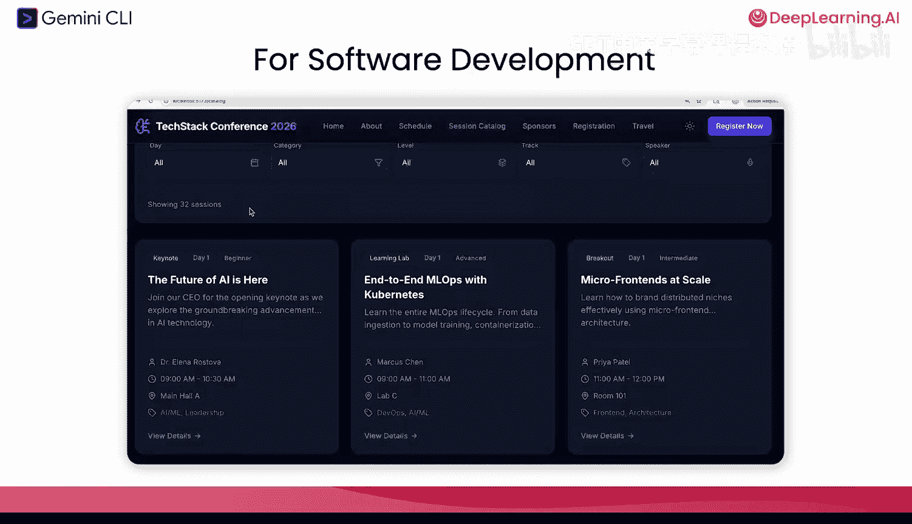
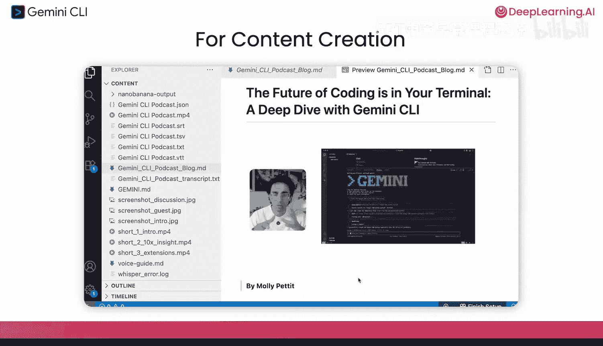
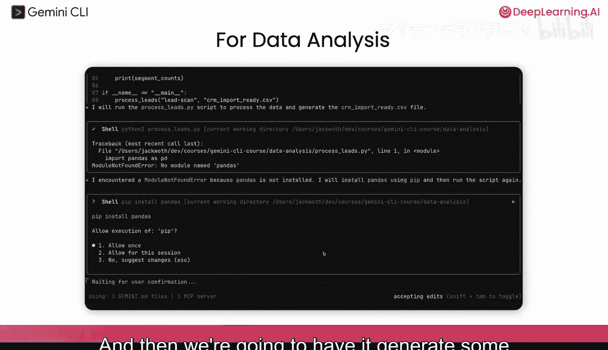
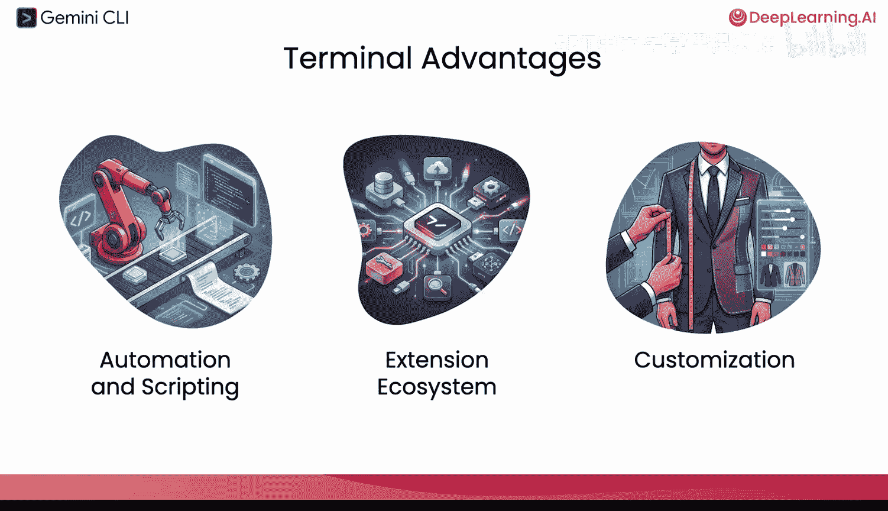
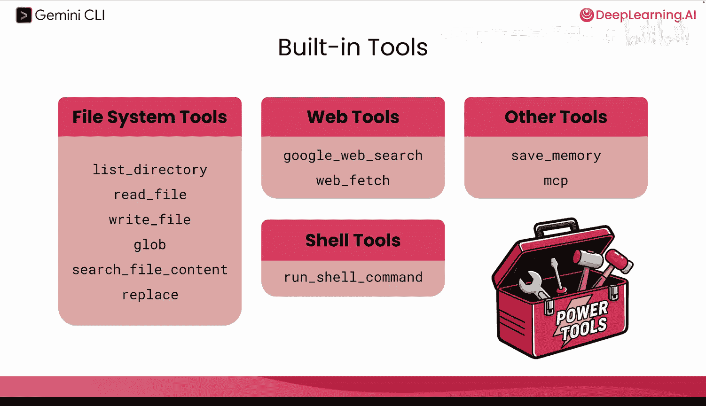

# 吴恩达《Gemini CLI：使用开源智能体进行代码开发与创作｜ Code & Create with an Open-Source Agent》 - P2：2.what-is-gemini-cli.zh_en - GPT中英字幕课程资源 - BV1oH6qBPEEe

Gmini CI is designed for any task that requires working with local files and multiple tools。

In this lesson， you'll see how Geminii works under the hood。

 you'll also learn why working from the command line gives you powerful advantages over web interfaces。

 I hope this lesson will spark ideas about what's possible with Geminili。 Let's dive in。

 So throughout this course， we are going to go over different use cases where you can use Gemini Ci to your advantage and it's quite vast what Geminii can do。

 You can do it for software development。 You can have it implement features。

 You can actually have it review code as a Github action in a Cicd pipeline。

 You can also use Gemini Ci for content creation。 So we're gonna to show you how you can actually take a podcast。

 break it up into shorts and generate content for social media and we'll use some really cool technologies such as nano bananaana。

 Gemini Ci can also be used for data analysis Later in this course。

 we are going to take quite a large data of Cv files and actually have Gemini Ci go ahead and process it。

 It's going to clean the data。 and then we're going to have it generate。😊。

Some really nice visualization dashboards for us。 We're also going to show how you can actually use Gemini Cli as a study buddy。

 We'll have Gemini Cli go over course notes for us。

 build summaries and then build interactive tests to help us make sure we're ready to go and have learned the material。

 So now what you've come here for what is Gemini C Gemini Ci is an agent that lives in the terminal。

 This means you can easily install it。 It very lightweight。

 You can just prompt and ask questions and the agent will go off， do research on your behalf。

 It'll find the files it needs to access and read the contents and then use that to give you a really clear response。

 It's a conversational AI agent at heart， and it's meant to be an interactive assistant。

 You're supposed to go back and forth with the agent to help you accomplish and perform the tasks you need。

 So as we mentioned， Gemini Ci's open source。 The community helps drive a lot of the feature development。

 You can actually go and inspect every single line of code。

 and it means you can actually go ahead and customize you can。😊，Work the code。

 add in your own features or create your own version of Gemini Ci。 And finally。

 the name kind of gives it away。 but it is powered and backed by Gemini models。

 The free tier actually comes with a very generous amount of requests so that you can actually use this tool absolutelyute free of charge for your daily work。

 So let's take a step back and look under the hood of Gemini Ci so we know how it actually works。

 You send a prompt。 This is sent to a large language model。 The Gemini models。

 and it does the reasoning to understand what tools it needs if it needs to process any information if it needs to request follow up information from you。

 the user， Then it's going to go ahead and actually call the tools in order to generate the proper response。

 and it can go through this process multiple times so it can iterate through calling different tools。

 getting different information sent to it and doing the reasoning on it until it is satisfied with response before it sends it back to you。

 This is really powerful because it means Gemini Ci can run for extended periods of time doing reasoning and looping。

Different tool calls in order to build out entire applications or debug really tricky issues on your behalf so that you can spend time doing what you do best in building。

So let's take a look at the actual advantages of using a terminal agent。

 the main one being that has direct access to your file system。 So all of the files on your machine。

 Gemini Ci can go and read the ones it needs to help answer your questions。

 This helps it be context aware。 This makes it very conversational and makes it feel like a partner in a task。

 Another one of the key advantages to a terminalbased agent like Gemini Ci is that is really a Swwiiss Armyni of tools。

 Anything you have installed on your local computer。 Gemini C is access to。

 it can actually go out and install things for you。 So for instance。

 if you're deploying an application or you want to check logs of a deployed service。

 you can actually have Gemini Ci used G cloudud to go ahead and pull those logs in。

 This really helps you stop context switching because Gemini Ci can install the tools and execute them on your behalf。

 Some use cases where this comes in handy。 Autoation and scripting。

 Instead of having to go learn about how to do something。

 you can actually have Gemini Ci just build a script and then it can run it for you。

 One of the advantages of Gemini Ci is also its vast。

Extensions ecosystem and this really helps Gemini Ci become fully customized so that any task you're trying to complete can be done through adding on extensions mP servers or custom commands at a base layer gemminii comes with a bunch of built in tools these are file systems tools list the directories read files write to files。

 do search and edits another cool capability of gemmini Ci is that it actually has a web search tool this is really helpful when gemmini Ci needs access to things that maybe were just release or there was things in the news you want to do some research on fresh data that it wasn't trained on As we mentioned it also has shell tools so it can run any single application on your machine through shell commands So if you have Githubi it will go ahead and actually run a shell command to execute Github Ci and put up that pull request for you there's also other tools such as the ability to save memory so that when you use Gemini Ci often it can remember certain pieces of how you like to customize your workflow or certain details that you don't want to have to repeat on every single。

So now that we've gone over the use cases and the tools for Gemini CLI and why it can be versatile。

 let's actually show it off and get it installed in our machines so that we can get going。

