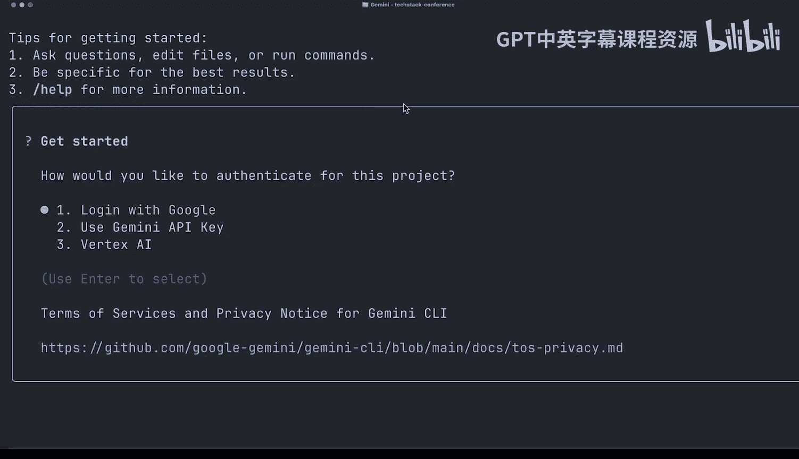
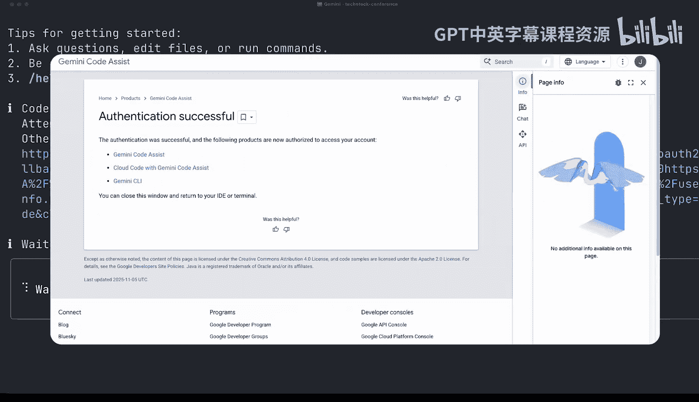
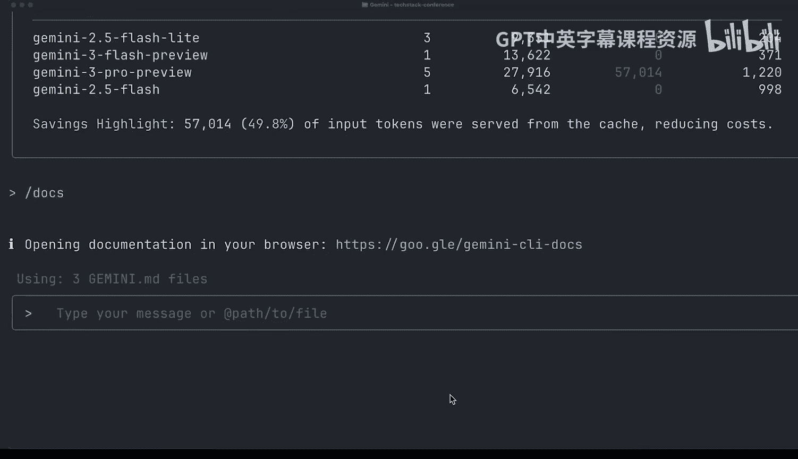
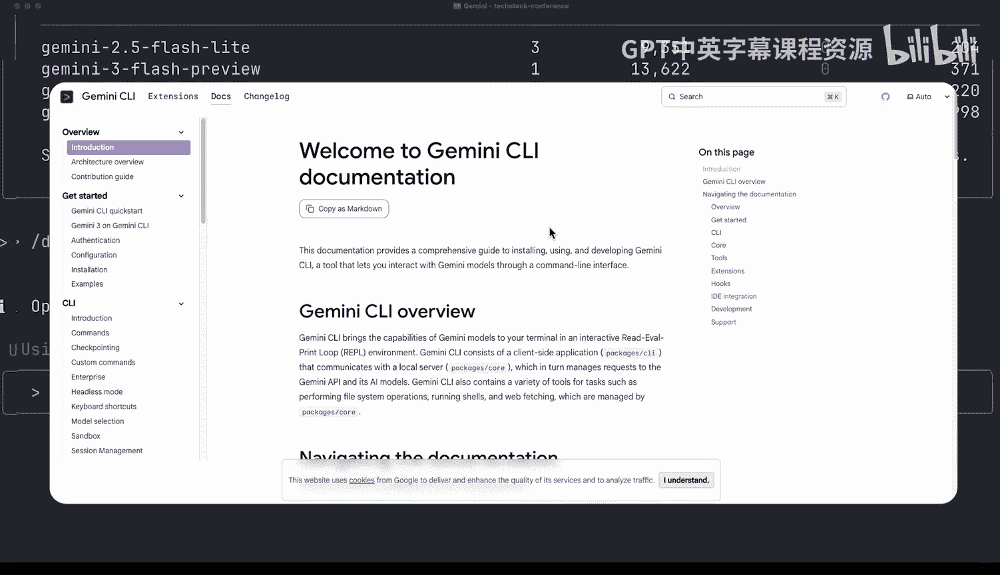
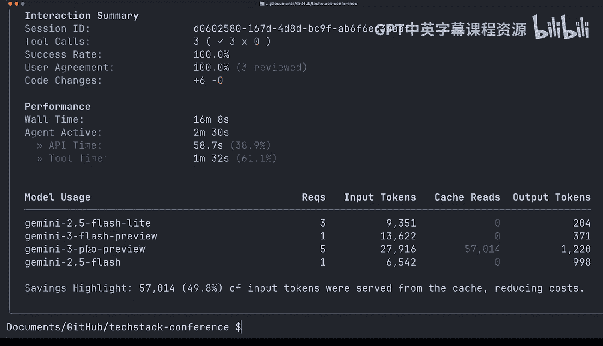

# 吴恩达《Gemini CLI：使用开源智能体进行代码开发与创作｜ Code & Create with an Open-Source Agent》 - P3：3.a-tour-of-gemini-cli.zh_en - GPT中英字幕课程资源 - BV1oH6qBPEEe

Let's get Gemini Ci up and running In this lesson， you'll learn how to install Gemini Cli。

 explore its commands and try your first workflow。 All right， let's get into it。

 throughoutout this course， we're going to take on the persona of an organizer for a tech conference。

 There's a ton of things we are tasked with， such as building out the website。

 doing research and planning， social media， as well as after the conference。

 We're going to want to go through all the data and potentially see if we have any leads that we can reach out to。

 All of this can be superpowered with Gemini Cli。 The first thing we want to do is actually do research。

 look at the notes from the past year's organizers。

 amplify that with searches from the Web and best practices for actually planning and organize a conference。

 to install a Gemini Ci。 You're going to need node as Gemini Cli is deployed as an MPM package。😊。

For all the prerequisites， installation instructions and prompts that we go over through this course。

 make sure to check the reading items at the end of the course。

 the command to install Gemini Ci is MPminstg@ Google/geminii。

 This will install the package as a global package so that you can use it across all of your projects on your machine。

All right， now we actually have Gemini CI installed。 The fun can begin。

 The command to start Gemini Ci is just Gemini。We're starting Gemini Ci in the folder or project for our conference。

 This is where we have all of our materials， as well as the first prototype of our website。

 We're using Gemini Cli in ghoste， but you can use it in any terminal of your choice。

 You should see something like this on screen or it's asking you to authenticate。

 There are three different authentication methods， there is login with Google where you just use your personal account。

 and this is what you'll want to do for the course as this gives you access to the free tier。

 if you want to continue on after pass that。 you can use an API key or vertex AI to get more requests。

 So to kick off the authentication flow just select enter on login with Google。

This will open up an Outhth flow in your local browser that you can go ahead and use to authenticate to GeminiCI。

Once authenticated， you should go back to Gemini CLI and see that the authentication has succeeded。

So here's what Gemini Ci looks like when you first started up。

 you'll see there are some tips on screen， as well as this nice Gemini banner。

 We're using the latest Gemmini 3 models。 depending when you are running this。

 you might have a more up to date model， you can go ahead and actually change the models if you prefer by doing s model。

 the default is to use auto， which actually lets Gemmini Ci intelligently decide which model is best for any given request。

 So if you ask something simple， like hi， it will actually use one of the cheaper Gemini 3 flash models。

 Where if you have something complex， like refactor my entire codeb。

 It's going to go ahead and choose Gemini 3 pro， the most capable model。

 The best place to look to get started with Gemi Ci is surround the s help command。

This will go ahead and list all the available built in commands that Gemini Cli comes with。

 as well as some fun keyboard shortcuts。 Another good command to get started with is slash settings。

If you're a vim user， you can actually enable vim mode。 So Gemini Ci respects Vim。

 My favorite setting is the hide footer setting。 This will actually go ahead and make Gemini Ci look a lot cleaner。

 and we'll go ahead and do escape。 And now you can see we no longer have that bar underneath。

 So we can actually have a nice， clean Ui。 You can actually customize the color scheme。

 This is another 1 I recommend doing by doing slash theme。

 And you can actually customize and create your own theme。 when I'm feeling adventurous。

 I like to use shades of purple。 But you know what。😊，Not feel un superaddventurous today。

 So let's stick with default。 Let's get started and send our first prompt to Gemin I C I。

 So last year， the organizers of the 2025 conference left us some suggestions for how to host and organize the conference。

 We have this in a marked down file， suggestions dot M D。

We can go ahead and use the@ symbol to actually pull in and reference that file so Gemini Ci will go and read it and have access to the context。

 If you just said read the suggestions file， it will also figure it out。

 but it will have to take some time to process and think about it first So let's go ahead and execute that and you'll see Gemini Ci actually will spin and think and it will actually sometimes have some woody jokes as well as output messages as it reasons through Geminili has responded。

 we can see the recommendations from last year's organizers such as the website making sure the schedule and session catalog are easy to find as well as making sure we have a unique hashtag for socials we'll take these into consideration and they'll be handy later。

 so we have the recommendations from last year's organizers but maybe these are out of date so we can go ahead and prompt Gemini Cli to see if this matches the online best practices and it should go ahead and actually kick off the Google Web search pull all the information from the web so we can make sure that we are having the most accurate and up tod information the previous organizers align very well with the general industry。

line guideides offer a more structured timeline， so there may be things we want to incorporate as we go forward with our conference。

 So we'll prompt Gemin Ii to add the new findings to our doc so that we can reference it again later。

We'll see that Gemmini Ci is actually now calling the right file tool。

 Gemmini Ci will actually by default， have a confirmation so that you。

 the user are in the no and in the flow。 When you get a suggestion。

 you can use C S to expand it and see the full diff。

 You can also choose whether you want to allow the tool called it just once。

If you want to always allow the certain tool， or if you want to even open the in an external editor such as VS code。

 you can always reject the suggestions if you want to go in a different direction。

 We'll go ahead and allow the suggestion and have it right to the file。Now。

 our suggestions that M is up to date with both the recommendations from last year's organizers and best practices that we found online。

 When you move from task to task， it's best to actually wipe gemmin II so that you can start fresh。

 You can do this with a s clear command。That will remove all of the tool calls。

 as well as back and forth with Gemini Ci from the conversation history。

 allowing you to start on a new task freshresh and not have it cluttered to see all your stats in a given session。

 you can just run the stats command。 This will show all of the different code changes the model has made the tool calls as well as all of their requests and which models they're getting readed to because we are using the auto model。

 you can see that we're actually spreading out our requests between different models。

 If you want to learn more are running into any issues with Gemini Cli。

 you can actually open the documentation directly from within Geminii by running s docs。

So if you want to learn more or get more details on a specific feature of Gemini Ci。

 this is super handy to exit or get out of Gemini Ci。 you just type slash exitit or squi。

 You also get a quick snapshot of the session history。 So now we've covered the basics。

 We've shown you a Gemini Ci what it looks like and some popular commands。 We also mentioned context。

 We showed you how to keep things clean and make sure Gemini CI is being efficient。

 We're going to go into more detail in the next lesson and cover context and memory within Gemini Ci。

