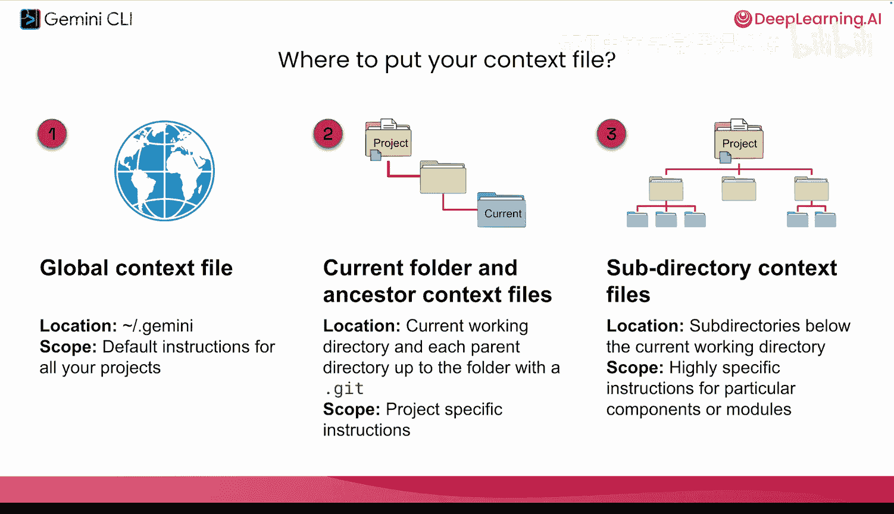
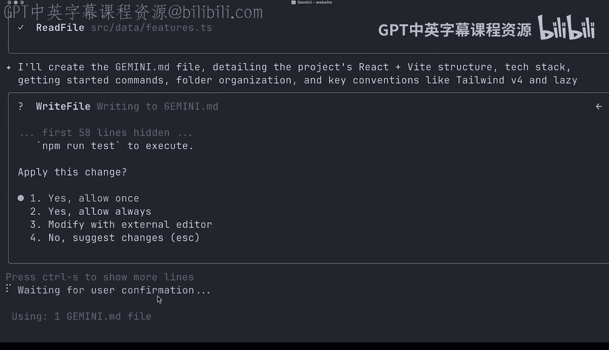
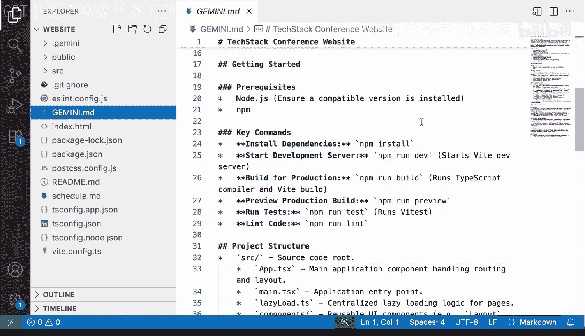
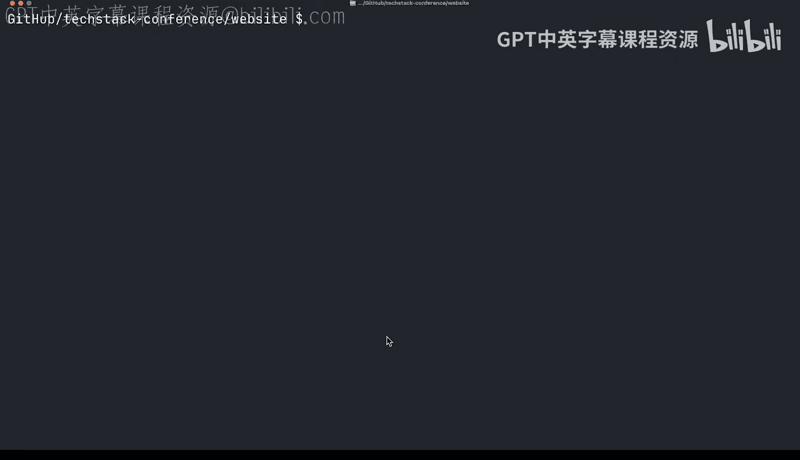

# 吴恩达《Gemini CLI：使用开源智能体进行代码开发与创作｜ Code & Create with an Open-Source Agent》 - P4：4.context-is-key-gemini.md.zh_en - GPT中英字幕课程资源 - BV1oH6qBPEEe

Context is everything when working with AI agents。 It determines what your agent knows and how it behaves。

 It's kind of like having your own assistant。 You'll teach them your preferences and habits。

 For example， how you like your coffee。 Let's take a look。

 I like to think of context as if your hiring gemmin Ii to be your personal assistant。

 You need to give context on what you like。 how you do certain things。 For instance。

 I like to take 12 sugars in my coffee。 If an assistant was new on the job。

 they wouldn't know this information。 This is also how we can think about it with Gemin I Ci。

 We need to prime it with the context it needs in order to answer the queries and respond efficiently。

 Context is a collection of information and AI agent uses to understand the user's request。

 Contex can come in various different forms。 General instructions。

 It could be instructions specific to a given project。

 such as this is using Python or this is using U V over Pip。 You can also give Gemin I Ci persona。

 such as you are a Q A tester。 make sure to test the changes and to end after every。

So where do we put all of this context？While Gemini Ci reads context from files called Gemini do M。

 you can have a global context file， So this is at your user level。

 So this would be instructions that apply to all of your projects that you want Geminili to remember Project project。

 you can also have Gemini do M files in a given project How Gemini loads these is in the current folder。

 It looks for ancestor context files。 So if you have one gemmini do M in your current folder。

 but also one in the folder above， it will keep on traversing that until it finds a dot git folder and say these are all in scope。

You can also have Gemini M files in subdirecties。 This is great for if you have certain folders such as testing or builds。

 you could have different customized Gemini。 MD files for each one of these folders that tell Geminii how to interact within the folder。

One of our coworkers has been working on the website for our tech stack conference。

 They just handed off all the code to us。 We want to start fresh and learn about the project and how it's structured。

 There are several commands within Gemini Cli to help you manage your memory and context。

 There is show where you can show the current memory contents。 Our memory is currently empty。

 The slash memory add command， lets us add memories to our global Geminite M context。

 This is again saved across all of our projects。 This is great for generic things that you want Gemini Ci to save across all your sessions。

 such as your name， how you want it to talk to you and other critical information。

 such as I only like purple on Tuesdays。 This is going to go ahead and prompt you to confirm that you want to add this to your memory。

 And again， we can see that it is in the global context file， marked by the squiggly line。

 Let's go ahead and allow this。 It's going to go ahead and automatically refresh the memory。

 so that now it's being pulled into the context。 Now， if we go and run slash memory show。

 We should see our new memory being saved。 So if we ask it， what is my name It should。😊。

Be able to use the memory it has in order to answer the prompt。 bininggo， it got it right。

 So that's perfect。 Let's take it a step further。 It's a good idea to get in the habit of creating a new gemmini do M D context file per project。

 givingiv the agent general knowledge on the technologies you are using an overview of the structure of your project and where certain files tend to go。

 can really help it work more efficiently。 Guiding the agent with context will help steer it down the right path without it needing to explore your code or files every single time you start a new session。

 Luckily， there is a built in command to help you quickly。

 create a good starting context file for any existing project slash in it。

 It will go through read in different key files。 You can see for our project。

 It's reading our package dot Json。 is going to start to look at the dependencies。

 It's also going to go through some of the key files such as our index as well as our different data。

😊，You'll see that Gemini Ci is now wanting to create the Gemini do M file detailing the project structure and technologies we are using。

 Our website is using reactact and Vet。 It's going to go through the text stack folder organization and store all of these in the context file。

 And once again， you can do control S to expand the output and see the exact details of what it's storing。

 Let's go ahead and create art Gemini do M D file。 I'm going to look through this in detail as I'm still getting caught up on how the website is built。

You'll see key details like getting started prerequisites for the project。

 It also covers key commands like how to MPM install。

 how to run the development server or even build the project for production。 Now。

 if we start a new session if we run smemory show， we can actually see that our contents of our Gemini M file are being loaded into memory。

 So now we've covered context and how to load context from our existing project with Gemini。 M。

 and the next lesson， we'll focus on how we can load external context through model context protocol or MCP。

