# 吴恩达《Gemini CLI：使用开源智能体进行代码开发与创作｜ Code & Create with an Open-Source Agent》 - P5：5.workflows-with-model-context-protocol-(mcp).zh_en - GPT中英字幕课程资源 - BV1oH6qBPEEe

MCP lets you connect Gemini Ci to your favorite external tools and services from Canva to databases In this lesson。

 you'll learn how to access remote servers using brand materials to generate a web page。

 Let's code Model context protocol or MCP is an open standard。

 enabling AI agents to seamlessly and securely connect with external tools。 Apis and data sources。

 MCP gives a standard of how LLms or large language models interact with data in context。

 Let's take Mongo Db as an example。 We have information stored in a Mongo Db database。

 and they have an MCP server。 We can use that MCP server within Gemini Cli to get access to all of the data。

 L the tables fetch the data do reads and writes to our actual database through this standard protocol。

 and it's not locked in to just Gemini Ci。 If we decide to move our application or use a different agent we can still use those exact same tools because we've used MCP。

 This is valuable because MCP lets you build on top of the built in。

Capilities of Gemini Ci extending the tools and commands you have access to。

 you can go ahead and use MCP to connect to Google Cloud to Github to sneak。

 you can even build your own MCP server that runs your own code。

 Any of the popular cloud services that you use in your day to day tasks are probably available as MCP servers before we connect our first MCP server to Gemini Cli。

 Let's take a look at our website and see how it' structured。 We can use Gemini Ci's shell mode。

 This passes through and actually runs the command without Gemini Ci having to think about it。 Now。

 any command you run would be as if you're running it directly in your normal terminal。

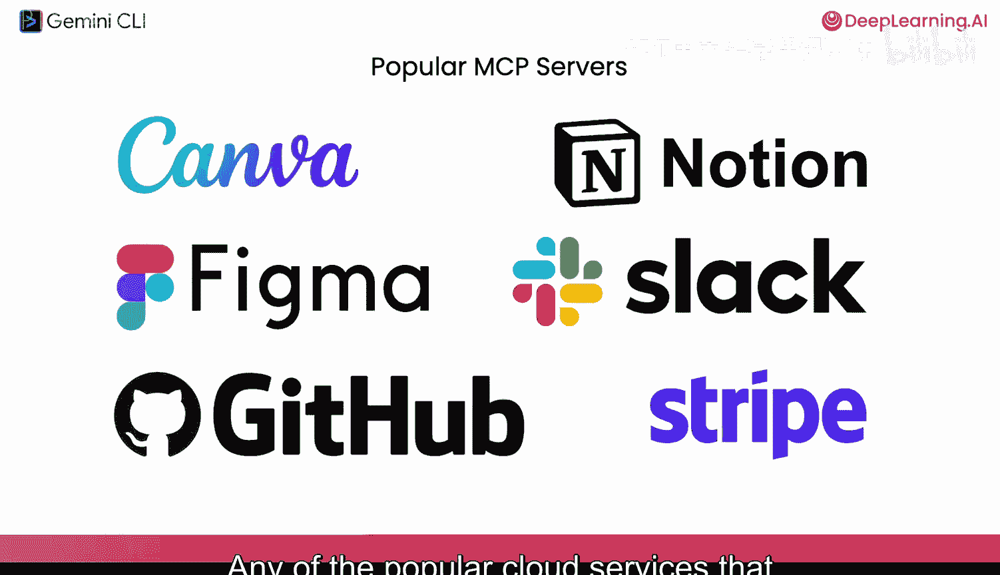

So we now have our website dependencies installed。 Let's go ahead and run the actual dev server for this。

 Ge Ili is actually gonna to know this from our context。

 It doesn't even have to go and read any files。 It just knows that start our dev server。

 It's MPM run Dev。 And it's gonna to go ahead and prompt us for the shell command。

 Let's go ahead and allow it。 We'll go ahead and open local host on port 5，1，7。

3 or the MPM server is running。 oof， that's a little tough on the eyes。

 Let's go ahead and change into dark mode。 Okay， that looks a lot lot better。

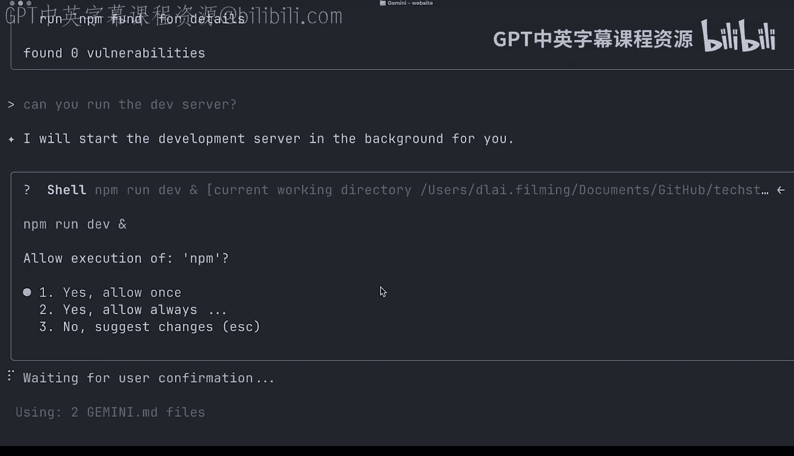

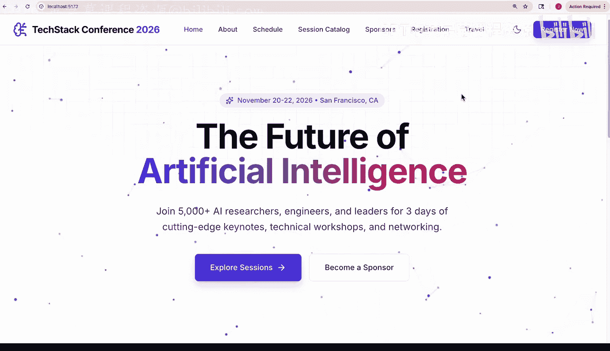

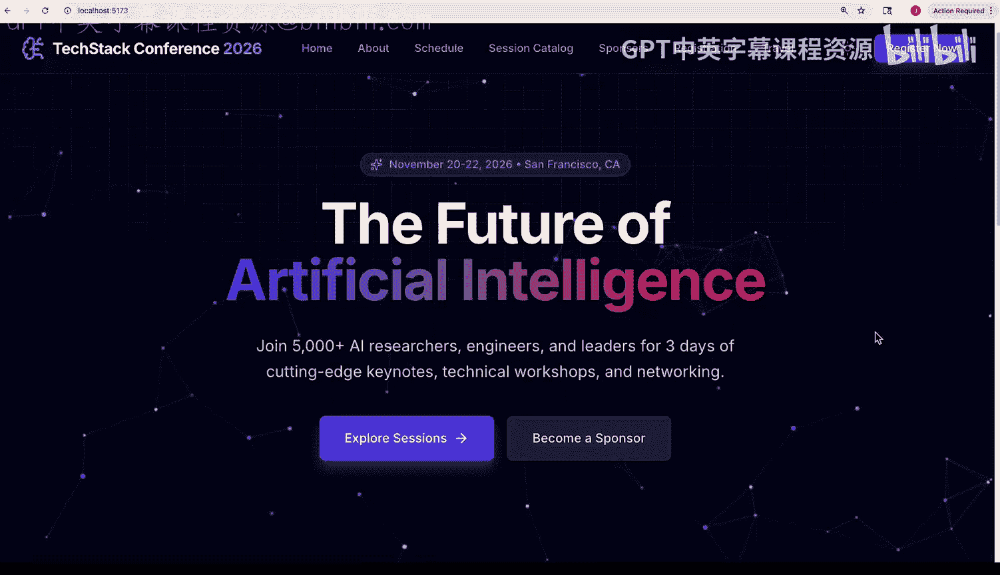

This looks awesome。 We've got a great foundation。 It looks like we have most of the stuff we want。

 implemented。😊。

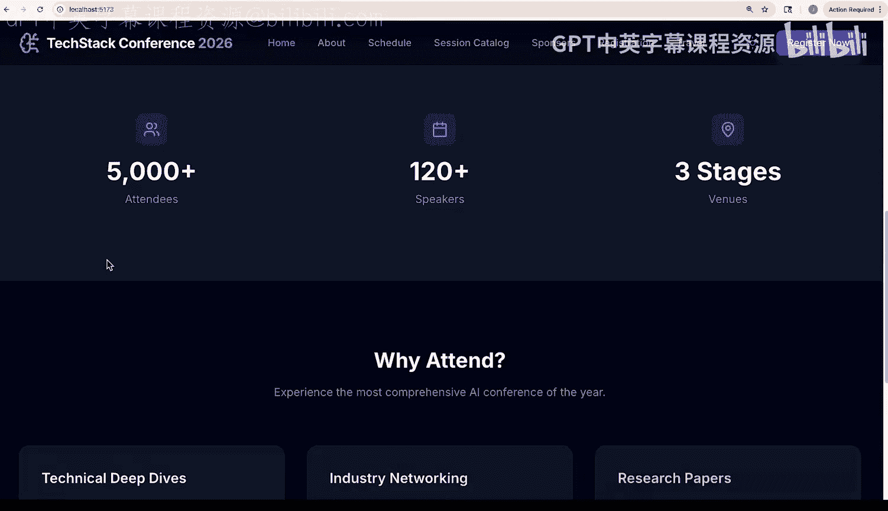

One thing I see that's missing is a social media kit。

 People who attend the conference are going to want to be able to share on social media。

 We should tell them what hashtag to use， as well as the color schemes and fonts for the conference。

 Our social media team has curated a brand kit in Canva that we can use for this。

 Instead of downloading and saving the image and design。

 we can actually leverage Canva's MCP server to do this within Gemini Ci without having to leave our terminal。

 Gemini Ci has subcommands for MCP that we can use to add an MCP server with a single line Gemini MCP ad dash T for the type。

 We're using an H TtP remote server。 We pass the name of the server Canva。

 as well as the URL to the remote MCP endpoint。 You can find this URL online from Canva。

 Once we run the command， we should see that the MCP server has been added to our settings。 Now。

 when we start up Gemini Ci， we should see that it's asking us to authenticate to the remote server。

 We can do this with s MP off。 It will give you a list of your configured MP servers。

 Let's choose Canva。 It will open up an Outh flow in your local browser。

 You'll want to go ahead and allow。😊。

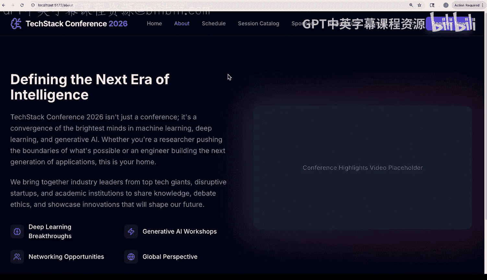

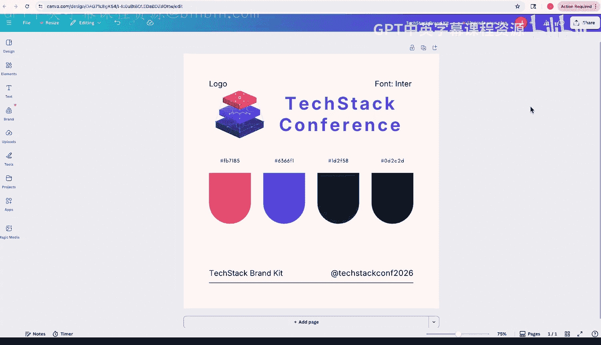

You can come back to Gemini Ci， and you should see that you are authenticated to verify this。

 run s MCP。 This will list your available MCP servers and will have an icon such as green to show that you are connected。

 The s mP command will list all the available tools you have。

 If you want to see detailed descriptions。 you can run s MCP desk。

 Now that we are connected to the MCP server from Canva。

 We can now ask it questions about our Canva designs。 such as can you list my most recent design。

 Gemini Ci will look at the tools Canva provides and realize that it needs to call the search designs tool。

 It knows that our most recent design that we edited was the techtac brand kit。

 Let's go ahead and ask Gemini Ci to read in the design and create a slash socials page for our social media kit。

 Gemini Ci will again discover the tools it needs to call in order to accomplish the task。

 It's going go ahead and get the design。 we're actually seeing it called different tools in parallel here。

 So it's reading the file at the exact same time that it's going to actually go and get the content from our Canva design。

 We can see that it's pulling in the different elements from our。

design such as what we had on screen， as well as all the different fonts and colors。

 It's now stepping through and figuring out its plan on how it can add the socials page to our website。

 And now it's gonna go ahead and write the file。 instead of having to manually allow each and every single one of these confirmations。

 We can do Yes， All always and it will help speed up our flow。

 You can see that it's now put us into accepting edits mode。

 You can also get here by running shift tab。 All right， it's complete。

 We now should have a socials page， as well as in the footer。

 we should have a link to the social kit。 Let's take a look。

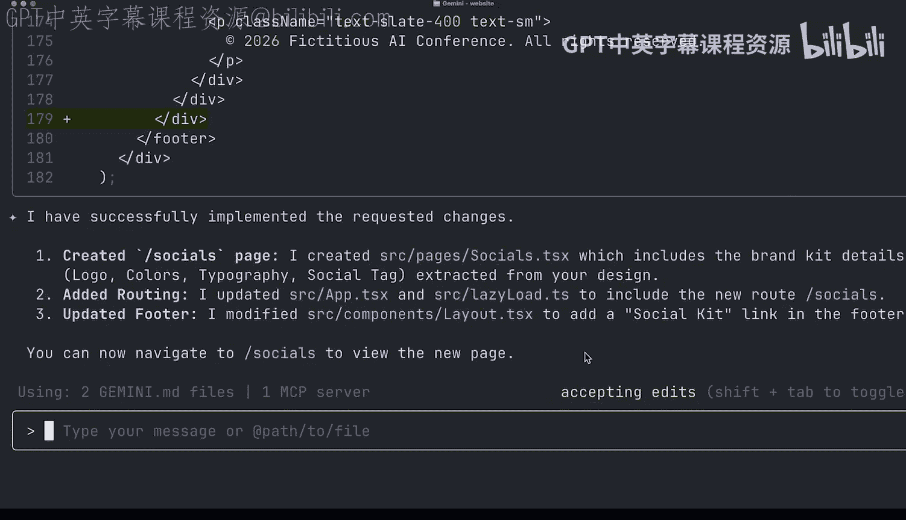

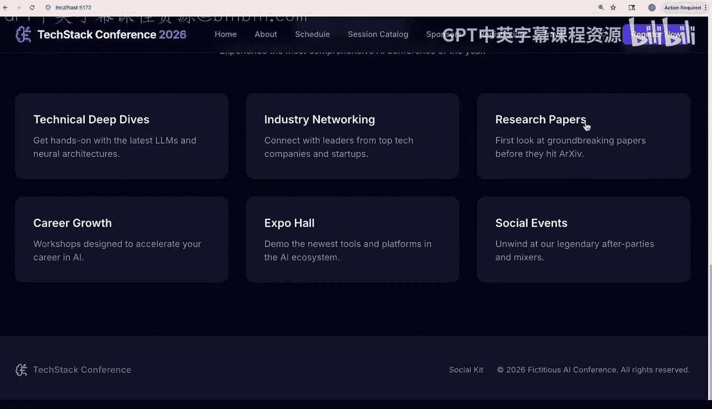

And there it is social kit。 We now have an official page we can send to conference goers so they can use official assets when they post on socials。

 Not bad at all。 Gemini CI can accomplish pretty complex tasks on your behalf。

 I encourage you to give complex tasks to Gemini Ci。

 You might be surprised with what it can accomplish。 Com up。

 We'll go above and beyond MCP with Gemini CI's extensions ecosystem。

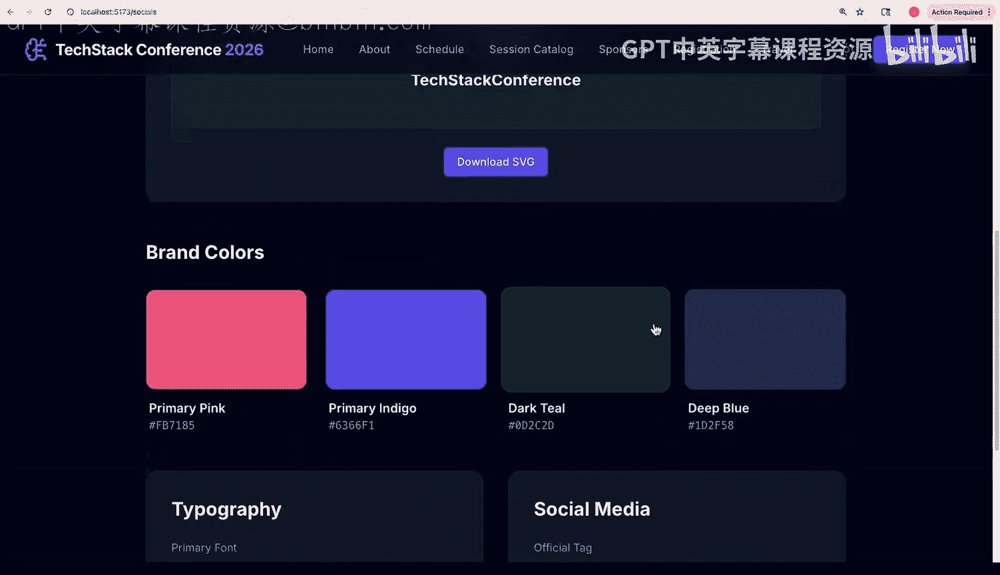

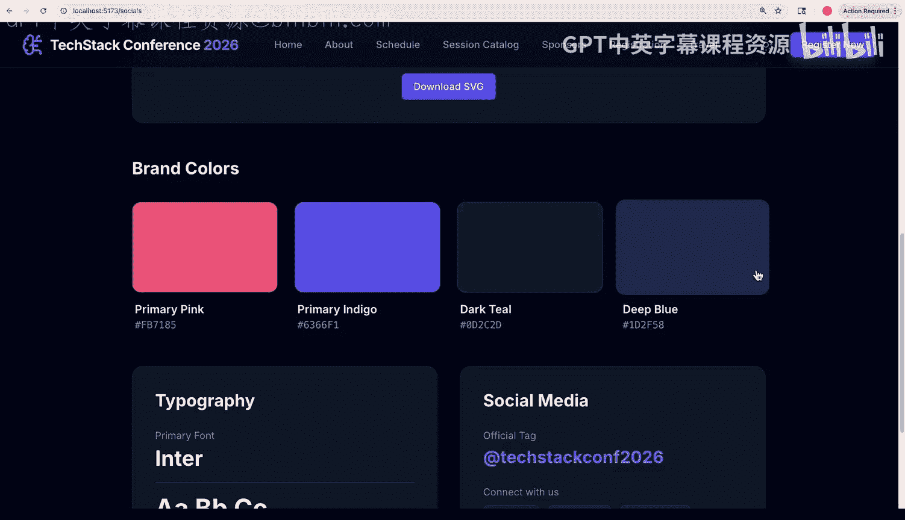