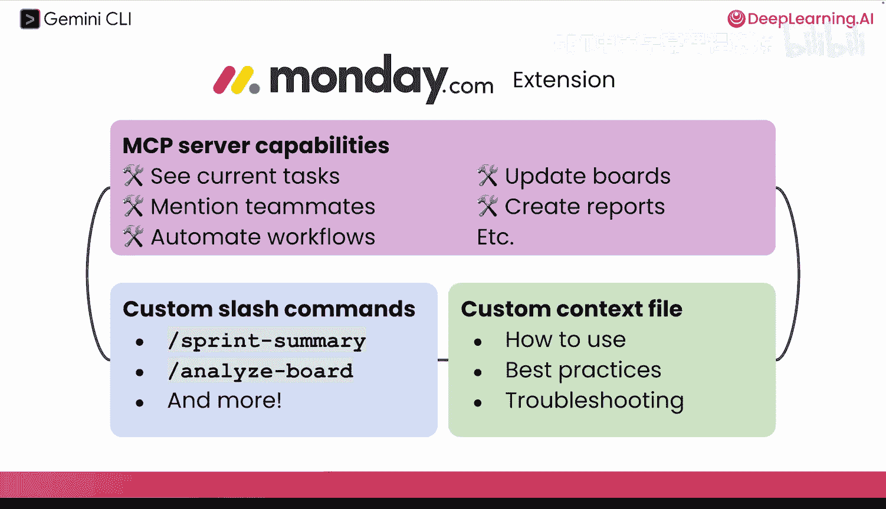
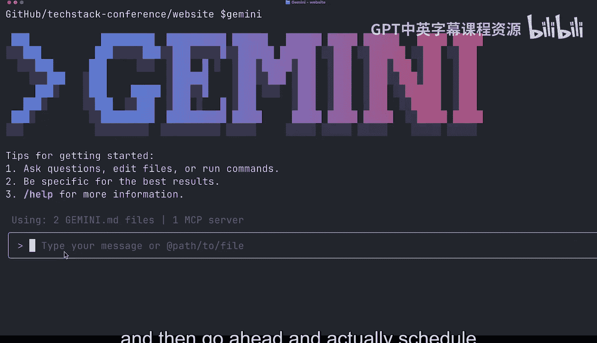
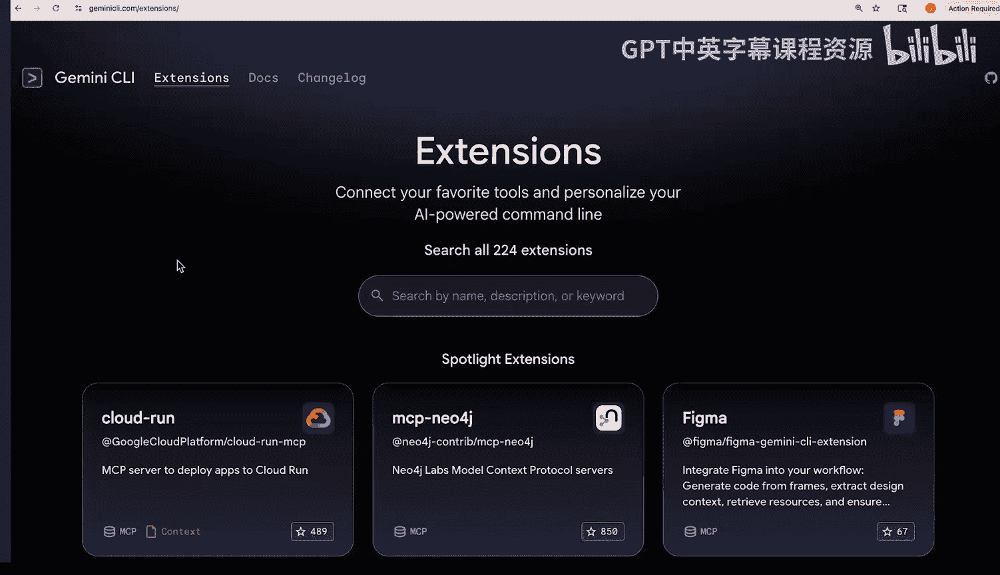
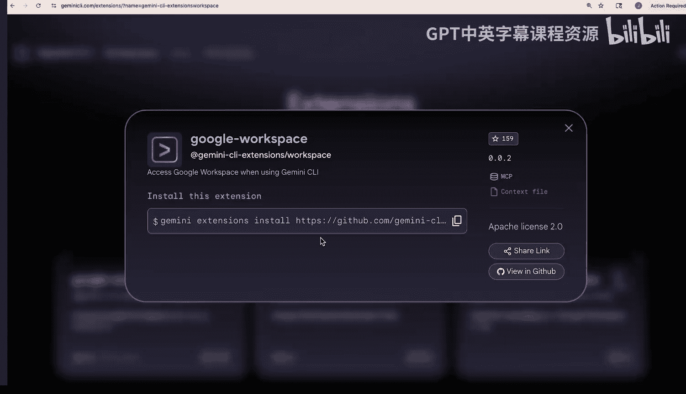
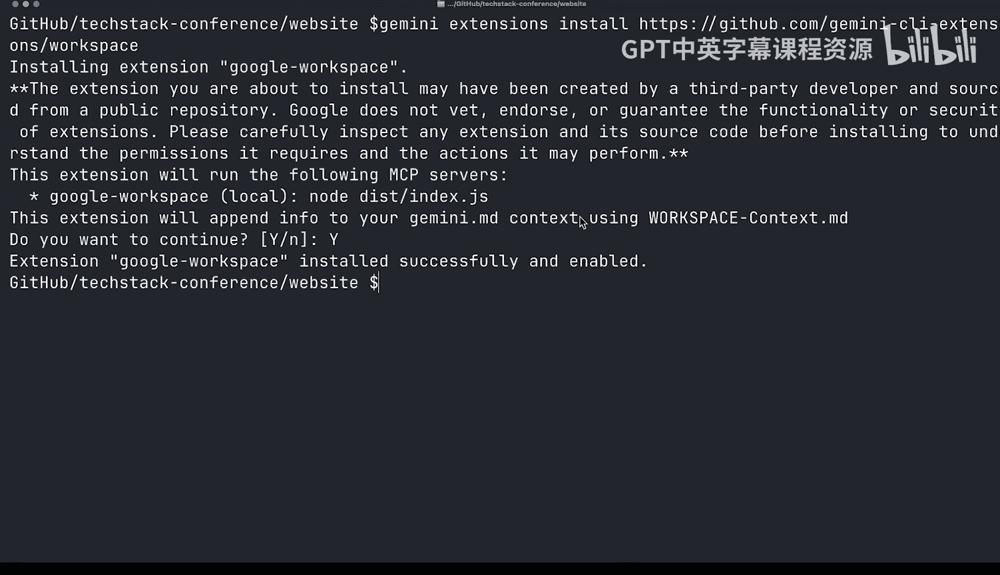
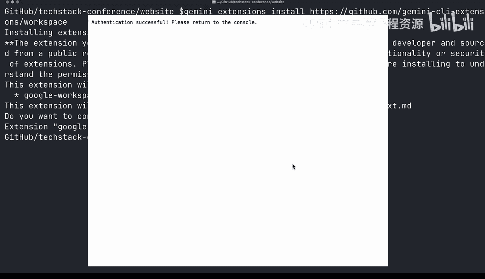
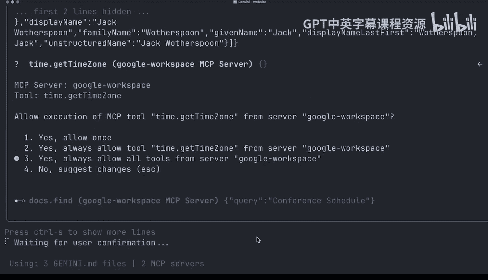
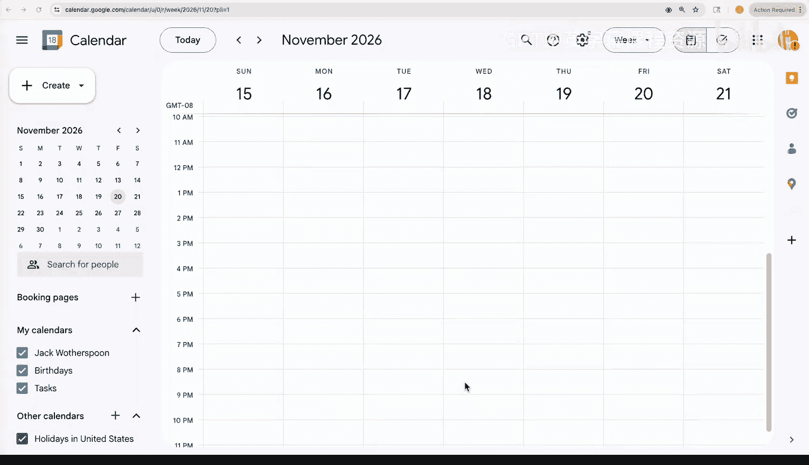
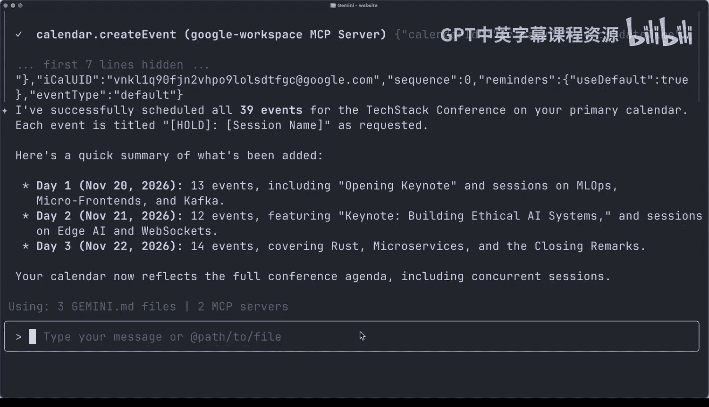
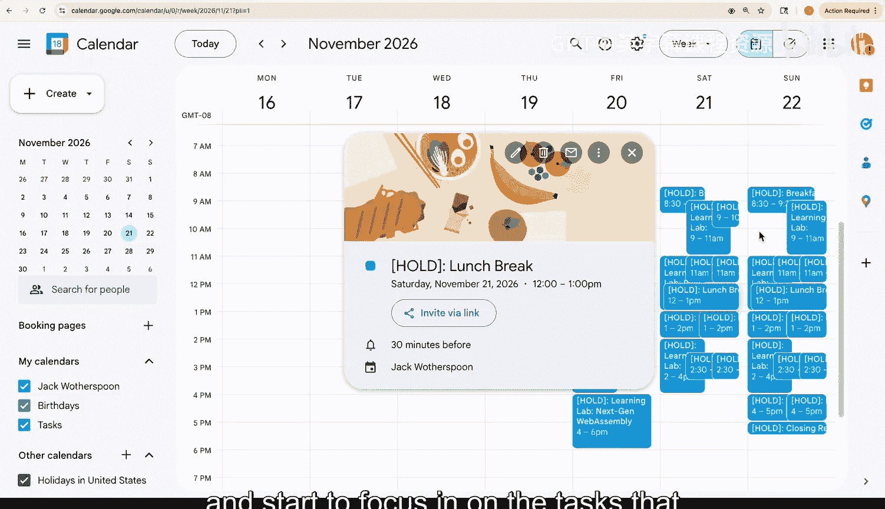

# 吴恩达《Gemini CLI：使用开源智能体进行代码开发与创作｜ Code & Create with an Open-Source Agent》 - P6：6.customization-with-gemini-cli-extensions.zh_en - GPT中英字幕课程资源 - BV1oH6qBPEEe

Gmini Ci extensions take MCP servers to the next level by bundling them with custom commands and context。

 In this lesson， you'll explore the extension gallery with hundreds of options。

 install the Google workspace extension and see how it orchestrates across docs， calendar and sheets。

 Let's dive in。 Well Gemini Cli extension goes above and beyond MCP。

 by actually allowing you to bundle one or more MCP servers into a simple and easy to install package with a custom context file and custom s commands。

 MCP servers are great。 but tools sometimes need to be used in complex workflows。

 They're not really trained to know the context outside of their individual tools by bundling MCP servers with a custom context file。

 you can actually tell Gemini how to properly use any tool and really create these complex workflows。

 Gemini Ci has quite a vast extensions ecosystem Currently with over 200 extensions。

 You can explore all of them on our site。 There's a good chance that tools you're already using in your day to day。

 Our Gemini C extensions。 For example， with the Monday com。😊，Extension。

 you can get access to the Monday co mP server so that you can see your current tasks that are assigned to you。

 update your project boards。 It also comes packaged with a custom s command s sprint summary that lets you pull in your current teams sprint and get a quick summary to catch you up to speed。

 It also comes with a custom context file。 This explains how to use the Monday extension best practices as well as troubleshooting for their MCP server for the textt conference we've been utilizing Google Docs to help us build up our plan and schedule for the conference。

 We can actually install the Google Workspace extension to pull in the information from our schedule that is in a Google doc。

 and then go ahead and actually schedule holds on our calendar for the conference to get the command to install the Google Workspace extension。

 Let's head over to the extensions gallery on Geminili com。

Clicking on the tile will bring us to the One click install command。

Running the command will prompt you to confirm that you want to install the extension。

Once the extension has been successfully installed， you can go an open Gemini Cli。

 It will trigger again an Oathth flow on startup。 go ahead and log in to your email。

 select all to accept the permissions。 This will give it access to things like your calendar。

 as well as your Google Docs。

Once you've completed this， you can head back to Gemin II。

 You can run the s extensions list command to see all the extensions you have installed。

 Let's go ahead and ask Gemin II to read in our conference schedule。

 Google Doc and list the schedule for the conference。The Google workspace gets me。

 It will query tools to know who is currently logged in。

 as well as what time zone to use in its tools later on。

So Gemini Ci has gone and read our Google Doc to actually get the information on the schedule for the conference。

 I'm a busy guy， so I want to make sure I get out ahead and put holds in my calendar so that no one books while the conference is going on。

 Now， let's ask Gemini Ci to go ahead and put those holds on my calendar。

 Let's make sure the title for the actual calendar invite is a hold with the title of the session。

Yeah。Gmin II has gone through our schedule， and it's notifying me that there is going to be 39 calendar invites。

 It's also noticed that there are some concurrent sessions。 It's even asking me。

 should we do multiple overlapping events on the calendar。

 Let's tell Gemin I I not to worry about that right now and just schedule all the events。

So Ge and ICI went ahead and scheduled all 39 events。 It's going to give us a quick summary here。

 Let's check it out。 Looks like a chill few days。

Good thing。 Brefat and lunch are free。Now that you've seen all the ways you can extend at Gemin ILI's capabilities。

 let's take it a step further and start to focus in on the tasks that you can accomplish with Gemin ICLI。

 such as software development。

