# 吴恩达《Gemini CLI：使用开源智能体进行代码开发与创作｜ Code & Create with an Open-Source Agent》 - P7：7.gemini-cli-for-software-development.zh_en - GPT中英字幕课程资源 - BV1oH6qBPEEe

Now， let's see Gemini CI in action for software development。 In this lesson。

 you'll use GeminiI to build a feature for a conference website， researching the code base。

 implementing the feature and testing it。You'll see how Gemin I Ci handles the full development workflow from start to finish。

 Let's dive into the code。 Gemini Ci is a well rounded tool that you can do for all sorts of different types of tasks。

 such as vibe coding， automation and writing scripts。 You can write tests。

 clean up your code bases debug issues。 Really the possibilities are endless in the terms of software development。

 Continu where we left off with the conference。 We can leverage Gemini Ci to enhance our website and build out some features。

 We just finalize the schedule and list of speakers for the conference。

 We're gonna have Gemini Ci actually implement a feature request to populate the session catalog page on the conference website。

 I definitely recommend checking out our extensions page again as there are a lot of great developerfo tools that you can install as extensions。

 If we head back over to the tech stack conference website and go to the session catalog page。

 We can see that we currently don't have any sessions in our catalog。

 There is an open feature request on Github for this feature。 It's quite detailed。

 and you can go ahead and look through it。 And it has the type of information that we want each。😊。

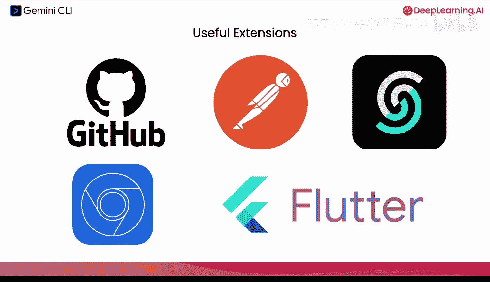

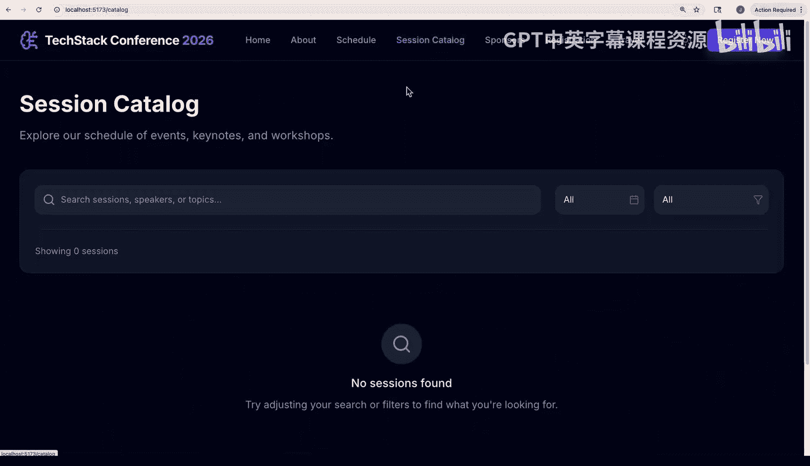

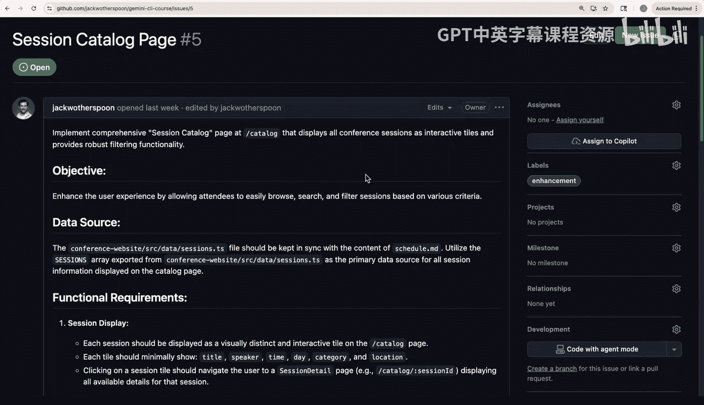

S to be able to be filtered by or searched through。 We touched on it briefly earlier。

 But now we're going to show you the power of custom s commands in Gemini Ci。

 Custom slash commands live in your dot gemmini folder within a subfold for commands。

 These are dot tom fileses that let you put a description and a prompt。

 These can be anything from implementing a feature request like we're doing here to reviewing code。

 We're actually going to call the Github Ci and actually trigger a shell command by using the following syntax。

 Well tell it to use a shell commands by indicating an exclamation mark followed by curly brackets inside the curly brackets we'll put our shell command。

 So G H issue view。 This is gonna to go ahead and actually use the Github Ci to pull in our feature request and get all the information we need to go ahead and then implement it。

 We also take in an arguments in curly brackets。 This lets us pass the issue number that we want to go ahead and pull in。

 So when we trigger this， we will pass in number5 as that is the issue number on our repository。

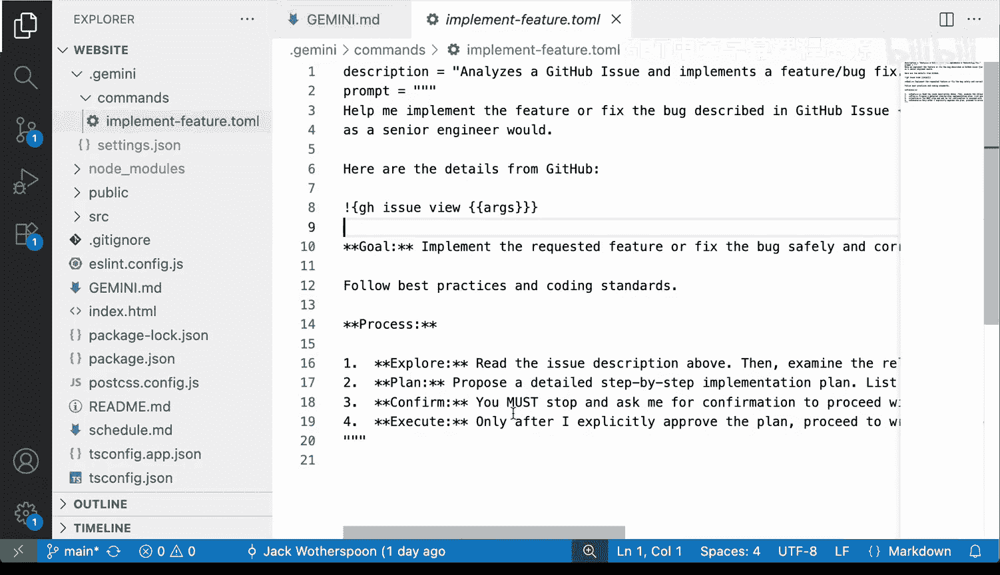

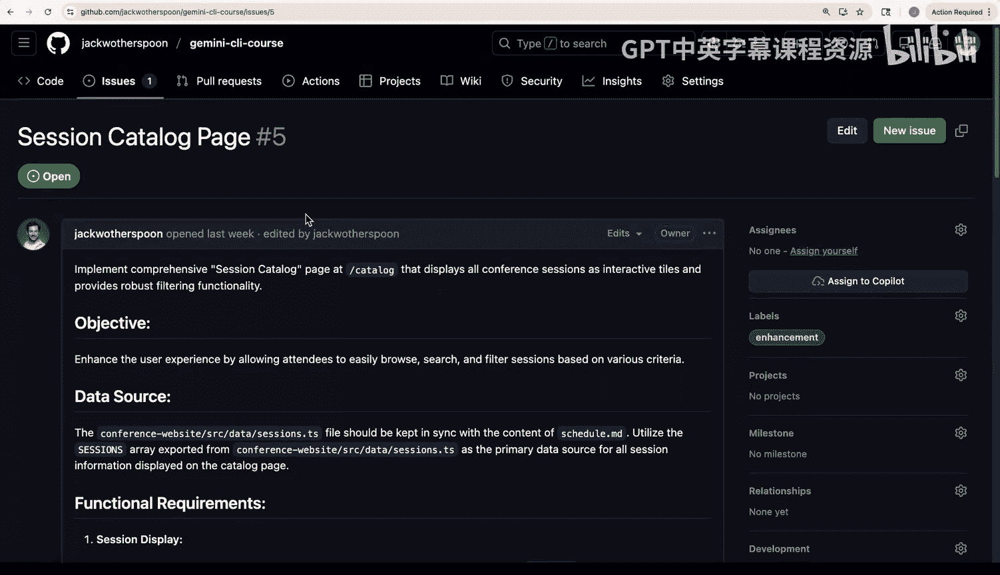

When we run the s command， it will ask us if we want to trigger the shell command within it。

 Let's go ahead and allow it。In our custom s command， we told the Gemin II to go and plan。

 then iterate， and then test and review。 so it's going to go through the motions of all of those in order that we defined。

And you'll see that once it's done making the changes。

 it's going go ahead and prompt to run the tests。 The MPM run test command was in our GeminiMD context file earlier。

 so we can actually see that the tests are failing since we've added a new functionality。

 GeminiI should be able to pick up on this for commands that are interactive。

 Gemini CI allows you to press control F to focus in on the shell。

So we can go ahead and focus in on the shell and press cure to Quet。Now。

 Gemin ICLI should hopefully go and fix those tests。

Now let's go ahead and run the tests again after it's fixed the changes。

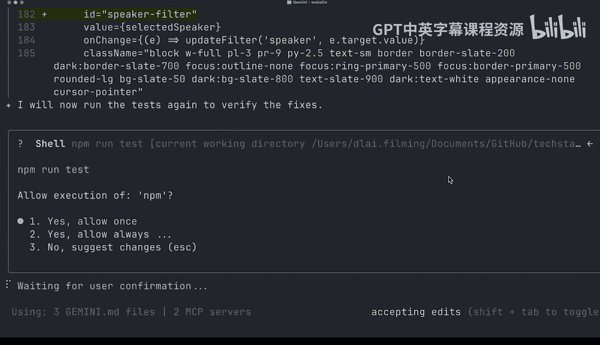

We can see that all the tests pass， the code has been properly updated。

 now Gemin ICI is telling us the feature has been fully implemented。 Let's go check it out。

Heading back over to the website and looking at our new session catalog page。

 the page is showing 32 sessions， and we can actually scroll through and see all the different sessions and view the details。

 We can even filter and search so we can go ahead and search。

 Future of AI is here and find the proper session。 Jim and I CI has successfully implemented and tested the new feature。

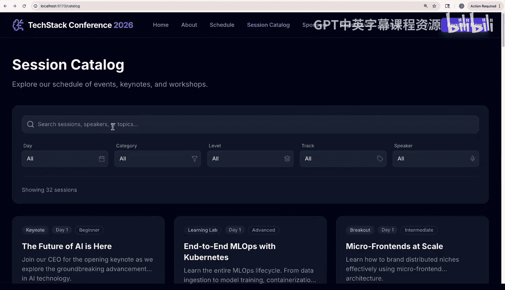

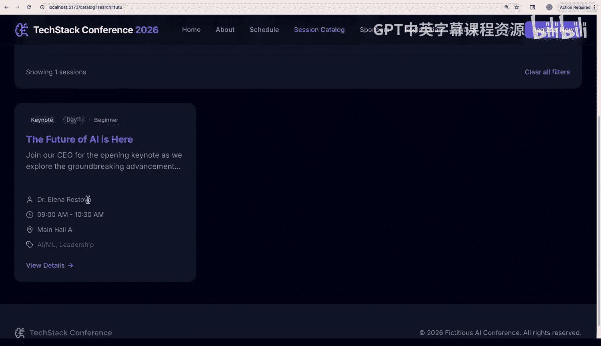

While looking at the session catalog， I noticed that the schedule and week at a glance is not really the nicest format。

 It's taking up the whole width of the screen， whereas we could display all this information in column so that you can see it all in one place。

 We can take a screenshot and actually paste it into Gemini Ci and have Gemini CI analyze the image and understand it and make proper changes。

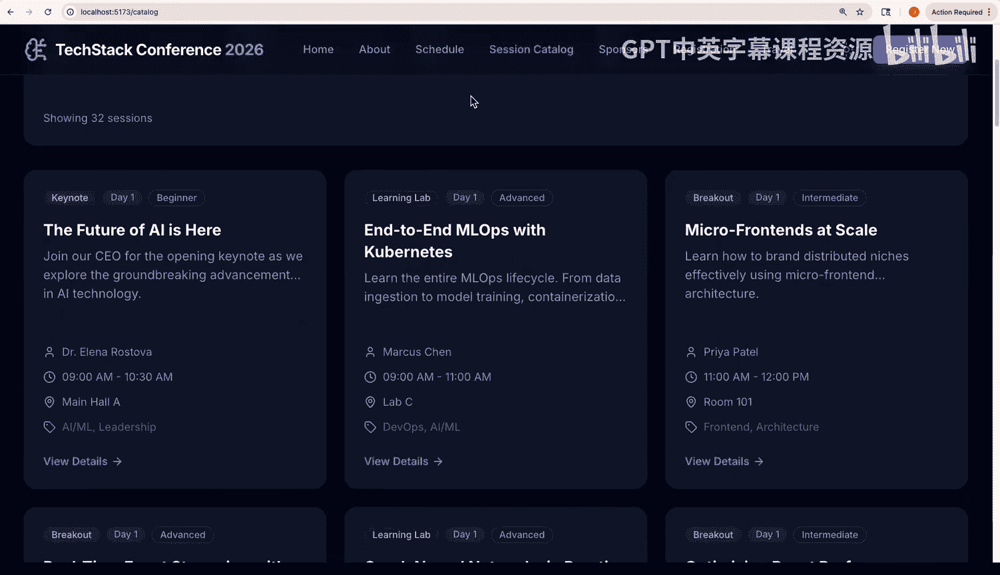

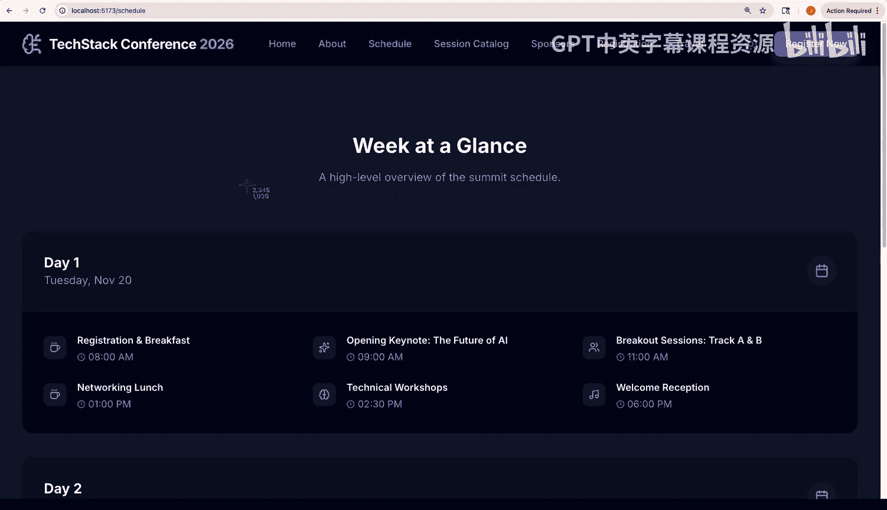

We'll just type out our prompt as normal and paste in our image and you should see it added to the prompt box。

It looks like Gemini Cli is even making sure it doesn't break any tests。 Good job， Gemini。

 That looks a lot better。We'll now have Gemin ICLI。

 even check out a new branch and commit the changes that we just made。As we go through this。

 Gemin and ICLI will even make a really nice commit message。Before I push these changes。

 I actually want to set up an automatic pull request reviewer so that Gemini CLI as a Gitthub action will actually run on every single pull request and do a detailed review。

 We can do this in Gemini CI by using the s setup Gitthub command。

What this command does is it goes ahead and downloads all the workflow files for the Github actions and automatically configures them for your repository。

 It will then open up a page that you can go through to see all the details and how you can authenticate it。

 I'll add these steps to the reading item at the end of the course。

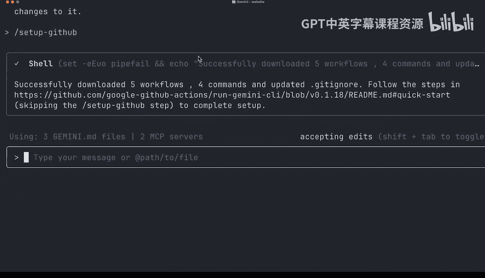

Ive already set up all this automation， so we don't have to go through all the steps。

 but as we put up this pull request， we should see that Gemmini CLI will automatically kick off a pull request review。

The Gitthub action for Gemini Cli can also be used for different workflows。

 You can even just comment on a Pl request at Gemini Ci。 Can you please explain this to me。

 and itll actually go ahead and kick off a workflow to just add a comment and describe the pull request for you when the Gitthub action is done。

 It will comment on the pull request with its summary， as well as general feedback。

 and it will actually go ahead and add comments with suggested changes。

 and it will mark them with a different color such as yellow based on the severity。

The suggestion looks good。 Let's go ahead and commit。And then merge。

So now we've actually implemented a feature with Gemin I CLli and had it review its own feature。

 and actually make a fix from its own feature。 I recommend giving this a try and configuring it on your own repositories。

 Let us know how it goes。

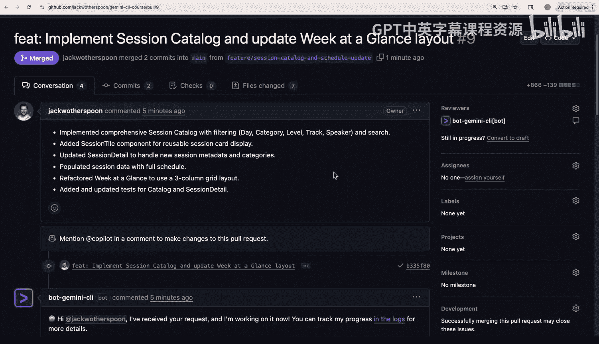