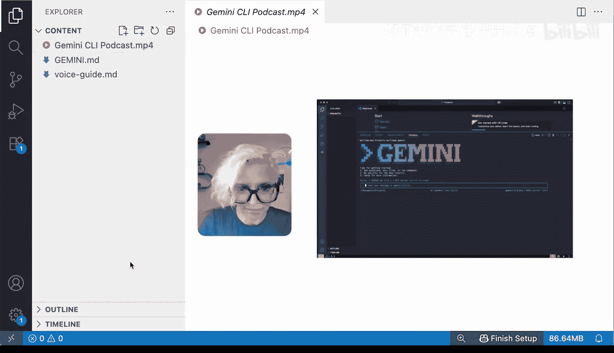
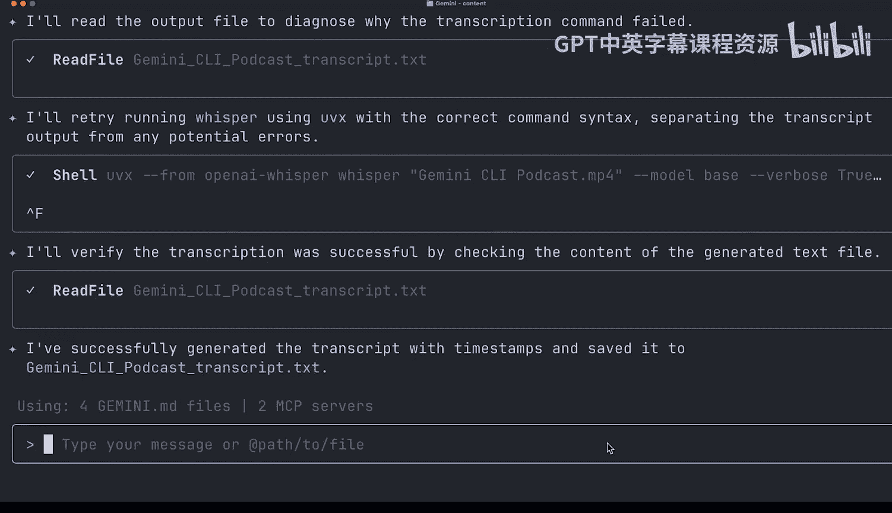
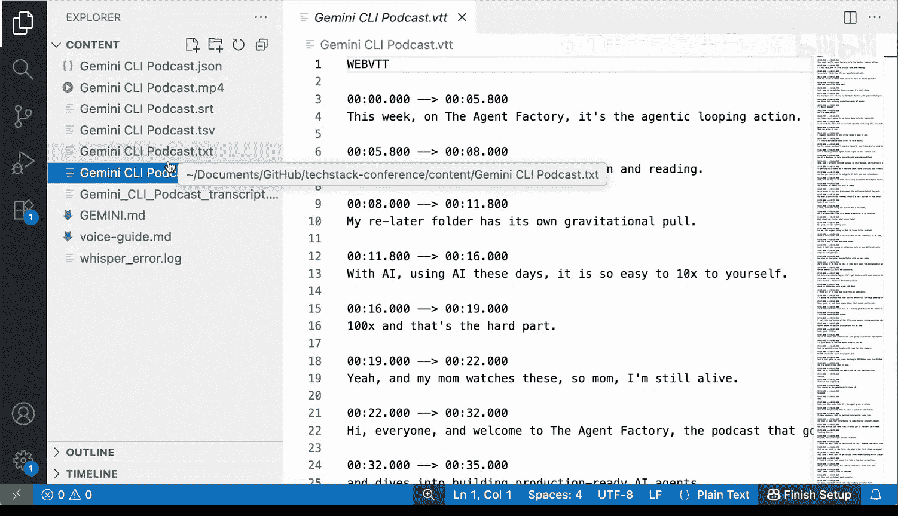
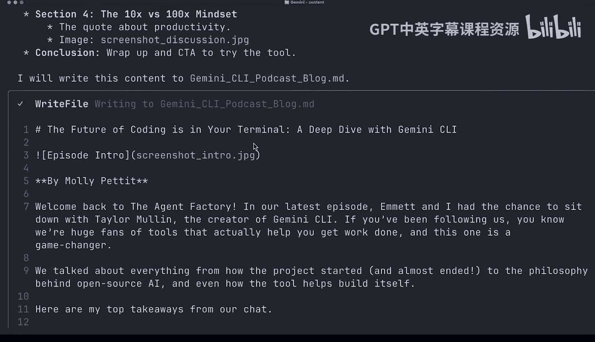
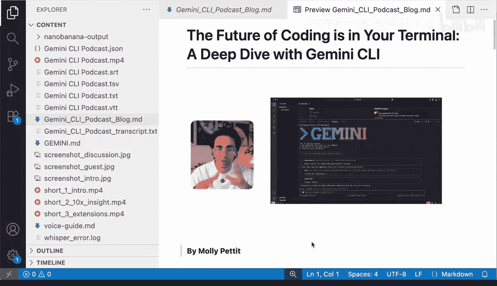
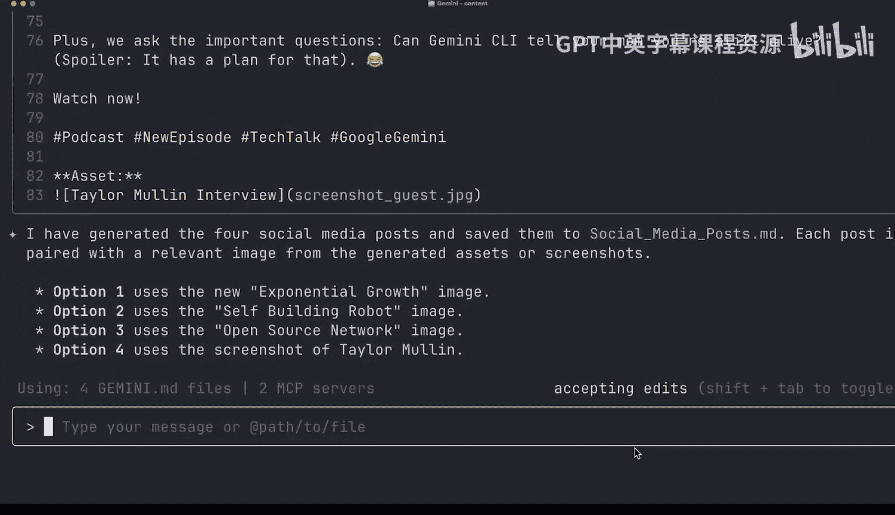
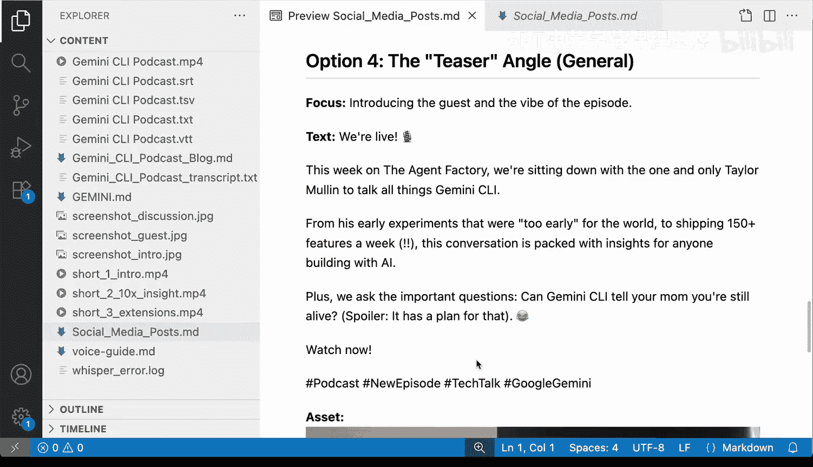

# 吴恩达《Gemini CLI：使用开源智能体进行代码开发与创作｜ Code & Create with an Open-Source Agent》 - P8：8.gemini-cli-for-content-creation.zh_en - GPT中英字幕课程资源 - BV1oH6qBPEEe

So far， you've seen many coding use cases for Gemin ICLI。

But many developers are expanding their use of agent coding tools into noncoding use cases。

 Gemini Ci excels at working with multimedia data， whether that's images or videos。

 Let's get creative by tackling a marketing task。 So now we're gonna to take a look at how Gemini Ci can be used for content creation。

 As we mentioned， one of the strengths of Gemini is its multimodality。

 It can really interact well with all different types of text video images。 you name it。

 during the conference， we recorded a video podcast。 One of our team members just sent it over to us。

 and we've downloaded it onto our local machine。 We want to use Gemini Ci to produce promotional content for the recording。

 We want to have it actually go through and analyze the video and help us make some promotional assets。

 Like a few shorts， a blog post and some social media posts。

 There are also a few extensions that are very useful for this。

 And we'll take advantage of the nanoob banana1 in this lesson。

 where now when a content folder where we have our local podcast。

 as well as a Gemini M context file that our team member sent over。

 First prompt we want to go ahead with is actually have。😊。

Gmini CI transcribe the video with timestamps and quotes。

 we'll have it save it into a local TXT file for now。

 It looks like Gemini CI has gone ahead and notified us that there's certain tools it's going to want to accomplish the task at hand。

 such as FFM peg and Whisper。 It's going to go ahead and check if these are installed。

 It's also going to try to set up the environment by checking for U。

It's now going to go ahead and call Uv in order to transcribe the video using Whi。

It looks like Gemin II ran into an issue， but it's diagnosed it and it's going to try to recover。

It looks like it's done running， it's gone through the whole video and transcribed it with timestamps。

This looks like exactly what we wanted， which is perfect。

 It also looks like Gemini Ci went ahead and created different formats for subtitles。

 using these transcriptions。 We're going to ask Gemini Ci to create some shorts for us to actually go into our original video and chop it up and give us clips that we can use for social promo。

 There are a lot of different ways to do this kind of thing。

 I personally do it a lot of the time manually。 So it's nice to have a tool like Gemini Ci that will go ahead and do it for me。

 It looks like Gemini Ci has gone ahead and pinpointed the three shorts or times stamps that it wants to use for cutting up the videos。

😊。

🎼It's now done。 It's picked its three clips and gone ahead and clipped them。

 It looks like it did introduction to Gemini Ci， that 10 x versus 100 x insight。

 as well as discussion on Gemini CI extensions with AI using AI these days。

 it is so easy to 10 X yourself，00 x。Thatト？So now that we have different video clips。

 we want to take it a step further。 We also want a blog that we can post。

 We're going to want to include images in our blog。

 So this is where we're going to use the nano banana extension。

 I've already gone to the process of installing it。

 which I did in the exact same fashion that you saw with the Google Workspace extension。

 So let's now tell a gemmin II to go ahead and create that blog using the transcriptions it created earlier。

Jim and ICla is going to go ahead and take screen grabs from the actual videos themselves and then use those as input to nano bananaana to help make them more creative。

It looks like it's complete。 It's written a blog to markdown file。

 And the title of the blog is the future of coding is in your terminal， a deep dive with gemmini C I。

 Prety catchy。 I won't make you all read through this， but let's take a quick look。

We can see a nice mix of screenshots as well as nano banana generated images。

We've got one final task for Gemini CLI now that we have our different short videos as well as our blog。

 we want to create promotional social media posts， so let's have Gemini CLI do that for us。

It looks like it's gone ahead and generated four social media posts。 Let's take a look。

Here are some of the posts that came up with。Honestly， it's not too bad。

 You might even see me post one of these。We've seen so many different use cases for Gemini CI。

 We're going to switch gears slightly and head away from the text conference use case and give you a bonus lesson that we think you'll find useful。

 We know you're taking an online course so that we thought it would be useful to showcase how you can use Gemini CI for learning。

😊。

