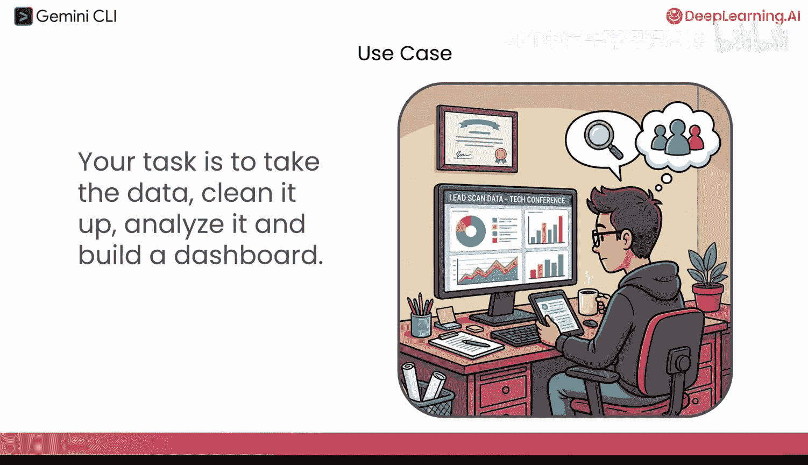
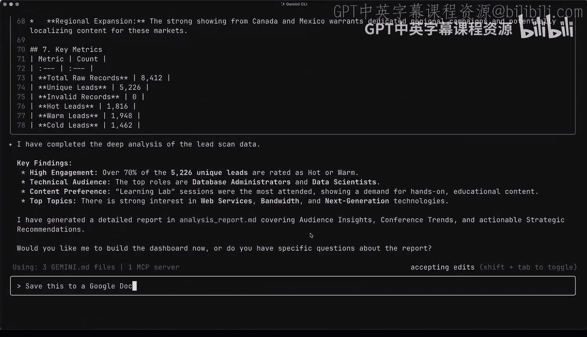
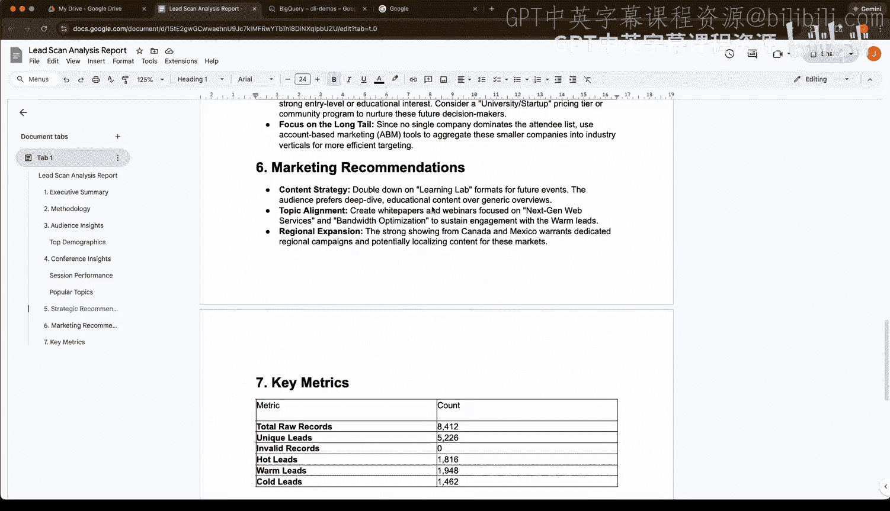
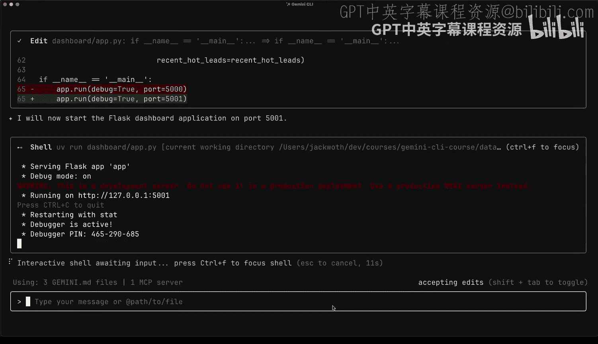
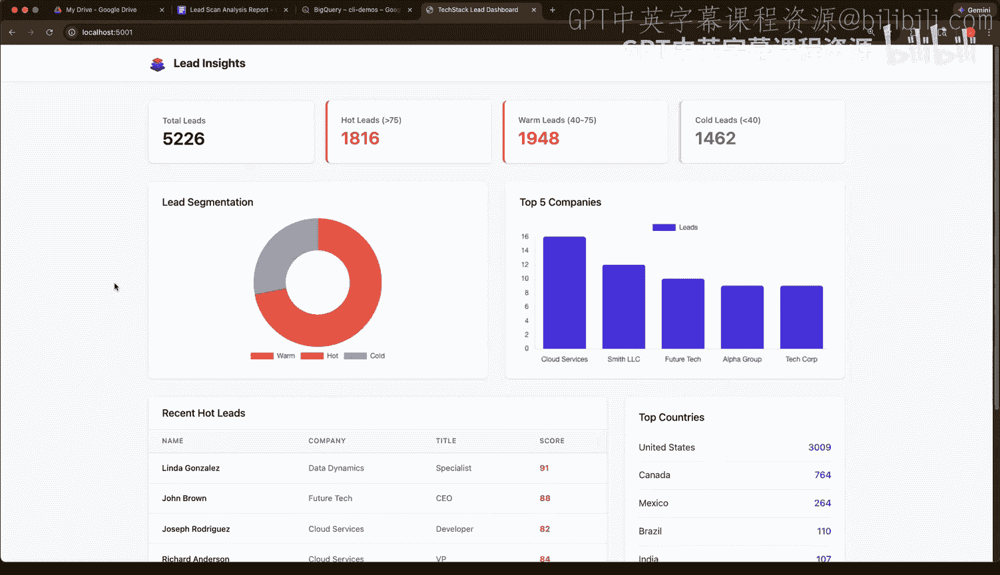

# 吴恩达《Gemini CLI：使用开源智能体进行代码开发与创作｜ Code & Create with an Open-Source Agent》 - P9：8.gemini-cli-for-data-analysis.zh_en - GPT中英字幕课程资源 - BV1oH6qBPEEe

You can use Gemin IclI to analyze both structured and unstructured data from Csvs to Pfs to system logs。

 In this lesson， you'll clean， analyze and visualize conference lead scan data to build an interactive dashboard。

 You'll see how Gemin II handles the entire data pipeline。 Here we go。

One of the strengths to Gemini Ci or any agentic Ci really。

 is the ability for it to be able to handle and read various different data types from structured data like Cvs to unstructured data like Google Docs Pdfs to source code to visual data images diagrams or searching the web like we showed in a previous lesson for the purpose of this lesson。

 the textt conference is now over。 it was a huge success。 So congrats。

 But now that the conference is over， you have the challenge of figuring out what to do with all the data that you collected during the conference。

 as attendees walked through the conference floor or attended sessions or booths。

 their badges were scanned， each scan of a badge is a data point。

 So you know have thousands and thousands of data points。

 you want to be able to hammer down on the data in order to make actionable decisions for next year's conference。

 in order to accomplish this， you are going to want to ingest all of the data with Gemini Ci use it to help clean up the data。

 analyze it and then we'll build a really nice visual dashboards so we can easily see the results。

 So before we。

Into using Gemini Ci for this lesson。 Let's first take a look at our context file， our Gemini。

md we've tailored our context file with insights about what equates to a hot lead versus a warm lead versus a cold lead as well as some insights about how we want this to be summarized what we want our dashboard to look like as well as insights like who is the audience for this dashboard or the results of our analysis you can take a quick look at the kind of data that we are dealing with。

 We have thousands of entries of data from the conference such as scan I attendee ID and information about the attendees like their name。

 their email stuff that you would expect to be collected when you get your badge scanned at a conference。

 So we have Gemini Cli booted up in our data analysis folder so we are ready to get going So we'll tell Gemini Ci to take a look at our lead scan data we have it stored locally as well as in the cloud in Google sheetets So we're telling it that we have two data sources local files as well as Google sheetets and really we're just telling it to process and clean the data it will go through and remove duplicates。

or remove invalid data and give us a nice final clean data set that we can use for our dashboards。

 Gemin II is using the workspace extension again to go ahead and retrieve the data from the Google sheets as well as it's built in tools to go and read through our local CSv files。

 It's going to go ahead and create a local Python script that it can run to help us process the leads and clean up our data。

 You'll notice that Gemin II is going to save our Google sheets to local files so that it can process everything in a uniform and concise way。

 It's going to go ahead and try to run the Python script。It looks like it's trying to use Pip。

 but as a Python person， I prefer Uv。 So I'll go ahead and actually just tell Gemi Ci to use the Uv tool over Pip for a much nicer and clean virtual environment。

 You can see that it's now successfully process all of the leads。

 There are over 8000 raw records in our lead scan data with over 5000 of those being what are classified as unique leads。

 And you can see the priority segment breakdown from having around 1800 hot leads。

1900 warm leads and 1400 cold leads。 Now that we've processed these leads。

 We want to actually save them to a database so that we can access them at a later date or team members can see the same data that we're seeing as right now。

 it's just stored in a local CV file。 So we'll go ahead and tell Gemni Ci to actually import the data to a big query database on Google Cloud。

 Gemini Ci will actually utilize the tools on my local machine。

 I already have the G cloud Ci installed as well as the big query BQ CI installed with just a few quick。

It will be able to upload all of the data to BigQu。

 And now it's going ahead and using that BigQu Ci to create the dataset set。

 We can quickly verify this by querying how many warm leads we have in our big query table。

 We can see that we get the same result that we had before from our local analysis that there are 1948 warm leads。

 Let's now go a step further and ask Gemini Ci to do a deep analysis of the data and really find trends and important details that maybe our marketing team would want to use in a future marketing plan。

 So this time， Geminii will create another Python script。

 but this time it will cater it more towards marketing。

 You can see that this data now has things like the top companies where attendees came from the top countries。

 different job titles which sessions people found engaging。

 as well as some strategic and marketing recommendations。

 It saved it as a markdown file locally on our machine。

 but we want to have this as a Google Doc so that we can quickly share it out with other team members。

And if we head over and look in our Google Drive， we can see that Gemini Ci has successfully created it into a Google Doc。

 where we have things like an executive summary for anyone quickly taking a look at the details。

 The criteria for how we classified things as hot，warm or cold leads。

 as well as quick audience insights and demographics。 This is awesome。 people will really enjoy this。

 but we can go a step further make this even better by having Gemin Ili create a nice visually appealing dashboard with all this data。

 because we want the dashboard to use our logo as well as the color scheme from our brand guidelines that we added to our website by default Gemin Ii only has access to the files in the given project。

 We can utilize the directory ad command or slash their ad command within Gemin Ili to go ahead and add a different project into the session state so that gemmini Ci can access files like our logo SvG file。

 as well as see the font colors from our website project。

 So now we can go ahead and tell Gemini Ci to build the dashboard。😊。

Using our brand colors and conference logo。 Snago have scaffold out the project and add the dependencies like flask to make this dashboard a reality。

 It will create the app up pie flask application as well as the Hl files incorporating our brand colors and logo。

 It looks like Gemin Ili tried to start up the application。

 but that port is already being used on our local machine。

 So we'll go ahead and just prompted to use a different port and to try starting up the application again。

 And there we have it。 It looks like Gemin Ili has successfully started up the flask dashboard on port 5001。

 If we head over to local host on port 5001 where the application is living。

 We can see our dashboard is up and running using both our logo in the top left corner here for the textt conference。

 and using the color scheme from our website as well。

 You can see it has the same kind of data that was in our analysis report in our Google doc。

 But this time visualized as a nice dashboard that we can click on different items。

 we can see the breakdown of the top companies。 The recent hot leads。 This is just one way you can。

Use Gemmin ICLI to wrangle and help you deal with complex data。

 but there are a vast amount of different use cases out there that I hope you explore further。

