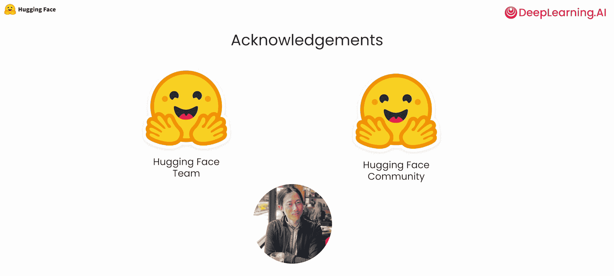
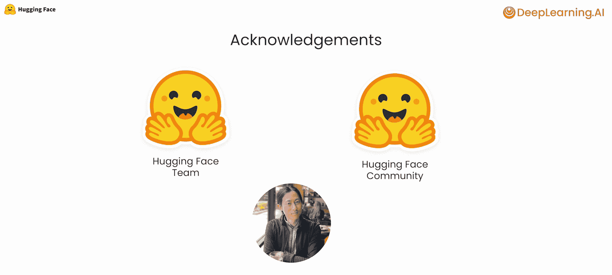

# 吴恩达《Hugging Face中的量化基础｜Quantization Fundamentals with Hugging Face》中英字幕 - P1：1.introduction - GPT中英字幕课程资源 - BV1et421774L

欢迎来到这个短期课程，使用 HuggingFace 构建的《量化，基础》课程，与 HuggingFace 合作。大型生成型 AI 模型，如大型语言模型，可能非常庞大，难，以在消费级硬件上运行。

量化已成为实现这一目标的关键工具。在本课程中，您将了解各种量化方法的不同选择和数据类，型，例如您应该使用 int8 还是 float16，或者某种称为 ，BFLOAT16 的东西。

它代表 Brain Float 16，用于压缩您的，模型。您还将了解有关如何压缩和存储 32 位浮点数的技术理论，和算法细节，也许是从您希望使用 8 位整数部署的模型中，我很高兴为您介绍本课程的讲师。

Eunice Bakoda 是 Hugging Face 的机器学习工程师。Unis 参与了开源团队，在那里他致力于许多由 ，HuggingFace 开发的开源工具的交集。

例如 Transformers，、Peft 和 TRL。Mark Sun 也是 HuggingFace 的机器学习工程师。Mark 是开源团队的一员，他为 Transformers 或 。

Accelerate 等库做出贡献。Mark 和 Unis 也深度参与量化，以使大型模型对 AI 社区，更加可用。谢谢，Andrew。我们很高兴与您和您的团队合作。在本课程中。

您将首先了解有关整数和浮点表示法的基本，概念，以及如何使用 PyTorch 和 Hugging Face ，Transformers 库加载 AI 模型。您还将了解每种不同数据类型的优缺点。

以便为您的用例，做出正确的决策。您还将深入了解线性量化，了解其在实践中的工作原理。您将看到线性量化如何用简单的术语工作。该量化方案在大多数最先进的量化方法中使用。在回顾了线性量化的工作原理后。

您将直接将其应用于使，用 HuggingFace 的 Quanto 库的小型文本生成模型中。Quanto 使得对任何 PyTorch 模型使用线性量化变得容易。

我们将首先使用 Transformers 库加载模型，然后使用 ，Quanto 对模型进行量化。总而言之，在本课程中，您将详细了解量化背后的基本理论，以及如何使用量化的实际方面。我希望您学会这些技术。

并将这些基本构件结合起来，创造，出一些独特的应用程序。许多人致力于创建本课程。我要感谢 HuggingFace 方面的整个团队对课程内容的审。

查，以及 HuggingFace 社区对开源模型的贡献。

来自 deeplearning 。ai 的 Eddie Hsu 也对本课程有所。

贡献。这是一个涵盖广泛内容的短期课程，我对您能以压缩的方，式学到什么感到兴奋。