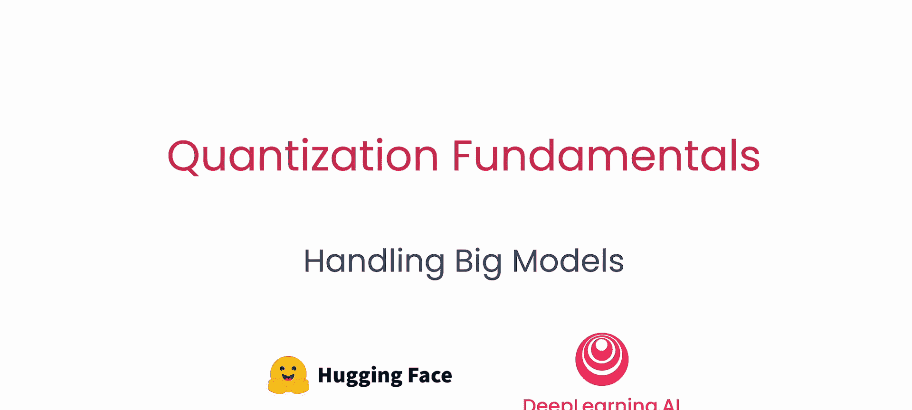
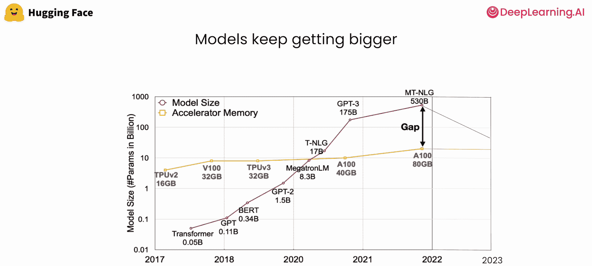
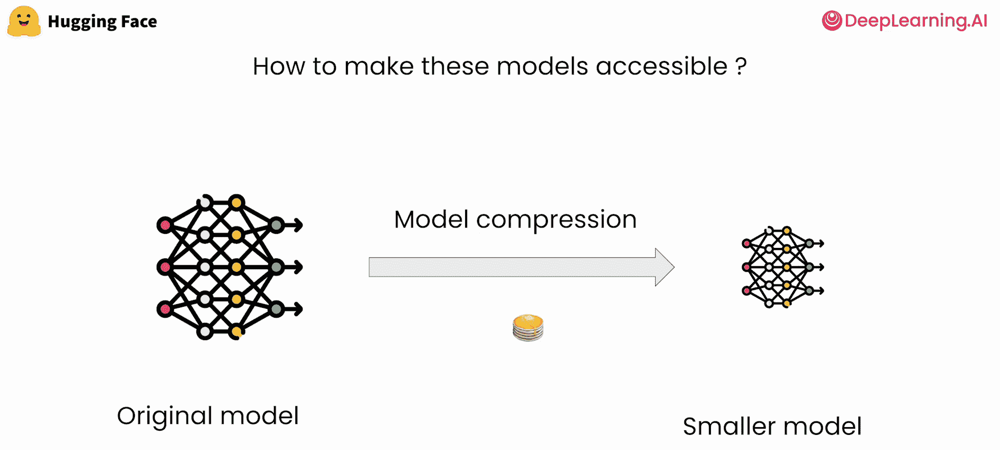
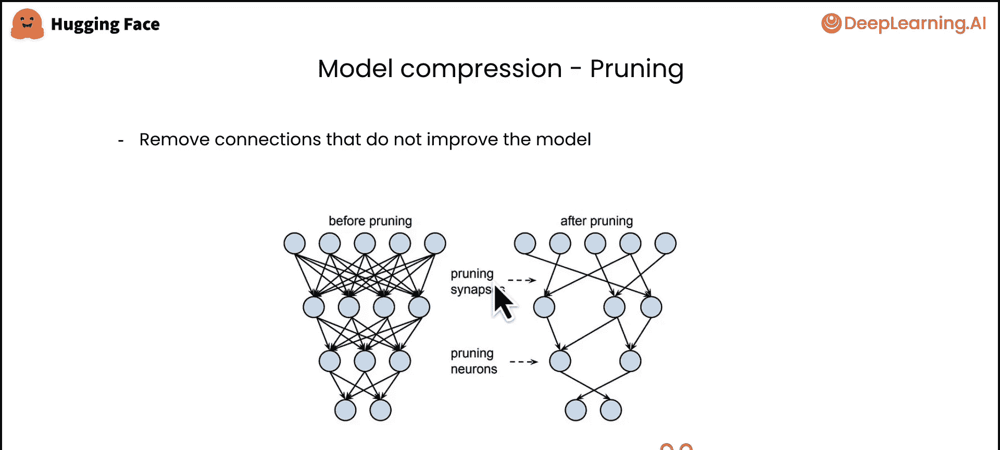
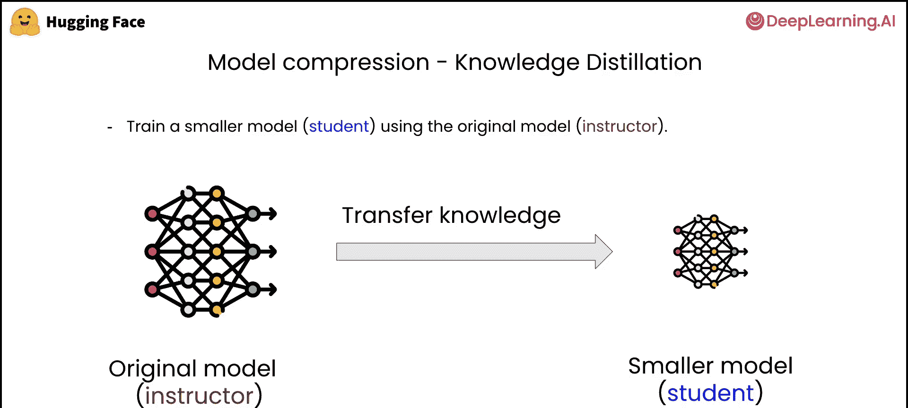
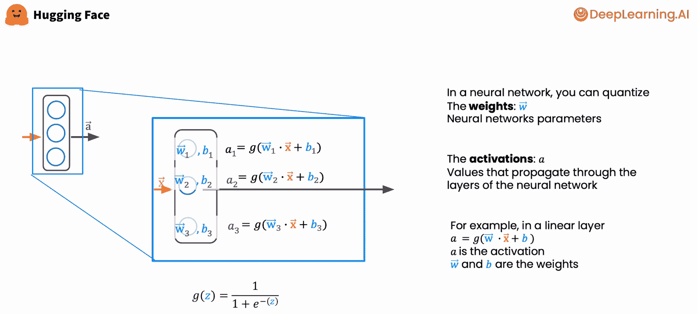
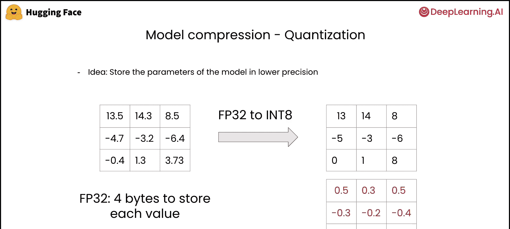
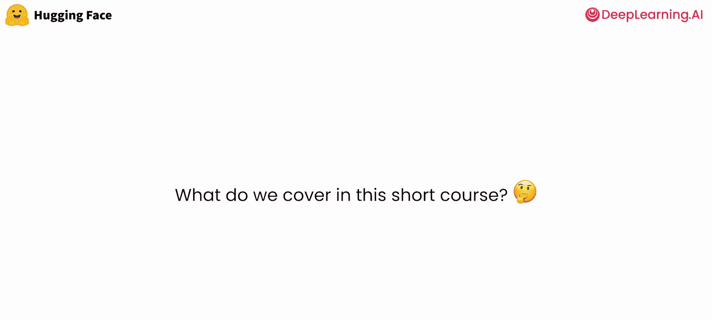
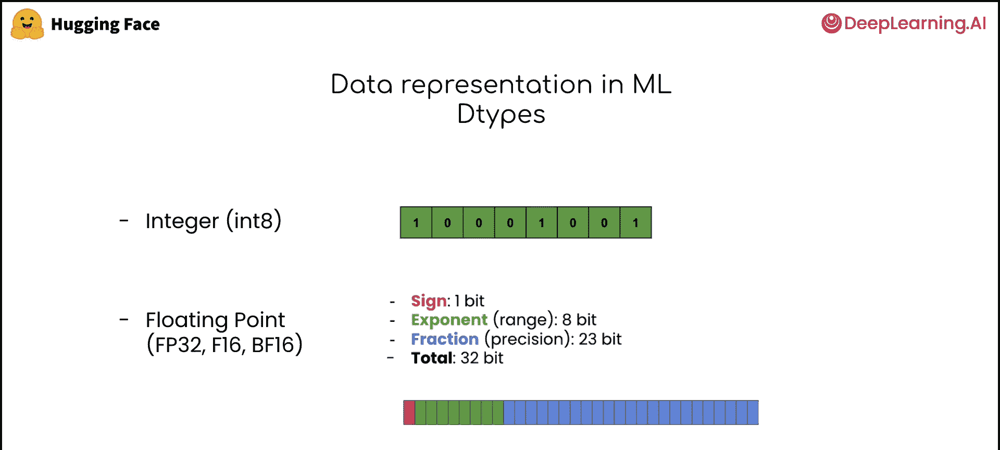
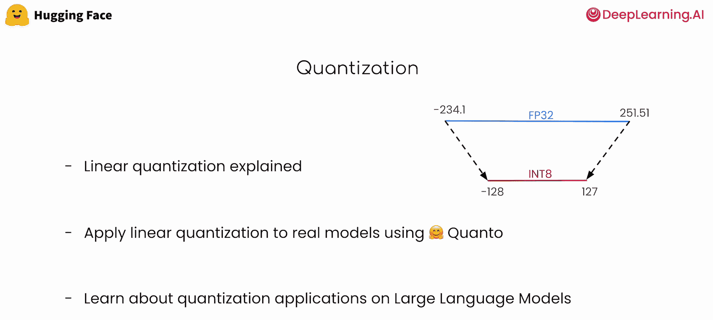

# 吴恩达《Hugging Face中的量化基础｜Quantization Fundamentals with Hugging Face》中英字幕 - P2：2.big models - GPT中英字幕课程资源 - BV1et421774L

AI模型变得越来越庞大，因此对于AI社区来说，量化是一项，非常激动人心的技术，因为它使我们能够将模型缩小到很，小的尺寸，以便任何人都可以在自己的计算机上运行它，而，几乎不会有性能下降。

让我们概述一下为什么我们需要量化，以及什么是量化。让我们开始吧。如今，量化是一个令人兴奋的话题，因为它使我们能够将模，型缩小到很小的尺寸，以便任何人都可以在自己的计算机。

上运行它，而没有性能下降。所以让我们一起来检查一下。如今，深度学习架构趋向于变得越来越大。特别是对于大型语言模型，在短短几年内，平均模型尺寸又，增长了一个数量级。

这显然扩大了最大GPU硬件与最大模型之间的差距，目前，最大的GPU硬件尺寸最多为80GB，正如您从这张图中可以看，到的。尽管这张图在2022年停止，但似乎在那一年之前一直在增，加。因此。

从2023年开始，最大最常用的最新技术语言模型似乎，具有大约700亿个参数的平均数量。这仍然在最大硬件和最大模型之间创建了差距，因为一个，70亿参数的模型将需要大约280GB的内存才能使模型适应，硬件。

此外，消费型硬件如NVIDIA T4 GPU只有16GB RAM。因此，运行这些最新技术模型对社区仍然是一个挑战。如何在不需要访问内存密集型硬件的情况下有效运行这些。

模型？所以，目前社区面临的整个挑战是通过模型压缩使这些模，型更易于访问。因此，我们将快速回顾一下一些当前最新技术的模型压缩，方法，如修剪和知识蒸馏，然后再花更多时间来讨论量化。

首先，修剪简单地包括删除模型中对模型决策没有太大重，要性的层。它仅仅是根据某些矩阵（例如权重的大小）删除一些层，可，能还有其他矩阵。

还有另一种方法叫做知识蒸馏。在这个过程中，您训练一个学生模型，即目标压缩模型，使，用来自教师模型的输出，以及主要损失项。这里的挑战在于，您需要确保有足够的计算资源来适应原，始模型，并从原始模型获取预测。

以便您可以将它们发送到，教师模型，同时计算损失。如果您必须对非常大的模型进行蒸馏，这可能会非常昂贵。

。在深入讨论量化之前，请回忆一下，对于神经网络，你可以，将权重和激活值表示如下。当量化神经网络时，你可以量化模型权重，可以用矩阵W表，示，但你也可以选择量化模型的激活值，这对应于你可以在。

右侧看到的计算的输出。

现在让我们来学习一下量化。量化简单地是将模型权重表示为较低精度。让我们从左侧考虑这个小矩阵开始，它存储了一个小模型，的一些参数。由于该矩阵存储在float32中，这是大多数模型的默认存储，数据类型。

它必须为每个参数分配4字节，即4倍8位精度。因此，该矩阵的总内存占用量将是36字节。如果我们将权重矩阵量化为8位精度，即int8，我们最终将，仅为每个参数分配一个字节。因此。

我们总共只需要九个字节来存储整个权重矩阵。然而，这是有代价的，即量化误差。最先进的量化方法背后的整个挑战是尽量降低这种误差。

以避免任何性能降低。总结一下，让我们概括一下我们将在本课程中涵盖的内容，为了让你对量化周围的基本概念有一个良好的基础理解。

我们首先要讨论机器学习中最常用的数据类型，比如整数，主要是int8精度，以及理解浮点表示法的工作原理，比如，float16，bfloat16或float32，以及根据你的用例使用哪种，精度。

这取决于你是在进行模型训练还是模型推断。

接下来，我们将深入探讨线性量化以及它的工作原理。在那之后，我们将使用Hugging Face生态系统中的quantum，库来量化一个transformer模型，并使用不同的配置来测试，结果。最后。

我们将讨论最近在应用于LLM的量化技术方面取得的，进展。在下一课中，你将学习如何探索数据类型，这些数据类型是，这些机器学习模型的核心构建块。

