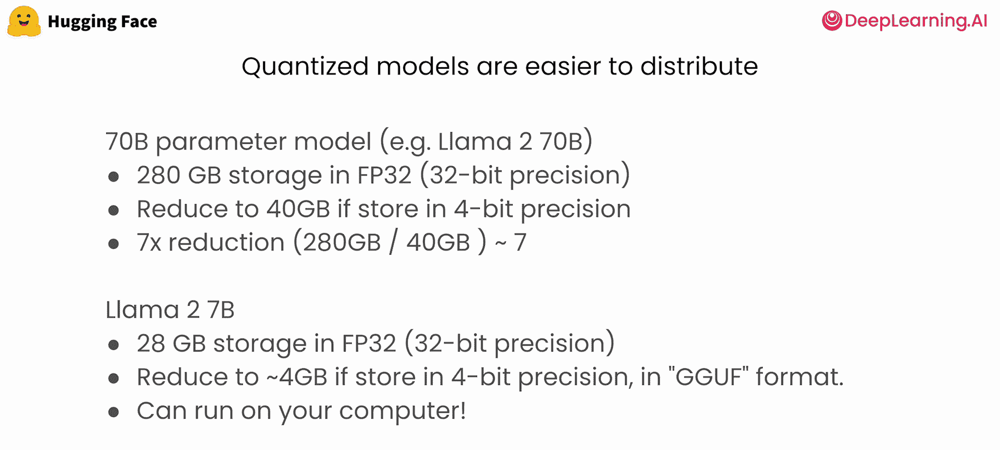
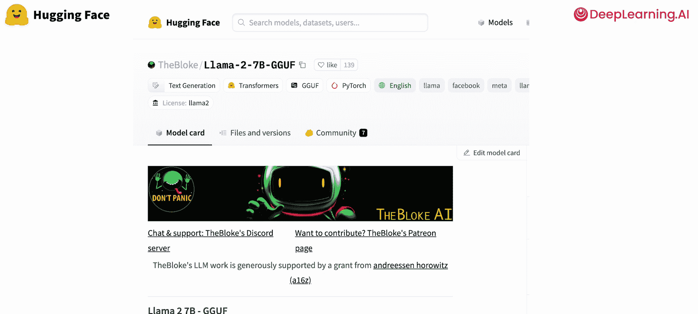
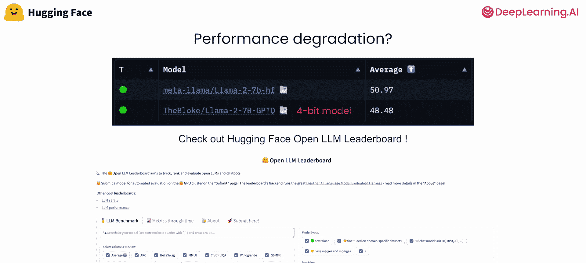
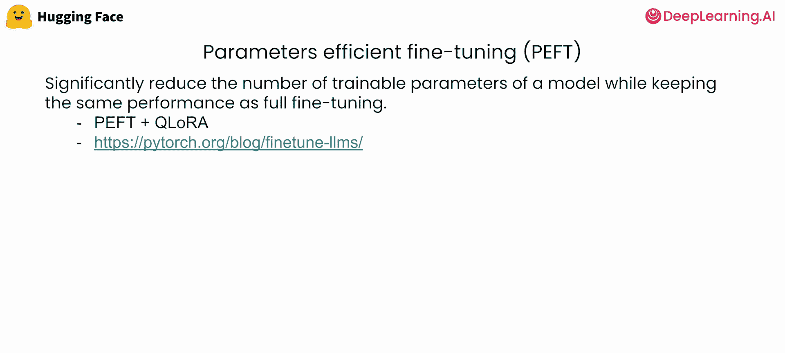
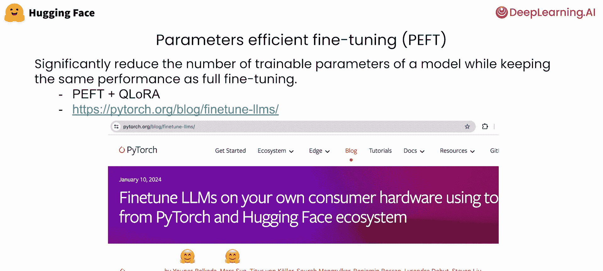
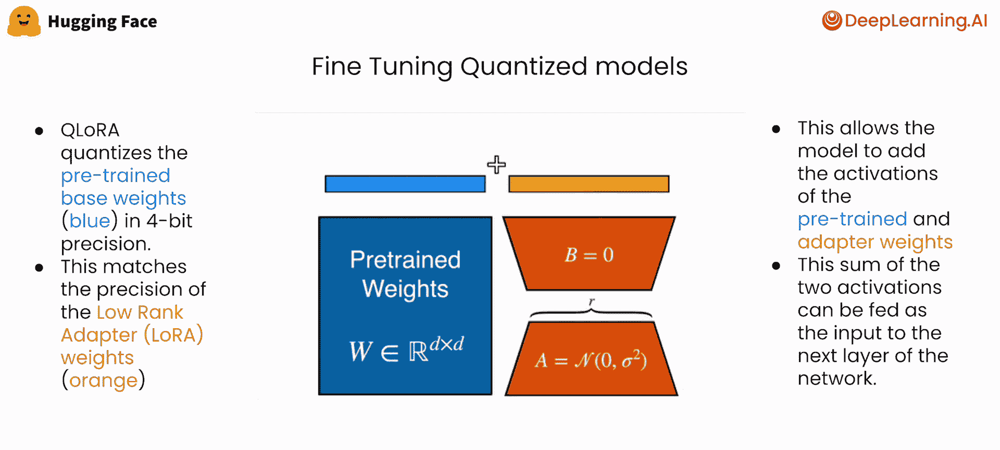

# 吴恩达《Hugging Face中的量化基础｜Quantization Fundamentals with Hugging Face》中英字幕 - P6：6.quantization of LLMs - GPT中英字幕课程资源 - BV1et421774L

在这节课中，我们将探讨当您将最先进的量化应用于大型，语言模型时会得到什么。例如，量化是否能帮助您进行微调和LLM？剧透警报，答案是肯定的。让我们看看是如何做到的。正如前几课所示。

量化是指以某种方式压缩模型权重。将量化应用于大型语言模型引起了开源人工智能社区的极，大兴趣，因为有效地将这些模型量化，而性能几乎没有下降，可以为任何人打开许多很酷的机会。

在短时间内出现了许多开创性的论文，我们在这里只列举，了其中一些。从2022年夏季开始，llm。int8提出了一种无性能降级的8位，量化方法，通过将底层矩阵乘法分解为两个阶段来实现。

为了缓解大规模LLM中出现的突出特征，作者建议将MatMul，分解为两个阶段，即将异常值部分设置为float16，将非异，常值部分设置为int8。QLora提出，通过将大型语言模型量化为4位精度。

并能够微，调我们称之为低秩适配器的模型，使LLMs变得更加易用。别担心，稍后我们会解释这一点。因此，使微调LLMs变得更加易用，适合任何人。另一方面。

AWQ、GPTQ和SmoothQuant提出了预校准模型的，方法，以使量化模型不受大型模型引起的大激活的影响。后来，出现了更多证明在2位精度上取得了有希望的结果的，方法，例如Qsharp、HQQ。

以及最近的AQLM。所有这些令人惊叹的工作都旨在专注于使LLMs更小更快，并且都是开源的，这意味着您可以直接获取官方实现并通，过自己尝试它们。我们只引用了一些论文，但您很容易找到许多其他研究特。

定主题的论文。同时，您可能也想知道，这些方法是否适用于所有模型？在这些方法中，有些方法需要进行校准过程，这意味着您需，要首先通过迭代一个数据集，并通过最小化一个错误，即量，化误差，来获取最佳的量化参数。

由于这些方法的原始工作是针对大型语言模型进行调整的，您可能需要在自己的项目和用例中调整这些方法。然而，其他一些方法则不需要这一步骤，这意味着它们可以，直接使用，而不受模态的限制。

通常是通过用新的量化模块，替换所有线性层的所有实例，正如我们在线性量化的课程，中所看到的那样。量化还使得大型语言模型更容易分发，因为它们更小。例如，一个700亿参数的模型在完整精度下需要280千兆字。

节的存储空间，而如果以4位精度存储，这可以进一步减少，到40千兆字节，导致减少了7倍。这使得加载这些模型的成本大大降低，并且打开了使用本，地计算机加载这些大型语言模型的机会，例如使用gduf格。

式与llama。c++。

在拥抱脸生态系统中，您还可以找到一些强大的量化模型，分发器，例如BLOC，您可以在这里看到，它向社区分发大多，数情况下需要一些预校准（例如AWQ或GPT-Q）的量化权重。

您可能还想知道所有这些量化方法如何影响模型性能与其，原始版本相比。评估这一点的一种方法是检查大型语言模型在为大型语言，模型专门设计的不同着名基准测试上的性能。为此。

您可以检查Hugging Face的Open LLM排行榜，该排行，榜现在支持在最先进的量化模型（例如LLM。int8、QLORA和，GPT-Q）上运行评估。所以对于您感兴趣的模型。

您可以检查其在排行榜上的性，能，并检查您是否对其满意。

所以为了总结，我想快速涵盖另一个话题，即微调大型语言，模型。您可能想知道是否可以对量化模型进行微调。嗯，有两种情况您可能对这种情况感兴趣。第一种情况是您想在模型被量化的同时进行微调，以获得。

可能的最佳量化模型，第二种情况对于那些想要为特定用，例和应用程序调整其模型的人来说可能很有用，例如在其，自己的数据集上微调大型语言模型。第一种情况可以通过量化-小时训练来实现。在这种情况下。

我们训练模型在量化后更准确。请注意，这种方法与我们之前分享的所有属于后训练量化，技术类别的方法都不兼容。所以对于第二种用例，我们将利用PEFT方法或参数高效微，调方法。因此。

PEFT方法旨在大幅减少模型的可训练参数数量，同时。

试图保持与完全微调相同的性能。所以我们将特别深入研究PEFT加QLORA，它同时利用了量化，和PEFT方法，您也可以查看这个示例，了解如何在三层谷歌，Colab实例上训练LLAMA7B模型。

这是一个动画图，展示了低秩适配器或LoRa的工作原理。在进行LoRa时，您只需将额外的可训练参数，即左侧可见的，蓝色权重，附加到右侧可见的冻结权重上。由于R参数通常远小于输入隐藏状态的维数。

最终优化器状，态变得极小，从而使训练协议更易于实现。QLORA利用这一点，将基本权重量化为左侧可见的蓝色权重，精确到4位，并确保量化权重的激活数据类型与LORA权重，的数据类型相匹配。这样。

我们就可以轻松执行您在这里看到的求和操作，还可，以从量化和参数高效微调方法中获得最佳效果，并解锁许，多酷炫的机会，例如在三层谷歌Colab实例上对LLM进行微，调。这就是本课程的全部内容。

我希望这为您提供了关于目前最先进的大型语言模型量化，阶段的一些深入见解，并为您展示了您可以通过这些方法，实现的内容以及您可以根据您的用例如何应用它们的概述，那么在下一课中，我们将共同总结本课程。

并回顾您在本课。

