# 吴恩达《Hugging Face的开源模型｜Open Source Models with Hugging Face》中英字幕（英文可关） - P10：10.image segmentation.zh - GPT中英字幕课程资源 - BV16u4m1u7t4

Hi， in this lesson， among other computer vision tasks。

 youre going to perform segmentation and something called visual prompting。By that。

 I mean that you will simply specify a point on a picture and the segmentation model will then identify a segmented object of interest。

 let's see all that together。

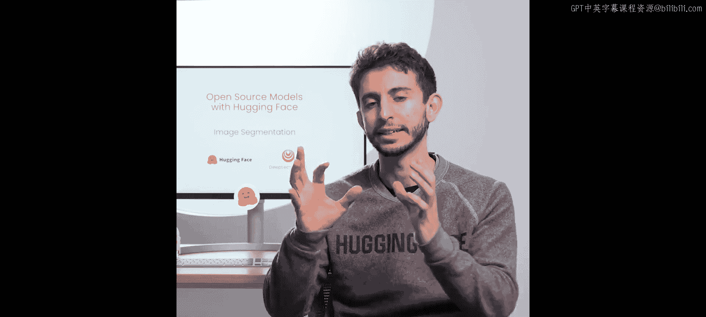

Welcome everyone to the lab session of lesson 9 we're going to see the segment Anything model from Facebook AI now called meta AI and yeah use that model to build cool applications first of all make sure to run the cell before starting the lab so that we won't get the warnings from transformers and also make sure to install the required libraries that we provide here so make sure to run these comments first before running the notebook Yeah so let's get started so yeah as we've been doing so far for all our labs we're going to use the pipeline object for this lab and we're going to focus on a task called mask generation so I'm going to explain in detail what mask generation means and how does it differs from the classic image segmentation task so let's first import our pipeline object and start to initialize the pipeline object so Sam for segment anything model pipe equal pipeline mask generation。

So in the image that you can see here， we simply performed image segmentation on the image that you can see on the top。

 the model predicts pixelwise labels for each pixel of the image with the corresponding label of the pixel so for example the blue pixels will refer to the sky the red pixels will refer to the class bridge and the other pixels respectively refer to the ground and the mountains and in segmentation mass generation the difference is that users can perform what we call visual prompting by guiding the model on the location of the object of interest in order to predict the segmentation mask of that object so segment anything model some from Facebook expects as an input 2D points as you can see here but you can also provide bounding boxes as input and the model will predict segmentation mask of that object of interest and in contrary to classic image segmentation the predicted mask won't have any label the only label。

That you can extract from that mask is that that object corresponds to the object of interest that you have specified to the model。

 There is also one thing that you could do with segment anything is the automatic mask generation pipeline so by that we simply sample some points from the 2D image and try out different combinations of 2D points together because you can also prompt multiple points per mask and filter out the predicted output with the higher scores to get the most relevant segmentation masks in the whole image if you pass that image and use the automatic mask generation pipeline you will end up with results such as this one where you'll have the masks for each object of interest so for example you have the road you have those small pieces of the train windows of the building and things like that So if you want to read more about segment anything model you can just check out the paper some paper from Facebook AI or the original repository of segment anything model and for our lab we're going to use a distilled。

Compressed version of the model called SSM which basically does the same thing as SA with similar performances。

 but it is much smaller， so this model is going to be useful for us because we're going to run our lesson on a small hardware so we will be able to run segment anything model without the need of having a high computer requirement。

Now that we have more or less understood what do we mean by mask generation and how it differs from classic image segmentation pipeline。

 let's try our hands onloading the model and try to play with the model once we have instantiateated the pipeline with mask generation we're going to pass the path to the segment anything model so we're going to use this model from the hub which corresponds to the slim sound model that I've presented you before so let's load this model。

All right， now that we have the pipeline， let's try to import an image that we have prepared for you。

So we're going to try to predict some segmentation masks on this image where you have some people and some cool lamas as you can see here for the automatic mask generation pipeline you can pass this optional arguments called points per batch and you can get different results based on this value so higher points per batch means more efficient pipeline inference for a smaller hardwares we recommend you to use a smaller points per batch so that you won't run into any hardware issues so yeah you can just run this command it will take some time for some computers but yeah just wait for the results and we're going to see the results together okay so now that the pipeline has finished its execution let's try to visualize the results so for that we've prepared a helper function for you called show pipe masks on image so we're going to import that and use it straight away on our original image。

Very nice。 so as you can see， the model was able to segment all。

Small regions of interest in the whole picture。 So for example。

 it was able to segment all the heads regions for each person was able to segment almost all the lamas individually themselves。

 also the closes yeah the wall behind and small items on the back as well。

 but the problem with this pipeline is that you need to iterate over all the points and postpro degenerated masks which might be a bit slow for some use cases and applications So we're going to focus on one specific use case where we're going to infer the model with an image and a single point So let's try to do that right now。

 So instead of using pipeline this time we're going to import the model class itself from transformers and some processor。

So we just need to call some model that from pretrained the checkpoint name that we used before and we're going to do the same thing for the processor。

 we can also print out the model to see its architecture for those who are curious so there is a positional limitting vision encoder transformomer layers and so on and for this exercise we're going to use the same image and let's say we're interested in segmenting this blue shirt from Andrew so for that we're going to pass any 2D points from the blue shirt in order to segment that region so we're going to give this location the  point00 starts from the top left so 1600700 should be somewhere here in the shirt so for that you need to first encode both the image and 2D points so we just have to pass to the processor the image input points equal input points and mention that we want to return Pythtorch sensors。

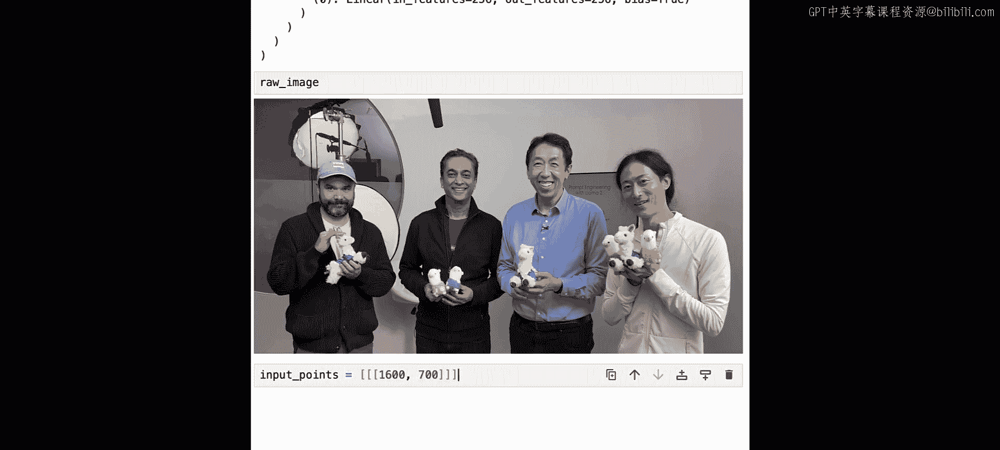

And we're going to perform a simple inference。On the model with the torch nograd。

Cont manager so that we make sure we don't compute the gradient。诶。So， import torch。

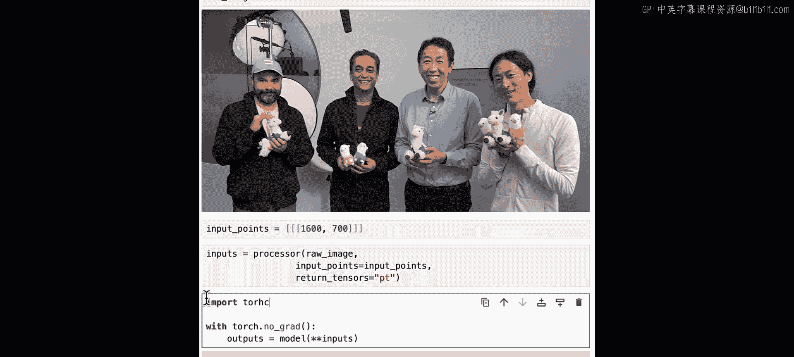

Allright。Okay， so once you have retrieved the output from the model we need to post process to predicted masks in order to resize them to the size of the original image。

 so for that you can simply call imageprocessor。 postprocess masks in order to get all the predicted masks and I wanted to quickly inspect the size of the predicted masks。

So if we do land predicted mask， we have one which corresponds to the number of images。

 but if we would have past many images then we would have as many masks as we do have images so let's just consider the first mask and inspect its size。

For our predicted mask we have a tensor of size1 so batch size3 and then size of the image so I just wanted to give a quick heads up on why do we have three on the second dimension so if you check again the overview of the sum architecture as you can see from this figure the model predicts three segmentation masks together with their confidence scores so that's exactly what's happening here so we have all the three masks and we can also inspect the prediction scores by getting outputs do IOU scores。

And as you can see。The first mask seems to be the mask with the higher confidence。

 but let's see on our case and print all the predicted segmentation masks given the visual prompt that we have tried。

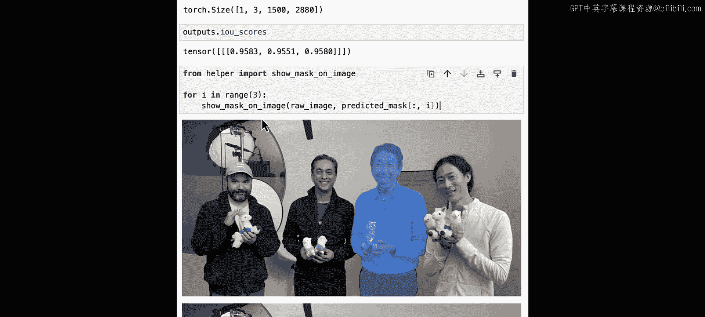

So very nice， so in two cases over three we were able to accurately predict the segmentation mask of Andrew's shirt but for the first mask it was able to segment Andrew entirely instead of the shirt。

 but to get better results for the specific use case one could also pass multiple points to get the segmentation mask which correspond to the region of Andrew's shirt yeah so you could try to past multiple points for the same mask you can also try to pass a bounding box that encapsulates the region of Andrew's shirt but yeah you can try out many combinations。

 feel free to try them out and also try out the combinations that are suggested in the official documentation of Sam model in hugging face transformers。

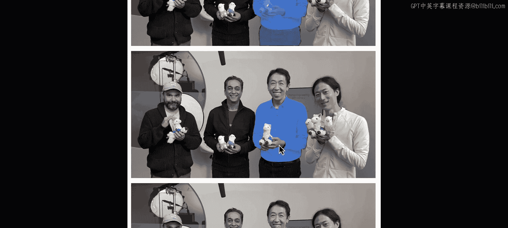

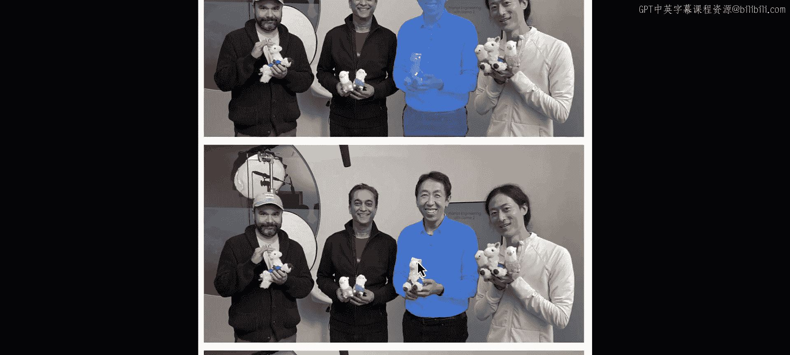

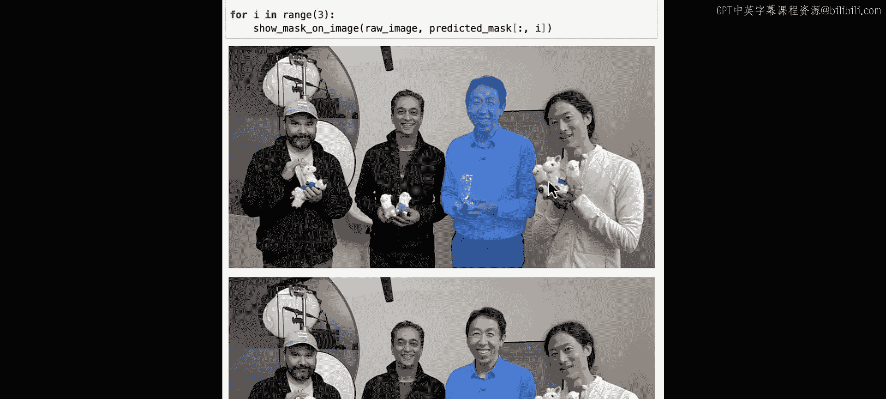

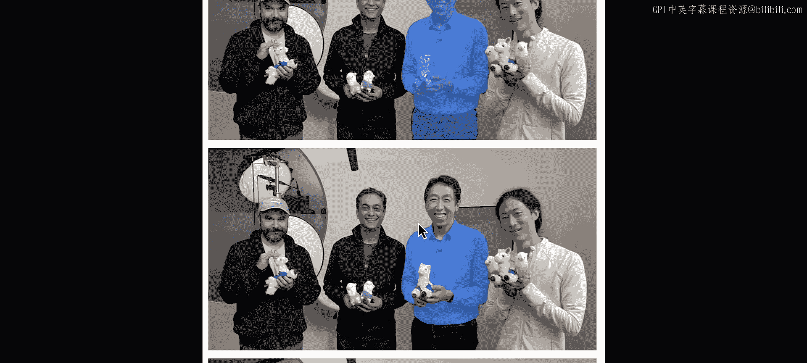

Now that we have seen how to use the segment anything model in order to segment any object of interest given an image and some 2D coordinates and or bounding boxes。

 I wanted to also present you another model called DPT which stands for dense prediction transformer。

 so DPT is a model that you can use to perform De estimation given an image。

 soDe estimation is a common task in computer vision that is also widely used for example in autonomous driving so for the demo we're going to use a model called DPT hybrid Midas from Intel and we're going to use pipeline as usual but this time we're going to call the Deaf estimation task for the pipeline。

So let's import pipeline from transformers and define our dev estimator by using dev estimation and for the model we're going to use。

D P T Hebrid from Intel。Okay so let's first inspect the image that we're going to use for this demo So as you can see it's a small tamagochi that is standing in a road in Vienna apparently according to the title so yeah we're just going to estimate the depth of this image let's see how it goes in terms of code So yeah as we've been using pipeline it's pretty straightforward so we just have to call de estimator that's what we call our object。

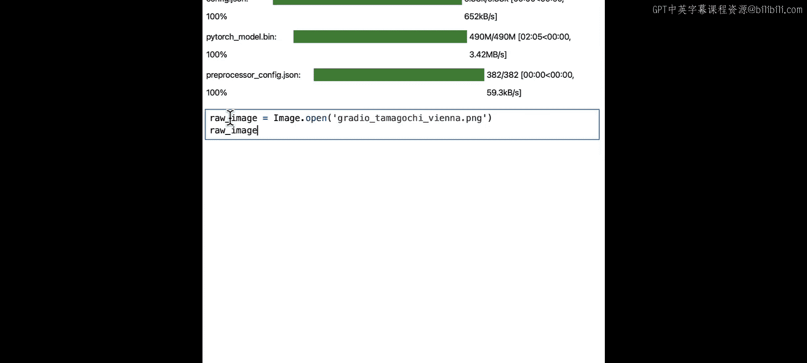

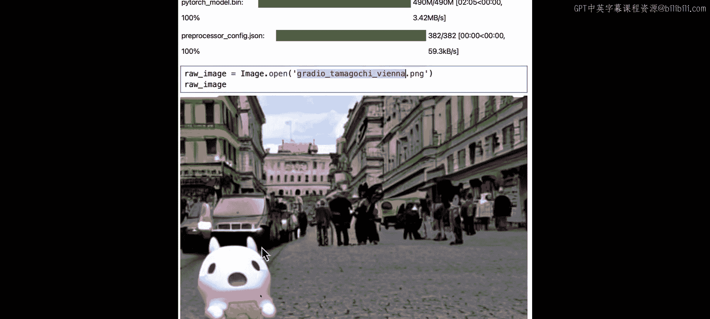

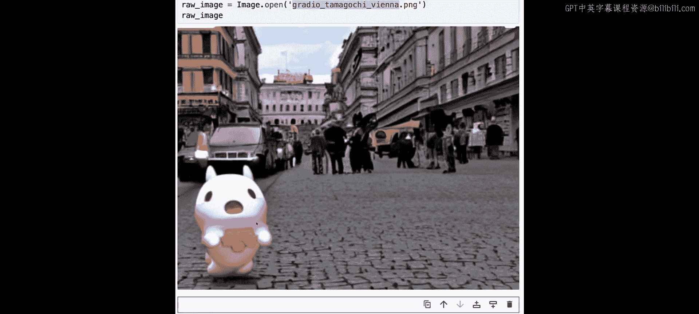

Of the row image and then if we inspect the output we have a dictionary with the key predicted de with the row def tensor of the predicted depth of the image。

 so we can't display that tensor as is so we need to first post processces the image by first resizing it to the size of the original image so for that we're going to use a function from pytorrch called interpolate from torch。

 nn do functional and we're going to consider the predicted de from the output。

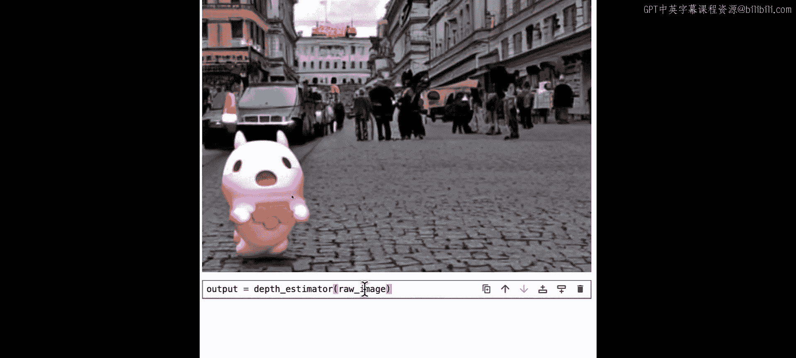

But we're going to。Un squeezeze in order to add a dimension on the first axis。

 if you inspect the shape of the predicted tensor。So it has one。

 so batch size number of images and then interpoollate also expects to have the number of channels in the second dimension。

 so we're just manually going to add it here。So。Just want to show you how it looks like if you call that method。

 So it just adds a new axis on the second axis。 And then we're going to。Resize it。

 So our target size is going to be the size of the row image。 We're going to use the B Qb mode。

So those are the things you shouldn't worry too much about， those are just the best。

 I would say best hyperparameters that you can use to resize an image and align corners equal falses。

All right。And then if we print out the prediction tensor， so now we should have the same shape。

As the input image。 So that's great。 But there is still one thing that we need to do。

So the values cannot be displayed as they are because for an RGP image。

 the pixel values needs to be between 0 and 255， so we need to normalize the prediction tensor so that the values will stay between 0 and 255 so we're just going to call that block。

We remove one dimension calling squeeze， we convert it to a N tensor。

 and then we normalize it between 0 and 255 and convert the image the tensor in int 8 and use that converted tensor usingP from RA。

To get the final depth and let's see how it looks like。

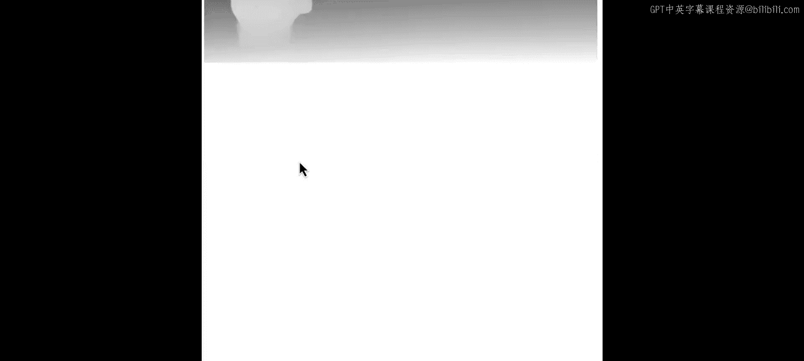

So here is the predicted output from the model so as you can see the Tamagochi that is in front of the picture has strong value towards the white pixels so it's very close to the image and then the elements that you can see far behind have pixel values that are close to black pixel so yeah I would say the model was able to quite accurately predict of the image。

So you can try it out with your custom images or images that you find on the internet and just make sure to resize the output using these formulas so let's say now you want to showcase this model through a simple demo and you want to share it with your friends or colleagues you can use radio that we used on the previous lesson and share the link of the graduate demo to your colleagues or your friends so yeah just wanted to quickly show you how to do this using radio so it's pretty much straightforward so we're going to import radio we're going to use transformers pipeline and we're going to use the deaf estimator object that we have defined here beforehand so that we don't have to load it each time。

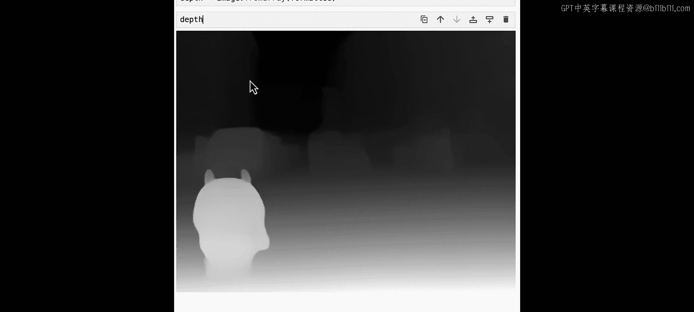

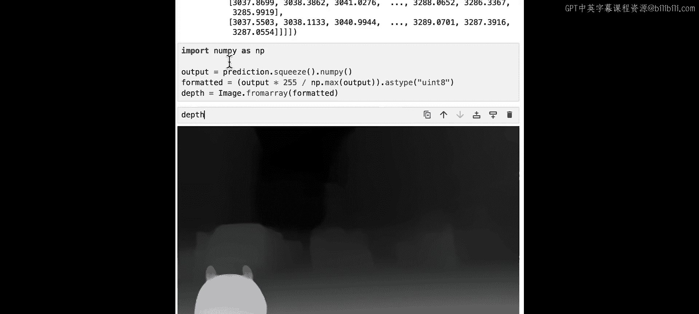

So similarly as the demo that we showed on the previous lesson。

 graot interface expects a method that does everything for you given the input that the user will pass。

 so we need to define a method that we take the input image as input and we'll do everything for you under the hood to the user and returns the predicted image with the pill image format。

 so we just have to write down all the steps that we did here in a simple method so that we do everything in one go。

So this is how it would look like， so we get the output from the pipeline given the input image。

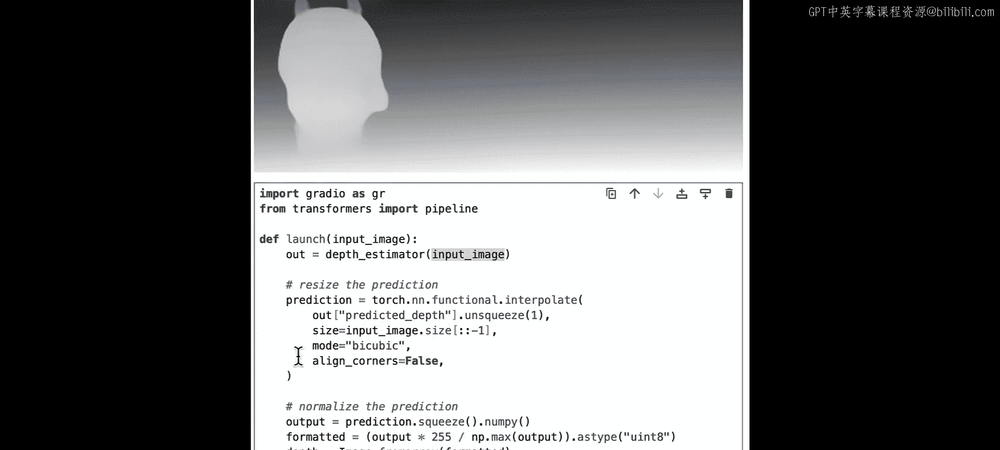

We besides the prediction using the snippet we used above and we normalize the output using also the snippet here。

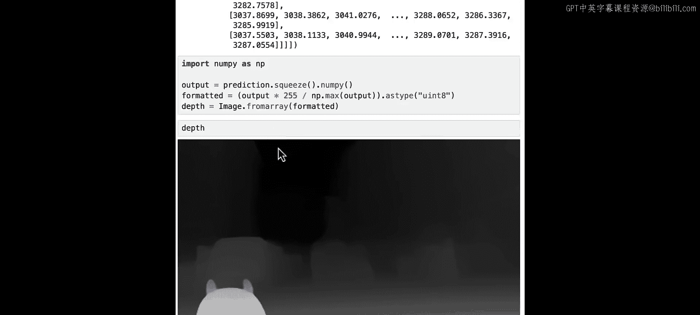

And then we define the gradient interface that takes the method as input。

 explicitly define the input as a peel image and the output as a peel image as well。

 we're going to run that cell and call interface。 launch with the argument share equal true so that you also have access to a shareable link so that you can share it with anyone。

So I'm just going to quickly try it on a local image。Very nice。

 it is able to predict the depth of the image accurately so yeah feel free to try that out again with your local images or images that you can find on the net。

 you can showcase this model to your friends and your colleagues in the next lesson you will learn with Mark how to use multimodal models where you can pass both image and some text in order for example to ask some questions about some specific images。

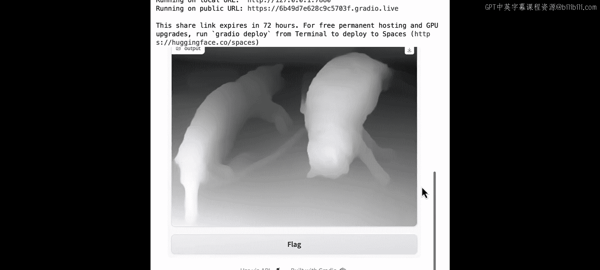

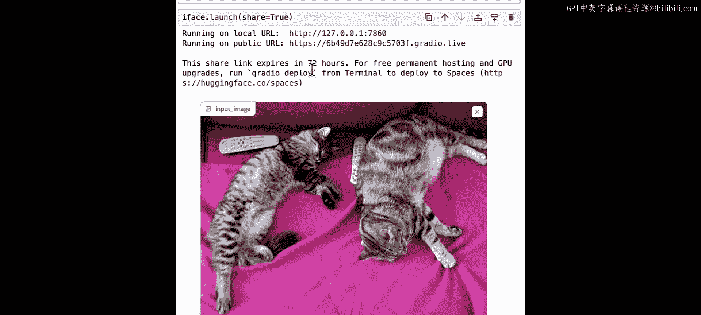

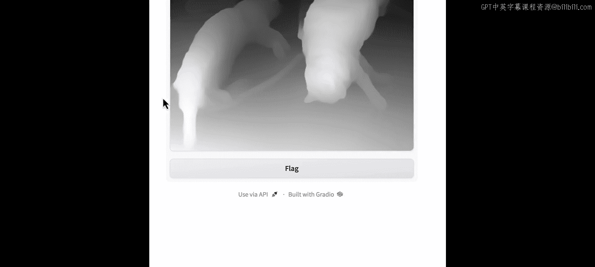

So yeah， let's move on to the next lesson together with Mark。

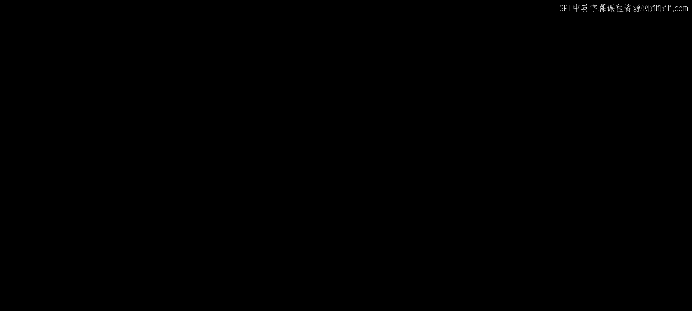