# 吴恩达《Hugging Face的开源模型｜Open Source Models with Hugging Face》中英字幕（英文可关） - P11：11.image retrieval.zh - GPT中英字幕课程资源 - BV16u4m1u7t4

In this lesson， you will work with multimodel models to perform image text matching using the open source model blip from Salesforols。

 so if you take a picture of a woman and a dog on the beach and also provide a text。

 my sister and her best friends， the model outputs a matching score to indicate how similar the text and image are。

 let's get started。

But first what exactly are multimodel models when a task require a model to be able to take as an input model one type of data let's send image and a sentence we will call it multimodel you may come across other definition of multimodel but we will stick to this one in this course when you think about multimodel models。

 you immediately think about chatGBT with GPT4v where you can send text image and even audio now if you want to try an open multimodels chatGBT you should also definitely try itix in this and the next few lessons you will go through some common multimodel task we will perform image to text matching。

 image captioning visual Q&A and zero shot image classification for the first three task we will be using the Blip model from Salesforce and for the last task the zero shot image classification we will be using the clip model。

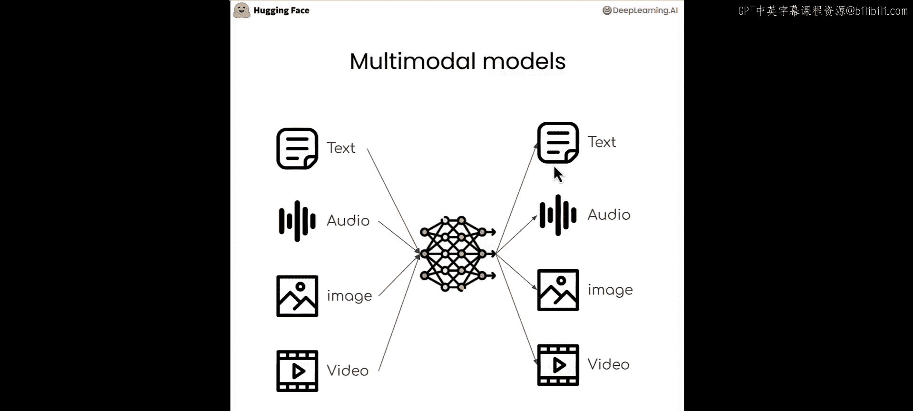

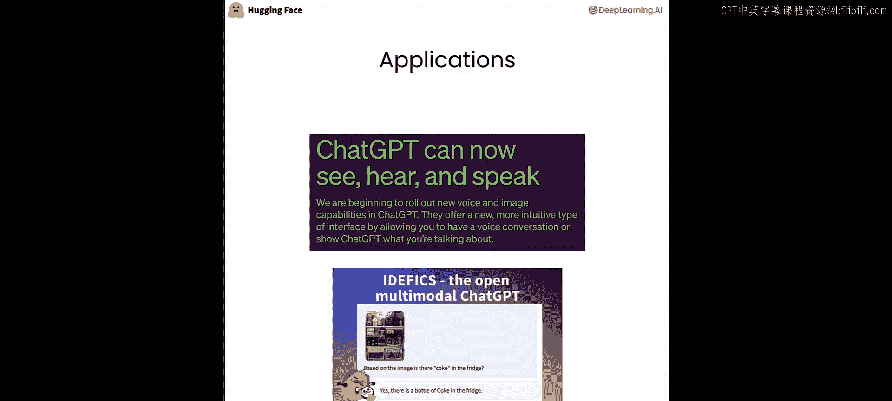

From OpenaiI the first text we will be looking into is the image text rettrial or matching the model will output if the text matches the image for example you can see that in this example we passed a photo of a man and a dog and the input text is the man in the blue shirt is wearing glasses the model should return that the text does not match the image let's code it for this classroom the libraries have already been installed for you if you' are running this on your own machine you can install the Transers library by running the following。

Since in this classroom we have already installed all the libraries we don't need to launch this comment。

 so I'll just comment it out。To perform the task， we need a few things we need to load the model and the processor first to load the model。

 we need to import Blip for image text retrial class from the Transformers library， let's do that。

Then to load the model。You just need to call the class。 We just imported， and。

Use the front pretraining methods to load。The checkpoint。As said before。

 I will be using the B model from Salforce to perform this task。

 and this is the related checkpoint for this specific task。As for the processor。

 it's practically the same， we need to import the autoprocessor class from transformers。

Then to load the correct processor， we just need to use the from freetrain methods。

And past the related checkpoint。

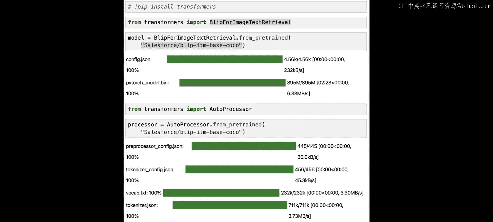

The processor role is to process the image and the text for the model。

Now let's get the image and the text that we will be passing to the processor。

 the processor will modify the image and the text in such way that the model will be able to understand it for the image we will be using the following URL link and to load the image we will be using the image class from the Pe library。

 the Pe library is installed by default when you install Python。

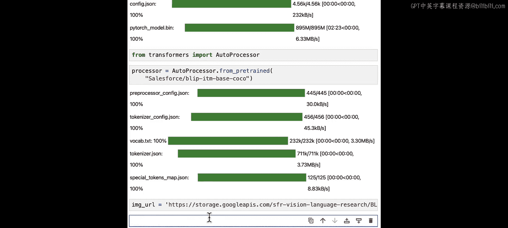

We also need to import the request library in order to perform HTTP request to get the data from the image。

In order to get the raw image， we need this code。In short。

 this line of code downloads an image from the specified URL， opens it。

 retrieve the road binary data， then convert it to the RGB column mode。

And if you print the raw image。You should be able to see the image now that we have the image。

 we will check if the model can successfully return that the image matches the following text。

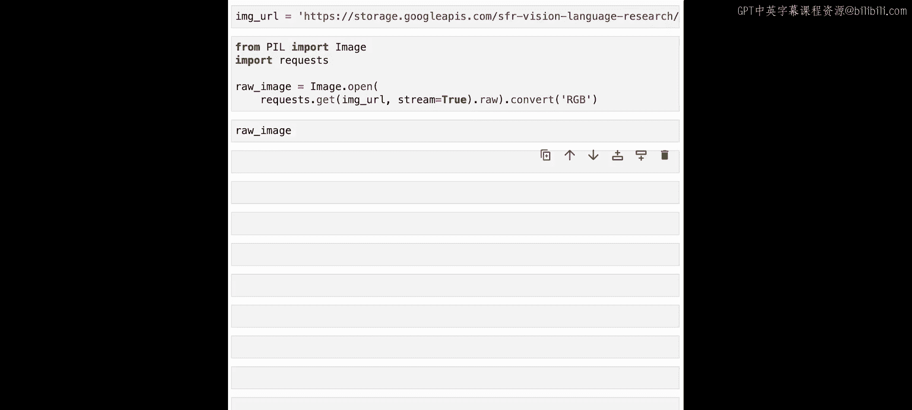

An image of a woman and a dog on the beach。 We need to get the input that the model can understand。

 so。

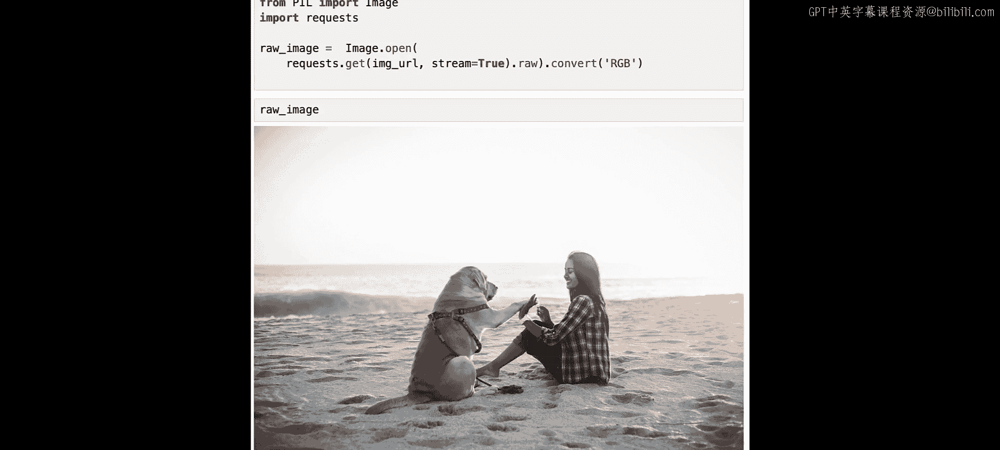

To do that， we need to call the processor， and we need to pass a few arguments。

 The first one is the image， So image equals to row image。 The second one is the text。

And the last one。Is return tensors。That we need to set it as P for pi torch。

So that we get pythtorch tensor at the end。

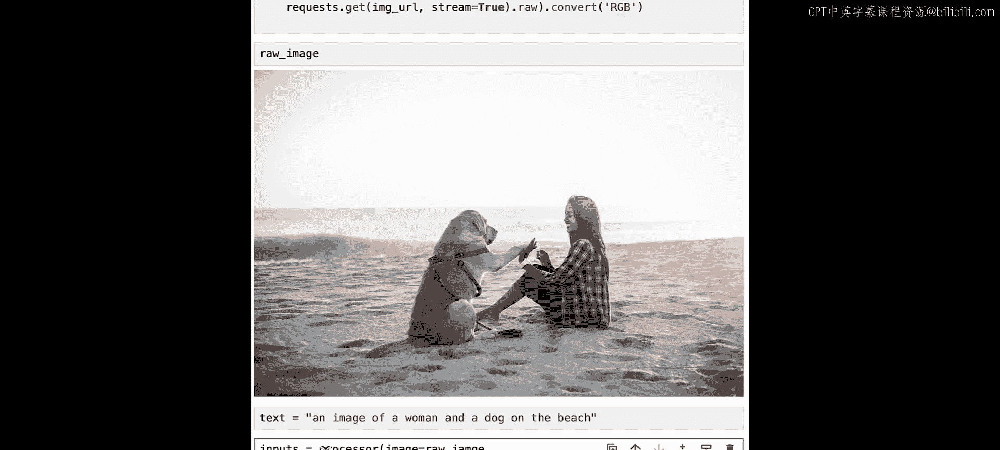

Let's print inputs to see what it looks like。

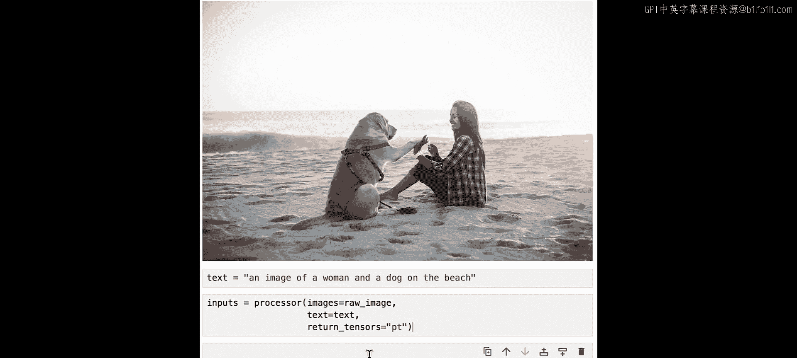

And as you can see we have a dictionary of multiple arguments， we have pixel values。

 inputs ID and the attention mask now we have everything to get the output we just need to pass the inputs that we have right here to the model。

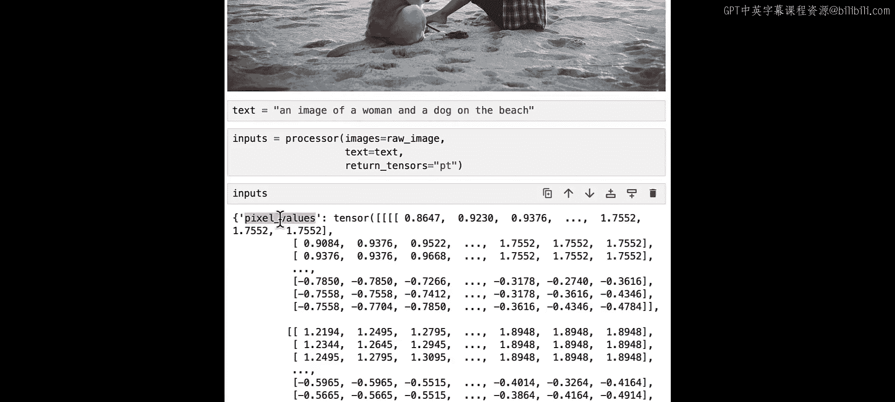

Note that we need to add a double store since we are passing a dictionary that contains the arguments。

 Now， let's print the scores。As you can see， these numbers doesn't mean anything yet because they are the logs of the model and to convert these values into something that we can understand。

 we need to pass them into a softmax layer， the output of this number into a softmax layer will give us the probability to get this softmax layer。

 we need to import torch。Then we need to pass the scores that we got into the soft max layer。

Let's check what we get。Now this number makes more sense the first value is the probability that the image and the text are not matched so the probability is very low and the second one is the probability that you' match and from the value it shows that indeed the text and the image are matched with a high probability as a conclusion we can say that the image and the text or match with a probability of 98% now is a good time to pause the video and try it on your own image and prompt let's move on to the next task image captioning you will use the same model but download different weights that were trained specifically to take an image and output text that describe that image Let's do that in the next lesson。

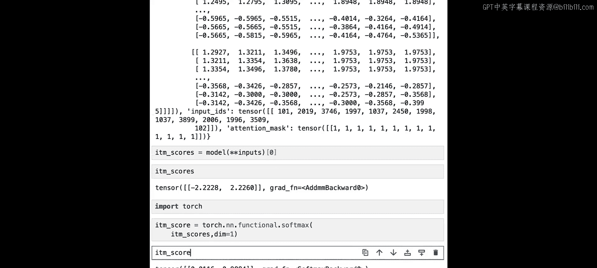

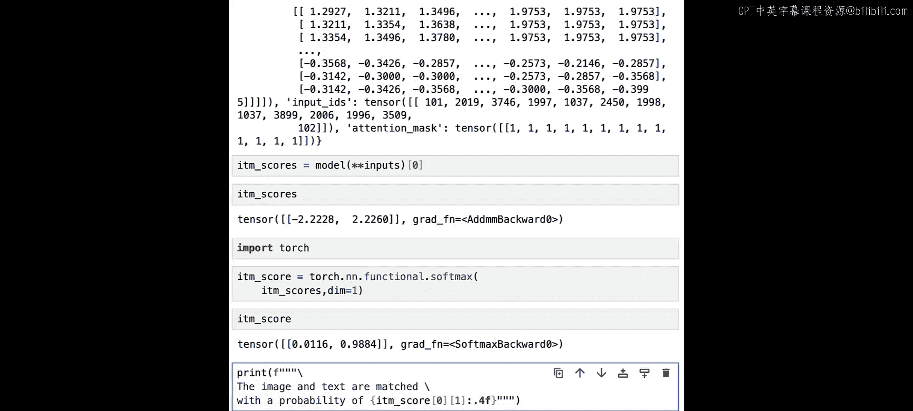