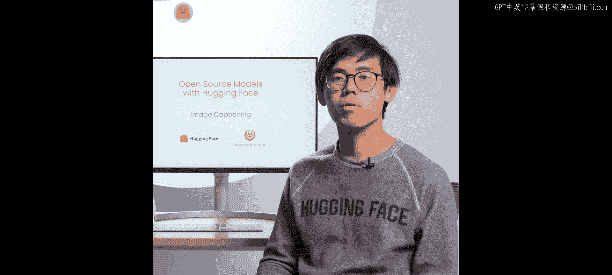
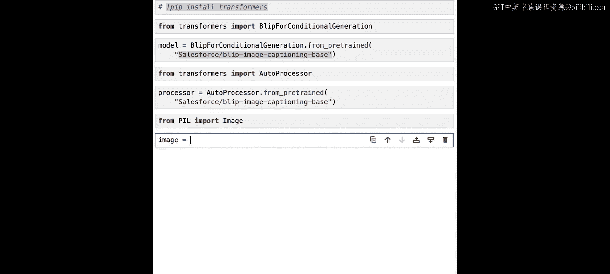
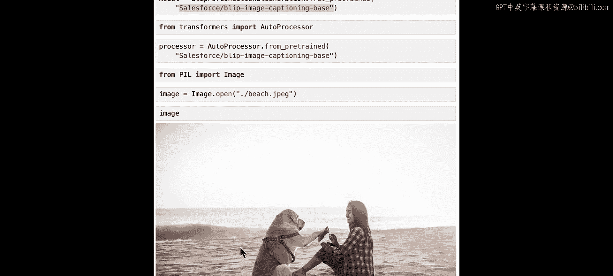
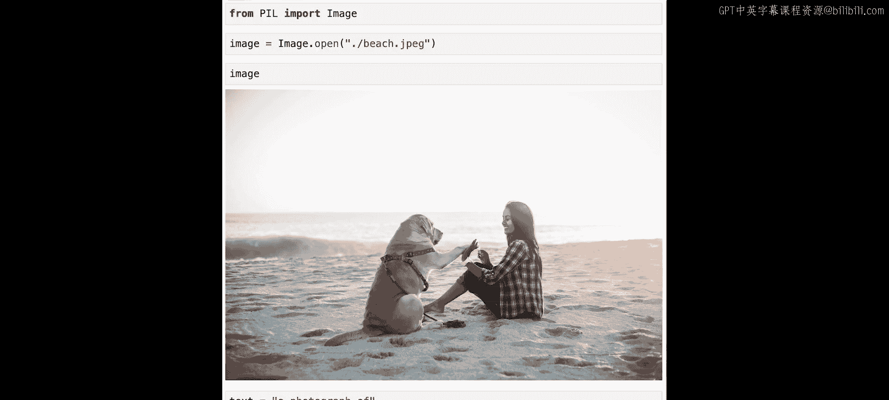
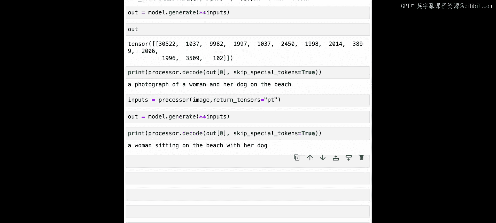

# 吴恩达《Hugging Face的开源模型｜Open Source Models with Hugging Face》中英字幕（英文可关） - P12：12.image captioning.zh - GPT中英字幕课程资源 - BV16u4m1u7t4

In this lesson， you will perform image captioning and you will use the same model G。

 but with different weights， let's get started。

The next test we will be looking into is image captioning。For the image captioning task。

 we ask the model to return the description of the image， For example。

 the model should return a man and a dog are reading a book together。

 we can put an input the start of the output text for example。

 we can let the model know that the output text should start with a dog on a couch with something else。

 let's move to the code for this classroom the libraries have already been installed for you if you' are running this on your own machine you can install the Transers library by running the following。

Since in this classroom we have already installed all the libraries， we don't need to run this。

 so I will comment it out to load the model for this specific task。

 we need to import the blip for conditional generation from the Transers library。

Then to load the model， we will use the form pretraining methods。

And we will be using the following checkpoint。Just like in the previous lab。

 we also need to import the processor。To load the processor is the same as the model。

 we will use the firm F gen method and pass the right checkpoint。

Now we have all the elements to perform the image captioning， we are just missing two small pieces。

 the image and the optional text， let's get the image first to do that we will use the image class from the Pell library。

To load the image， you can use the open methods from the image class and pass the pass to the image。

 Let's do that。

Let's check that we were indeed able to load the image and as you can see。

We have the picture of a dog and woman on the beach。

 Let's first perform conditional image captioning。 What it means is that we can pass a text that will be the start of the output of the model。

 for example。

We can pass。A photograph of then。We need to process the text and the image to do that we pass the text and the image to the processor。

We can also specify the return tensors argument to be equal to Pt for Pytorch。

 This way we will get Pytorch tensors at the end。 Let's check the inputs。

And just like in the last lab， we have a dictionary of arguments such as pixelix values。

 inputs ID and attention mask now to generate the description of the image。

 we need to use the generaterate methods。

Just like in the previous lab we also need to add the double stars since it is a dictionary of arguments。

 let's check the outputs as you can see we get as output a list of integers。

 these numbers or token IDs， these are usually how the model understands the text each token represents a part of the word or sometimes a single word to decode these tokens we need to call the decocode methods from the processor let's do that。

We put the output as the first hour argument。 This is optional。

 but we can skip the spatial token by setting that argument to true。And。Let's print the results。

And we get a photograph of a woman and her dog on the beach。 Now。

 let's try the unconditional image captioning。 What it means is that we don't pass any text and we let the model starts the description。

As you can see this time we didn't put any text and let's generate the text using thegene methods just like before。

So the output is equals to model to generate double store inputs。And it's thecodes。

And now we get a woman sitting on the beach with her dog now is a good time to stop the video and try to upload your own image and put your own conditional text to the model。

For the next lesson we will be testing visual question answering for this test。

 you can ask the model a question about an image and the model should return turn an answer Let's go to the next lesson。

