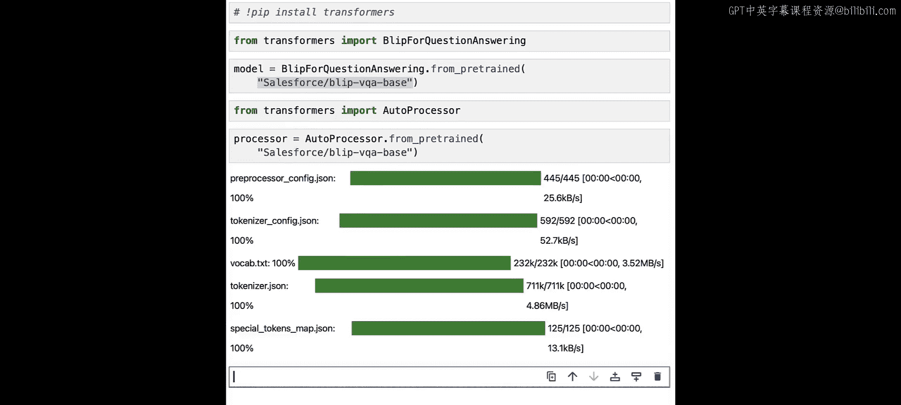
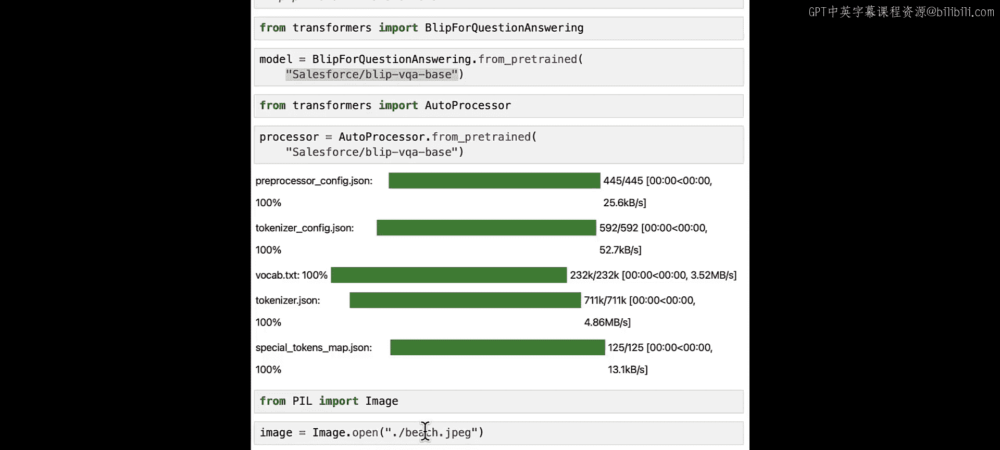
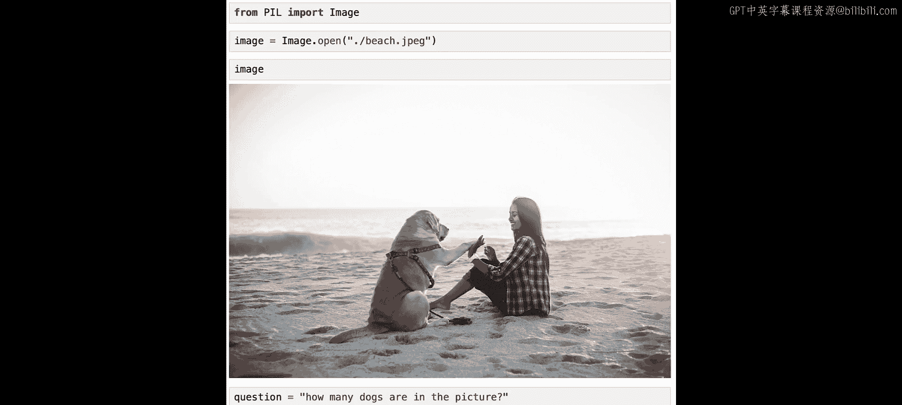
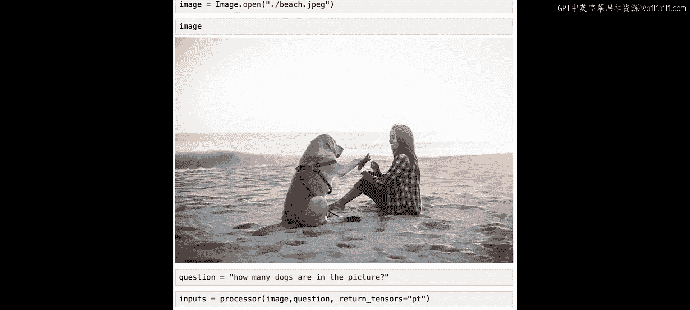
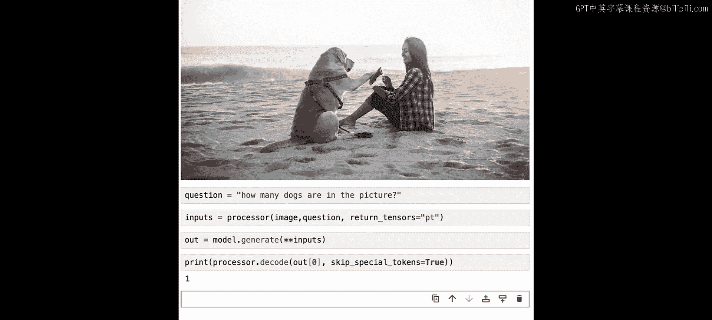

# 吴恩达《Hugging Face的开源模型｜Open Source Models with Hugging Face》中英字幕（英文可关） - P13：13.multi-modal visual question  answer.zh - GPT中英字幕课程资源 - BV16u4m1u7t4

Now you will reuse the blip model for question answering of an image。

 This means you can give the model a picture of a dog and a woman on the beach and I ask a question such as who' is at the beach and the model will answer your question based on that image。

 Let's do that now。

For the visual question answering task， you can ask the question about the image to the model and the model should return and answer if you ask the model what the dog is wearing。

 you should get a pair of glasses。Now let's code this in this classroom the libraries have already been installed if you're running this on your own machine。

 you can install the Transers library by running the following。

Since the libraries are already installed in this classroom。

 I won't run this and I'll just comment it out。Just like the last two lessons to perform the specific task。

 we need a few things the model and the processor， so let's import Blip for question answering class from the Transers library。

Now that the class is loaded， let's load the model by using the form preing methods。

And by passing the related checkpoint。For question answering。Let's do the same for the processor。

 So we will load from the transformers library。The class autoprocesor。

And we will load the processor using from pretrain also。Then we just need to pass。

The same checkpoint。啊。

And that's it。Now， let's load the image that we need to pass to the processor to get the inputs and we will pass these inputs to the model to generate the answer。

To load the image just like in the previous lab， we will use the pill library。

And the image class to do that。To load the image， we will use the open method and we just need to pass the path to the image that we want to open。

Let's check the image。😔。

And here we are。 and you can see that we need to have a picture of a dog and woman on the beach。

 Now let's ask a question to our model about this specific image。For example。

 let's ask it how many dogs are in the pictures we need to pass the inputs to the model so we will use the processor。

To process both the image。And the question。And we will return the tensors。😔，To be pytorch tenses。

Just like the previous lab， we will use the generaterate methods。Fund the model。To get the outputs。

And we need to use the processor。To decode。The output。

 and you can see that the model was able to answer correctly to the question that there is indeed only one do。

In the picture now I invite you to stop the video and ask other questions about this specific picture or you can even upload your own pictures and ask whatever question comes to your mind in the next lesson we will learn about zero shot classification with G model from open AI let's move on to the next lesson。

