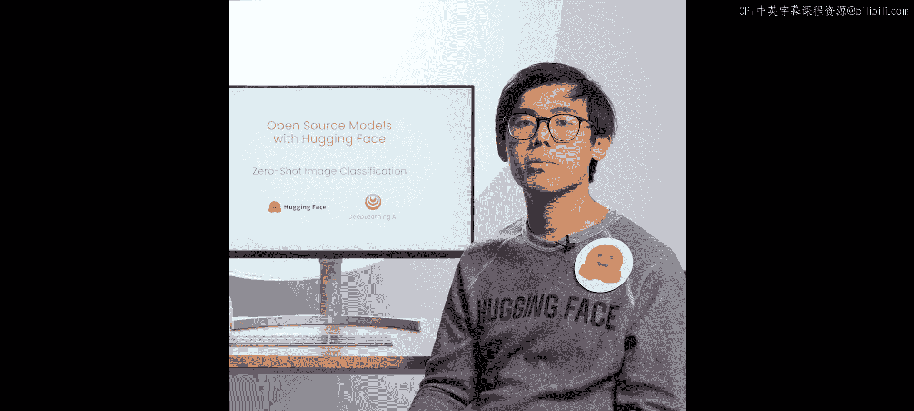
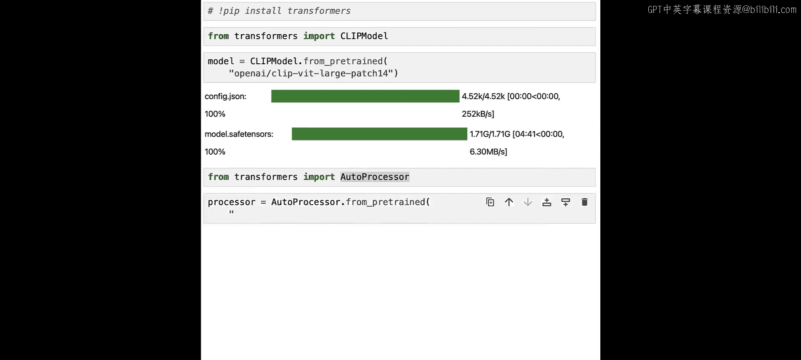
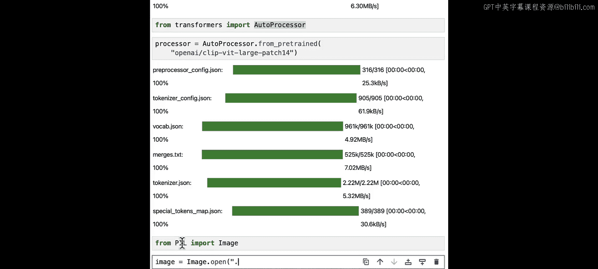
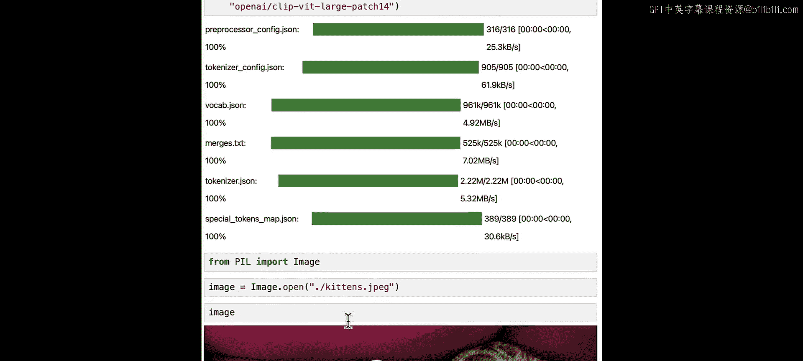
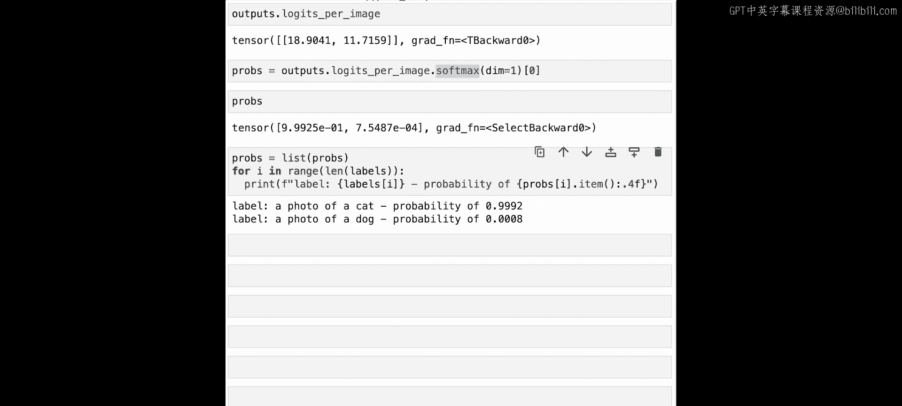

# 吴恩达《Hugging Face的开源模型｜Open Source Models with Hugging Face》中英字幕（英文可关） - P14：14.LZero_Shot_Image_Classification.zh - GPT中英字幕课程资源 - BV16u4m1u7t4

Now， you will use the clip model to classify images with zero shot classification。

 It's zero shot because the model will be able to classify the image from among the list of any labels that you do give it。

 This is great because you don't have to fine tune the model to recognize specific categories。

 You can just use the model out of the box。 Let's try it out。😊。

For zero shot classification task you will use the clip model from OpenaiI clip is a multimodal vision and language model the zero shot image classification task consists of classifying an image based on your own labels during inference time for example you can pass a list of labels such as plain or dog bird and the image you want to classify the model will choose the most likely label in this case it should classify it as a photo of a dog yet the photo is a little bit small but this is indeed a dog。

Let's see how to do that for this classroom the libraries have already been installed for you。

 if you are running this on your own machine， you can install the Transers library by running the following。

Deep install transformers。Since the libraries are already installed for us in this classroom。

 I won't be running this comment。Just like in the previous lessons。

 we need two things we need the model and the processor。

 let's first load the model from the Transformers's library。

 so we need to load the clip model from transformers。To load the model。

 we use the form freetrain methods。And we need to pass。The correct checkpoint。For this specific task。

Now that the model is loaded， let's load the processor so we will import auto processor from the Transers library。

And we will use also the front pretrain methods。To get the correct。Processor。

Now that the processor and the model is loaded， let's get an image to do that， just like。

The previous lessons we will use the pill libraries and import image glass。

We will load the image using image。😔，Dot open， and we will specify。The path to the image。

Here's our image。

To lovely kittens， let's try to classify this image， let's create the labels。So。Let's put。A photo。

A at。As the first label and the second label， we can put a photo of a dog。 then we need。

To create the input that will go inside our models to do that will reuse the processor。

We need to pass the text， which are the labels。The image。We will make sure that we get。

The pytorch tensors by specifying。Pity in the return tensors argument。 and we will also add。

The last argument padding to be equal to true in case the labels length are not the same。

 then we can pass this output to our model， so。Upputs equals models。Double store inputs。

Since the inputs is a dictionary of arguments， and let's check。What do we get？Yeah。

We get a very big output， but the thing that we are interested in are the logs per image。

 So let's print that。And。As we've seen in previous lessons to get the probability。

 we need to pass these logs into our softmax layers， so let's get the probability。Just like that。

 by calling。The soft max on the outputs per logs， let's get the softm of the logs and we take the first element。

 which is a single tensor。And as you can see now we have something that looks like a probability。

 the first element is the probability that the image is indeed a photo of a cat and the second one is the probability that the photo is a photo of a dog。

So to conclude， we see that for the label， a photo of a cat， the probability is particularly 100%。

 whereas for the second label。The probability is near zero now I invite you to pause the video and try a couple of things you can either maybe change the label so that you put labels that doesn't have anything to do with the image and try to see how the model respond to that you can also upload a new image or just change the labels in the next lesson Uni will show you how to deploy the Blip model using hugging phase bases。

