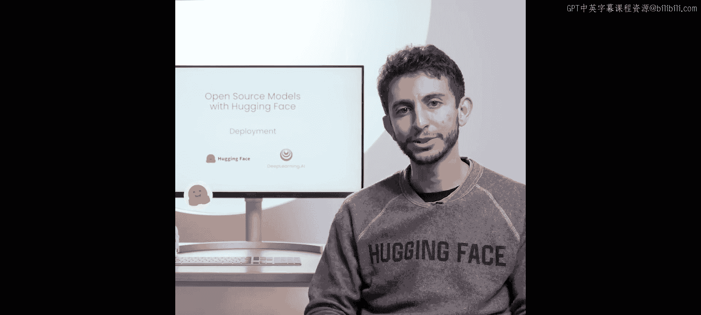
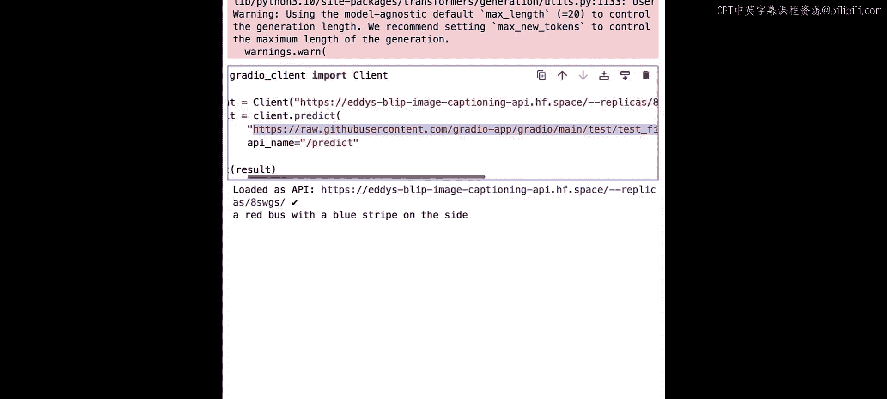
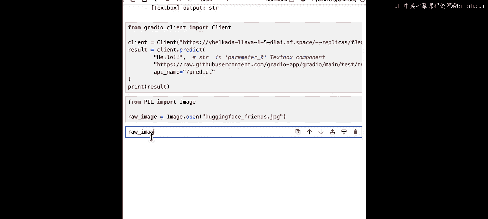
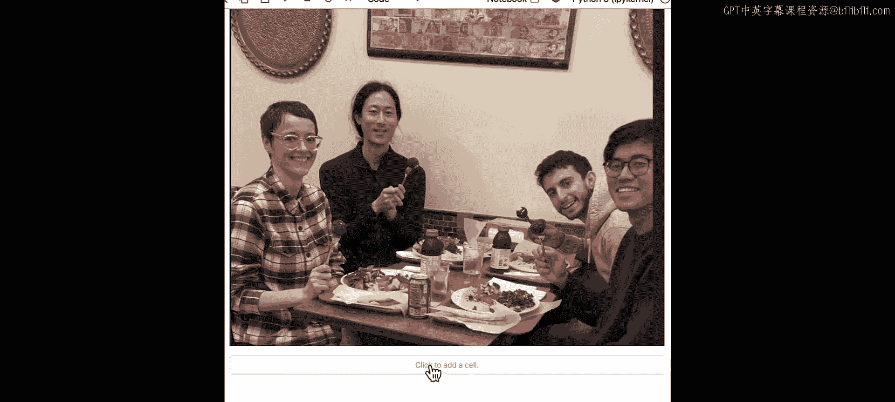
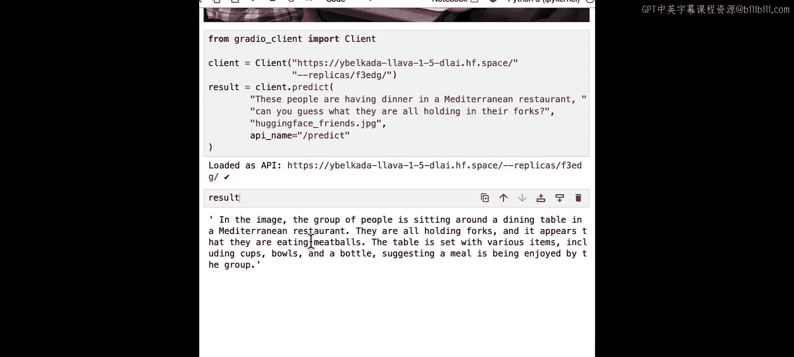
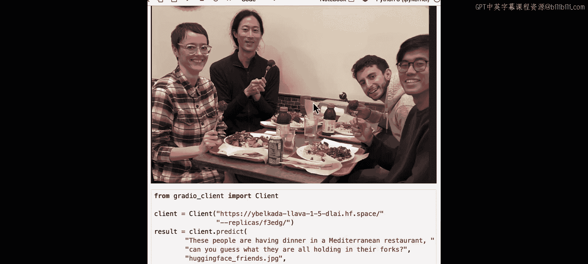
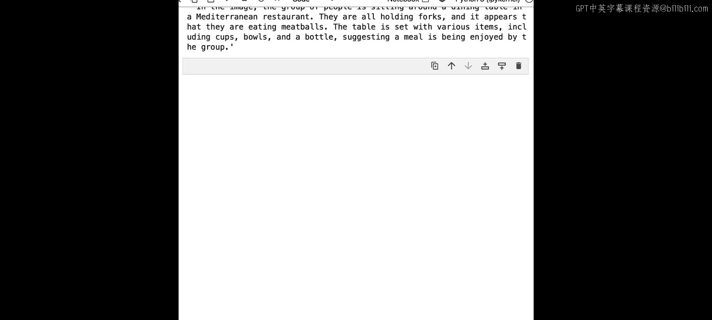

# 吴恩达《Hugging Face的开源模型｜Open Source Models with Hugging Face》中英字幕（英文可关） - P15：15.deployment.zh - GPT中英字幕课程资源 - BV16u4m1u7t4

Hi， you now have a broad overview of the type of tasks that you can achieve within the Huging face ecosystem in most cases for hosting demos and practical applications。

 it would be nice to have your application running without leaving your computer on in other words。

 upload the whole compute requirements outside your local machine。In this lesson。

 you will leverage hiking face spaces to deploy your demos and use them as an API。 Let's get started。

So welcome to this lab session about deploying M models in the Higingface ecosystem using Higing phase spaces。

 So at the end of this lab you will learn how to host an M model as an API on Higingface hub and call that API through a simple command So for this lesson we will deploy the blip model that you have covered on the multimodel lab session recall that the model has been fine tune on several multimodel tasks。

 making it possible to perform three different tasks image captioning visual question answering and image text retrieval In our case we're going to focus on image captioning So let's get started So first of all you need to create an account at the Higing phase website Hf do CO and make sure to connect to the main website then you just have to navigate here on the top right of the window and go to new space to create a new space。

 Let's decide for a name for the space so we're going to call it。Blip image captioning。API。

We're going to put the default license select the radio as the space SD DK and selected the basic hardware and put it public so that everyone can use it alright。

 so once you have created that space you need to create two files which are the requirements that TXT file to list all the required libraries that you need to run the space and the main file that you need to call app。

pyy so let's do that right now by creating first the requirements file and put all our requirements inside that TXT file so we'll add transformers because we need transformers Pytorch and radio。

Alright， so before creating the app。t P byL， let's quickly go back to our lab and create a new cell and first try out the demo locally before pushing it on the hub So as seen in the previous lab we're going to leverage the pipeline objects from transformers and use radio as a demo by leveraging the radio dot interface so as usual load the pipeline。

But this time we're going to load the image to text pipeline and we're going to load the Blip image captioning base model in order to perform image captioning。

Alright， so now that the model has been loaded as we've been doing so far for all our grad demos。

 we need to define a method that we'll call launch here that will take the input， call the pipeline。

 get the output and get the generated text from the output and note here we're using the globally defined pipeline that we have loaded here so that we won't have to instantiate a new pipeline each time we're calling launch that way we just have to define the initialization of pipeline once at the beginning of the script so that it's loaded only once and we use that globally defined model or pipeline inside the launch function。

Then let's define our Grt interface that will look like this with input being Gr dot image。

 output being text， and we call interface dot launch with share equal true so that we can also have a shareable link that you can share with your friends and colleagues。

All right， yeah， let's quickly try it out right now。

So we're going to try that out on this image that we have locally of two kittens lying on a couch with two remotes。

 so let's see how it goes。Perfect two cats sleeping on a couch。

 That's pretty much a good description of the scene。 Alright， so now the question is。

 what if I want to deploy a larger model or what if I don't want to deploy that model locally on my local computer because I want to use my computer to do something else。

 This is possible using spaces and that's what we're going to see in our lab。

 So once we have confirmed that the app works locally we're going to export that app directly into the created hugging face spaces So we're just going to copy paste all these blocks and paste it in the newly created app dot Py file on the space that we have created So let's just do it right now So we're going to create a new file appt Py。

And copy paste everything。Note that alternatively you can also git clone the space locally and do everything through Git here we're just doing everything through the command line through the UI for Easiness。

Here we're going to remove sherry called true。And we'll just have to wait the app to build。Okay。

 so if everything went well you'll end up with something like this。

 so if the app is successfully running， you should have that on your newly created space and we can also test it out right now to see if it works。

Alright so we got the same results as the test that we've been doing locally now how can I use that space as an external API so if you look into this window there is use via API select box here that you can click and we just have to you know follow the instructions here so first people install radio client so that's something we already did in our lab and we just need to retrieve this link。

Which is a temporary link that gets changed， I think each 24 hours。

So you just have to instantiate this client object with this correct link and call client would predict。

 then local path to the image or an URL or also a pill image object and make sure to call API name equal Pre and then you can directly print results so let's copy paste this snippet。

And try that out in our lab。So let's try that out。Perfect， so if we inspect the input image。

So indeed， it's a red bus with some blue stripes on the side。

So if you want also to further inspect what's in your API。

 you can also call the View API method directly on the client to get more information on the API。

So it also gives you some information on how to call the API so through API name equal predictdict the expected parameters and also the expected return type of the API perfect so we were able to call our model as an API outside our local machine so everything is done on the cloud feel free to try that space out or build a new space for your own use case or try out new models。

 new inputs and so on so before moving forward there is also another feature that I wanted to show you。

So just to complete my explanation about the client API， you can also make the space private。

In case you want to host a private model， we just have to。

Make sure that the space is private when going to the setting。Here。

 so by making the space private and then you just have to pass your hugging face token when you instantiate the client。

 So in terms of code， it would look something like this So you will instantiate your client with the argument H token your token So that way you'll have access to the private space as an API。

 So how can we push this further。 So we've been deploying this demoso on a CPU instance on the hugging face space。

 But what if I want to deploy a much larger model that cannot fit on a CPU instance or what if the CPU instance is a bit slow and I want to deploy it on a GP instance。

 So there is a feature you can use within the hugging face ecosystem called GPU zero space where you can basically spin some free GPs and demand for your spaces。

 So let's see how to do this。 you need to first go to this。

Hgging F organization called zero GPU Exprs you have to browse0 GPU dash Explorrs on Higing F Hub and request to join this organization in order to get access to this feature and once your request has been accepted you directly have access to the zero GPU feature whenever you create a new space you'll have the option zero GPU appearing here with dimension free。

So to demonstrate the zero GPU feature I've created a space on my personal account for the lava model。

 so lava model is an image to textt model which is quite large so the lava 1。

57b that is deployed on the space the demonstration space has approximately 16 GBs and needs quite a lot of GPU Ram to be run and the space slips here and as you can see it says running on a zero device so let's use that as an API so we just have to click use via API here okay so we can copy paste this snippets and try it out on our local machine and instead of using the default prompt and image we're going to use a custom image that we have prepared for you so remember this image of。

The instructors having dinner altogether in Pao Alto here。

So we're going to use this image and ask the model if it's able to predict what we are all holding in our forks。

So let's try that out right now。So we're going to prompt the model in such a way that we're going to explicitly ask what we are holding in our forks。

 so we're just going to say these people are having dinner in a Mediterranean restaurant to hint a bit that we're having falafels。

 can you guess what they are all holding in their forks？And yeah。

 recall that you can either pass an image URL or the path to your image。

 so we're going to pass the path to the image。And wait for the results。Perfect。

 so let's see what the model has predicted。So so it'd say that we're all eating meatballs。

 at least the model has predicted that it's something that is round。

 but it was not unfortunately able to detect that it was falaf despite the hint that we gave but yeah I guess that's a bit challenging maybe even for humans since it's round and a bit brown so yeah。

😊。

But still I think the description is quite accurate and it's quite funny how the model behaved with respect to the prompt and the image Al right so to wrap up this lesson I invite you to explore hugging face spaces in order to deploy your custom demos you can also browse the spaces webpage to check out the spaces of the week to get some inspiration and cool applications and demos that you can build and easily share。

😊，So I invite you to have a look at all the things that we have covered during this whole course and come up with some cool ideas that you can publish easily on hikingging face spaces and share it with your friends and colleagues allright so there is just one more video we will say thank you and wrap up the course so let's go on to the next lesson。

