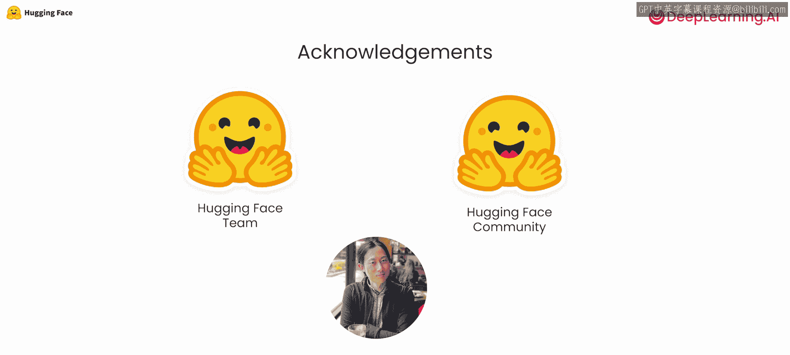

# 吴恩达《Hugging Face的开源模型｜Open Source Models with Hugging Face》中英字幕（英文可关） - P1：1.introduction.zh - GPT中英字幕课程资源 - BV16u4m1u7t4

Welcome to this short course， open source models with Hoing Fase built in partnership with Huing F thanks to open source software If you want to build an AI application。

 you might be able to grab an image recognition component here and an automatic speech recognition model there and an OM somewhere else and then string them together very quickly to build a new application Huing F has been transformative for the AI community in terms of making it easy for anyone to do this by making many。

 many open source models easily accessible and this has been a huge accelerator for how many people build AI applications In this course you learn directly from the Hing F team how to do this and build cool applications yourself possibly faster than you might have previously imagined would be possible for example。

 you use models to perform automatic speech recognition or ASR to transcribe speech into text and then also text to speech model。

Or TTS to go the other way to convert text into audio These models combined with an LOM。

 give you the building blocks you can use to build your own voice assistant。

You also see how to use hooking Fs transform a library to quickly preproces as well as post process outputs of machine learning models。

 for example， preprocessing audio like controlling the audio sampling rate in the ASR or TTS examples I just mentioned。

 as well as preprocess or post process data such as images and text。

The notion of grabbing open source components to build something quickly has been a paradigm shift in how AI applications are built and in this course you get a few for how to do this yourself I'm delighted to introduce our instructors for this course。

 Eunice Valgoar， a machine learning engineer at Huging phase。

 has been involved in the open source team where he works at the intersection of many open source tools developed by Huging phase such as Transers parameter efficient fine tuning of PEF and TRL。

 which stands for Transist reinforcement learning。Markson also a machine learning engineer at Huging phasese。

 is part of the open source team where he contributes to libraries such as the Transformers library and the Ace library Maria haousoverva is a member of technical staff at Huging phase and she leads the educational projects at Huging phase and contributes to crosslib efforts to make save the machine learning more accessible to everyone Andrew。

 we're excited to work with you and your team on this First you will create your own chatbot with open source LLM you will use open source LLM from meta the same code can apply to more powerful open source LLMs when you have access to more powerful hardware you will use open source models to translate text from one language to another summarize documents and calculate sentence and bes in order to compare similarity between two sentences Next you'll use transformers for processing audio。

What audio tasks do you think a voice assistant might be performing when you ask it for。

 say a weather forecast？It knows to wake up when you say its name that's classification It converts your speech to text to look up your request that's automatic speech recognition and it replies to you that text to speech In this course you'll classify arbitrary sounds transcribe speech recordings and generate speech from text The computer vision applications of transformers are plentiful you learn how to detect objects in images and segment images into regions called semantic areas For example。

 you can apply this code to detect that a puppy exists in an image and also segment the part of the puppy that makes up its ears After you've learned to handle text audio and image tasks you can combine these models in a sequence to handle more complex laws For example。

 if you want your app to help someone with a visual impairment by describing an image to them how could you implement that in this course you apply object detection to identify the。

ject image classification to describe those objects in text and then speech generation to narrate the names of those objects。

You also use a model that can take in more than one data type as input。

 these are called multimod models。For example， you build a visual question answering application in which you can send an image to a model。

 as well as a question about that image， and your application can then return an answer to that question based on the image。

You also use the Grra deal library to deploy an AI application to hugging face spaces so that anyone can use your application to perform tasks by making API calls through the internet。

Of course， the goal of all of these examples isn't just for you to really build these specific examples is so that you learn about all these building blocks so that you really combine them yourself into your own unique applications Many people have worked to create this course I'd like to thank on the hugging F side the entire hugging F team for the review of the course content as well as the hugging F community for the contributions to the open source models from deep learning AI Eddie Shu but also contributed to this course In the first lesson you' learn how to navigate thousands of models on the hugging F hub to find the right one for your task and how to use the pipeline object from the transformformers library to start building your applications That sounds super exciting Let's go on to the next video and get started。

