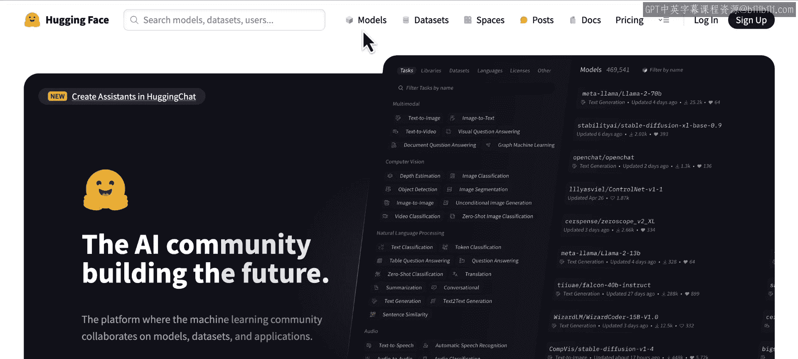
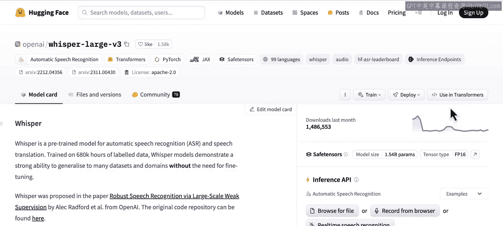
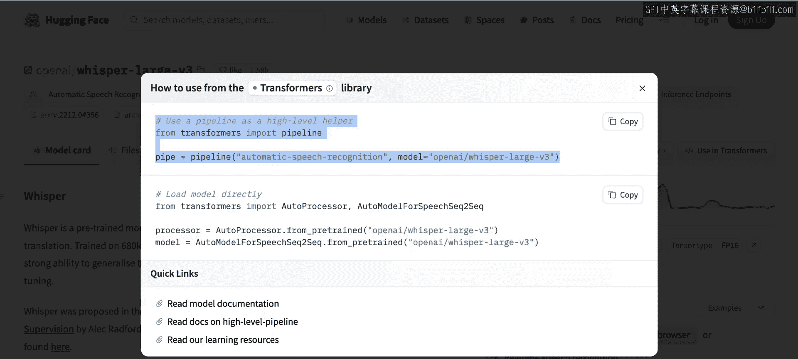

# 吴恩达《Hugging Face的开源模型｜Open Source Models with Hugging Face》中英字幕（英文可关） - P2：2.selecting models.zh - GPT中英字幕课程资源 - BV16u4m1u7t4

Today， thousands of open source models are available to you。

 and many are released every week on the Hiinface H。

 Hiinface H is an open platform that hosts models， data sets and machine learning demos that are called Hiinface spaces。

 How do you find a model that you need for your project。

 Let's head over to the Hiinface H to find out。😊，You'll find models suitable for many tasks on Models page。

The number of models here may seem overwhelming。 It's a good idea to begin your search by identifying what task you're working on in machine learning terms in this course youll see plenty examples of tasks let's say I want to do automatic speech recognition。

Let's choose it from the left side panel。There are still many models to pick from。

 but you can narrow your search down further， let's say you want a model to transcribe speech in French。

You can choose your language here。And let's say you want a model with a permissive license by permissive。

 I mean， a license that allows you to use the model for most kinds of applications。

 including commercial use。 This leaves you with much fewer options。 You can sort by。Downloads。

If you want to find models that are commonly used for this task。

Or if you'd like to try a recent model that the community is excited about， sort by trending。

Before picking one model or the other， check out their model cards。

 A well written model card is like a Rmi file for a model。

 It contains a lot of useful information such as models， architecture， how it was trained。

 what limitations it has， and so on。 as you can see here。

Models can have checkpoints with varying number of parameters。

 So we say that this type of model comes in different sizes。 Checkpoint refers to the saved model。

 including the pretrained weights and all the necessary configurations。 We often say we load a model。

 but technically speaking， will load a model checkpoint。

 Some checkpoints have dozens of millions of parameters。

 Others have a billion or a few billions of parameters。 depending on your hardware。

 you may not able to run the largest checkpoints。So let me show you a rule of thumb that I use to estimate how much memory I will need for a model。

 We'll go to files and versions。Here you can find a file called Pytorrch model bin。

 This file stores the trained weight of the model， and you can easily see its size。

Multiply that size by 1。2 in other words， at 20% on top。

 and this is approximately how much memory you'll need to run this model。

 Now let me quickly show you an alternative way to find a model for a task， a data set or a demo。

 Let's go to the task page。On this page， you can learn about different machine learning tasks。

 Let's choose a task that we're interested in。 Again， let's go with automatic speech recognition。

On this page you can learn about the task itself， so this is a great way to discover machine learning tasks that you have not worked with yet。

You can also find suggestions for models that will work with this task。Data sets you can use。

And find some demos where you can play with models that perform this task。

Note that whisper by Open AI is suggested as the top choice here。 Let's go back to this models page。

To load this model from the Hi and F H， you can use the Transformers library。

 notice the usings Transformers button。

If you click it you'll find two helpful code snippets showing how to load the model checkpoint in this course you'll be working with models using the pipeline object as in the first example。

The pipeline object offers a high level abstraction to solve tasks。

 It also takes care of complex preprocessing of inputs to match the model's expectations。

 For example， some audio models expect the input audio to come in the shape of a log mail spectrogram。

 Tex typically needs to be converted into socalled tokens。

 and images often need to be properly resized and normalized with the pipeline。

 You won't need to do any of these preprocessing steps by hand。

 Now that you know how to find models for your tasks and where to find the pipeline code snippet。

 Let's build your first application。 Let's go on the next lesson。

