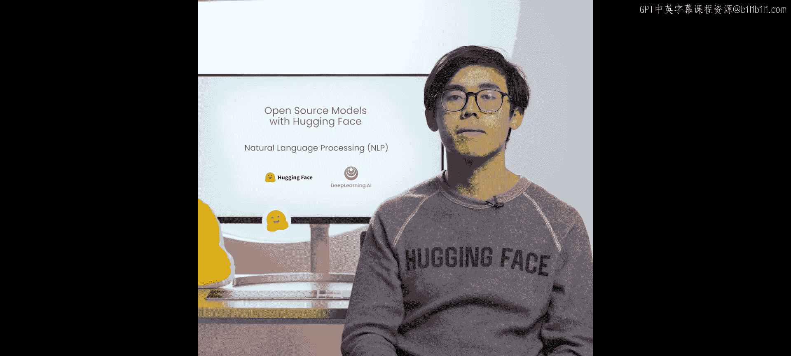
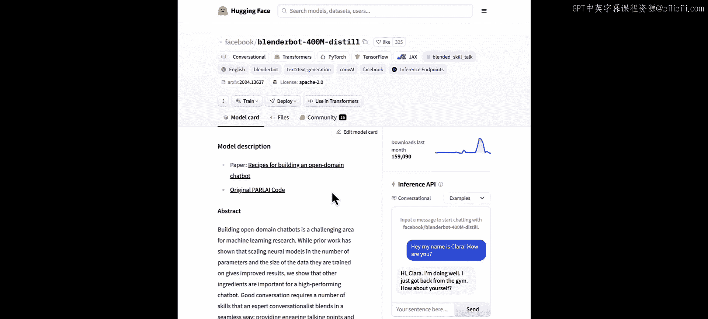
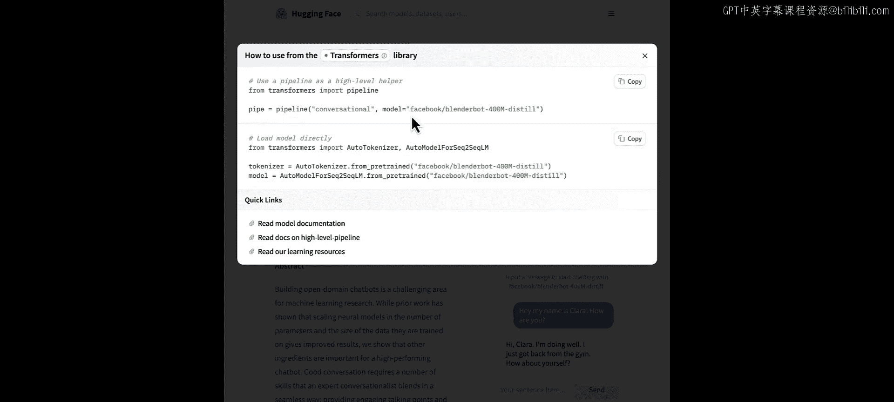
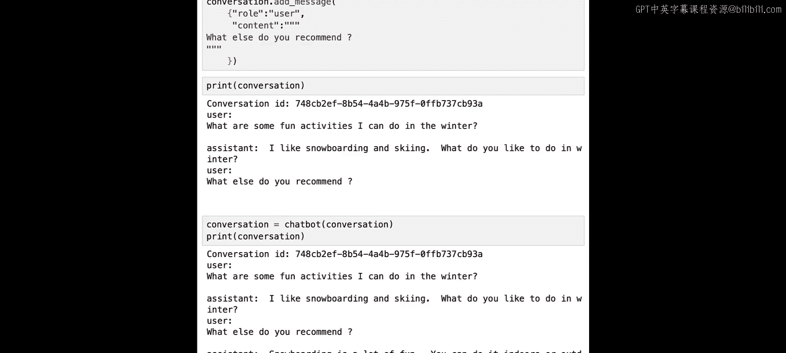

# 吴恩达《Hugging Face的开源模型｜Open Source Models with Hugging Face》中英字幕（英文可关） - P3：3.nlp.zh - GPT中英字幕课程资源 - BV16u4m1u7t4

Hi， in this lesson and the next few lessons， you will use the Higgging F Transformers Library to perform various natural language processing tasks。

In this lesson， you will build your own chatbot using an open source model built by metata。

 Let's get started。

We talked about natural language processing but what is the definition NLP is a field of linguistic and machine learning and it is focused on everything related to human language we saw significant progress in this field thanks to the transformer architecture from the well-known paper attention is all you in 2017 and since then this architecture is now the core of many state of the art machine learning models nowadays in this lesson we will be using the transformer library and in particular the pipeline function。

So as you can see I just imported the pipeline function from the transformer library for this classroom the libraries have already been installed for you if you are running this on your own machine。

 you can install the Transers library by running the following we don't need to actually run this comment so we can comment it out。

Now we have everything we need to create our own chatbots。As you can see。

 we created the conversational pipeline using a model from Facebook called Bnoboxox。

We decided to use this model because the model is very small and performs quite well。We only need 1。

6 gig to load it。 We can't use Lama or any other big models since we won't be able to load it。

 As you can see， we just created a conversational pipeline using a model from Facebook。

This function pipeline takes as the first argument， the task， as you can see。

 we've put conversational and for the second argument。

We need to pass the model and we selected a model from Facebook。

 we'll go through why we decided to use this model later on。

 but know that one of the main reason is because the model is very small， only needing 1。6 gigabyte。

We can't use any other big models such as Lamatou because it will exceed the four gigabyte that's available in this classroom now that the chatbot is loaded。

 let's pass a user message。We'll ask the chatbot what are some fun activities I can do in the winter to pass the user message inside the chatbot。

 we need first to put it into a conversation object。So， let's import。This object。

You just need to pass the user message inside the conversation object。

 and you need everything now to pass the conversation to the chatbot。

And as you can see the assistant responded， I like snowboarding and skiing what do you like to do in winter feel free to change the user message asking for example ideas about birthday things to do during the summer anything you ever wanted to ask a chatbot now let's step back and review what other NLP task you can perform with open source model you will also see how you can search the hugging face hub for suitable model for various tasks NLP has many application you must have heard about chatgPT the open AI chatbot or the open source equivalent hugging chat which lets the user select any open source language model such as Lama2 or Mistrral and converse with it NLP is also present in many tool we use every day we can think about auto completion in document translation tool or even spam filters NLP has many tasks。

You will go through a few of them in the next few lessons， but feel free to try the rest on your own。

 You will go through the text generation a task to build the chatbot sentence similarity sumization and machine translation One question remains which model should we choose There are so many open source model to browse the model you can use the hugging F hub I will show you how I decided to select the Facebook model for our conversational pipeline。

 We go to the hugging F hub on the model section。We can add filters。

So we'll choose the conversational task。Right here。

 conversational task is the task of generating conversational text that is relevant。

 coherent and knowledgeable given prompt， this model have application in chatbots and as a part of voice assistance。

As you can see right now， the model are sorted by trend weekend。

Change that to the most like As you can see we have so many different models since in the classroom we can only fit 4 GB we need to choose a smaller model。

 the second models seems to be a great choice because it's quite small since it only has 400 million parameters we see that it was normally a lot of times and it has a lot of likes so let's check this one。

We can go to the files you can see that the model is only 730 mebyte now we can just click using transformers to learn how to load it and this command should be pretty familiar with you as you can see he's telling us to use the pipeline object to use the conversational task and load the model by putting the name of the model here for example。

 let's ask the chatbot what else do you recommend。

And as you can see。The assistant answer has nothing to do with winter activities。

It doesn't remember the earlier conversation。The right way to do that is to add a message to the conversation LLMs don't naturally keep a memory of your previous messages。

 but when you're using transformer object， you can add follow up messages and the conversation object will keep your previous prompt as well as the LLMs response so that the LLMs will converse with you as if it remembers your earlier conversation Let's try that。

As you can see， we've added a new input to our conversation。

 what else do you recommend to the earlier conversation now let's pass this conversation to our chatbot。

As you can see the assistance answers shows some memory of the previous conversation about winter activities。

 the response may not be very insightful because the model is very small。

 there are many state of the open source model that can do quite well if you have the hardware to run them let's take a look at some of these unhuging facet at Huging face we have the open LLM leader that enables users。

 companies to evaluate open source LLMs and Chbot so let's see what are the most performing Chbot we will only select the pretrain one first。

The printerterm model or model that are train from scratch。

 so most of the model that you will see at the top of the lid are coming from large companies since not everyone has the compute capability to train those big models so as you can see you can see some familiar name with。

 for example， the new mixed models， the Falcon model， the E model and the QN model。

There's a lot of debates surrounding this leader board。

 people are skeptical if the benchmark we choose or representative of the performance of the models。

 we know that they are not perfect but we will be adding more and more benchmark so that we are able to evaluate fairly all the models。

 but if you want to have a look at another leader board， you can take a look at the Liis chatbot Ina。

 this leader board collected over 200，000 human preferences vote to rank LLMs with the LO ranking system。

We have proprietary models such as GPT4 board or C。

 but as you can see in this list we also have open source model which are quite catching quite fast the proprietary models as you can see here in the list we have the mixed role model which have Aache 2。

0 license what it means is that it allows you to use modify and distribute the models。

 you can commercialize it， use it everywhere in the next lesson we learn how to summarize long document and translate text from English to French let's go on to the next lesson。

