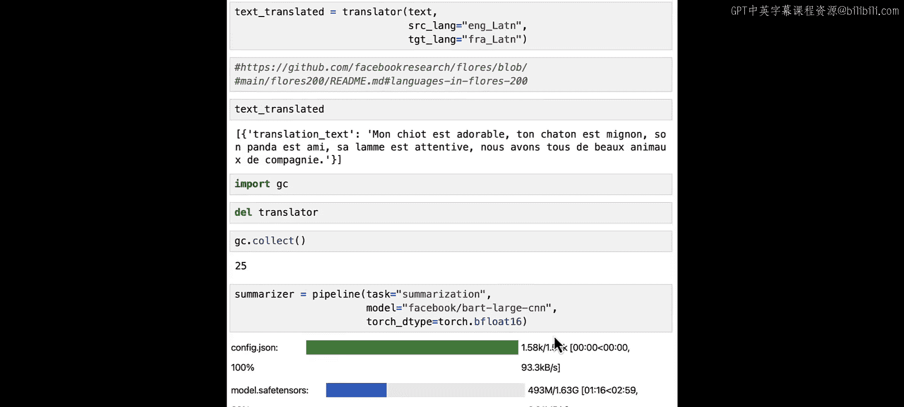
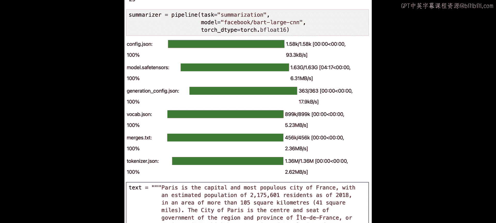
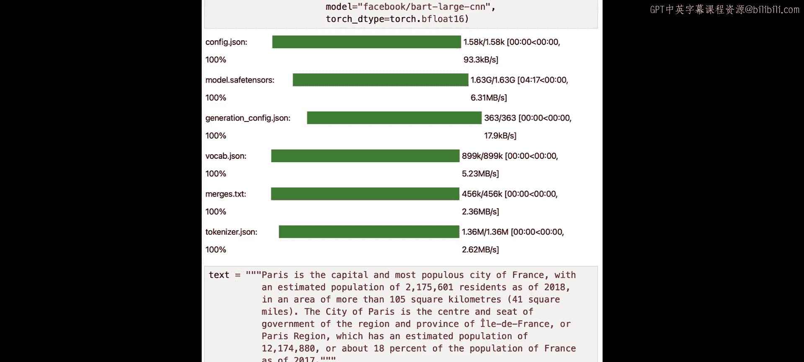
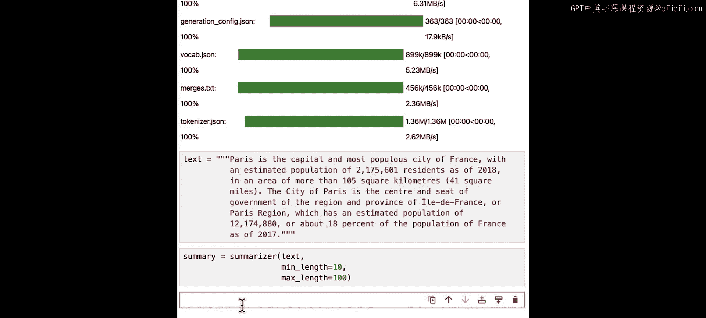
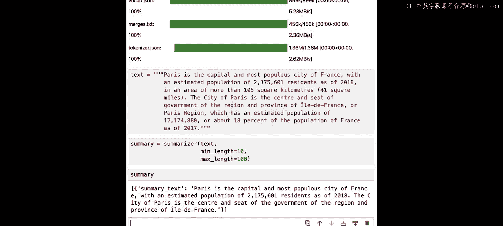

# 吴恩达《Hugging Face的开源模型｜Open Source Models with Hugging Face》中英字幕（英文可关） - P4：4.translation and summarization.zh - GPT中英字幕课程资源 - BV16u4m1u7t4

Hi， in this lesson， you will be translating text from English to French and summarizing long documents and using open source models from meta。

 let's get started。

For this classroom， the libraries have already been installed for you。

 if you're running this on your own machine， you can install the Transformers library by running the following。

P installed transformers。Similarly， you can install Pytorrch by running the following pep install torch。

Since the libraries are already installed in this classroom， I won run these comments。

 let's import the pipelineling function from transformers and also import torch。

Now that the pipeline is importted， we can create the translator pipeline by typing translator equals to pipeline。

We need to set the task to be equal to translation。And we need to set the model。

For this particular task， we will select a model。From Me。

This model for Me N LLB stands for no language Left Behind。

It is capable of translating 200 different languages。

 the last argument we will add is the torch D type， we will set it to a torch bilet。16。

By setting the torch D type to Bflow 16， we are able to compress the model without any performance degradation。

Now that the translator is loaded， we can start to translate the text。

 so the text that we will be translating is the following to translate the text。

 you can pass the text to the translator。You also can set the source language and the target language just like that。

The source language is English， so you need to pass the following string。As for the target language。

 we said that we will be translating the text to French， so we need to pass this string。

For each language you have a specific string that you need to pass to the translator。

 you can find the code for each language at the following link。Let's check the translated text。

As you can see the texts have been successfully translated into French if you know a little bit about French you can see that Peupppi was correctly translated to。

 but there are still a few mistakes that were made as you can see Lamma was translated as Lama which is wrong it should have been just Lama Now I invite you to stop the video and try yourself if your own textex or by changing the target language before moving to the summarization task let's freeze some memory by deleting the model and calling the garbage collector to do that we need to import GC。

We need to delete the translator。And we need to call。G C， dot collect。

Summarization is also very simple to perform using pipeline。

 you just need to set task as summarization， let's do that。To perform the summarization。

 we will use a model from meta called B Lage CNN。Lastly。

 we will also set the torchD type to Bflow 16 to compress the model。

Now that the sumr pipeline is loaded， let's summarize the following text。As you can see。

 the following text is a description about Paris， and let's put that into our pipeline to get the summary you just need to pass to the summarr tool that we just loaded the text。

You can also set the minimum length and the maximum length of the summary。

Just by setting the minimum length and maximum length arguments。 So in our example。

 we set it the minimum length to 10 and the maximum length to 100。Let's see what we get。

And as you can see， we indeed have the summary of the text we passed earlier Now I encourage you to pause the video here and try to summarize some of the pieces of text that you find on the internet or maybe even summarize an email in the next lesson you will measure the similarity between any two sentences This task is very useful for many application that involves searching for relevant pieces of text let's go on to the next lesson。

