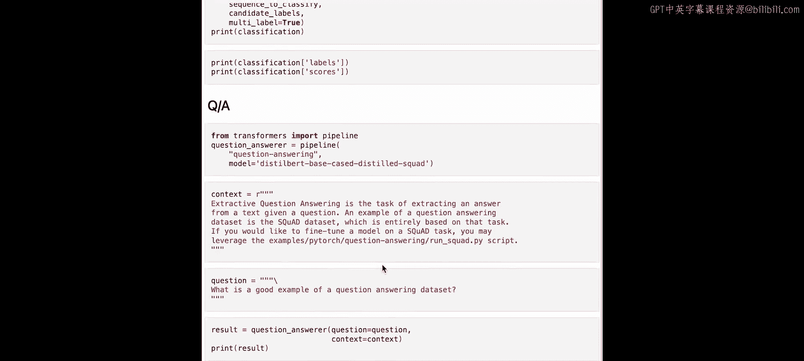

# 吴恩达《Hugging Face的开源模型｜Open Source Models with Hugging Face》中英字幕（英文可关） - P5：5.sentence embeddings.zh - GPT中英字幕课程资源 - BV16u4m1u7t4

Hi， in this lesson， you will measure sentence similarity using the sentence transformformerss library sentence similarity measure how close two pieces of text are。

 for instance， the phrase I like kits and we love cats have similar meaning。

 These sentence similarity is particularly useful for information retrieval and clustering or grouping。

 Let's get started。

For this classroom the libraries have already been installed for you。

 if you are running this on your own machine， you can install sentenceent Transformers library by running the following P install sentence transformers。

Since the library are already being installed in this classroom， we don't need to run this cell。

So I will just comment it out。Let's load from sentence Transformers library。

 the sentence transformformer class， this class will enable you to load many models。

To load the model you just need to pass the name of the model inside the sentence transformer class for this lesson we decided to use this particular model to perform sentence similarity This model was actually function by the open source community back in 2021 Huging Face and Google organized an event called Community Week where anyone can join online used to provided hardware and trained NLP and computer visionion model。

 the MinLM sentence embeing model was one of the model that came out of the event。

Sentence similarity models convert input text into vectors or so-called embeddings these embedding capture semantic information let's encode the following sentences。

 the cats sit outside a man is playing guitarit and the movie are awesome to encode these sentences we will use the encode methods so for these sentences we can get the embedding this way。

Model dot encode。We put the sentences。And we can also add an argument to make sure that we get tensors at the end。

Through the argument， convert to tensor equals true。

And now let's print the embeddings and as you can see。

 we manage to encode the text to embeddings or vectors。

 let's do the same thing with another list of sentences。So we have the dog plays in the garden。

 a woman watches TV。And the new movie is so great。We do the exact same thing。And。

We get the embeddings too for the sentences too。And now。We can calculate how close。

These sentences are between them。To do that， we will use the cosine distance。

 which is a measure to calculate how close and how far two vectors are to do that。

 we need to import the u function from the sentence transformers library。

Then all we need to do is to use the cosine methods from the U。We can pass the two embeddings。

This will compute the cosine similar reaches。And let's print them。

Notice that these are pairwise similarity for every sentence in the first list to every sentence in the second list。

 if you look at the diagonal of the matrix， you will get the similarities between the first sentences of both list。

 the second element of the diagonal will be the second sentences of both list and the third element of the diagonal will be the similarities between the third sentences of both list。

Now let's output the score of each pair in both list。

You can see that the cat sits outside and the dog plays in the garden gives a score of 0。28。

 which suggests that there is a similarity between those two sentences。

 the model probably picked the fact that cat and dogs。

Is quite similar for the second pair we have a man is playing guitar and a woman watches TV These two sentences do not have any similarities hence the very low score the last example the movie are awesome and the new movie is so great shows a score of 0。

65 This is indeed the correct since this two sentence are very similar That's it for the lesson I hope you learned a lot and feel free to try other tasks in the list we have text classification zero shot classification and Q& A let's go on to the next lesson。

